# ADR 0001: Rust-Owned Canonical Import Architecture

## Status and Scope

This accepted decision defines Baozi's top-level architecture and ownership boundaries. It does not
claim implementation completion. Current progress, verification results, and known gaps live in the
canonical refactor plan and engineering evidence records linked below.

Assimp is a mature comparative input for behavior, format breadth, failure cases, and test design.
It is not Baozi's architecture source, public compatibility target, or implementation dependency.
Baozi owns its contracts and arrives at its Rust implementation independently.

## Context

A multi-format 3D importer needs more than a collection of parsers. Formats share concerns that
must have one owner: source identity, dependency access, resource accounting, diagnostics, scene
invariants, postprocess loss, public outcomes, and evidence of format maturity. If each parser owns
those concerns, behavior diverges and hostile inputs find bypasses. If a third-party parser or
Assimp model leaks outward, replacing that backend becomes a public breaking change.

Baozi therefore needs one canonical Rust scene contract and an import lifecycle whose capabilities
narrow as data moves from untrusted bytes to validated output.

## Decision

Baozi uses a Rust-owned modular workspace with:

- one canonical, source-preserving scene intermediate representation (IR)
- a facade that composes the common import, inspect, and postprocess workflow
- a single import session that owns input snapshots, detection evidence, policy, budgets, and final
  outcomes
- one runtime-neutral operation substrate shared by validation, import, and postprocess without an
  upward crate dependency
- format-private parsers and converters that receive only bounded capabilities
- central iterative validation that creates the invariant-bearing result
- a typed, ordered, loss-aware postprocess pipeline
- structured format descriptors and executable maturity evidence

The public replacement is the canonical v1 contract governed by ADR 0006. Baozi does not preserve
the unpublished prototype through compatibility shims, parallel scene types, or version-suffixed
replacement names.

### Crate Ownership

| Crate/family | Sole architectural ownership | Must not own or expose |
| --- | --- | --- |
| `baozi-operation` | runtime-neutral operation control/coordinator, common ledger and linear reservation mechanisms, bounded event delivery primitives, and shared control/resource causes | Scene or format semantics, IO, import/postprocess phase vocabularies, diagnostic codes, or final outcomes |
| `baozi-core` | canonical IR, scene-local IDs, validation proof, domain errors, provenance/remap types | parser ASTs, IO handles, import policy, backend errors |
| `baozi-io` | normalized asset identities, byte sources, scoped resolver/backends, opened handles, IO errors | format semantics, Scene construction, final import outcomes |
| `baozi-import` | import session, immutable probe, parser capability scope, option compilation, policy, import phase/dimension vocabulary, import diagnostic codes, detection, and import outcomes | canonical format semantics, postprocess algorithms, shared operation mechanisms, public facade composition |
| `baozi-postprocess` | typed plans, dependency/conflict/loss rules, postprocess phase/dimension vocabulary, postprocess diagnostic codes, transactional operations, and step reports | parser behavior, IO access, shared operation mechanisms, direct publication of unvalidated Scene state |
| `baozi-format-*` | format grammar, private backend, source-semantic conversion, format-owned typed options | public Scene variants, raw AssetIo access, report finalization, backend type leakage |
| `baozi` | public workflow, built-in feature composition, composite public error/outcome presentation | parser internals, mutable import context, validation-proof construction, budget ledger |
| test/fuzz support | fixtures, semantic snapshots, differential normalization, adversarial harnesses | production authority or alternate canonical models |

`baozi-operation` is a foundation crate with no dependency on another production Baozi crate.
`baozi-core`, `baozi-import`, and `baozi-postprocess` may depend on it and expose only the narrower
capabilities their domain requires. ADR 0022 owns ledger semantics and ADR 0033 owns control and
delivery semantics. Import and postprocess map shared causes into their own phase-aware failures and
remain the only owners of their reports; the operation layer cannot finalize either outcome.

Future archive/container and exporter contracts require their own accepted decisions and
implementation tracers. Their proposed designs do not extend this accepted import architecture
until promoted through ADR lifecycle governance.

### Import Lifecycle

```mermaid
flowchart LR
    Caller[Caller] --> Facade[baozi facade]
    Facade --> Session[Import session]
    Session --> Snapshot[Bounded immutable primary snapshot]
    Snapshot --> Probe[Shared immutable probe]
    Probe --> Registry[Deterministic detector selection]
    Registry --> Scope[Capability-limited parse scope]
    Scope --> Format[Format-private parser and converter]
    Format --> Builder[Internal SceneBuilder]
    Builder --> Validate[Bounded central validator]
    Validate --> Validated[Validated canonical Scene]
    Validated --> Process[Optional typed postprocess plan]
    Process --> Final[Validated result and structured report]
    Session --> Failure[Structured failure with bounded evidence]
    Session -. control and accounting .-> Operation[baozi-operation]
    Validate -. checkpoints and reservations .-> Operation
    Process -. control and accounting .-> Operation
```

The session exists before primary IO. Detection and parsing share the same stable input identity;
detectors do not own stream rewinding. Parsers cannot construct public reports, assign lifecycle
stages, forge validation, or reach policy-bypassing IO. Every success passes central validation.

### Canonical Scene Boundary

The canonical IR preserves source semantics needed across current and future formats. It is not a
GPU layout, runtime entity graph, or mirror of Assimp's pointer-based `aiScene` structures.

Core rules:

- scene-local typed IDs connect owned collections without self-referential lifetimes
- logical meshes contain one or more primitives rather than recovering identity from names
- attributes carry explicit domains and storage semantics
- image, texture, and sampler identities remain distinct
- skin, morph, animation, hierarchy, material, metadata, space, and provenance data remain explicit
- lossy lowering or normalization is a postprocess operation requiring caller authority and a loss
  record
- structural mutation consumes validation proof and returns a new validated result, complete remaps,
  and derived-data invalidation

Detailed ownership and cardinality belong to the Scene IR ADRs; this ADR fixes only the top-level
role and direction of dependency.

### Options, Diagnostics, and Outcomes

- Common options are typed and frozen before the session begins.
- Format-owned options cross object-safe importer boundaries through versioned Baozi-owned
  envelopes and codecs, not string property bags or backend types.
- Diagnostics use stable codes, bounded messages, severity, source/object paths, and structured
  causes where applicable.
- Failure evidence is an outcome, not discarded error text.
- Reports expose immutable evidence and statistics; parsers do not finalize them.

### Assimp and Clean-Room Boundary

Baozi may study Assimp to identify capability categories, malformed-input classes, algorithmic
trade-offs, and expected normalized behavior. Optional differential tests may compare Baozi-owned
fixtures through a normalized external oracle.

Baozi does not:

- copy Assimp's C/C++ API or memory model into the canonical Rust design
- link Assimp into the default architecture
- treat Assimp output as the sole correctness oracle
- copy or mechanically translate Assimp source into the canonical implementation
- copy Assimp fixtures into Baozi's corpus, even when their license appears permissive

The canonical implementation and Baozi-owned fixtures are independently authored and intended for
`MIT OR Apache-2.0` licensing. `repo-ref/assimp` remains read-only study material. Any future request
to vendor, copy, or mechanically translate Assimp material requires a separate accepted ADR,
license review, isolation plan, and explicit change to this boundary. This engineering policy is not
legal advice.

Useful comparative references at the audited Assimp revision include its
[importer contract](https://github.com/assimp/assimp/blob/bcc62230fc0471475528d732f4ad108a59bb7f6c/include/assimp/BaseImporter.h),
[registry](https://github.com/assimp/assimp/blob/bcc62230fc0471475528d732f4ad108a59bb7f6c/code/Common/ImporterRegistry.cpp),
[scene structures](https://github.com/assimp/assimp/blob/bcc62230fc0471475528d732f4ad108a59bb7f6c/include/assimp/scene.h),
and
[postprocess registry](https://github.com/assimp/assimp/blob/bcc62230fc0471475528d732f4ad108a59bb7f6c/code/Common/PostStepRegistry.cpp).
These permalinks are study inputs, not normative Baozi implementation sources.

## Alternatives Considered

### Option A: Rust-owned canonical model and capability-limited modular pipeline

Pros:

- aligns ownership, error handling, and invariants with Rust
- keeps parser backends replaceable
- centralizes safety, validation, postprocess, and evidence contracts
- scales format breadth without exposing parser-specific models

Cons:

- requires explicit normalization and crate-boundary design
- creates more initial infrastructure than a one-format loader

Decision: chosen.

### Option B: Mirror Assimp's structs, flags, and importer API

Pros:

- simplifies superficial field-by-field comparisons
- may ease a future compatibility adapter

Cons:

- imports pointer-array lifetime and mutation assumptions into Rust
- makes source-preserving semantics depend on a foreign model
- confuses comparative behavior with public compatibility

Decision: rejected. A future isolated adapter requires its own decision.

### Option C: One crate with parser-owned scene outputs

Pros:

- fastest path to a small demonstration
- minimal workspace wiring

Cons:

- duplicates validation, limits, diagnostics, and sidecar behavior
- makes feature isolation and backend replacement difficult
- cannot enforce one success/failure contract across formats

Decision: rejected.

### Option D: Thin Rust facade over Assimp

Pros:

- immediate broad format coverage
- inherits a mature implementation history

Cons:

- retains C++ build, ABI, safety, and deployment costs
- does not produce a Rust-owned architecture
- prevents the clean-room and WASM-first boundaries Baozi requires

Decision: rejected for production architecture. A sandboxed external oracle remains optional test
infrastructure.

## Consequences

Positive:

- every cross-format concern has a single owner
- importers remain focused on grammar and source semantics
- central validation and loss-aware postprocess apply consistently
- public APIs stay Baozi-owned as backends change
- mature-project lessons can inform tests without dictating implementation shape

Negative:

- broad schema and lifecycle changes require coordinated workspace cutovers
- converters must translate private backend data into canonical IR
- evidence and format documentation are part of the cost of adding support

## Risks and Mitigations

| Risk | Severity | Likelihood | Mitigation |
| --- | --- | --- | --- |
| Canonical IR omits complex-format semantics | High | Medium | Validate the model against multi-primitive, skin, morph, animation, metadata, and provenance tracers before stability promotion |
| Parser bypasses session policy | Critical | Medium | Pass only a capability-limited parse scope and enforce facade-path integration/fuzz tests |
| Backend model leaks into public API | High | Medium | Rustdoc/API review and format replacement conformance tests |
| Assimp study becomes untracked derivation | High | Low | Clean-room review, fixture provenance, and third-party notice gates |
| Central abstractions become shallow wrappers | Medium | Medium | Assign sole ownership and reject duplicate parser-local policy/model paths |
| Architecture status is confused with implementation completion | Medium | High | Keep accepted decisions separate from linked progress and verification evidence |

## Acceptance Criteria

| Contract | Measurable evidence |
| --- | --- |
| Ownership | architecture checker and crate review find one owner for IR, IO, session, postprocess, facade, and format parsing |
| Stable input | facade tests prove one bounded primary snapshot feeds detection and parse without reopen/rewind ownership |
| Validation boundary | every successful import and postprocess result carries non-forgeable validation evidence |
| Backend isolation | public API/rustdoc contains no third-party parser or Assimp implementation type |
| Canonical workflow | packaged consumer imports, inspects logical primitives/typed attributes, optionally processes, and handles structured failure using canonical v1 names |
| Clean-room evidence | every external fixture or derived file has provenance and license metadata |
| Format breadth discipline | each promoted format has facade tests, semantic snapshots, malformed/limit cases, fuzz evidence, and a truthful support document |

## Implementation Evidence

Implementation and verification change over time; consult these evidence locations rather than
editing the accepted decision to report transient status:

- [Canonical architecture refactor plan](../plans/2026-07-10-001-refactor-baozi-canonical-architecture-plan.md)
- [Facade source](../../crates/baozi/src/lib.rs)
- [Core source](../../crates/baozi-core/src/lib.rs)
- [Import source](../../crates/baozi-import/src/lib.rs)
- [Format support documents](../formats/)
- [Engineering memory index](../knowledge/engineering/index.md)
