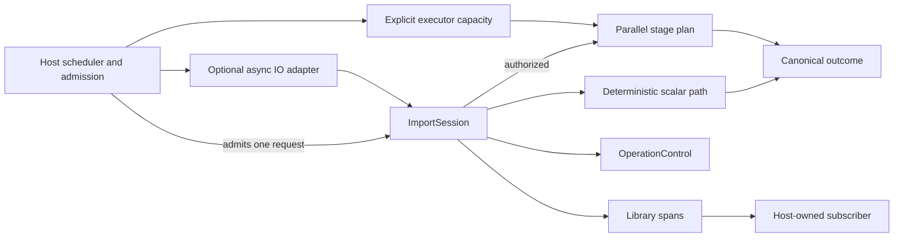

# ADR 0002: Runtime Neutrality, Host Concurrency, and Execution Backends

## Context

Baozi is embedded in command-line tools, build systems, editors, game engines, servers, and WASM
applications. Those hosts already own incompatible async runtimes, worker pools, admission queues,
tracing subscribers, and shutdown rules. A library-owned global runtime or concurrent-import
semaphore would hide contention, create priority inversion, and make cancellation and capacity
planning impossible for the host.

At the same time, parsing and post-processing need a deterministic scalar baseline and room for
parallel and SIMD acceleration. Thread safety must therefore be separated from permission to create
or schedule work.

## Decision

Baozi's canonical core is synchronous, runtime-neutral, and deterministic. The host owns admission
of concurrent import sessions and the capacity on which they execute. Baozi owns only work inside an
admitted session, subject to the session's frozen budget and operation control.

Accepted means this contract is authoritative. It does not claim that every adapter or optimization
described here is implemented.

### Ownership Boundary

| Concern | Owner | Contract |
| --- | --- | --- |
| Concurrent-session admission | Host application | The host decides when a session may start and how many may coexist. |
| Async runtime and blocking isolation | Host adapter | Core crates expose no Tokio, async-executor, or reactor types. |
| Per-session work plan | Baozi | Work is deterministic and bounded by the session budget. |
| Intra-session executor capacity | Host or explicit adapter | Parallel work requires an explicitly supplied executor/capacity; no mandatory global pool. |
| Runtime-neutral operation control, reservations, ledger state machine, and coordinator | `baozi-operation` | ADRs 0022 and 0033 are authoritative; the crate owns mechanisms, never domain phases or outcomes. |
| Import/post-process phase policy and outcome conversion | The owning `baozi-import` or `baozi-postprocess` operation | Each owner supplies phase keys, limits, and domain causes to `baozi-operation`. |
| Trace collection and formatting | Host application | Library code may emit spans but never installs a subscriber. |
| SIMD selection | Private algorithm backend | Public Scene and math types never expose CPU-specific vector types. |

Baozi must not create a process-global semaphore, queue, runtime, thread pool, tracing subscriber,
profiler, or mutable execution policy. A convenience facade may construct a scoped executor owned by
that facade call, but it cannot silently consume a process-global pool or govern other sessions.

`baozi-operation` is a dependency-leaf workspace crate. It depends on neither `baozi-core`,
`baozi-io`, `baozi-import`, `baozi-postprocess`, nor the facade. `baozi-core`, `baozi-import`, and
`baozi-postprocess` may depend on it for the shared capability and accounting mechanisms. This
direction lets core validation poll and reserve work without depending upward on the import domain,
and lets import and post-processing use one state machine without depending on each other.

### Thread-Safety Is Not Scheduling Authority

Public immutable configuration, registry snapshots, owned reports, failures, diagnostics, and
validated scenes must satisfy `Send + Sync`. Parser-local scratch state may remain single-threaded
when it cannot escape its session. Trusted extension implementations must be `Send + Sync`, but that
bound is not a sandbox and does not authorize Baozi to invoke one implementation concurrently unless
its contract says so.

The default execution mode is single-threaded. Parallel algorithms must:

- be explicitly enabled after host admission;
- use stage-local output or deterministic partitioning rather than shared structural mutation;
- consume the same operation and live-memory budgets as scalar execution;
- preserve stable ordering and produce equivalent results within the algorithm's documented numeric
  tolerance; and
- stop scheduling new work after cancellation.

### Async and IO Adapters

An async adapter creates the same canonical import session before acquisition, then fulfills that
session's primary/dependency requests asynchronously. It must produce the same outcomes as the
synchronous path. It may not pre-open outside the session, create a second parser implementation, or
expose runtime-specific types from `baozi-core`, `baozi-import`, or format crates. CPU-bound parsing
must be isolated according to host policy rather than run accidentally on a reactor thread.

### Scalar and SIMD Backends

The scalar implementation is the correctness oracle and is always available. SIMD and other
accelerated backends are private, feature- and target-gated, and selected without changing canonical
IR types. Runtime feature detection is required when a compiled binary may run on CPUs below the
build host's feature set.

## Crate Contract

| Crate | Must | Must not |
| --- | --- | --- |
| `baozi-operation` | Own runtime-neutral control, coordinator, reservation, and ledger state-machine primitives | Own format policy, Scene semantics, import/post-process phases, reports, IO, a scheduler, or global state |
| `baozi-core` | Own runtime-independent IR, validation, and scalar contracts | Depend on runtimes, executors, subscribers, or CPU-specific public types |
| `baozi-io` | Provide synchronous canonical IO and separately gated adapters | Select an application runtime |
| `baozi-import` | Run one admitted session, define import phases/policy, and honor explicit operation capabilities | Reimplement operation mechanisms, admit other sessions, or own a global queue |
| `baozi-format-*` | Keep all mutable state session-local | Spawn untracked threads or use mutable globals |
| `baozi-postprocess` | Define post-process phases/reports, compile deterministic plans, and use supplied operation capabilities | Reimplement operation mechanisms, depend on `baozi-import`, hide global parallelism, or use nondeterministic ordering |
| `baozi` facade | Compose explicit adapters | Change execution mode based on ambient process state |

## Alternatives Considered

### Option A: Async-first API and Tokio throughout the workspace

This is convenient for network services, but it leaks one runtime into CPU-bound parsers, complicates
WASM and host integration, and does not solve blocking work. Rejected.

### Option B: Baozi-owned global pool and concurrent-session semaphore

This provides simple automatic parallelism, but competes with host scheduling, hides aggregate memory
pressure, and cannot express host priorities. Rejected.

### Option C: Runtime-neutral core with host admission and explicit execution capacity

This adds adapter plumbing but preserves deterministic behavior, makes capacity ownership visible,
and works across all declared host classes. Chosen.

## Consequences

Positive:

- Hosts can coordinate Baozi with their own memory, priority, and shutdown policies.
- Format crates remain testable without an async runtime or worker pool.
- Scalar, parallel, and SIMD implementations share one semantic contract.
- No ambient process configuration can change an import silently.

Negative:

- Applications wanting concurrent imports must perform admission explicitly.
- Async and parallel integrations require adapters and feature-specific tests.
- Baozi cannot promise to interrupt an opaque in-process backend that does not cooperate.

## Risks and Mitigations

| Risk | Severity | Mitigation |
| --- | --- | --- |
| An adapter accidentally starts unlimited blocking work | High | Require host admission before session creation and integration tests with a bounded executor. |
| Parallel output differs by worker count | High | Stable partition/merge rules and scalar-versus-parallel conformance tests. |
| A global pool enters through a dependency | Medium | Feature-tree review and tests that run with no parallel feature. |
| SIMD changes floating-point behavior | Medium | Scalar oracle, documented tolerances, and cross-backend fixtures. |
| Users mistake `Send + Sync` for plugin isolation | High | Keep the trusted-extension threat boundary explicit and require process isolation for hostile code. |

## Acceptance Criteria

| Contract | Testable acceptance |
| --- | --- |
| Runtime independence | Core/import/format crates compile without Tokio, Rayon, or a subscriber dependency in their canonical feature set. |
| Dependency direction | The crate graph permits core/import/postprocess to depend on `baozi-operation`; `baozi-operation` has no upward workspace dependency and postprocess does not depend on import. |
| Host admission | An instrumented host gate is the only authority that permits N sessions to enter; changing N changes observed concurrency, while Baozi creates no global semaphore, queue, or admission token. |
| Thread safety | Compile-time assertions cover registry snapshots, frozen config, reports, failures, and validated scenes. |
| Determinism | Scalar output and each parallel worker-count variant have identical stable ordering and equivalent values. |
| Explicit parallelism | With no executor/capacity supplied, no worker thread is created; dependency and symbol checks find no hidden global pool. |
| Subscriber ownership | Captured spans work with a test subscriber, while library initialization never changes the global subscriber. |
