# ADR 0003: Canonical Scene IR Ownership and State Model

## Context

Every importer and postprocess operation needs one broad, loss-aware scene model. The previous
decision called `Scene` immutable while ADR 0025 allowed arbitrary direct mutation of its public
collections. That contradiction made a successful import indistinguishable from a scene that had
been invalidated by a caller.

Assimp's fixed-revision [`aiScene`](https://github.com/assimp/assimp/blob/bcc62230fc0471475528d732f4ad108a59bb7f6c/include/assimp/scene.h)
demonstrates the value of one common aggregate, while its public pointer arrays and separate
[`ValidateDataStructure`](https://github.com/assimp/assimp/blob/bcc62230fc0471475528d732f4ad108a59bb7f6c/code/PostProcessing/ValidateDataStructure.cpp)
pass also demonstrate how mutable storage can exist outside a fresh validation boundary. Baozi
keeps the common aggregate and rejects that mutation model.

## Decision

`baozi-core` owns the only canonical scene IR. Format backend models remain private and must be
converted before crossing the format crate boundary. The canonical lifecycle has three distinct
capabilities:

- `SceneBuilder` owns an unvalidated draft and is the construction API for importers and trusted
  producers. Finishing it produces only a construction-branded directory descriptor, not a public
  generation.
- `ValidatedScene` owns a scene generation plus an unforgeable validation proof. The core central
  validator is the only proof constructor. Import, postprocess, and downstream code may invoke that
  validator, but cannot construct a proof or `ValidatedScene` directly or bypass full validation.
- `SceneEdit` isolates mutations from an existing `ValidatedScene`. Commit validates and returns a
  new generation; failure or cancellation publishes no partial state or generation.

This is the accepted U4 target, not a claim that the workspace has completed the cutover. The
operation-owned retained-storage foundation exists, but core has not yet integrated the final
`CanonicalBlockRef`/`SceneConstructionOperation` path and the legacy Scene lifecycle remains until the
atomic workspace switch and deletion gates complete.

Opening `SceneEdit` is a derived-operation start against the input Scene's inherited
`PhysicalStorageAccount`. It performs ADR 0044's shared poison/counter admission before edit work,
clone/share/refcount access, or replacement allocation. Poison-first returns typed
`AccountPoisoned` and leaves the input untouched. If edit start or a retained admission linearizes
first and another account clone later latches poison, its charge remains coupled, all later
retain/share attempts fail, and final validation/preparation returns
`FinalizationContainmentError` before any exact prepared wrapper, generation, proof, remap, or
handoff exists. No core edit API can reset, ignore, or replace the inherited account latch.

`Scene` collections are not publicly mutable. Read-only accessors and typed iterators provide the
common inspect workflow. `ImportReport::scene()` exposes a read view, so callers that only import and
inspect never handle proof internals. A caller opts into `SceneEdit` only when changing content.

```mermaid
stateDiagram-v2
    [*] --> Building: SceneBuilder
    Building --> ContainmentFatal: retained builder panic; no reservation
    Building --> Draft: finish
    Draft --> CheckedDraft: central validation
    Draft --> [*]: validation failure; no generation
    CheckedDraft --> Reserved: reserve one output generation
    CheckedDraft --> PreparedRichFailure: reservation rejection/exhaustion; consume no nonce
    Reserved --> PreparedSuccess: freeze and classify exact success
    Reserved --> PreparedRichFailure: later downgrade; burn gap
    Reserved --> PreparedMinimalFallback: rich-failure preparation fails or non-unwind root fault; burn gap
    Reserved --> ContainmentFatal: release proof unavailable; burn gap and poison coupled ownership
    PreparedSuccess --> Validated: infallible reserved-token handoff
    PreparedSuccess --> [*]: drop; burn private gap
    PreparedRichFailure --> [*]: pure failure handoff; no generation
    PreparedMinimalFallback --> [*]: pure fallback handoff; no generation
    ContainmentFatal --> [*]: typed fatal containment error; no generation or fallback claim
    Validated --> Editing: begin edit
    Editing --> CheckedNext: validate candidate
    CheckedNext --> ReservedNext: reserve exactly one final generation
    CheckedNext --> Validated: validation or reservation failure; no candidate generation
    ReservedNext --> PreparedSuccessNext: freeze and classify exact success
    ReservedNext --> Validated: later downgrade; burn gap and retain input
    PreparedSuccessNext --> ValidatedNext: infallible reserved-token handoff
    PreparedSuccessNext --> Validated: drop; burn private gap and retain input
    ValidatedNext --> Editing: begin another edit
```

The aggregate owns these collections:

| Owner | Owned concepts | Cross-references |
| --- | --- | --- |
| Scene | scene space, nodes, mesh instances, logical meshes, materials, images, samplers, textures, skins, animations, cameras, lights, metadata, provenance arena, derived scene bounds | generation-qualified dense IDs |
| Node | authored base transform, ordered children, camera/light attachments | node, camera, and light IDs |
| Logical mesh | primitives, morph target definitions, default morph weights, derived logical-mesh bounds | owner-qualified local IDs and primitive-local data |
| Primitive | topology, indices, vertex/corner/face attributes, material, derived primitive bounds | material ID |
| Mesh instance | owner node, logical mesh, optional skin, morph overrides, instance attributes | node, mesh, and skin IDs |
| Material | typed common fields, texture bindings, bounded extensions | texture IDs |

Canonical presence is semantic rather than inferred from storage allocation. Core record/header fields
carry an explicit presence discriminator plus semantic element count wherever `Absent` and
`PresentEmpty` differ. A zero count therefore does not erase source meaning, while ADR 0044 may forbid
a physical zero-length payload block and represent present-empty content entirely in its owning
record/header.

The node hierarchy is one rooted tree. A node canonically stores its ordered child IDs; parent lookup
is a derived index/view rather than a reciprocal stored field. The root has no derived parent, every
other node appears in exactly one parent's child list, and every node is reachable exactly once. Each
scene-owned mesh instance stores exactly one owner `NodeId`; node-to-instance iteration is likewise a
derived index/view, not a second reciprocal list. Shared geometry uses multiple mesh instances rather
than shared child nodes. A future DAG hierarchy would require a new decision because transform
evaluation, animation targets, provenance, and edit remaps all depend on this ownership rule.

Logical mesh and attribute rules are authoritative in ADR 0030; deformation and animation in ADR
0031; transactional edits, remaps, and derived-data invalidation in ADR 0032; persistent source
identity and provenance in ADR 0036; camera and light semantics in ADR 0040.

A node preserves its authored base-transform representation as either an authored local matrix or
materialized translation, rotation, and scale (TRS). A computed local matrix is a derived inspection
and evaluation value, not a replacement for the authored representation. The builder and validator
must therefore reject an animation channel that targets a matrix-authored node unless the applicable
format contract has explicitly lowered it to TRS with provenance and authorized representation loss.
ADR 0008 defines matrix/TRS numeric semantics, and ADR 0031 defines the base-pose and channel-overlay
rules. This distinction is part of the canonical aggregate rather than a glTF-only adapter detail.

Every published scene owns an opaque `SceneGenerationId` that is collision-free and never reused
within the runtime generation domain. Core's private `SceneGenerationId::allocate()` is fallible and
returns a linear `ReservedSceneGeneration` rather than a public ID, so nonce acquisition cannot occur
in the final ownership handoff. The operation finalizer classifies the terminal result completely
during preparation; it never returns one opaque success-capable prepared value whose outcome is
decided only during handoff. The reservation typestate obeys this lifecycle:

1. after complete central validation, publication preparation attempts checked generation
   reservation as its final fallible identity acquisition before attribution freeze; exhaustion or
   collision rejection leaves the generation domain unchanged;
2. successful reservation consumes a never-reused nonce but does not construct, expose, or publish a
   `SceneGenerationId`;
3. preparation finishes the final control downgrade and returns exactly one typed terminal variant:
   `PreparedSuccess`, `PreparedRichFailure`, or `PreparedMinimalFallback`; only the exact
   `PreparedSuccess` structurally owns the reservation together with the validated, destination-
   qualified but still domain-unexposed canonical owner, while both failure wrappers structurally
   contain no reservation or canonical owner; and
4. `PreparedSuccess` handoff consumes the reservation by ownership conversion into the public
   `SceneGenerationId`, constructs the only new `ValidatedScene` proof, and performs no allocation,
   lock, checked counter transition, retry, or other fallible state change.

Reservation rejection or exhaustion consumes no nonce and is classified as an ordinary rich failure
with preserved evidence and zero canonical output. It does not by itself require the minimal
fallback. If appending, validating, or preparing that downgraded rich failure then fails, or an
invalid root or equivalent non-unwind integrity fault prevents rich preparation after candidate
cleanup is verified and the retained operation layer confirms its startup fallback baseline remains
intact, the finalizer selects
`PreparedMinimalFallback`. A retained canonical or
evidence builder panic never selects that fallback. The retained store returns
`FinalizationContainmentError`, and core constructs no fallback, generation, proof, or remap from that
path. ADR 0044 exclusively owns physical-side disposition, charge/attribution coupling, cleanup
precedence, and retained allocation membership below core's non-owning block views.
Double panic, `panic = "abort"`, process exit, and OOM require process isolation. Once reservation has succeeded, any later
publication-preparation failure, cancellation, caught unwind, or prepared-success drop burns that invisible
nonce gap. The nonce is never returned to the domain and never reused, so no failed path publishes a
generation or proof. The two exact failure wrappers contain no reservation by the time they leave
preparation.

`SceneBuilder::finish` exposes no token. ADR 0032 gives immutable edit step states only report-scoped
typed ordinals/paths, never generation reservations or public `SceneGenerationId` values. Each
`Changed` edit reserves and publishes exactly one generation for its final `ValidatedScene`; only the
composed input-to-final remap is generation-qualified. Two edits branched from the same input
therefore receive distinct final tokens rather than both being identified only as `G + 1`; equal
scene content does not imply equal generation identity. Generation tokens are runtime capabilities,
not persistence keys, step-state identities, or source identities.

Scene-wide dense IDs are typed pairs of `(SceneGenerationId, dense_index)`. Primitive and morph
target handles are owner-qualified triples of
`(SceneGenerationId, logical_mesh_index, local_index)`. Their fields and constructors are private.
Every lookup checks kind, generation,
owner where applicable, and range before returning a view. A handle from another generation or
logical mesh is a typed stale/foreign-ID error even when its numeric index happens to be in range.
Generation-changing APIs return explicit remaps; callers cannot opt into unchecked numeric reuse.

Canonical storage keeps private typed index components for intra-scene references; a read accessor
combines the owning scene's generation token with an index to form the public handle above. Thus a
new generation does not require rewriting every unchanged stored edge merely to change its token,
while no unqualified index crosses the read/edit/remap API boundary. Owner-qualified local accessors
similarly derive the mesh component from the actual owner rather than accepting it from a caller.

Validation proves collection ownership, reference integrity, graph invariants, cardinality, numeric
policy, derived-data state, and extension bounds together; there is no public API that constructs a
proof from a boolean or unchecked `Scene`. ADR 0032 defines the exact `Derived<T>` state and
generation-qualified remap contract.

## Considered Options

### Option A: Public mutable vectors with caller-invoked validation

This is convenient for ad hoc tooling and resembles the current code, but any function receiving a
`Scene` must defensively revalidate it. Cached bounds and remaps can silently become stale, and stage
claims are forgeable. Rejected.

### Option B: Immutable scenes with full rebuilds for every change

This makes invariants simple, but large tools would clone unrelated buffers and cannot express
transactional failure efficiently. Rejected.

### Option C: Builder, validated generation, and isolated edit transaction

This keeps the success state trustworthy, permits focused copy-on-write replacement, and gives
postprocess one atomic mutation boundary. Chosen.

## Consequences

- All format crates target the same Rust-owned aggregate without leaking backend types.
- Breaking changes are required: direct field mutation and constructors for validated result types
  are removed rather than preserved behind compatibility aliases.
- `SceneBuilder::finish` produces only an owned `SceneDraft`; every publication path passes that
  draft or an edit candidate through the central validator, even when a producer performed local
  checks.
- Successful preparation may consume an unpublished generation nonce; aborting after reservation
  burns a never-reused gap rather than weakening the handoff or publishing partial identity.
- Editors must retain or consume explicit remaps when they keep IDs across generations.

## Risks and Mitigations

| Risk | Severity | Mitigation |
| --- | --- | --- |
| Read-only access feels cumbersome | Medium | Provide typed slices, iterators, lookups, and convenience views for positions and triangle data. |
| Edit transactions duplicate large data | High | Share unchanged storage and allocate only affected replacements; peak-live accounting remains mandatory. |
| Internal code bypasses proof construction | High | Keep proof constructors private, expose only the central validating function as the legal minting path, and add compile-fail/public-API tests. |
| Validator and IR drift | High | Every new field lands with invariant tests and validator coverage in the same change. |
| Generation allocation fails after publication evidence is frozen | Critical | Reserve `ReservedSceneGeneration` as the final fallible pre-freeze identity acquisition; rejection/exhaustion becomes a rich failure with no nonce, later freeze/preparation failure may burn a successful reservation, and handoff only consumes exact `PreparedSuccess`. |
| Failed preparation reuses or exposes a reserved nonce | Critical | The linear private reservation burns on drop, has no public conversion except prepared handoff, and never returns a nonce to the allocator. |
| A success-capable prepared wrapper defers terminal classification to handoff | Critical | Preparation completes control downgrade and returns exact success, rich-failure, or minimal-fallback wrappers; only exact success can contain `ReservedSceneGeneration`. |
| A retained-builder panic is reported as a clean fallback | Critical | ADR 0044 returns typed fatal containment; core constructs no fallback, generation, or proof from that path. |
| A derived edit starts or commits through a poisoned account clone | Critical | begin-edit and final publication eligibility linearize against ADR 0044's one shared latch; poison-first has zero work/refcount/allocation effects, start/retain-admission-first retains charge and fails finalization before handoff, and no reset/reuse API exists |

## Success Metrics

| Metric | Target | Measurement |
| --- | --- | --- |
| Generation isolation | Stale, foreign-owner, and sibling-branch handles are rejected before lookup | exact/stale/branch API tests |
| Generation publication | exhaustion becomes an ordinary rich failure before attribution freeze and consumes no nonce; successful handoff publishes exactly one reserved never-reused token; failed/prepared-drop paths publish none | exhaustion, cancellation, caught-unwind, and prepared-drop probes |
| Terminal classification | only exact `PreparedSuccess` can own one generation reservation; exact rich-failure/minimal-fallback wrappers structurally cannot; retained-builder containment is not a prepared publication | API-shape, downgrade, startup-side, uncertain-cleanup, and compile-fail probes |
| Poisoned lineage | every clone of one Scene account rejects new derived edits after poison; a pre-admitted edit cannot publish once poison linearizes before final eligibility | two-order barriers, input digest/proof/refcount/allocator probes, account snapshots, and no-bypass API scans |
| Validation complexity | Complete validation visits each graph edge, entity, reference, and payload cell at most a constant number of times | deterministic validator work counters |
| Publication integrity | Only the central validator can mint proof; import finalization and edit commit may publish only its successful result | compile-fail and rollback tests |

## Acceptance Criteria

- External code cannot mutate a validated collection or construct `ValidatedScene` directly; it can
  obtain one only by passing a draft through the central validator.
- `SceneBuilder::finish` and a checked draft expose no generation; preparation reserves a private
  never-reused nonce before attribution freeze, and only infallible handoff converts it into the
  `SceneGenerationId` carried by the new `ValidatedScene`.
- Exact/exhausted generation-domain tests prove reservation failure consumes no nonce and precedes
  attribution freeze, preserves ordinary rich-failure evidence, and records zero canonical output.
  Only a subsequent failure to append, validate, or prepare that rich failure or a non-unwind root
  integrity fault with verified candidate cleanup and a confirmed intact retained startup baseline
  selects the minimal fallback. A
  retained-builder panic instead requires ADR 0044 typed fatal containment with no fallback or zero-
  leak claim; abort/double-panic/exit/OOM fixtures are process-isolated. Separate later-preparation-failure,
  cancellation, caught-unwind, and prepared-drop tests prove any path after successful reservation may burn
  an invisible gap, while no failed path publishes/reuses an ID or constructs a proof.
- Preparation returns exact `PreparedSuccess`, `PreparedRichFailure`, or
  `PreparedMinimalFallback` terminal wrappers. Only exact success can bind one
  `ReservedSceneGeneration`; both failure wrappers structurally contain none, and each exact handoff
  is a pure consuming split rather than terminal classification.
- Every importer success and postprocess success contains a valid proof from the central validator.
- Root, reachability, unique derived parentage, duplicate child edges, and every dense reference are
  centrally validated.
- Failed or cancelled edits preserve the input scene digest and generation.
- Poisoned-account edit tests force both linearization orders. Poison-first `SceneEdit` start returns
  typed `AccountPoisoned` with zero work/counter/share/refcount/allocator delta. Start/retain-first
  keeps its charge, rejects later sharing/allocation, and final preparation returns
  `FinalizationContainmentError` with no exact wrapper, generation, proof, remap, or handoff. Sibling
  account/Scene clones expose the same poison/count/evidence, and compile-fail/source gates find no
  reset, ignore, reuse, or account-replacement escape.
- Stale dense IDs require an explicit remap before use with a new generation.
- Primitive and morph-target handles from another logical mesh fail even when the local index exists.
- Every `Changed` edit publishes exactly one final generation. Ordered per-step remaps use only the
  owning report's typed step-state ordinals/paths, while the composed input-to-final remap is the sole
  generation-qualified edit relation; sibling edits publish distinct final endpoints.
- A node view distinguishes authored matrix from authored TRS, while its derived local matrix follows
  ADR 0008 without changing the preserved source representation.
- `Absent` and `PresentEmpty` survive validation and semantic digesting as distinct values without a
  physical zero-length payload allocation.
- Public API tests prove the import-inspect path does not require builder, proof, or ledger internals.

## Amendment History

### 2026-07-27: Follow retained physical-ownership authority supersession

- Affected headings: frontmatter `related`, `Decision`, canonical presence, failure containment,
  `Risks and Mitigations`, `Success Metrics`, and `Acceptance Criteria`.
- Previous rule: current canonical lifecycle text cited ADR 0042, which combined durable retained
  ownership invariants with U4-specific implementation and measurement details.
- New rule: ADR 0044 is the sole retained physical-ownership and lineage authority. Canonical Scene
  semantics and lifecycle consequences are unchanged. Older amendment entries preserve the ADR
  identifier in effect when they were recorded and do not restore ADR 0042 authority.
- Compatibility impact: none; this is an atomic authority-navigation update.
- Required review: reciprocal supersession, dependency direction, current-text reference scan, and
  direct ADR review.
- Rationale: core should depend on durable ownership guarantees without freezing a temporary U4
  storage implementation.

### 2026-07-20: Consume operation publication ownership without redefining attribution

- Affected heading: `Decision` generation-reservation lifecycle.
- Previous rule: core described exact success as owning `private frozen attribution`, duplicating
  ADR 0022's superseded prepared-attribution vocabulary.
- New rule: ADR 0022 alone commits attribution destinations during preparation. Exact core success
  owns the reserved generation plus an already destination-qualified but domain-unexposed canonical
  owner. Handoff converts the reservation into `SceneGenerationId`, exposes/moves the canonical
  owner, and constructs `ValidatedScene`; core does not define or execute an attribution transition.
- Compatibility impact: private pre-release publication vocabulary changes; generation identity,
  Scene semantics, and stable-wire policy do not.
- Required review: core-to-operation typestate mapping, generation rejection/gap/drop probes, and
  source gates that reject a core-defined prepared-attribution owner.
- Rationale: generation identity is core authority, while ledger destination commitment is operation
  authority. Keeping those responsibilities separate preserves the infallible handoff boundary.

### 2026-07-19: Supersede clean retained-builder fallback at the canonical boundary

- Affected headings: canonical lifecycle diagram, generation identity, `Risks and Mitigations`,
  `Success Metrics`, and `Acceptance Criteria`.
- Previous rule: the earlier 2026-07-19 amendment still allowed a caught retained-builder unwind to
  produce minimal fallback after a general verified-cleanup test.
- New rule: a retained canonical/evidence builder panic always resolves below core as ADR 0042 typed
  fatal containment and returns `FinalizationContainmentError`; it cannot construct
  fallback, generation, proof, or remap. Only rich-failure preparation failure or a non-unwind root
  integrity fault with verified candidate cleanup and an intact startup baseline may select minimal
  fallback. ADR 0042 exclusively owns the underlying physical admission, containment, cleanup-
  evidence, attribution-coupling, and retained-membership protocol.
- Compatibility impact: pre-release canonical finalization and fault tests change; Scene identity and
  wire compatibility remain explicitly unstabilized.
- Required review: lifecycle exhaustivity, typed containment integration, no generation/proof/remap on
  containment, root-fault fallback, generation-gap, physical-owner integration, and ADR review.
- Rationale: core can mint a validation proof only from a fully owned canonical aggregate. A builder
  panic is evidence of an incomplete ownership graph, not an ordinary report-quality downgrade.

### 2026-07-19: Close derived-edit poison and unwind containment

- Affected headings: canonical lifecycle, lifecycle diagram, generation identity, `Risks and Mitigations`,
  `Success Metrics`, and `Acceptance Criteria`.
- Previous rule: an “unrecoverable builder panic” selected minimal fallback without distinguishing
  verified cleanup from an uncertain dependency/storage release, and `SceneEdit` did not define how
  derived-operation start or final commit behaves when another account clone latches poison.
- New rule: only a caught single unwind followed by proved cleanup, correct lease ordering, and zero
  operation-live attribution may prepare minimal fallback and claim no leak. A surviving process with
  uncertain release keeps payload/lease/attribution coupled, latches the shared physical account and
  marks the operation/extension path poisoned, and returns
  typed `FinalizationContainmentError` without a fallback or refund. Abort, double panic, process exit,
  and OOM require process isolation. `SceneEdit` start and final publication eligibility linearize
  against ADR 0042's shared account latch: poison-first rejects before edit/refcount/allocation work;
  start/retain-admission-first keeps charge but cannot prepare or hand off after poison. All clones share the
  latch/count/evidence and no reset/account-replacement escape exists. None of these paths publishes or
  reuses a generation nonce.
- Compatibility impact: the pre-release edit-start/finalization error domains gain typed
  `AccountPoisoned` and fatal containment results;
  no stable Scene or wire compatibility is promised.
- Required review: caught-unwind cleanup/drop probes, uncertain-extraction poisoning and no-refund
  tests, two-order derived-start/retain/finalization barriers, clone/reuse/no-bypass and zero-side-
  effect probes, process-isolated abort/double-panic/exit/OOM fixtures, generation never-reuse, and ADR review.
- Rationale: a minimal report is truthful only when Baozi can prove what was deallocated; otherwise
  conservative retained accounting is safer than an optimistic zero-leak result. A Scene cannot
  authorize new derived work through an account whose physical lifetime is no longer trustworthy.

### 2026-07-18: Classify terminal state before handoff and reserve one published generation

- Affected headings: `Decision`, lifecycle diagram, canonical presence semantics, generation identity,
  `Consequences`, `Risks and Mitigations`, `Success Metrics`, and `Acceptance Criteria`.
- Previous rule: builder/edit publication was described as assigning or minting a fresh
  `SceneGenerationId` during validation or commit without representing that nonce allocation can fail
  or explaining prepared-drop behavior.
- New rule: core privately reserves one never-reused nonce as the final fallible pre-freeze identity
  acquisition for a provisional success. Preparation completes terminal classification as exact
  success, rich failure, or minimal fallback before handoff. Reservation rejection/exhaustion
  consumes no nonce and becomes an ordinary rich failure; only failure to prepare that downgraded
  evidence or an unrecoverable builder/root integrity fault selects minimal fallback. Only exact
  `PreparedSuccess` owns `ReservedSceneGeneration`; failure wrappers structurally contain none.
  Handoff is a pure consuming split that constructs `ValidatedScene` only for exact success. Edit step
  states use report-scoped typed ordinals/paths and every changed edit publishes exactly one final
  generation; only its composed input-to-final remap is generation-qualified. Canonical headers also
  distinguish `Absent` from `PresentEmpty` without zero-length physical blocks.
- Compatibility impact: pre-release builder, validator, and edit typestates change; no public caller
  can observe or construct the reservation, and no previously stable generation representation or
  wire exists.
- Required review: generation exhaustion/concurrency/never-reuse review, cancellation/unwind/prepared-
  drop probes, proof-construction compile-fail gates, import/edit handoff integration, empty-semantics
  digest tests, and direct ADR review.
- Rationale: a fallible allocator cannot remain after the pure ownership boundary; reservation makes
  failure explicit without weakening collision freedom, never-reuse, or proof atomicity.
