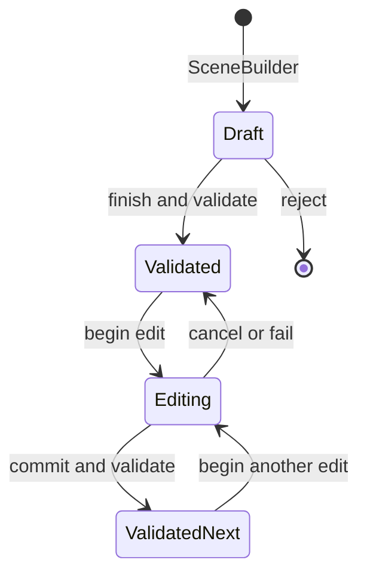

# ADR 0003: Canonical Scene IR Ownership and State Model

## Context

Every importer and postprocess operation needs one broad, loss-aware scene model. The previous
decision called `Scene` immutable while ADR 0025 allowed arbitrary direct mutation of its public
collections. That contradiction made a successful import indistinguishable from a scene that had
been invalidated by a caller.

Assimp's fixed-revision [`aiScene`](https://github.com/assimp/assimp/blob/bcc62230fc0471475528d732f4ad108a59bb7f6c/include/assimp/scene.h)
demonstrates the value of one common aggregate, while its public pointer arrays and separate
[`ValidateDataStructure`](https://github.com/assimp/assimp/blob/bcc62230fc0471475528d732f4ad108a59bb7f6c/code/PostProcessing/ValidateDataStructure.cpp)
pass also demonstrate how mutable storage can exist outside a fresh validation boundary. Baozi
keeps the common aggregate and rejects that mutation model.

## Decision

`baozi-core` owns the only canonical scene IR. Format backend models remain private and must be
converted before crossing the format crate boundary. The canonical lifecycle has three distinct
capabilities:

- `SceneBuilder` owns an unvalidated draft and is the construction API for importers and trusted
  producers.
- `ValidatedScene` owns a scene generation plus an unforgeable validation proof. The core central
  validator is the only proof constructor. Import, postprocess, and downstream code may invoke that
  validator, but cannot construct a proof or `ValidatedScene` directly or bypass full validation.
- `SceneEdit` isolates mutations from an existing `ValidatedScene`. Commit validates and returns a
  new generation; failure or cancellation publishes no partial state.

`Scene` collections are not publicly mutable. Read-only accessors and typed iterators provide the
common inspect workflow. `ImportReport::scene()` exposes a read view, so callers that only import and
inspect never handle proof internals. A caller opts into `SceneEdit` only when changing content.

The aggregate owns these collections:

| Owner | Owned concepts | Cross-references |
| --- | --- | --- |
| Scene | scene space, nodes, mesh instances, logical meshes, materials, images, samplers, textures, skins, animations, cameras, lights, metadata, provenance arena, derived scene bounds | generation-qualified dense IDs |
| Node | authored base transform, ordered children, camera/light attachments | node, camera, and light IDs |
| Logical mesh | primitives, morph target definitions, default morph weights, derived logical-mesh bounds | owner-qualified local IDs and primitive-local data |
| Primitive | topology, indices, vertex/corner/face attributes, material, derived primitive bounds | material ID |
| Mesh instance | owner node, logical mesh, optional skin, morph overrides, instance attributes | node, mesh, and skin IDs |
| Material | typed common fields, texture bindings, bounded extensions | texture IDs |

The node hierarchy is one rooted tree. A node canonically stores its ordered child IDs; parent lookup
is a derived index/view rather than a reciprocal stored field. The root has no derived parent, every
other node appears in exactly one parent's child list, and every node is reachable exactly once. Each
scene-owned mesh instance stores exactly one owner `NodeId`; node-to-instance iteration is likewise a
derived index/view, not a second reciprocal list. Shared geometry uses multiple mesh instances rather
than shared child nodes. A future DAG hierarchy would require a new decision because transform
evaluation, animation targets, provenance, and edit remaps all depend on this ownership rule.

Logical mesh and attribute rules are authoritative in ADR 0030; deformation and animation in ADR
0031; transactional edits, remaps, and derived-data invalidation in ADR 0032; persistent source
identity and provenance in ADR 0036.

A node preserves its authored base-transform representation as either an authored local matrix or
materialized translation, rotation, and scale (TRS). A computed local matrix is a derived inspection
and evaluation value, not a replacement for the authored representation. The builder and validator
must therefore reject an animation channel that targets a matrix-authored node unless the applicable
format contract has explicitly lowered it to TRS with provenance and authorized representation loss.
ADR 0008 defines matrix/TRS numeric semantics, and ADR 0031 defines the base-pose and channel-overlay
rules. This distinction is part of the canonical aggregate rather than a glTF-only adapter detail.

Every published scene owns an opaque `SceneGenerationId` that is collision-free within the runtime
generation domain. Builder finish and every successful edit commit expose a fresh token; ADR 0032
also assigns never-reused tokens to private step states without granting them a proof. Two edits
branched from the same input therefore receive distinct tokens rather than both being identified
only as `G + 1`; equal scene content does not imply equal generation identity. Generation tokens are
runtime capabilities, not persistence keys or source identities.

Scene-wide dense IDs are typed pairs of `(SceneGenerationId, dense_index)`. Primitive and morph
target handles are owner-qualified triples of
`(SceneGenerationId, logical_mesh_index, local_index)`. Their fields and constructors are private.
Every lookup checks kind, generation,
owner where applicable, and range before returning a view. A handle from another generation or
logical mesh is a typed stale/foreign-ID error even when its numeric index happens to be in range.
Generation-changing APIs return explicit remaps; callers cannot opt into unchecked numeric reuse.

Canonical storage keeps private typed index components for intra-scene references; a read accessor
combines the owning scene's generation token with an index to form the public handle above. Thus a
new generation does not require rewriting every unchanged stored edge merely to change its token,
while no unqualified index crosses the read/edit/remap API boundary. Owner-qualified local accessors
similarly derive the mesh component from the actual owner rather than accepting it from a caller.

Validation proves collection ownership, reference integrity, graph invariants, cardinality, numeric
policy, derived-data state, and extension bounds together; there is no public API that constructs a
proof from a boolean or unchecked `Scene`. ADR 0032 defines the exact `Derived<T>` state and
generation-qualified remap contract.

## Considered Options

### Option A: Public mutable vectors with caller-invoked validation

This is convenient for ad hoc tooling and resembles the current code, but any function receiving a
`Scene` must defensively revalidate it. Cached bounds and remaps can silently become stale, and stage
claims are forgeable. Rejected.

### Option B: Immutable scenes with full rebuilds for every change

This makes invariants simple, but large tools would clone unrelated buffers and cannot express
transactional failure efficiently. Rejected.

### Option C: Builder, validated generation, and isolated edit transaction

This keeps the success state trustworthy, permits focused copy-on-write replacement, and gives
postprocess one atomic mutation boundary. Chosen.

## Consequences

- All format crates target the same Rust-owned aggregate without leaking backend types.
- Breaking changes are required: direct field mutation and constructors for validated result types
  are removed rather than preserved behind compatibility aliases.
- Validation is mandatory at builder finish and edit commit, even when an operation believes its
  local checks are sufficient.
- Editors must retain or consume explicit remaps when they keep IDs across generations.

## Risks and Mitigations

| Risk | Severity | Mitigation |
| --- | --- | --- |
| Read-only access feels cumbersome | Medium | Provide typed slices, iterators, lookups, and convenience views for positions and triangle data. |
| Edit transactions duplicate large data | High | Share unchanged storage and allocate only affected replacements; peak-live accounting remains mandatory. |
| Internal code bypasses proof construction | High | Keep proof constructors private, expose only the central validating function as the legal minting path, and add compile-fail/public-API tests. |
| Validator and IR drift | High | Every new field lands with invariant tests and validator coverage in the same change. |

## Success Metrics

| Metric | Target | Measurement |
| --- | --- | --- |
| Generation isolation | Stale, foreign-owner, and sibling-branch handles are rejected before lookup | exact/stale/branch API tests |
| Validation complexity | Complete validation visits each graph edge, entity, reference, and payload cell at most a constant number of times | deterministic validator work counters |
| Publication integrity | Only builder finish and edit commit can produce a public proof | compile-fail and rollback tests |

## Acceptance Criteria

- External code cannot mutate a validated collection or construct `ValidatedScene` directly; it can
  obtain one only by passing a draft through the central validator.
- Every importer success and postprocess success contains a valid proof from the central validator.
- Root, reachability, unique derived parentage, duplicate child edges, and every dense reference are
  centrally validated.
- Failed or cancelled edits preserve the input scene digest and generation.
- Stale dense IDs require an explicit remap before use with a new generation.
- Primitive and morph-target handles from another logical mesh fail even when the local index exists.
- Sibling edits from one input publish different generation IDs and distinct remap endpoints.
- A node view distinguishes authored matrix from authored TRS, while its derived local matrix follows
  ADR 0008 without changing the preserved source representation.
- Public API tests prove the import-inspect path does not require builder, proof, or ledger internals.
