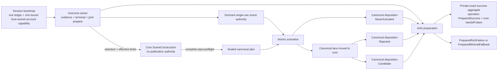

# ADR 0003: Canonical Scene IR Ownership and State Model

## Context

Every importer and postprocess operation needs one broad, loss-aware scene model. The previous
decision called `Scene` immutable while ADR 0025 allowed arbitrary direct mutation of its public
collections. That contradiction made a successful import indistinguishable from a scene that had
been invalidated by a caller.

Assimp's fixed-revision [`aiScene`](https://github.com/assimp/assimp/blob/bcc62230fc0471475528d732f4ad108a59bb7f6c/include/assimp/scene.h)
demonstrates the value of one common aggregate, while its public pointer arrays and separate
[`ValidateDataStructure`](https://github.com/assimp/assimp/blob/bcc62230fc0471475528d732f4ad108a59bb7f6c/code/PostProcessing/ValidateDataStructure.cpp)
pass also demonstrate how mutable storage can exist outside a fresh validation boundary. Baozi
keeps the common aggregate and rejects that mutation model.

## Decision

`baozi-core` owns the only canonical Scene IR and the only lifecycle that can turn producer input
into a validated generation. Format-private models cross that boundary only through an opaque,
single-use, core-owned `SceneConstruction`. The canonical lifecycle has three distinct capabilities:

- `SceneConstruction` owns semantic preflight, every unpublished canonical allocation after
  activation, validation, and canonical-candidate authority. A trusted producer receives only one
  bounded authoring surface. Before activation, import-bound construction owns no dormant operation
  authority, canonical table, publication join, or generation reservation. Complete authoring-input
  preflight returns one opaque `SealedCanonicalPlan` that carries exactly one non-authority,
  single-use activation request. The matching import outcome owner atomically consumes its dormant
  scene authority with that request and moves the
  resulting canonical lane into core for materialization. Finishing authoring returns a non-owning
  `SceneDraft` containing the construction brand and canonical directory-slot descriptor; it transfers
  no retained owner, operation context, account, ledger, validation proof, or generation. The
  construction neither creates a second ledger nor owns outcome-evidence or joint-preparation
  authority. A standalone construction uses the same preflight/activation seam through a separate
  core-owned operation adapter with its own real ledger.
- `ValidatedScene` owns a scene generation plus an unforgeable validation proof. The matching core
  construction lifecycle is the only proof constructor. Import, postprocess, and standalone callers
  may drive that lifecycle through public domain entry points, but cannot submit a draft without its
  matching owner, construct a proof or `ValidatedScene` directly, or bypass complete validation.
- `SceneEdit` isolates mutations from an existing `ValidatedScene`. Commit validates and returns a
  new generation; failure or cancellation publishes no partial state or generation.

Preparation consumes the construction owner together with the producer's exact draft result. A
missing, duplicated, already-consumed, or foreign descriptor cannot publish success. A core failure
latched while authoring remains authoritative even if producer code catches the returned error or
returns another value. Core completes central validation and seals the canonical success or rejection
before handoff; the owning operation completes terminal classification during joint preparation.
Only the exact success domain aggregate may privately pair qualified canonical ownership with one
core-owned generation handoff token; failure branches structurally retain neither. Handoff is a pure
two-step ownership move and constructs `ValidatedScene` only for success.

Composed operations use one sealed joint-preparation context owned by the operation domain. Session
startup creates one outcome owner containing the sole operation ledger, account-bound minimal
terminal baseline, outcome-evidence authority, terminal-cause latch, joint-preparation authority, and
one dormant non-copyable scene authority. Startup does not allocate or activate canonical tables, and
the authority remains inside the outcome owner while core performs complete semantic/envelope/input/
  capacity/attribution preflight. A successful preflight returns one sealed plan that contains exactly
  one non-authority, single-use activation request. The outcome owner extracts and consumes that request
  with the dormant authority exactly once; the remaining plan becomes usable only with the resulting
  same-brand lane. Ordinary
rejection before mutation remains `NeverActivated`, uncertain mutation is containment, and success
moves a brand-coupled canonical lane into core for materialization. That lane cannot prepare or
publish independently. Before joint preparation, the outcome owner consumes exactly one brand-bound
canonical disposition: `NeverActivated` with zero canonical retained-output admission/table/
allocation/commitment, `Rejected` after
verified cleanup with zero publishable canonical output, or `Candidate` with the sealed validated
canonical owner. Fatal containment is not a disposition and cannot prepare a terminal. Final
preparation consumes the exact disposition and matching outcome-evidence candidate. A missing,
foreign, duplicated, or independently prepared authority, lane, disposition, or candidate fails
closed. `NeverActivated` still preserves all attempted/consumed preflight work and any released
transient-scratch evidence; it is not a claim that no work occurred. These disposition names describe
durable states rather than stable public Rust identifiers.

Import and standalone construction reuse the dormant-plan-activation seam. Postprocess does not:
it opens a derived `SceneEdit` lane against the input Scene's inherited physical account and lineage,
then reuses only the operation-owned joint-preparation/pure-handoff primitive. It cannot route a
derived edit through standalone construction or obtain a fresh dormant source-scene authority.

Opening `SceneEdit` is a derived-operation start against the input Scene's inherited
`PhysicalStorageAccount`. It performs ADR 0044's shared poison/counter admission before edit work,
clone/share/refcount access, or replacement allocation. Poison-first returns typed
`AccountPoisoned` and leaves the input untouched. If edit start or a retained admission linearizes
first and another account clone later latches poison, its charge remains coupled, all later
retain/share attempts fail, and final validation/preparation returns
`FinalizationContainmentError` before any exact prepared wrapper, generation, proof, remap, or
handoff exists. No core edit API can reset, ignore, or replace the inherited account latch.

`Scene` collections are not publicly mutable. Read-only accessors and typed iterators provide the
common inspect workflow. `ImportReport::scene()` exposes a read view, so callers that only import and
inspect never handle proof internals. A caller opts into `SceneEdit` only when changing content.

```mermaid
stateDiagram-v2
    [*] --> Dormant: session bootstrap; zero canonical tables
    Dormant --> NeverActivated: early failure; consume dormant authority
    Dormant --> Planning: selection + limits; authority stays in outcome owner
    Planning --> NeverActivated: parse/preflight failure; consume dormant authority
    Planning --> Planned: seal complete canonical plan
    Planned --> NeverActivated: activation rejects before mutation
    Planned --> Building: consume dormant + request; lane moves to core
    Planned --> ContainmentFatal: activation disposition uncertain
    Building --> Rejected: verified materialization failure
    Building --> ContainmentFatal: retained construction panic or uncertain cleanup
    Building --> Draft: finish exact descriptor
    Draft --> Rejected: missing/foreign/latched or validation failure
    Draft --> Candidate: matching owner consumes descriptor; central validation succeeds
    NeverActivated --> JointPreparing: combine with exact outcome evidence
    Rejected --> JointPreparing: combine with exact outcome evidence
    Candidate --> FreezePermit: operation preflights joint destination intent
    FreezePermit --> Rejected: core generation reservation rejects; consume no nonce
    FreezePermit --> Reserved: core reserves nonce and splits freeze contribution + handoff token
    Reserved --> JointPreparing: operation consumes contribution + exact outcome evidence
    JointPreparing --> PreparedRichFailure: final eligibility + infallible commit; no generation owner
    JointPreparing --> PreparedMinimalFallback: final eligibility + infallible commit; fallback evidence
    JointPreparing --> ExactSuccessAggregate: pivot yields operation PreparedSuccess; import pairs matching core token
    JointPreparing --> ContainmentFatal: release proof unavailable; no exact terminal
    Reserved --> ContainmentFatal: later uncertainty; burn gap and poison coupled ownership
    ExactSuccessAggregate --> PublishedOwners: operation pure handoff
    PublishedOwners --> Validated: core handoff token consumes canonical owner + reserved nonce
    ExactSuccessAggregate --> [*]: drop aggregate; burn private gap
    PreparedRichFailure --> [*]: pure failure handoff; no generation
    PreparedMinimalFallback --> [*]: pure fallback handoff; no generation
    ContainmentFatal --> [*]: typed fatal containment error; no generation or fallback claim
    Validated --> Editing: begin edit
    Editing --> CheckedNext: validate candidate
    CheckedNext --> EditFreezePermit: operation preflights edit destination/control
    CheckedNext --> Validated: validation failure; retain input
    EditFreezePermit --> Validated: core reservation rejects; no nonce
    EditFreezePermit --> ReservedNext: core reserves nonce and splits contribution/token
    ReservedNext --> EditCommitIntent: operation consumes edit contribution + evidence
    ReservedNext --> Validated: later downgrade; burn gap and retain input
    EditCommitIntent --> ExactSuccessAggregateNext: pivot yields operation PreparedSuccess; pair edit token
    ExactSuccessAggregateNext --> PublishedNext: operation pure owner exposure
    PublishedNext --> ValidatedNext: core token consumes canonical owner + reserved nonce
    ExactSuccessAggregateNext --> Validated: drop aggregate; burn private gap and retain input
    ValidatedNext --> Editing: begin another edit
```

The aggregate owns these collections:

| Owner | Owned concepts | Cross-references |
| --- | --- | --- |
| Scene | scene space, nodes, mesh instances, logical meshes, materials, images, samplers, textures, skins, animations, cameras, lights, metadata, provenance arena, derived scene bounds | generation-qualified dense IDs |
| Node | authored base transform, ordered children, camera/light attachments | node, camera, and light IDs |
| Logical mesh | primitives, morph target definitions, default morph weights, derived logical-mesh bounds | owner-qualified local IDs and primitive-local data |
| Primitive | topology, indices, vertex/corner/face attributes, material, derived primitive bounds | material ID |
| Mesh instance | owner node, logical mesh, optional skin, morph overrides, instance attributes | node, mesh, and skin IDs |
| Material | typed common fields, texture bindings, bounded extensions | texture IDs |

Canonical presence is semantic rather than inferred from storage allocation. Core record/header fields
carry an explicit presence discriminator plus semantic element count wherever `Absent` and
`PresentEmpty` differ. A zero count therefore does not erase source meaning, while ADR 0044 may forbid
a physical zero-length payload block and represent present-empty content entirely in its owning
record/header.

The node hierarchy is one rooted tree. A node canonically stores its ordered child IDs; parent lookup
is a derived index/view rather than a reciprocal stored field. The root has no derived parent, every
other node appears in exactly one parent's child list, and every node is reachable exactly once. Each
scene-owned mesh instance stores exactly one owner `NodeId`; node-to-instance iteration is likewise a
derived index/view, not a second reciprocal list. Shared geometry uses multiple mesh instances rather
than shared child nodes. A future DAG hierarchy would require a new decision because transform
evaluation, animation targets, provenance, and edit remaps all depend on this ownership rule.

Logical mesh and attribute rules are authoritative in ADR 0030; deformation and animation in ADR
0031; transactional edits, remaps, and derived-data invalidation in ADR 0032; persistent source
identity and provenance in ADR 0036; camera and light semantics in ADR 0040.

A node preserves its authored base-transform representation as either an authored local matrix or
materialized translation, rotation, and scale (TRS). A computed local matrix is a derived inspection
and evaluation value, not a replacement for the authored representation. The builder and validator
must therefore reject an animation channel that targets a matrix-authored node unless the applicable
format contract has explicitly lowered it to TRS with provenance and authorized representation loss.
ADR 0008 defines matrix/TRS numeric semantics, and ADR 0031 defines the base-pose and channel-overlay
rules. This distinction is part of the canonical aggregate rather than a glTF-only adapter detail.

Every published scene owns an opaque `SceneGenerationId` that is collision-free and never reused
within the runtime generation domain. Core's private `SceneGenerationId::allocate()` is fallible and
returns a linear `ReservedSceneGeneration` rather than a public ID, so nonce acquisition cannot occur
in the final ownership handoff. The matching operation outcome owner classifies the terminal result;
core alone reserves and interprets generation identity. Neither crate calls upward into the other:
the domain adapter sequences sealed tokens in the existing dependency direction. The reservation
typestate obeys this lifecycle:

1. after complete central validation and outcome-evidence assembly, the operation outcome owner
   preflights every pre-generation destination/control condition and returns one opaque single-use
   freeze permit. The permit applies no destination commitment and grants no generation authority;
2. the domain adapter passes that permit into the candidate's one-shot core method. Reservation
   rejection or exhaustion consumes no nonce and returns a brand-bound `Rejected` disposition plus
   the matching operation failure contribution, so ordinary rich-failure preparation retains its
   freeze/evidence authority;
3. successful reservation consumes one never-reused nonce, then core splits the generation-ready
   state into an operation-understandable freeze contribution and a core-owned handoff token. The
   latter retains the reservation and validation proof; operation never interprets or constructs it;
4. the operation outcome owner consumes the freeze contribution with exact outcome evidence through
   the final eligibility/infallible-commit pivot. Exact failure wrappers structurally have no core
   handoff token or canonical owner. Exact success is privately paired with the matching core handoff
   token until handoff; and
5. operation's pure handoff exposes the already qualified canonical owner, after which the matching
   core token consumes that owner and reservation into `SceneGenerationId` plus `ValidatedScene`.
   Both moves are allocation-free, lock-free, callback-free, accounting-free, and infallible; no
   intermediate is public.

Reservation rejection or exhaustion consumes no nonce and is classified as an ordinary rich failure
with preserved evidence and zero canonical output. It does not by itself require the minimal
fallback. If appending, validating, or preparing that downgraded rich failure then fails, or an
invalid root or equivalent non-unwind integrity fault prevents rich preparation after candidate
cleanup is verified and the retained operation layer confirms its startup fallback baseline remains
intact, the finalizer selects
`PreparedMinimalFallback`. A retained canonical or
evidence builder panic never selects that fallback. The retained store returns
`FinalizationContainmentError`, and core constructs no fallback, generation, proof, or remap from that
path. ADR 0044 exclusively owns physical-side disposition, charge/attribution coupling, cleanup
precedence, and retained allocation membership below core's non-owning block views.
Double panic, `panic = "abort"`, process exit, and OOM require process isolation. Once reservation has succeeded, any later
publication-preparation failure, cancellation, caught unwind, or prepared-success drop burns that invisible
nonce gap. The nonce is never returned to the domain and never reused, so no failed path publishes a
generation or proof. The two exact failure wrappers contain no reservation by the time they leave
preparation.

Finishing authoring exposes no token. ADR 0032 gives immutable edit step states only report-scoped
typed ordinals/paths, never generation reservations or public `SceneGenerationId` values. Each
`Changed` edit reserves and publishes exactly one generation for its final `ValidatedScene`; only the
composed input-to-final remap is generation-qualified. Two edits branched from the same input
therefore receive distinct final tokens rather than both being identified only as `G + 1`; equal
scene content does not imply equal generation identity. Generation tokens are runtime capabilities,
not persistence keys, step-state identities, or source identities.

Scene-wide dense IDs are typed pairs of `(SceneGenerationId, dense_index)`. Primitive and morph
target handles are owner-qualified triples of
`(SceneGenerationId, logical_mesh_index, local_index)`. Their fields and constructors are private.
Every lookup checks kind, generation,
owner where applicable, and range before returning a view. A handle from another generation or
logical mesh is a typed stale/foreign-ID error even when its numeric index happens to be in range.
Generation-changing APIs return explicit remaps; callers cannot opt into unchecked numeric reuse.

Canonical storage keeps private typed index components for intra-scene references; a read accessor
combines the owning scene's generation token with an index to form the public handle above. Thus a
new generation does not require rewriting every unchanged stored edge merely to change its token,
while no unqualified index crosses the read/edit/remap API boundary. Owner-qualified local accessors
similarly derive the mesh component from the actual owner rather than accepting it from a caller.

Validation proves collection ownership, reference integrity, graph invariants, cardinality, numeric
policy, derived-data state, and extension bounds together; there is no public API that constructs a
proof from a boolean or unchecked `Scene`. ADR 0032 defines the exact `Derived<T>` state and
generation-qualified remap contract.

## Considered Options

### Option A: Public mutable vectors with caller-invoked validation

This is convenient for ad hoc tooling and resembles the current code, but any function receiving a
`Scene` must defensively revalidate it. Cached bounds and remaps can silently become stale, and stage
claims are forgeable. Rejected.

### Option B: Immutable scenes with full rebuilds for every change

This makes invariants simple, but large tools would clone unrelated buffers and cannot express
transactional failure efficiently. Rejected.

### Option C: Core-owned construction, validated generation, and isolated edit transaction

This keeps the success state trustworthy, permits focused copy-on-write replacement, and gives
postprocess one atomic mutation boundary. Chosen.

## Consequences

- All format crates target the same Rust-owned aggregate without leaking backend types.
- Breaking changes are required: direct field mutation and constructors for validated result types
  are removed rather than preserved behind compatibility aliases.
- Finishing authoring produces only a non-owning, branded `SceneDraft` descriptor. Every canonical-
  success publication path consumes that descriptor with its matching construction owner or validates
  an edit candidate, even when a producer performed local checks.
- Successful preparation may consume an unpublished generation nonce; aborting after reservation
  burns a never-reused gap rather than weakening the handoff or publishing partial identity.
- Editors must retain or consume explicit remaps when they keep IDs across generations.

## Risks and Mitigations

| Risk | Severity | Mitigation |
| --- | --- | --- |
| Read-only access feels cumbersome | Medium | Provide typed slices, iterators, lookups, and convenience views for positions and triangle data. |
| Edit transactions duplicate large data | High | Share unchanged storage and allocate only affected replacements; peak-live accounting remains mandatory. |
| Internal code bypasses proof construction | High | Keep proof constructors private, require the matching construction owner or edit transaction as the legal minting path, and add compile-fail/public-API tests. |
| Validator and IR drift | High | Every new field lands with invariant tests and validator coverage in the same change. |
| Generation allocation fails after destination commitment or leaks into operation | Critical | Operation first issues a zero-commit freeze permit; core alone rejects or reserves/splits the generation-ready value. Operation receives only the freeze contribution, while the private domain aggregate retains the core handoff token. Later preparation may burn the gap, and only paired pure core handoff publishes it. |
| Failed preparation reuses or exposes a reserved nonce | Critical | The linear private reservation burns on drop, has no public conversion except prepared handoff, and never returns a nonce to the allocator. |
| A success-capable prepared wrapper defers terminal classification to handoff | Critical | Operation preparation completes control downgrade and returns exact success, rich-failure, or minimal-fallback wrappers. Only the private domain success aggregate may pair operation success with a core generation handoff token; operation wrappers never contain `ReservedSceneGeneration`. |
| A retained-builder panic is reported as a clean fallback | Critical | ADR 0044 returns typed fatal containment; core constructs no fallback, generation, or proof from that path. |
| A derived edit starts or commits through a poisoned account clone | Critical | begin-edit and final publication eligibility linearize against ADR 0044's one shared latch; poison-first has zero work/refcount/allocation effects, start/retain-admission-first retains charge and fails finalization before handoff, and no reset/reuse API exists |
| An import-bound construction silently creates a second ledger, activates canonical storage before exact input planning, or prepares it alone | Critical | Session startup keeps one dormant scene authority under the sole operation owner while core produces only a sealed preflight plan. Exact activation consumes that plan plus authority once and moves only the resulting lane into core. The lane has no independent prepare/handoff path. Integration plus compile-fail tests reject nested-ledger startup, early/double activation, foreign disposition/candidate pairing, and direct canonical publication. |

## Success Metrics

| Metric | Target | Measurement |
| --- | --- | --- |
| Generation isolation | Stale, foreign-owner, and sibling-branch handles are rejected before lookup | exact/stale/branch API tests |
| Generation publication | freeze-permit/core reservation rejection becomes ordinary rich failure with no nonce; only the privately paired core handoff publishes one never-reused token after operation commit, while failed/prepared-drop paths publish none | exhaustion, cancellation, caught-unwind, and paired prepared-drop probes |
| Terminal classification | only the exact success domain aggregate can pair operation-prepared canonical ownership with one core-owned generation handoff token; exact rich-failure/minimal-fallback wrappers structurally cannot; retained-builder containment is not a prepared publication | API-shape, downgrade, startup-side, uncertain-cleanup, and compile-fail probes |
| Poisoned lineage | every clone of one Scene account rejects new derived edits after poison; a pre-admitted edit cannot publish once poison linearizes before final eligibility | two-order barriers, input digest/proof/refcount/allocator probes, account snapshots, and no-bypass API scans |
| Validation complexity | Complete validation visits each graph edge, entity, reference, and payload cell at most a constant number of times | deterministic validator work counters |
| Publication integrity | Only the matching core construction or edit transaction can drive central validation and mint proof; import finalization and edit commit may publish only that successful result | compile-fail, foreign/missing-draft, and rollback tests |
| Composed ledger uniqueness | every import exposes exactly one operation-ledger snapshot; dormant-authority activation and later canonical work contribute through that ledger rather than a nested core ledger | import-owned session-owner integration, early/exact/double activation probes, snapshot cardinality assertions, and dependency/API-shape scans |

## Acceptance Criteria

- External code cannot mutate a validated collection or construct `ValidatedScene` directly; it can
  obtain one only by completing the matching core construction or a validated edit transaction.
- A finished `SceneDraft` descriptor exposes no owner or generation. Operation issues a zero-commit
  freeze permit, core alone reserves and splits the private nonce, operation commits only the freeze
  contribution, and the paired pure core handoff converts the token into the `SceneGenerationId`
  carried by the new `ValidatedScene`.
- Missing, duplicated, already-consumed, and foreign draft descriptors cannot publish success. A
  latched construction failure remains authoritative even when producer code catches the immediate
  error, and panic after the continuation enters its consuming transition fails closed rather than
  restoring reusable authority.
- Exact/exhausted generation-domain tests prove reservation failure consumes no nonce and precedes
  attribution freeze, preserves ordinary rich-failure evidence, and records zero canonical output.
  Only a subsequent failure to append, validate, or prepare that rich failure or a non-unwind root
  integrity fault with verified candidate cleanup and a confirmed intact retained startup baseline
  selects the minimal fallback. A
  retained-builder panic instead requires ADR 0044 typed fatal containment with no fallback or zero-
  leak claim; abort/double-panic/exit/OOM fixtures are process-isolated. Separate later-preparation-failure,
  cancellation, caught-unwind, and prepared-drop tests prove any path after successful reservation may burn
  an invisible gap, while no failed path publishes/reuses an ID or constructs a proof.
- Operation preparation returns exact `PreparedSuccess`, `PreparedRichFailure`, or
  `PreparedMinimalFallback` wrappers and no core generation value. Only the private domain exact-
  success aggregate may pair operation success with one `SceneHandoffToken`; failure aggregates
  structurally contain neither token nor canonical owner. Operation owner exposure and core proof
  conversion are pure consuming moves rather than terminal classification.
- Every importer success and postprocess success contains a valid proof from the central validator.
- Root, reachability, unique derived parentage, duplicate child edges, and every dense reference are
  centrally validated.
- Failed or cancelled edits preserve the input scene digest and generation.
- Poisoned-account edit tests force both linearization orders. Poison-first `SceneEdit` start returns
  typed `AccountPoisoned` with zero work/counter/share/refcount/allocator delta. Start/retain-first
  keeps its charge, rejects later sharing/allocation, and final preparation returns
  `FinalizationContainmentError` with no exact wrapper, generation, proof, remap, or handoff. Sibling
  account/Scene clones expose the same poison/count/evidence, and compile-fail/source gates find no
  reset, ignore, reuse, or account-replacement escape.
- Stale dense IDs require an explicit remap before use with a new generation.
- Primitive and morph-target handles from another logical mesh fail even when the local index exists.
- Every `Changed` edit publishes exactly one final generation. Ordered per-step remaps use only the
  owning report's typed step-state ordinals/paths, while the composed input-to-final remap is the sole
  generation-qualified edit relation; sibling edits publish distinct final endpoints.
- A node view distinguishes authored matrix from authored TRS, while its derived local matrix follows
  ADR 0008 without changing the preserved source representation.
- `Absent` and `PresentEmpty` survive validation and semantic digesting as distinct values without a
  physical zero-length payload allocation.
- Public API tests prove the import-inspect path does not require builder, proof, or ledger internals.
- Import-bound construction tests prove the session operation is the only ledger owner, bootstrap
  issues only one dormant scene authority and retains it while core seals the complete input plan.
  Activation consumes that authority plus request only after selection, effective-limit freeze, and
  complete preflight, then moves the brand-coupled canonical lane into core. Early failures consume the
  dormant authority into `NeverActivated`, canonical rejection
  consumes the lane into `Rejected`, and success seals `Candidate`; only the matching outcome owner
  can combine one of those dispositions with the outcome-evidence candidate. Standalone core tests
  prove the separate adapter still owns one real ledger rather than a no-op attribution path.

## Amendment History

### 2026-08-05: Bind canonical construction to one joint publication context

- Affected headings: frontmatter `updated`, `Decision`, composition diagram, risks, success metrics,
  and acceptance criteria.
- Previous rule: core-owned construction was required to bind to an import session, but the Accepted
  text did not distinguish canonical-lane ownership from ownership of the whole import operation. An
  implementation could therefore share only the physical account while silently creating a second
  construction ledger, or let canonical storage prepare independently from outcome evidence.
- New rule: bootstrap creates one outcome owner with the sole import ledger, minimal terminal,
  outcome-evidence/terminal/joint-preparation authority, and one dormant scene authority. The authority
  remains in that owner while core produces a sealed complete-input plan containing exactly one
  non-authority activation request; exact activation consumes the dormant authority and that request,
  then binds the remaining plan to the resulting canonical lane. Finalization consumes exactly one brand-
  bound `NeverActivated`, `Rejected`, or `Candidate` disposition. A candidate may cross the operation
  freeze-permit/core-reservation seam, after which joint preparation and the paired pure core handoff
  are the only path to a validated generation. The operation `PreparedSuccess` wrapper never owns the
  reserved generation; only an import-private exact-success aggregate pairs it with the matching core
  handoff token. This rule supersedes the older 2026-07-18 amendment's prepared-wrapper ownership
  wording. Standalone core construction is a separate real adapter
  over the same activation seam, not the import path and not a no-op ledger.
- Compatibility impact: private pre-release operation/core/import construction and publication APIs
  may break; no stable wire or published compatibility surface exists.
- Required review: real import-owned session-owner integration, duplicate-ledger rejection,
  dormant/exact/double activation, lane-brand mismatch, independent-prepare compile-fail coverage,
  exact success/rich/minimal publication, drop order, and standalone ledger evidence.
- Rationale: canonical proof ownership and import outcome ownership are different responsibilities.
  A dormant single-use authority plus exact later activation preserves both without coarse bootstrap
  reservation, a migration-only attach seam, two ledgers, or partial publication.

### 2026-08-01: Make canonical construction a core-owned opaque continuation

- Affected headings: `Decision`, lifecycle diagram, generation identity, alternatives,
  consequences, risks, success metrics, and acceptance criteria.
- Previous rule: the Accepted text described an importer-facing `SceneBuilder` as the owner of an
  unvalidated draft and implied that an independently owned draft could later be submitted to a
  general validator.
- New rule: one opaque single-use `SceneConstruction` owns unpublished canonical storage,
  validation, terminal classification, and publication authority. Producers borrow only a bounded
  authoring surface and return a non-owning branded directory descriptor. Preparation must consume
  that exact descriptor with its matching owner; missing, foreign, duplicated, latched-failure, or
  transition-panic paths cannot mint proof or generation. `ValidatedScene` remains constructible only
  by pure exact-success handoff.
- Compatibility impact: pre-release builder, validation, and producer APIs may break; no stable wire
  or public retained-storage layout is affected.
- Required review: descriptor/owner API shape, foreign and missing draft probes, caught-error and
  transition-panic fail-closed tests, central validation coverage, generation reservation/drop, import
  composition, and direct ADR coherence review.
- Rationale: a descriptor cannot prove ownership of unpublished storage. Keeping the construction
  owner inside core makes proof minting, generation identity, retained lifetime, and terminal cause
  one non-forgeable lifecycle.

### 2026-07-27: Follow retained physical-ownership authority supersession

- Affected headings: frontmatter `related`, `Decision`, canonical presence, failure containment,
  `Risks and Mitigations`, `Success Metrics`, and `Acceptance Criteria`.
- Previous rule: current canonical lifecycle text cited ADR 0042, which combined durable retained
  ownership invariants with U4-specific implementation and measurement details.
- New rule: ADR 0044 is the sole retained physical-ownership and lineage authority. Canonical Scene
  semantics and lifecycle consequences are unchanged. Older amendment entries preserve the ADR
  identifier in effect when they were recorded and do not restore ADR 0042 authority.
- Compatibility impact: none; this is an atomic authority-navigation update.
- Required review: reciprocal supersession, dependency direction, current-text reference scan, and
  direct ADR review.
- Rationale: core should depend on durable ownership guarantees without freezing a temporary U4
  storage implementation.

### 2026-07-20: Consume operation publication ownership without redefining attribution

- Affected heading: `Decision` generation-reservation lifecycle.
- Previous rule: core described exact success as owning `private frozen attribution`, duplicating
  ADR 0022's superseded prepared-attribution vocabulary.
- New rule: ADR 0022 alone commits attribution destinations during preparation. Exact core success
  owns the reserved generation plus an already destination-qualified but domain-unexposed canonical
  owner. Handoff converts the reservation into `SceneGenerationId`, exposes/moves the canonical
  owner, and constructs `ValidatedScene`; core does not define or execute an attribution transition.
- Compatibility impact: private pre-release publication vocabulary changes; generation identity,
  Scene semantics, and stable-wire policy do not.
- Required review: core-to-operation typestate mapping, generation rejection/gap/drop probes, and
  source gates that reject a core-defined prepared-attribution owner.
- Rationale: generation identity is core authority, while ledger destination commitment is operation
  authority. Keeping those responsibilities separate preserves the infallible handoff boundary.

### 2026-07-19: Supersede clean retained-builder fallback at the canonical boundary

- Affected headings: canonical lifecycle diagram, generation identity, `Risks and Mitigations`,
  `Success Metrics`, and `Acceptance Criteria`.
- Previous rule: the earlier 2026-07-19 amendment still allowed a caught retained-builder unwind to
  produce minimal fallback after a general verified-cleanup test.
- New rule: a retained canonical/evidence builder panic always resolves below core as ADR 0042 typed
  fatal containment and returns `FinalizationContainmentError`; it cannot construct
  fallback, generation, proof, or remap. Only rich-failure preparation failure or a non-unwind root
  integrity fault with verified candidate cleanup and an intact startup baseline may select minimal
  fallback. ADR 0042 exclusively owns the underlying physical admission, containment, cleanup-
  evidence, attribution-coupling, and retained-membership protocol.
- Compatibility impact: pre-release canonical finalization and fault tests change; Scene identity and
  wire compatibility remain explicitly unstabilized.
- Required review: lifecycle exhaustivity, typed containment integration, no generation/proof/remap on
  containment, root-fault fallback, generation-gap, physical-owner integration, and ADR review.
- Rationale: core can mint a validation proof only from a fully owned canonical aggregate. A builder
  panic is evidence of an incomplete ownership graph, not an ordinary report-quality downgrade.

### 2026-07-19: Close derived-edit poison and unwind containment

- Affected headings: canonical lifecycle, lifecycle diagram, generation identity, `Risks and Mitigations`,
  `Success Metrics`, and `Acceptance Criteria`.
- Previous rule: an “unrecoverable builder panic” selected minimal fallback without distinguishing
  verified cleanup from an uncertain dependency/storage release, and `SceneEdit` did not define how
  derived-operation start or final commit behaves when another account clone latches poison.
- New rule: only a caught single unwind followed by proved cleanup, correct lease ordering, and zero
  operation-live attribution may prepare minimal fallback and claim no leak. A surviving process with
  uncertain release keeps payload/lease/attribution coupled, latches the shared physical account and
  marks the operation/extension path poisoned, and returns
  typed `FinalizationContainmentError` without a fallback or refund. Abort, double panic, process exit,
  and OOM require process isolation. `SceneEdit` start and final publication eligibility linearize
  against ADR 0042's shared account latch: poison-first rejects before edit/refcount/allocation work;
  start/retain-admission-first keeps charge but cannot prepare or hand off after poison. All clones share the
  latch/count/evidence and no reset/account-replacement escape exists. None of these paths publishes or
  reuses a generation nonce.
- Compatibility impact: the pre-release edit-start/finalization error domains gain typed
  `AccountPoisoned` and fatal containment results;
  no stable Scene or wire compatibility is promised.
- Required review: caught-unwind cleanup/drop probes, uncertain-extraction poisoning and no-refund
  tests, two-order derived-start/retain/finalization barriers, clone/reuse/no-bypass and zero-side-
  effect probes, process-isolated abort/double-panic/exit/OOM fixtures, generation never-reuse, and ADR review.
- Rationale: a minimal report is truthful only when Baozi can prove what was deallocated; otherwise
  conservative retained accounting is safer than an optimistic zero-leak result. A Scene cannot
  authorize new derived work through an account whose physical lifetime is no longer trustworthy.

### 2026-07-18: Classify terminal state before handoff and reserve one published generation

- Affected headings: `Decision`, lifecycle diagram, canonical presence semantics, generation identity,
  `Consequences`, `Risks and Mitigations`, `Success Metrics`, and `Acceptance Criteria`.
- Previous rule: builder/edit publication was described as assigning or minting a fresh
  `SceneGenerationId` during validation or commit without representing that nonce allocation can fail
  or explaining prepared-drop behavior.
- New rule: core privately reserves one never-reused nonce as the final fallible pre-freeze identity
  acquisition for a provisional success. Preparation completes terminal classification as exact
  success, rich failure, or minimal fallback before handoff. Reservation rejection/exhaustion
  consumes no nonce and becomes an ordinary rich failure; only failure to prepare that downgraded
  evidence or an unrecoverable builder/root integrity fault selects minimal fallback. At that time the
  exact `PreparedSuccess` wrapper was described as owning `ReservedSceneGeneration`; the 2026-08-05
  amendment supersedes that ownership detail by pairing an operation wrapper with a core token only
  inside the private exact-success aggregate. Failure wrappers structurally contain neither. Handoff
  is a pure consuming split that constructs `ValidatedScene` only for exact success. Edit step
  states use report-scoped typed ordinals/paths and every changed edit publishes exactly one final
  generation; only its composed input-to-final remap is generation-qualified. Canonical headers also
  distinguish `Absent` from `PresentEmpty` without zero-length physical blocks.
- Compatibility impact: pre-release builder, validator, and edit typestates change; no public caller
  can observe or construct the reservation, and no previously stable generation representation or
  wire exists.
- Required review: generation exhaustion/concurrency/never-reuse review, cancellation/unwind/prepared-
  drop probes, proof-construction compile-fail gates, import/edit handoff integration, empty-semantics
  digest tests, and direct ADR review.
- Rationale: a fallible allocator cannot remain after the pure ownership boundary; reservation makes
  failure explicit without weakening collision freedom, never-reuse, or proof atomicity.
