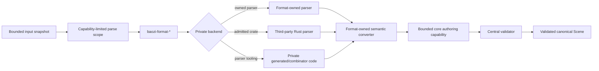

# ADR 0004: Parser Backend and Format Coverage Policy

## Status and Scope

This accepted decision governs how a format parser is selected, contained, documented, and
promoted. Acceptance establishes the policy; it does not claim that every current format has met a
particular maturity tier. Current support and verification status live in format evidence records
and the canonical refactor plan.

Public compatibility consequences are owned solely by ADR 0006. Parser tooling details are refined
by ADR 0018, but no tooling decision may weaken this format-private boundary.

## Context

Baozi needs broad format coverage, while Rust parser ecosystems vary from mature domain libraries
to incomplete or unsuitable crates. A universal self-write rule wastes mature work. A universal
wrapper rule lets dependency APIs, allocation behavior, diagnostics, and release cadence define
Baozi. Both approaches become unsafe if parsers can bypass the shared import session or publish a
backend model directly.

The architectural question is therefore not "owned parser or dependency" in the abstract. It is
whether a backend can remain private, bounded, replaceable, and semantically accountable to the
same canonical output contract.

## Decision

Baozi uses a hybrid, per-format parser strategy behind a mandatory format-private backend boundary.

- self-write when the format is small, diagnostics and recovery require precise control, or no
  acceptable dependency exists
- use a mature Rust dependency when it reduces real complexity and passes license, target, MSRV,
  safety, resource, and replacement gates
- use parser tooling selectively inside the format crate under ADR 0018
- convert backend data into Baozi-owned canonical IR before it leaves the format crate
- use Assimp only as an optional external behavioral/differential oracle over curated fixtures
- never introduce a stopgap alternate backend, Assimp binding, or parallel old/new public model to
  preserve the unpublished prototype
- require an additional accepted ADR before adding native FFI to any production format path; FFI is
  never an implicit fallback or part of the default/WASM path

### Mandatory Boundary

The backend and any intermediate AST/event/error types are private implementation details. They do
not appear in the facade, canonical IR, public outcomes, diagnostics, typed options, snapshots, or
support promises.

Every parser receives resources only through the selected session capability. It cannot reopen the
primary asset, access raw application IO, finalize reports, assign lifecycle stages, or construct a
validated result.

### Backend Replacement

Changing a private backend is not a public API event. It is a semantic conformance event.

A replacement must run the same:

- Baozi-owned fixture corpus and normalized semantic expectations
- malformed, resource-limit, dependency-IO, and cancellation cases
- facade-path import and validation contracts
- deterministic snapshot/digest comparisons
- format fuzz target and required target builds

Backend-specific quirks are not preserved unless the format contract deliberately documents them
as Baozi semantics. A replacement that discovers an incorrect canonical behavior fixes it under the
relevant semantic ADR; it does not add a compatibility switch.

### Dependency Admission and Maturity Separation

Admission safety and maturity evidence are separate decisions. A production parser backend may enter
the first-party format inventory and become reachable through a facade format feature only after all
applicable baseline admission gates pass:

1. license and redistribution terms fit Baozi and its fixture policy;
2. declared MSRV and dependency MSRV satisfy the workspace target;
3. the bytes-only path compiles for every required portable target without native filesystem or
   process-global assumptions;
4. no parser/backend type crosses the format boundary;
5. attacker-controlled counts, recursion, reads, and decoded storage are bounded before allocation
   or backend amplification and fit the session's attempted/live/committed accounting;
6. admitted malformed inputs become bounded Baozi failures rather than panic, abort, unbounded
   recursion, unchecked allocation, or invalid validated success;
7. source spans and backend errors map to bounded Baozi diagnostics without host-path leakage; and
8. dependency purpose, version policy, license, unsafe/FFI footprint, and limitations are recorded
   in the format evidence document.

A conservative opaque-allocation allowance is accounting evidence, not permission for a known
unbounded path. If Baozi cannot prevent attacker-controlled unbounded allocation, recursion, panic,
or abort before backend entry, the affected path must be disabled and unregistered, rejected, or
isolated in a non-first-party process boundary. It cannot enter the first-party inventory or remain
reachable under an Experimental label.

Only after baseline admission may missing non-safety maturity evidence leave a backend Experimental.
Examples include incomplete declared semantic breadth, replacement/conformance breadth, sustained
fuzz or RSS campaign history beyond the admission baseline, an independent oracle, and packaged
consumer evidence. ADR 0011 owns those maturity requirements and promotion decisions.

A green happy-path import is neither admission nor maturity evidence.

### Maturity and Evidence Authority

ADR 0011 is the sole authority for format maturity levels, capability statuses, promotion evidence,
and user-facing support claims. This ADR adds only backend-specific admission evidence: dependency
metadata, private-type isolation, bounded failure behavior, and the boundary between mandatory
safety admission and later maturity evidence. There is no opaque-allocation or sanitizer exception
to baseline hostile-data safety.

The code-side format descriptor and structured evidence must identify the backend and satisfy both
authorities, but backend popularity or a successful sample import never promotes maturity.
Transient test counts and current work-unit progress stay in verification evidence rather than in
either durable decision.

### Feature Authority

ADR 0007 is the sole authority for facade feature names, default/all-format composition, crate
topology, and feature CI. This ADR imposes one parser-boundary constraint on that composition:
facade features express formats or capabilities, never backend implementation choices.

A backend-specific Cargo feature, when unavoidable inside an unpublished format crate, remains
private implementation configuration and cannot alter canonical semantics. The facade does not
forward backend selector features. A user-selectable backend requires a separate accepted public
contract; it is not created as an escape hatch.

## Alternatives Considered

### Option A: Self-write every parser

Pros:

- maximum control over limits, diagnostics, and source semantics
- smallest dependency and licensing surface

Cons:

- repeats mature parsing work
- delays complex formats and architectural feedback
- can produce ad hoc implementations where proven tooling is clearer

Decision: rejected as a universal rule; preferred when the format and evidence justify it.

### Option B: Wrap ecosystem crates wherever possible

Pros:

- fastest initial breadth
- leverages upstream maintenance and conformance work

Cons:

- ecosystem quality and target support vary widely
- opaque allocation, panic, and diagnostic behavior may violate Baozi contracts
- dependency models can leak into canonical design

Decision: rejected as a universal rule.

### Option C: Use Assimp or another compatibility backend until native parsers arrive

Pros:

- broad immediate format coverage
- provides familiar normalized output

Cons:

- introduces native build/ABI and clean-room ambiguity
- creates a second architecture and migration obligation
- makes temporary lossy behavior a de facto public contract

Decision: rejected. Assimp remains an optional out-of-process test oracle only.

### Option D: Hybrid format-private backends with uniform conformance gates

Pros:

- balances delivery speed with ownership and replaceability
- lets each format choose suitable parsing technology
- preserves one public semantic and safety contract
- makes backend replacement measurable

Cons:

- requires converter layers and per-format audits
- evidence cost is higher than accepting backend success at face value

Decision: chosen.

## Consequences

Positive:

- Baozi can use mature Rust libraries without making them public architecture
- small formats retain precise diagnostics and limit control
- all formats share validation, outcomes, security, and maturity rules
- replacement pressure is handled inside format crates rather than through versioned public models

Negative:

- backend wrappers must account for opaque behavior and normalize errors
- each format needs durable documentation and broad evidence
- safely admitted dependencies may remain Experimental while non-safety promotion evidence is
  incomplete

## Risks and Mitigations

| Risk | Severity | Likelihood | Mitigation |
| --- | --- | --- | --- |
| Third-party backend allocates before Baozi preflight | Critical | Medium | preflight the slice or disable, reject, replace, or process-isolate it; allowance/RSS evidence cannot admit a known unbounded path |
| Backend types or assumptions leak into IR | High | Medium | public API/rustdoc checks plus replacement conformance tests |
| Format count grows faster than semantic quality | High | High | structured maturity gates and curated defaults |
| Limits differ between formats | High | Medium | session-owned budgets and shared facade contract harnesses |
| Backend selector silently changes output | High | Low | no facade backend features; canonical semantic tests apply to every backend |
| License or fixture provenance is unclear | High | Medium | format evidence and dependency/fixture audit before promotion |
| Deprecated tier becomes a pre-release compatibility dump | Medium | Medium | delete unpublished prototypes; use Deprecated only for released contracts |

## Acceptance Criteria

| Contract | Measurable evidence |
| --- | --- |
| Boundary isolation | public API/rustdoc search exposes no parser backend AST, error, handle, or Assimp type |
| Capability discipline | production format code has no direct policy-bypassing primary/sidecar IO path |
| Safety admission | a backend with a known panic, abort, unbounded-allocation/recursion, or invalid-success path has no first-party registration, inventory entry, or facade format feature |
| Replacement safety | admitted wrapped backends pass the same facade, semantic, malformed, limit, snapshot, and fuzz harness as owned parsers |
| Feature boundary | ADR 0007's machine gate finds no facade backend selector and every backend configuration preserves canonical semantics |
| Promotion evidence | each backend satisfies ADR 0011's structured maturity/evidence gate without using backend popularity as proof |
| Target safety | each backend satisfies the target, sanitizer, and package gates owned by the target/release authorities |
| Failure truth | unsupported semantics and backend failures return structured errors/diagnostics instead of silent drops |

## Implementation Evidence

Implementation status changes over time. Consult:

- [Canonical architecture refactor plan](../plans/2026-07-10-001-refactor-baozi-canonical-architecture-plan.md)
- [STL format crate](../../crates/baozi-format-stl/)
- [OBJ format crate](../../crates/baozi-format-obj/)
- [PLY format crate](../../crates/baozi-format-ply/)
- [glTF format crate](../../crates/baozi-format-gltf/)
- [Format support documents](../formats/)
- [Engineering memory index](../knowledge/engineering/index.md)
