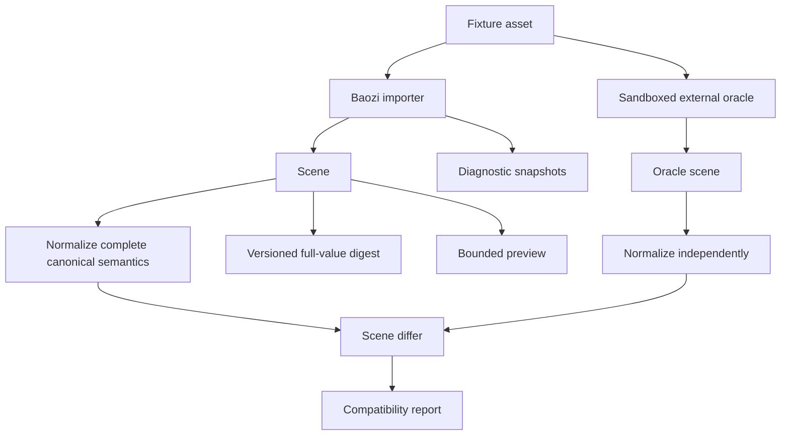
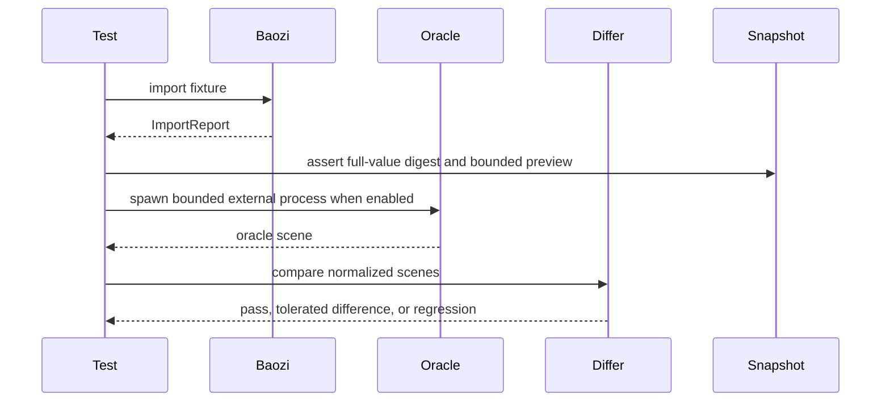

# ADR 0005: Testing, Fuzzing, and Differential Oracle Strategy

## Status and Authority

This accepted ADR owns Baozi's layered test portfolio, fixture provenance policy, and external-oracle
sandbox policy. ADR 0026 is the sole authority for per-field validator/snapshot/direct/fuzz evidence
and golden encoding mechanics. ADR 0011 composes both into format maturity gates.

Acceptance does not claim that every current format already has every layer. Current test counts,
fuzz campaign results, and implementation gaps live in the canonical refactor plan and verification
records.

## Context

Asset importers fail in more ways than normal libraries. Real files are malformed, exported by buggy
tools, truncated, huge, or depend on sidecar files. A Baozi parser can be memory safe and still be
wrong: wrong units, wrong coordinate system, wrong material mapping, wrong hierarchy, or silent data
loss.

Assimp's value comes partly from its large fixture corpus and years of compatibility behavior.
Baozi needs a test strategy that uses Assimp as a behavioral oracle where useful, while keeping
Baozi's implementation and asset corpus license-clean.

Assimp reference points:

- unit tests: [test/unit](https://github.com/assimp/assimp/tree/bcc62230fc0471475528d732f4ad108a59bb7f6c/test/unit)
- model fixtures: [test/models](https://github.com/assimp/assimp/tree/bcc62230fc0471475528d732f4ad108a59bb7f6c/test/models)
- non-BSD model fixtures: [test/models-nonbsd](https://github.com/assimp/assimp/tree/bcc62230fc0471475528d732f4ad108a59bb7f6c/test/models-nonbsd)
- fuzzing setup: [fuzz](https://github.com/assimp/assimp/tree/bcc62230fc0471475528d732f4ad108a59bb7f6c/fuzz)

## Decision

Baozi will use layered verification:

- unit tests for core invariants and algorithms
- property tests for scene builders, validators, and post-process passes
- versioned golden records whose stable digest covers complete canonical values and whose human
  preview stays bounded
- malformed fixture tests for errors and diagnostics
- fuzz targets for every public parser
- round-trip tests only after the exporter contract is Accepted with an implementation tracer; no
  exporter or round-trip authority is active merely because this test layer exists
- independent normalized differential tests, with Assimp available only as a sandboxed external
  oracle over trusted fixtures
- benchmark tests for large assets and post-process algorithms

The oracle is used to find behavior differences, not to force Baozi to copy Assimp's memory layout
or compatibility quirks. Importer-generated output and snapshots of that same output are not the
only oracle for a semantic claim.

## Architecture





## Test Layers

### Unit Tests

Unit tests cover:

- ID handle creation and lookup
- opaque construction, branded draft-descriptor, and central validation invariants
- validator failures and repairable diagnostics
- material conversion helpers
- path resolution
- resource limit enforcement
- individual post-process algorithms
- error formatting without losing structured data

### Property Tests

Property tests cover:

- generated valid scenes remain valid after builder round-trip
- invalid references are always rejected
- triangulation preserves area within tolerance for valid polygons
- transform composition stays finite
- bounding boxes contain all transformed vertices
- parallel and scalar post-process paths match within tolerance

Candidate crates: `proptest` or `quickcheck`. The exact choice can be made during implementation.

### Golden Records

Golden records must satisfy ADR 0026: a versioned, domain-separated stable digest covers complete
behavior-bearing canonical values while human preview and auxiliary memory remain bounded. Counts,
field names, selected prefixes, and summaries alone are insufficient.

ADR 0026 is the sole authority for snapshot encoding, field coverage, traversal, resource/scale
bounds, mutation tests, and known vectors. This ADR owns only the role of golden records in the
broader layered test portfolio and the requirement to keep raw-import and processed evidence
distinct.

Snapshot rules:

- separate records for raw import and post-processed result
- review workflow for intentional changes

Suggested layout:

```text
tests/
├── assets/
│   ├── owned/
│   ├── third-party/
│   └── nonredistributable/
├── golden/
│   ├── obj/
│   ├── stl/
│   ├── ply/
│   └── gltf/
└── formats/
```

`nonredistributable` is for local-only fixtures referenced by environment variable or ignored path,
not committed assets.

### Malformed Fixture Tests

Every parser must include invalid inputs:

- truncated files
- wrong magic bytes
- invalid indices
- invalid string encodings
- recursive includes
- missing sidecar files
- oversized declared counts
- archive path traversal where an Accepted archive/container ADR and implementation tracer make the
  path active
- unsupported but valid feature use

Expected diagnostics should be snapshot-tested so error quality does not regress.

### Fuzzing

Each public parser has at least one production-path fuzz target:

```text
fuzz/fuzz_targets/<format>_import.rs
```

Fuzz goals:

- no panics
- no unbounded allocation
- no infinite loops
- no unsafe memory bugs if unsafe is ever introduced
- parser errors remain structured
- every successful output passes the central validator
- sidecar, graph, diagnostic, allocation, and operation budgets remain effective
- minimized crashes become regression fixtures with corpus provenance

Fuzzing should run in CI on a time budget and locally for deeper campaigns.

### Differential Oracle Tests

Differential tests normalize Baozi and independently obtained expectations into a complete semantic
comparison model. The model covers object identity and hierarchy, transforms, topology, every
geometry attribute value, materials, images/textures/samplers, skins, morphs, animation curves,
cameras/lights, metadata/provenance, scene space, diagnostics, and explicit losses applicable to the
fixture. Counts and summaries are navigation aids, not comparison authority.

The preferred primary oracle is a Baozi-owned normalized expectation derived from the source-format
semantics. An independent parser may provide another differential view. Assimp is optional and
non-authoritative: disagreement triggers classification and investigation rather than automatic
acceptance of either output.

Allowed differences must be explicit:

- triangulation order
- floating-point tolerance
- coordinate handedness when post-process differs
- material approximation between legacy and PBR fields
- unsupported feature diagnostics

Oracle failures are not automatically Baozi failures. Some real assets may expose Assimp bugs or
intentional Baozi deviations. The differ report should classify:

- match
- tolerated difference
- Baozi regression
- oracle limitation
- unsupported feature

When Assimp is used, the harness runs it as an external process with no network, a minimal read-only
trusted-fixture scope, bounded time/memory/output, and validation of the returned comparison data.
It is never linked into Baozi, never receives arbitrary fuzz corpora, and never reads application
paths outside its explicit fixture scope. An unavailable oracle skips only that optional comparison;
Baozi-owned semantic evidence remains mandatory.

### Performance and Benchmark Tests

Baozi should benchmark:

- parser throughput by file size
- allocation count or peak memory where practical
- post-process passes on large meshes
- scalar versus parallel output and timing
- no-op profiling overhead
- common import presets

Use Criterion for development benchmarks. CI should run only cheap smoke benchmarks unless a
dedicated performance workflow exists.

## Asset Licensing Policy

Test assets are source material, not disposable data. Every committed third-party fixture needs:

- origin URL or local source citation
- license
- allowed redistribution status
- modifications, if any
- attribution text when required

Baozi does not copy fixtures from Assimp, including `test/models` and `test/models-nonbsd`. The
reference checkout remains read-only study material. Create Baozi-owned minimal fixtures for core
behavior. Independently sourced third-party fixtures require explicit redistribution permission,
provenance, attribution, and a concrete semantic purpose.

Recommended asset metadata:

```text
tests/assets/<group>/LICENSES.md
tests/assets/<group>/<fixture>.license.md
```

## Tooling Policy

Rust tests should prefer nextest when available:

```powershell
cargo nextest run
```

Fallback:

```powershell
cargo test
```

Tooling:

- `baozi-test-support` implements ADR 0026's golden contract and this ADR's normalized differ; a
  snapshot crate may assist review but is not an evidence authority
- `proptest` for property tests
- `cargo-fuzz` for fuzzing
- `criterion` for benchmarks
- `cargo-deny` for license and advisory checks
- `cargo-semver-checks` once public APIs start stabilizing

## Alternatives Considered

### Option A: Fixture-only tests

Pros:

- Simple to implement.
- Easy to understand.
- Good for early parsers.

Cons:

- Misses malformed edge cases.
- Does not protect against panics from arbitrary input.
- Does not reveal compatibility differences with Assimp.

Decision: rejected as insufficient.

### Option B: Differential tests only

Pros:

- Quickly exposes behavior gaps against Assimp.
- Useful for broad compatibility work.
- Helps prioritize real-world differences.

Cons:

- Can copy oracle bugs.
- Requires a separately installed, sandboxed external oracle.
- Does not define Baozi-owned invariants.

Decision: rejected as the only strategy. Use differential testing as one layer.

### Option C: Layered tests with snapshots, fuzzing, properties, and oracles

Pros:

- Separates correctness, compatibility, robustness, and performance.
- Keeps Baozi-owned behavior explicit.
- Scales as format coverage grows.

Cons:

- More infrastructure up front.
- Requires asset license discipline.
- Snapshot updates need review hygiene.

Decision: chosen.

## Success Metrics

| Metric | Target | Measurement |
| --- | --- | --- |
| Parser test baseline | Every stable format has valid and malformed fixtures | test inventory |
| Fuzz coverage | Every public parser crate has a fuzz target | `cargo fuzz list` |
| Golden completeness | Raw and processed records satisfy ADR 0026's complete-value and bounded-review contract | ADR 0026 evidence gate |
| Oracle usefulness | Differential reports classify differences, not only pass/fail | oracle test output |
| Asset license clarity | Every committed third-party fixture has license metadata | docs check |
| Validator confidence | Invalid scenes cannot be produced by public builders without error | unit/property tests |
| Performance awareness | Large mesh and common preset benchmarks exist | Criterion benchmark list |

## Risks and Mitigations

| Risk | Severity | Likelihood | Mitigation |
| --- | --- | --- | --- |
| A compact golden omits semantic values | High | Medium | require ADR 0026 field evidence; summaries and preview-only records fail promotion |
| Oracle dependency is hard to build in CI | Medium | Medium | Make oracle tests optional and keep Baozi-owned tests mandatory |
| Fixture licenses are unclear | High | Medium | Require asset metadata before committing fixtures |
| Fuzzing finds many bugs but no one triages | Medium | Medium | Keep corpus small at first and add regression tests for crashes |
| Performance benchmarks become flaky | Medium | Medium | Use benchmarks for trends, not strict CI gates initially |
| Tests overfit Assimp behavior | Medium | Medium | Classify tolerated differences and keep Baozi invariants primary |

## Consequences

Positive:

- Parser quality scales with format count.
- Baozi can use Assimp as an oracle without copying its internals.
- Asset licensing remains auditable.
- Diagnostics and error quality become testable contracts.

Negative:

- More work before marking formats stable.
- Oracle tests may be optional on some developer machines.
- Snapshot review process must be maintained.

## Fixed Implementation Constraints

- Golden mechanics, field coverage, digest schema, preview bounds, and scale gates are owned by ADR
  0026; `baozi-test-support` is their implementation owner.
- The external oracle runs in an optional/scheduled sandbox workflow; Baozi-owned semantic evidence
  remains mandatory in ordinary gates.
- Fuzzing stays in the workspace-adjacent top-level `fuzz/` package so production dependencies do
  not absorb fuzz-only tooling.

## Implementation Evidence

Implementation sequence and current verification live in the
[canonical architecture refactor plan](../plans/2026-07-10-001-refactor-baozi-canonical-architecture-plan.md),
the `baozi-test-support` tracer, format/facade test suites, fuzz workspace, and engineering
verification records. Those artifacts demonstrate progress without changing this accepted
strategy.
