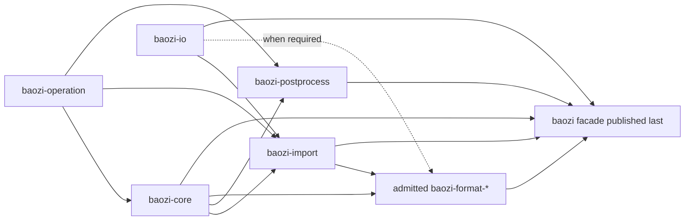
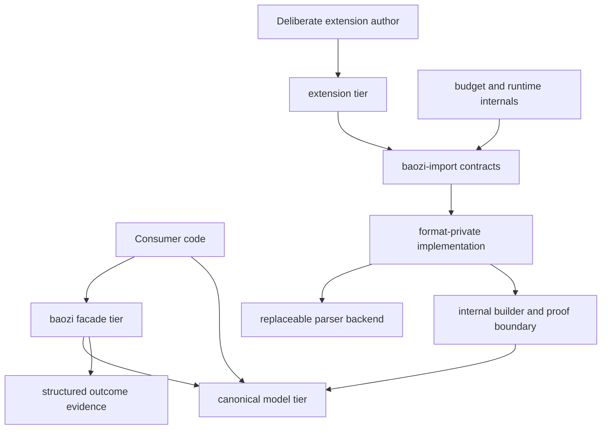

# ADR 0006: Public API, Versioning, and Crate Stability Policy

## Status and Authority

This ADR is Baozi's single authority for public compatibility promises, stability tiers, breaking
changes, crate publication, and versioning. Other ADRs may define domain semantics, ownership, or
extension behavior, but they must link here rather than create a second compatibility policy.

`Accepted` means that this decision governs new work. It does not claim that every current symbol,
crate manifest, document, or release gate already conforms. Implementation status and verification
belong in the canonical refactor plan and its evidence records, not in this durable decision.

ADR 0024 is superseded by this document. Its useful intent is incorporated here; it is not a second
source of public API rules.

## Context

Baozi needs an ergonomic Rust facade, a source-preserving canonical scene model, deliberately
extensible import infrastructure, and replaceable format backends. These surfaces have different
costs of change. Treating every `pub` item as equally stable would freeze prototype contracts;
treating every surface as indefinitely unstable would make the library unusable.

Baozi has not shipped a stable consumer contract. The canonical reset therefore replaces prototype
APIs through one atomic cutover instead of preserving them through aliases, version suffixes, or
parallel models.

## Decision

### Canonical v1 Reset

The replacement public model is canonical v1 behavior. Here, "v1" names the first coherent Baozi
contract; it does not assert that the Cargo package has reached SemVer `1.0.0`.

For this pre-release canonical reset:

- replace incorrect prototype APIs in place and delete their implementations, tests, and examples
- do not add version-suffixed replacement types or modules, version-to-version adapters,
  deprecated aliases, compatibility shims, or parallel old/new scene models
- do not retain an unpublished API solely because code in this repository used it
- land each replacement as one coherent contract, with callers and tests updated atomically in the
  same cutover
- use ordinary domain names such as `Scene`, `Importer`, and `ImportReport` for the replacement

After a public contract is actually released, the release policy below governs subsequent breaks.
This one-time reset is not permission to bypass review, evidence, or crate ownership boundaries.

### Stability Tiers

| Tier | Owned surface | Pre-release promise | Promotion requirement | Released promise |
| --- | --- | --- | --- | --- |
| Facade | common import, inspect, and process workflow from `baozi` | coherent and documented; breaks are intentional | packaged consumer test plus public docs | SemVer after declared stable |
| Canonical model | invariant-bearing scene types and read-only typed views from `baozi-core` | may break only through an accepted semantic ADR and atomic cutover | validation, snapshot, format, and public workflow evidence | SemVer for fields/types marked stable |
| Extension | custom importer, IO, option codec, and postprocess contracts in owning crates | experimental; may break without compatibility adapters | multiple real implementations, object-safety/API review, and examples | SemVer only after explicit promotion |
| Internal/backend | parser ASTs, conversion scratch data, ledgers, builders, proofs, registries, and backend helpers | no compatibility promise | not eligible; expose a narrower owned contract instead | no promise even when its crate is published |
| Test support | differs, fixtures, fuzz helpers, and snapshot internals | workspace-private by default | separate publication and stability decision | no promise unless explicitly published |

An item is not promoted merely because Rust requires it to be `pub` across workspace crate
boundaries. Stability is an explicit documented property, not a visibility inference.

### Public Facade Boundary

The `baozi` facade owns the normal workflow:

1. select a source and typed import options
2. receive a validated scene or a structured failure carrying bounded evidence
3. inspect logical meshes, primitives, attributes, materials, hierarchy, and provenance through
   canonical types
4. optionally run a typed postprocess plan and inspect its report

The facade may expose immutable descriptors and structured outcome evidence needed for this
workflow. It must not expose parser-backend types, raw probes, mutable import contexts, registry
internals, validation-proof constructors, budget ledgers, process-runtime types, native handles, or
SIMD-specific storage.

A deliberate extension entry point may refer to an experimental trait owned by another Baozi
crate. Its documentation and versioning follow the extension tier; appearing on an `Importer`
method does not silently promote the trait to facade stability.

### Construction and Invariants

- Report and descriptor families with expected future fields use constructors and read-only
  accessors rather than public struct literals.
- Canonical scene construction and validation-proof creation remain internal capabilities.
- Public structural edits use the transaction/remap contract owned by the scene-invariant ADR;
  callers cannot assign an import stage or forge validation.
- Duplicate registration and other caller-controlled conflicts return structured errors rather
  than panic.
- Public APIs expose Baozi-owned domain and error types, never third-party parser or Assimp types.

### Error and Diagnostic Compatibility

Structured categories, stable diagnostic codes, object/source paths, severity, and typed evidence
are compatibility candidates. English message prose, debug formatting, and backend-specific causes
are not compatibility identifiers.

Tests of stable contracts assert structured fields. Full-message snapshots are allowed for user
experience review but do not create a permanent message-string promise unless a separate contract
says so.

### Feature Compatibility

Documented facade features are public API only after their capability is real and promotion gates
pass. Before promotion, misleading or empty features are deleted rather than preserved.

Once released as stable:

- renaming or removing a feature is a breaking change
- changing a feature's semantics or adding material dependency/runtime cost requires release notes
- default-feature changes require an explicit compatibility review
- backend-selection features remain private to format crates and cannot change canonical semantics

Parser backend admission lives in ADR 0004, feature composition in ADR 0007, and format
maturity/evidence in ADR 0011. This ADR owns only their compatibility consequences.

### Crate Publication

Workspace decomposition does not imply independent public products. A crate remains
`publish = false` until it has a documented consumer reason, complete dependency topology, package
simulation, license metadata, public documentation, and an assigned stability tier.

The facade and every published transitive dependency must be packageable together. Internal shell
crates are deleted or kept unpublished; they are not published to make a feature graph appear
complete.

The first public product is the `baozi` facade. Its release unit is one lockstep version containing
every production package reachable from the facade through required or optional Cargo dependencies:
`baozi-operation`, `baozi-core`, `baozi-io`, `baozi-import`, `baozi-postprocess`, every admitted
first-party `baozi-format-*` package wired by a facade feature, and the facade itself. A facade feature
cannot name an unpublished registry dependency. `baozi-test-support`, `baozi-xtask`, fuzz packages,
fixtures, and reference trees are never members of this release unit without a future explicit
publication decision.

`baozi-operation` is a public supporting package because published core/import/postprocess packages
need a registry-resolvable dependency. It is not a primary end-user product or alternate facade. Its
cross-crate mechanism APIs remain Internal/backend tier unless an explicit compatibility review
promotes a narrower surface. Publication therefore makes it packageable and versioned; it does not
silently promise direct-consumer stability for every public item.

Publication follows dependency order and the facade is always last:

Before the first publish command, CI packages every member, tests the extracted packages against
registry-style dependencies, verifies license/readme/repository metadata and documentation, and
proves that the version and dependency requirements form one closed release train. After each
supporting package publish, automation verifies its immutable registry artifact before continuing.

Registry publication is not transactional, so recovery is explicit:

- on any supporting-package failure, stop immediately and do not publish the facade;
- never overwrite or rebuild an already published version, and never loosen dependency requirements
  merely to continue a partial train;
- if the remaining packages can be corrected without changing published bytes or versioned
  contracts, resume the same dependency-ordered train after registry verification;
- otherwise mark the train aborted, advance the lockstep version for every release-unit package,
  rebuild and reverify the complete train, then publish the replacement train from the leaves;
- an orphaned supporting version may be yanked only with a recorded reason after a usable replacement
  exists; yanking is not rollback and cannot justify reusing that version; and
- if a faulty facade was already published, recovery is a new SemVer release and release note, never
  mutation of the published artifact.

### Release Versioning

Before the first public release:

- breaking changes are allowed and should favor the correct canonical design
- the old prototype is deleted instead of deprecated
- the architecture plan and Conventional Commits provide implementation history

For published `0.x` releases:

- user-visible breaks are intentional, called out in the changelog, and shipped in an appropriate
  minor release
- no stability tier is promoted implicitly
- short deprecation windows are optional when replacement is genuinely useful; they are not
  required for an incorrect or unsafe experimental contract
- release-unit package versions move in lockstep; a supporting crate cannot drift ahead or behind the
  facade train even when its direct-consumer surface remains experimental

After `1.0.0`:

- stable facade, canonical-model surfaces, promoted extension contracts, documented features, and
  published crate topology follow SemVer
- removals normally follow deprecation and replacement guidance
- exceptions require a security or correctness rationale, an ADR, and explicit release notes

## Architecture

Compatibility flows outward only through owned contracts. Internal visibility does not flow a
stability promise back to consumers.

## Alternatives Considered

### Option A: Preserve the prototype alongside version-suffixed replacements

Pros:

- minimizes immediate call-site churn
- permits old and new models to coexist temporarily

Cons:

- doubles the model, validation, documentation, and test surface
- creates adapters that can silently lose semantics
- spends compatibility budget on an unpublished contract

Decision: rejected. Baozi performs one canonical v1 replacement and deletes the prototype.

### Option B: Treat every public workspace item as stable

Pros:

- simple rule for users to understand
- enables early third-party extension work

Cons:

- Rust cross-crate visibility accidentally freezes internal mechanics
- makes resource, proof, and backend boundaries expensive to correct
- prevents format evidence from shaping extension contracts

Decision: rejected. Stability is assigned by tier and explicit promotion.

### Option C: Keep every API unstable until `1.0`

Pros:

- maximum refactoring freedom
- minimal release process before `1.0`

Cons:

- gives early consumers no dependable common workflow
- obscures which breaks are architectural and which are accidental
- delays packaging and documentation discipline

Decision: rejected. The facade and canonical model earn stability progressively.

### Option D: Tiered stability with an atomic canonical v1 reset

Pros:

- fixes the model while Baozi has no stable consumers
- gives common workflows a smaller, reviewable contract
- keeps parser and extension internals replaceable
- provides a clear path to SemVer stability

Cons:

- requires explicit promotion evidence and documentation ownership
- downstream prototype users must update without a compatibility adapter

Decision: chosen.

## Consequences

Positive:

- the project can make necessary breaking corrections without carrying two architectures
- consumers can distinguish supported workflows from merely public workspace mechanics
- backend replacement does not determine public versioning
- stability promotion becomes an evidence-backed engineering decision

Negative:

- prototype call sites and tests must be updated atomically as part of the cutover
- extension authors accept churn until their contracts are promoted
- release tooling must understand features, crate topology, and API tiers

## Risks and Mitigations

| Risk | Severity | Likelihood | Mitigation |
| --- | --- | --- | --- |
| A second ADR recreates a compatibility policy | High | Medium | ADR index/checker treats this ADR as the sole authority and requires links from related decisions |
| A `pub` internal type is mistaken for stable API | High | High | Crate docs label tiers; package/API review checks facade and published crates |
| Canonical reset leaves old aliases or dual storage | High | Medium | Repository-wide source, API, documentation, and package gates reject replacement suffixes, adapters, legacy symbols, and duplicate models |
| Facade exposes proof, ledger, or backend details | High | Medium | Compile-fail tests and public API review enforce construction/capability boundaries |
| Experimental users are surprised by a break | Medium | High | Mark extension tiers explicitly and record user-visible `0.x` breaks after publication |
| Feature names promise unavailable behavior | Medium | Medium | Promotion requires executable feature and packaged-consumer evidence; delete empty features |
| Registry publish fails after supporting crates are immutable | High | Medium | publish in dependency order with facade last; stop the train, never reuse bytes/version, and advance the complete lockstep train when same-version recovery is impossible |
| Supporting package visibility is mistaken for product stability | High | Medium | identify `baozi-operation` and similar crates as packageable support with Internal/backend-tier APIs until explicit promotion |

## Acceptance Criteria

| Contract | Measurable evidence |
| --- | --- |
| One authority | ADR checker finds exactly one accepted public compatibility authority and resolves ADR 0024's `superseded_by` link |
| No parallel compatibility model | repository search and API baseline contain no version-suffixed replacement, old/new adapter, or duplicate Scene model |
| Facade boundary | public API review exposes the common workflow and bounded evidence without registry, probe, context, proof-construction, or ledger internals |
| Invariant boundary | compile-fail tests prove callers cannot forge validation or directly publish an invalid structural edit |
| Backend isolation | public API and rustdoc contain no third-party parser or Assimp implementation types |
| Feature truthfulness | each documented feature has observable behavior and passes its isolated test/package gate |
| Release readiness | packaged consumer imports, inspects, and optionally processes a scene using only canonical v1 names |
| Closed release topology | package simulation proves every required and optional facade dependency is registry-publishable at one lockstep version, with licenses, metadata, docs, and extracted-package tests |
| Failure recovery | release automation publishes the facade last and a dry-run fault injection proves a partial supporting train cannot publish the facade or cause version drift/reuse |

## Implementation Evidence

Conformance is demonstrated through the following durable evidence locations. Their contents record
implementation state but do not alter this decision's authority:

- [Canonical architecture refactor plan](../plans/2026-07-10-001-refactor-baozi-canonical-architecture-plan.md)
- [Facade source](../../crates/baozi/src/lib.rs)
- [Import contracts](../../crates/baozi-import/src/lib.rs)
- [Core scene contracts](../../crates/baozi-core/src/lib.rs)
- [Engineering memory index](../knowledge/engineering/index.md)

Transient pass/fail counts, current symbol gaps, and work-unit completion belong in those evidence
records. They must not change this ADR's accepted decision status.
