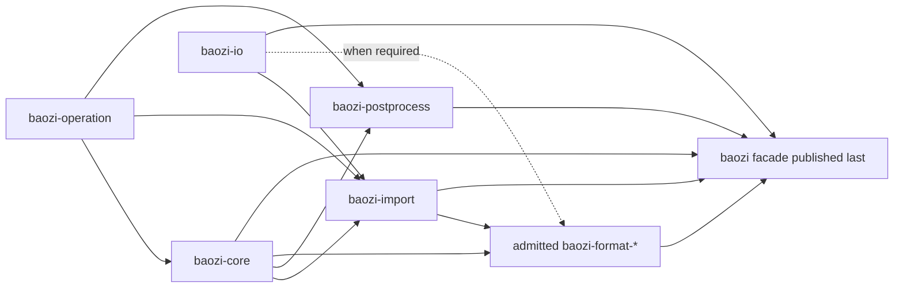
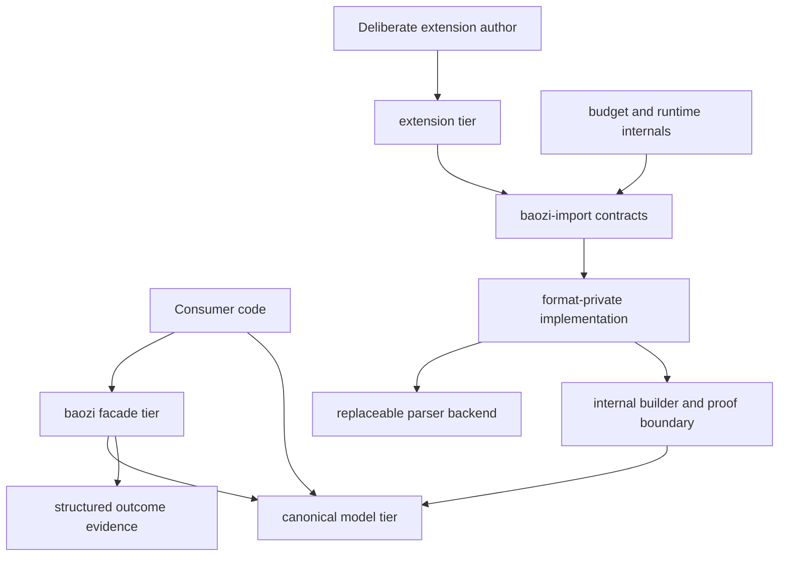

# ADR 0006: Public API, Versioning, and Crate Stability Policy

## Status and Authority

This ADR is Baozi's single authority for public compatibility promises, stability tiers, breaking
changes, crate publication, and versioning. Other ADRs may define domain semantics, ownership, or
extension behavior, but they must link here rather than create a second compatibility policy.

`Accepted` means that this decision governs new work. It does not claim that every current symbol,
crate manifest, document, or release gate already conforms. Implementation status and verification
belong in the canonical refactor plan and its evidence records, not in this durable decision.

ADR 0024 is superseded by this document. Its useful intent is incorporated here; it is not a second
source of public API rules.

## Context

Baozi needs an ergonomic Rust facade, a source-preserving canonical scene model, deliberately
extensible import infrastructure, and replaceable format backends. These surfaces have different
costs of change. Treating every `pub` item as equally stable would freeze prototype contracts;
treating every surface as indefinitely unstable would make the library unusable.

Baozi has not shipped a stable consumer contract. The canonical reset therefore replaces prototype
APIs through one atomic cutover instead of preserving them through aliases, version suffixes, or
parallel models.

## Decision

### Canonical v1 Reset

The replacement public model is canonical v1 behavior. Here, "v1" names the first coherent Baozi
contract; it does not assert that the Cargo package has reached SemVer `1.0.0`.

For this pre-release canonical reset:

- replace incorrect prototype APIs in place and delete their implementations, tests, and examples
- do not add version-suffixed replacement types or modules, version-to-version adapters,
  deprecated aliases, compatibility shims, or parallel old/new scene models
- do not retain an unpublished API solely because code in this repository used it
- land each replacement as one coherent contract, with callers and tests updated atomically in the
  same cutover
- use ordinary domain names such as `Scene`, `Importer`, and `ImportReport` for the replacement

After a public contract is actually released, the release policy below governs subsequent breaks.
This one-time reset is not permission to bypass review, evidence, or crate ownership boundaries.

### Stability Tiers

| Tier | Owned surface | Pre-release promise | Promotion requirement | Released promise |
| --- | --- | --- | --- | --- |
| Facade | common import, inspect, and process workflow from `baozi` | coherent and documented; breaks are intentional | packaged consumer test plus public docs | SemVer after declared stable |
| Canonical model | invariant-bearing scene types and read-only typed views from `baozi-core` | may break only through an accepted semantic ADR and atomic cutover | validation, snapshot, format, and public workflow evidence | SemVer for fields/types marked stable |
| Extension | custom importer, IO, option codec, and postprocess contracts in owning crates | experimental; may break without compatibility adapters | multiple real implementations, object-safety/API review, and examples | SemVer only after explicit promotion |
| Internal/backend | parser ASTs, conversion scratch data, ledgers, builders, proofs, registries, and backend helpers | no compatibility promise | not eligible; expose a narrower owned contract instead | no promise even when its crate is published |
| Test support | differs, fixtures, fuzz helpers, and snapshot internals | workspace-private by default | separate publication and stability decision | no promise unless explicitly published |

An item is not promoted merely because Rust requires it to be `pub` across workspace crate
boundaries. Stability is an explicit documented property, not a visibility inference.

### Public Facade Boundary

The `baozi` facade owns the normal workflow:

1. select a source and typed import options
2. receive a validated scene or a structured failure carrying bounded evidence
3. inspect logical meshes, primitives, attributes, materials, hierarchy, and provenance through
   canonical types
4. optionally run a typed postprocess plan and inspect its report

The facade may expose immutable descriptors and structured outcome evidence needed for this
workflow. It must not expose parser-backend types, raw probes, mutable import contexts, registry
internals, validation-proof constructors, budget ledgers, process-runtime types, native handles, or
SIMD-specific storage.

A deliberate extension entry point may refer to an experimental trait owned by another Baozi
crate. Its documentation and versioning follow the extension tier; appearing on an `Importer`
method does not silently promote the trait to facade stability.

### Construction and Invariants

- Report and descriptor families with expected future fields use constructors and read-only
  accessors rather than public struct literals.
- Canonical scene construction and validation-proof creation remain internal capabilities.
- Public structural edits use the transaction/remap contract owned by the scene-invariant ADR;
  callers cannot assign an import stage or forge validation.
- Duplicate registration and other caller-controlled conflicts return structured errors rather
  than panic.
- Public APIs expose Baozi-owned domain and error types, never third-party parser or Assimp types.

### Error and Diagnostic Compatibility

Structured categories, stable diagnostic codes, object/source paths, severity, and typed evidence
are compatibility candidates. English message prose, debug formatting, and backend-specific causes
are not compatibility identifiers.

Tests of stable contracts assert structured fields. Full-message snapshots are allowed for user
experience review but do not create a permanent message-string promise unless a separate contract
says so.

### Feature Compatibility

Documented facade features are public API only after their capability is real and promotion gates
pass. Before promotion, misleading or empty features are deleted rather than preserved.

Once released as stable:

- renaming or removing a feature is a breaking change
- changing a feature's semantics or adding material dependency/runtime cost requires release notes
- default-feature changes require an explicit compatibility review
- backend-selection features remain private to format crates and cannot change canonical semantics

Parser backend admission lives in ADR 0004, feature composition in ADR 0007, and format
maturity/evidence in ADR 0011. This ADR owns only their compatibility consequences.

### Crate Publication

Workspace decomposition does not imply independent public products. A crate remains
`publish = false` until it has a documented consumer reason, complete dependency topology, package
simulation, license metadata, public documentation, and an assigned stability tier.

The facade and every published transitive dependency must be packageable together. Internal shell
crates are deleted or kept unpublished; they are not published to make a feature graph appear
complete.

The first canonical product is the `baozi` facade. Its release unit is one lockstep version containing
every production package reachable from the facade through required or optional Cargo dependencies:
`baozi-operation`, `baozi-core`, `baozi-io`, `baozi-import`, `baozi-postprocess`, every admitted
first-party `baozi-format-*` package wired by a facade feature, and the facade itself. A facade feature
cannot name an unpublished registry dependency. `baozi-test-support`, `baozi-xtask`, fuzz packages,
fixtures, and reference trees are never members of this release unit without a future explicit
publication decision.

`baozi-operation` is a public supporting package because published core/import/postprocess packages
need a registry-resolvable dependency. It is not a primary end-user product or alternate facade. Its
cross-crate mechanism APIs remain Internal/backend tier unless an explicit compatibility review
promotes a narrower surface. Publication therefore makes it packageable and versioned; it does not
silently promise direct-consumer stability for every public item.

### Existing Registry State and Canonical Release Train

The crates.io registry already contains `baozi 0.0.1`, published on 2026-07-09 with placeholder
metadata and no supporting release train. That immutable artifact is not the canonical v1 contract,
does not establish compatibility for the current workspace, and must never be overwritten, rebuilt,
or reused. Before the first canonical train, release automation must record its noncanonical status
and yank it; yanking is a discovery control, not deletion or rollback. The canonical train starts at
the repository's current lockstep version (currently `0.1.0`) and publishes only the closed package
set proven by the package simulation.

U9 must create `docs/release/registry-state.toml` as the sole expected-state authority for a release.
The reviewed manifest binds its schema version, registry identity, release version/tag, full source
commit SHA, and complete release-unit package set. Each package entry records expected presence,
registry-stable owner kind/ID set, credential route, maximum token TTL, and the complete approved
Trusted Publisher configuration set when OIDC is allowed. Display names are documentary only. The
release workflow must prove the tag and checkout SHA match the manifest, exhaust all paginated owner
and publisher results, and reject missing, duplicate, unknown, extra, or stale entries. Until this
manifest and its validator exist, publication is disabled; live state can never define its own
expected value.

Registry authentication is scoped to the registry state rather than a blanket "first release"
assumption:

- before publishing the first package, one complete preflight queries every release-unit name and
  current owner set; every name must be absent as expected or owned exactly as approved, and any
  unexpected occupation, owner drift, timeout, or partial response stops the train before an
  immutable upload;
- immediately before each upload, automation repeats the exact-name and owner check for that
  package; the initial preflight reduces avoidable partial trains but does not reserve a crates.io
  name, so a late occupation still stops the train and enters the documented partial-train recovery
  path;
- the first publication of each supporting crate name that is not already present requires an
  explicitly approved crates.io API token with endpoint scope `publish-new`, an exact crate-name
  scope, and an expiry; supporting crates cannot rely on an OIDC relationship that does not yet
  exist;
- the existing `baozi` package may use crates.io Trusted Publishing/OIDC for a later canonical
  version only after the complete live publisher configuration set exactly matches the manifest and
  a token exchange verifies the selected repository owner, repository, workflow, and environment;
  crate owner identity and repository owner identity remain distinct fields, and inability to
  enumerate the complete configured set blocks all publication unless an independently protected,
  equally current complete snapshot can be exhaustively compared; an exact-crate token fallback is
  allowed only after set equality succeeds, a typed service-availability failure occurs before token
  issuance, and the protected release environment records an approval; any claim, binding,
  configuration, or authentication rejection stops the train;
- yanking uses a separate expiring exact-crate `yank` token; wildcard crate scopes, unrelated
  endpoint scopes, and no-expiry credentials are forbidden; API tokens have a manifest-declared
  maximum TTL no greater than 24 hours, and an `always()` cleanup attempts and verifies immediate
  revocation; cancellation, runner loss, or registry outage cannot be called a successful revoke,
  so an unverified cleanup blocks later publication, emits an alert, and requires confirmed manual
  revocation or expiry before another credential is used;
- tokens never enter the repository, workflow logs, or package metadata, and a failed token/OIDC
  authentication stops the train before the facade or any later package is published; and
- an OIDC setup is not evidence of artifact reproducibility or provenance by itself.

The mandatory pre-release evidence is package topology, lockstep versions, extracted-package
consumer tests, metadata/license checks, and immutable registry-artifact verification. U9 evaluates
cryptographic provenance/attestation, SBOM, signatures, and reproducible-build claims as separate
release-evidence axes. A tool or format that cannot provide stable, reviewable evidence is not made a
hard gate merely because it is available in a particular CI image.

Publication follows dependency order and the facade is always last:

Before the first publish command, CI packages every member, tests the extracted packages against
registry-style dependencies, verifies license/readme/repository metadata and documentation, and
proves that the version and dependency requirements form one closed release train. After each
supporting package publish, automation verifies its immutable registry artifact before continuing.
Packaging and upload both use the lockfile; the real command is
`cargo publish --locked --registry crates-io -p <crate>`. Automation records the local `.crate`
SHA-256, then uses bounded retries to download the exact published `.crate`. The downloaded archive
SHA-256, registry checksum, and local archive SHA-256 must all match before the next package starts;
metadata equality without the consumer-visible archive is insufficient.
The historical API response fingerprint for `baozi 0.0.1` is documentary only: live checks compare
its immutable version/archive tuple and query mutable yank/owner state independently.

Registry publication is not transactional, so recovery is explicit:

- on any supporting-package failure, stop immediately and do not publish the facade;
- never overwrite or rebuild an already published version, and never loosen dependency requirements
  merely to continue a partial train;
- if the remaining packages can be corrected without changing published bytes or versioned
  contracts, resume the same dependency-ordered train after registry verification;
- otherwise mark the train aborted, advance the lockstep version for every release-unit package,
  rebuild and reverify the complete train, then publish the replacement train from the leaves;
- an orphaned supporting version may be yanked only with a recorded reason after a usable replacement
  exists; yanking is not rollback and cannot justify reusing that version; and
- if a faulty facade was already published, recovery is a new SemVer release and release note, never
  mutation of the published artifact.

### Release Versioning

Before the first canonical release train (the existing placeholder version is excluded):

- breaking changes are allowed and should favor the correct canonical design
- the old prototype is deleted instead of deprecated
- the architecture plan and Conventional Commits provide implementation history

For published `0.x` releases:

- user-visible breaks are intentional, called out in the changelog, and shipped in an appropriate
  minor release
- no stability tier is promoted implicitly
- short deprecation windows are optional when replacement is genuinely useful; they are not
  required for an incorrect or unsafe experimental contract
- release-unit package versions move in lockstep; a supporting crate cannot drift ahead or behind the
  facade train even when its direct-consumer surface remains experimental

After `1.0.0`:

- stable facade, canonical-model surfaces, promoted extension contracts, documented features, and
  published crate topology follow SemVer
- removals normally follow deprecation and replacement guidance
- exceptions require a security or correctness rationale, an ADR, and explicit release notes

## Architecture

Compatibility flows outward only through owned contracts. Internal visibility does not flow a
stability promise back to consumers.

## Alternatives Considered

### Option A: Preserve the prototype alongside version-suffixed replacements

Pros:

- minimizes immediate call-site churn
- permits old and new models to coexist temporarily

Cons:

- doubles the model, validation, documentation, and test surface
- creates adapters that can silently lose semantics
- spends compatibility budget on an unpublished contract

Decision: rejected. Baozi performs one canonical v1 replacement and deletes the prototype.

### Option B: Treat every public workspace item as stable

Pros:

- simple rule for users to understand
- enables early third-party extension work

Cons:

- Rust cross-crate visibility accidentally freezes internal mechanics
- makes resource, proof, and backend boundaries expensive to correct
- prevents format evidence from shaping extension contracts

Decision: rejected. Stability is assigned by tier and explicit promotion.

### Option C: Keep every API unstable until `1.0`

Pros:

- maximum refactoring freedom
- minimal release process before `1.0`

Cons:

- gives early consumers no dependable common workflow
- obscures which breaks are architectural and which are accidental
- delays packaging and documentation discipline

Decision: rejected. The facade and canonical model earn stability progressively.

### Option D: Tiered stability with an atomic canonical v1 reset

Pros:

- fixes the model while Baozi has no stable consumers
- gives common workflows a smaller, reviewable contract
- keeps parser and extension internals replaceable
- provides a clear path to SemVer stability

Cons:

- requires explicit promotion evidence and documentation ownership
- downstream prototype users must update without a compatibility adapter

Decision: chosen.

## Consequences

Positive:

- the project can make necessary breaking corrections without carrying two architectures
- consumers can distinguish supported workflows from merely public workspace mechanics
- backend replacement does not determine public versioning
- stability promotion becomes an evidence-backed engineering decision

Negative:

- prototype call sites and tests must be updated atomically as part of the cutover
- extension authors accept churn until their contracts are promoted
- release tooling must understand features, crate topology, and API tiers

## Risks and Mitigations

| Risk | Severity | Likelihood | Mitigation |
| --- | --- | --- | --- |
| A second ADR recreates a compatibility policy | High | Medium | ADR index/checker treats this ADR as the sole authority and requires links from related decisions |
| A `pub` internal type is mistaken for stable API | High | High | Crate docs label tiers; package/API review checks facade and published crates |
| Canonical reset leaves old aliases or dual storage | High | Medium | Repository-wide source, API, documentation, and package gates reject replacement suffixes, adapters, legacy symbols, and duplicate models |
| Facade exposes proof, ledger, or backend details | High | Medium | Compile-fail tests and public API review enforce construction/capability boundaries |
| Experimental users are surprised by a break | Medium | High | Mark extension tiers explicitly and record user-visible `0.x` breaks after publication |
| Feature names promise unavailable behavior | Medium | Medium | Promotion requires executable feature and packaged-consumer evidence; delete empty features |
| Registry publish fails after supporting crates are immutable | High | Medium | publish in dependency order with facade last; stop the train, never reuse bytes/version, and advance the complete lockstep train when same-version recovery is impossible |
| Supporting package visibility is mistaken for product stability | High | Medium | identify `baozi-operation` and similar crates as packageable support with Internal/backend-tier APIs until explicit promotion |
| The existing placeholder package is mistaken for the canonical contract | Critical | High | record and yank `baozi 0.0.1` before the canonical train, never reuse its version, and require the lockstep package simulation to start from the new train |
| A release-unit name changes after the initial preflight | Critical | Low | preflight every name and exact owner set before the first upload, recheck the current package immediately before upload, stop on drift, and use partial-train recovery because crates.io offers no name reservation |
| Expected owners or credential routes are inferred from mutable live state | Critical | Medium | require a reviewed tag/commit-bound registry-state manifest with exhaustive stable owner IDs and fail closed on missing or incomplete pagination |
| First-publication authentication is unavailable or overprivileged | High | Medium | use exact-crate scoped credentials with a maximum 24-hour TTL, verify best-effort immediate revocation, block after unverified cleanup, and allow OIDC only when the complete publisher configuration set matches the manifest |
| A live mutable API response is compared with a historical byte digest | High | High | normalize the captured immutable tuple, check live yank/owners separately, and never use the raw response fingerprint as a live equality gate |
| Registry metadata matches while the downloadable archive is absent or wrong | Critical | Low | bounded-retry the exact archive download and require local archive, registry checksum, and downloaded bytes to have one SHA-256 |
| Provenance/SBOM/signing tooling drifts or is unavailable | Medium | Medium | keep these as separate U9 evidence decisions with pinned tool/input records; do not make an unstable tool an implicit publication blocker |

## Acceptance Criteria

| Contract | Measurable evidence |
| --- | --- |
| One authority | ADR checker finds exactly one accepted public compatibility authority and resolves ADR 0024's `superseded_by` link |
| No parallel compatibility model | repository search and API baseline contain no version-suffixed replacement, old/new adapter, or duplicate Scene model |
| Facade boundary | public API review exposes the common workflow and bounded evidence without registry, probe, context, proof-construction, or ledger internals |
| Invariant boundary | compile-fail tests prove callers cannot forge validation or directly publish an invalid structural edit |
| Backend isolation | public API and rustdoc contain no third-party parser or Assimp implementation types |
| Feature truthfulness | each documented feature has observable behavior and passes its isolated test/package gate |
| Release readiness | packaged consumer imports, inspects, and optionally processes a scene using only canonical v1 names |
| Closed release topology | package simulation proves every required and optional facade dependency is registry-publishable at one lockstep version, with licenses, metadata, docs, and extracted-package tests |
| Failure recovery | release automation publishes the facade last and a dry-run fault injection proves a partial supporting train cannot publish the facade or cause version drift/reuse |
| Registry state | a tag/commit-bound machine manifest is the sole expected-state authority for the complete release unit; normalized exact-version evidence records the immutable `baozi 0.0.1` version/archive tuple without treating mutable live JSON bytes as stable; a separate live check proves it is yanked immediately before the `0.1.0` train, and no workflow targets the old version |
| Name preflight and upload-time recheck | before the first upload, workflow tests query every release-unit name and exact owner set, so failures visible then produce zero publications; every upload repeats its exact-name/owner check, and an injected late race stops before that upload, with any earlier immutable packages handled by partial-train recovery |
| Authentication boundary | workflow tests prove a never-published supporting crate can reach only an exact-crate `publish-new` job with at most a 24-hour TTL, update/yank jobs use distinct endpoint scopes, unverified cleanup blocks later publication, and an existing package may select OIDC only after exhaustive publisher-set equality plus a successful exact-bound exchange; wildcard/no-expiry/excess-scope credentials fail |
| Locked artifact identity | package and real publish commands use `--locked`; dry-run is never authentication evidence; each upload records the local `.crate` SHA-256 and requires exact owner/version plus equality of local archive, registry checksum, and bounded-retry downloaded archive before continuing |
| Evidence-axis separation | attestation, SBOM, signatures, and reproducibility are each represented by an explicit U9 gate or documented deferral and cannot be inferred from successful publication |

## Implementation Evidence

Conformance is demonstrated through the following durable evidence locations. Their contents record
implementation state but do not alter this decision's authority:

- [Canonical architecture refactor plan](../plans/2026-07-10-001-refactor-baozi-canonical-architecture-plan.md)
- [Facade source](../../crates/baozi/src/lib.rs)
- [Import contracts](../../crates/baozi-import/src/lib.rs)
- [Core scene contracts](../../crates/baozi-core/src/lib.rs)
- [Engineering memory index](../knowledge/engineering/index.md)

Transient pass/fail counts, current symbol gaps, and work-unit completion belong in those evidence
records. They must not change this ADR's accepted decision status.

## Amendment History

### 2026-07-17: Account for the existing placeholder registry artifact

- Affected: `Crate Publication`, `Existing Registry State and Canonical Release Train`,
  `Release Versioning`, `Risks and Mitigations`, and
  `Acceptance Criteria`.
- Previous: the policy described the next release as the first public product and assumed every
  package name was absent from crates.io.
- New: `baozi 0.0.1` is recorded as an immutable, noncanonical placeholder; the canonical train
  begins at `0.1.0`; a tag/commit-bound manifest supplies the expected registry state; every
  release-unit name/owner is preflighted before the train and rechecked before its upload; API tokens
  use expiring exact-crate endpoint scopes with bounded TTL and verified cleanup; an existing facade
  name may use Trusted Publishing only after exhaustive configuration-set equality; real publication
  is locked and verified by local, registry, and downloaded archive equality.
- Impact: no published bytes or version is reused, discoverable name conflicts move before the train,
  late races stop at the affected upload and use explicit partial-train recovery, unknown publisher
  authority cannot be bypassed by changing credentials, and authentication/artifact/provenance
  evidence axes remain distinct.
- Review: 2026-07-17 crates.io registry-state and release-governance review.
- Rationale: registry publication is irreversible and non-transactional. Discoverable
  name/owner/authentication failures must move before the first upload, each name must be rechecked
  at its upload boundary, and every published byte identity must be checked before advancing the
  dependency train.

## External Evidence

- [Captured crates.io `baozi 0.0.1` registry evidence](../research/crates-io-baozi-0.0.1-registry-evidence.md)
  records the [exact-version API](https://crates.io/api/v1/crates/baozi/0.0.1), 2026-07-17 retrieval
  date, `1388` UTF-8 response bytes,
  response SHA-256 `afd7d3d57fb9503fc745ac247d7d260f3cb0a06f665ce2fb51e563590e46bff2`,
  and immutable `.crate` SHA-256
  `e74b14d1e2410f8a062bb423f7bbc8bc9fdaa9cf4ac64b10efccc562d62bbd28`. The API body contains
  mutable fields and is only a time-point snapshot; yank status remains a release-time live check.
  The same evidence record captures official Cargo initial-publication guidance and fixed crates.io
  Trusted Publishing documentation supporting the conditional token/OIDC routing above. Its
  [normalized TOML manifest](../research/crates-io-baozi-0.0.1-registry-evidence.toml) separates the
  immutable tuple from mutable observations. The crates.io source at fixed commit
  `e9c29a333bcb7c14e82adb59309e0220a771648a` defines `publish-new`, `publish-update`, and `yank`
  endpoint scopes, crate-name patterns, and token expiry; Baozi narrows crate patterns to exact names.
