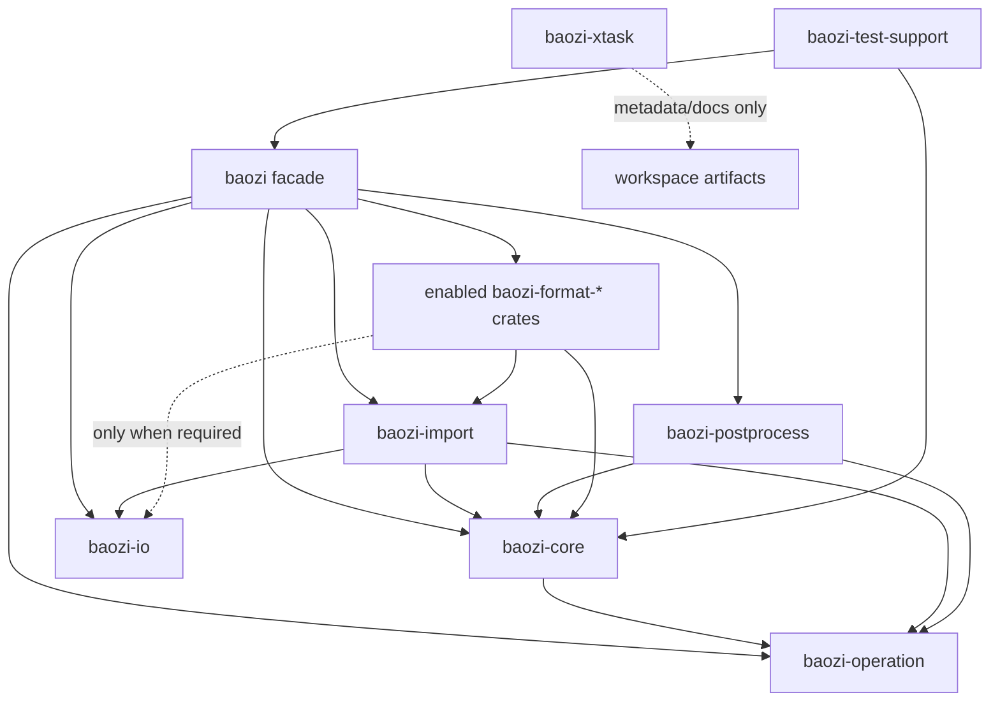

# ADR 0007: Workspace Crate Graph, Feature Membership, MSRV, and CI Gates

## Status and Authority

This accepted ADR is the sole authority for production workspace dependency direction, facade
feature membership, aggregate-feature algebra, the minimum supported Rust version (MSRV), and the
baseline CI gates that protect those contracts.

Acceptance defines the target contract. It does not claim that today's manifest or workflow is
already complete; implementation status and exact verification results belong in linked evidence.
Public compatibility consequences are governed by ADR 0006, format maturity by ADR 0011, parser
backend admission by ADR 0004, and target tiers by ADR 0034.

## Context

Baozi's format breadth requires optional dependencies, but Cargo features are additive and easily
drift from documentation. An `all-formats` feature that omits experimental first-party formats is
not "all". A default set that automatically grows with every new parser is equally misleading.
Backend selector features in the facade would also leak implementation choices into public API.

Crate boundaries have the same problem: workspace visibility can become an accidental dependency
cycle or publish contract unless ownership and direction are explicit. CI must derive checks from
the declared graph rather than rely on a few hand-maintained feature combinations.

## Decision

Baozi uses a focused Cargo workspace with resolver `3`, Rust edition `2024`, and workspace MSRV
`1.95`. The workspace may contain only implemented production responsibilities and development
tools; future shells are not created to reserve names.

### Production Dependency Direction



Hard rules:

- `baozi-operation` is a runtime-neutral dependency leaf. It owns control, coordinator, checked
  reservation, and ledger state-machine mechanisms; it depends on no upward Baozi production crate
  and owns no domain phase, policy, dimension, report, outcome, Scene, IO, scheduler, or worker pool.
- `baozi-core` may depend only on `baozi-operation` among Baozi production crates; it has no
  dependency on IO, import, postprocess, format, runtime, or parser crates and owns only
  canonical/domain errors.
- `baozi-io` owns asset identities, IO capabilities, and `IoError`; it has no production Baozi-crate
  dependency and must not reuse a core or facade aggregate error as its error type.
- `baozi-import` depends on core, IO, and operation, maps their distinct errors into import causes,
  supplies import-owned ledger semantics to the shared mechanism, and does not depend on concrete
  format crates.
- `baozi-postprocess` depends on core, operation, and private algorithm backends; it supplies its own
  ledger semantics and does not depend on import, IO, or formats.
- each `baozi-format-*` crate depends only on core/import and IO when its source contract requires
  dependency access; it does not depend on the facade or postprocess.
- the facade composes core, IO, import, postprocess, and enabled first-party formats.
- production crates never depend on `baozi-test-support`, fuzz packages, xtask, examples, or CLI
  tools.
- no workspace production dependency cycle is allowed.

Archive/container and exporter crates are not created until their own accepted ADR and
implementation tracer make the responsibility active. Workspace decomposition does not by itself
authorize publication; ADR 0006 owns package stability and publication.

### First-Party Format Inventory

A first-party format is a Baozi-owned production format crate present in the structured format
inventory and registered by the facade through a corresponding `format-<id>` feature. Parser shells
without real import behavior are deleted and do not qualify as inventory entries.

First-party inventory admission precedes maturity classification. A parser or backend known to fail
ADR 0004/0014 baseline hostile-data safety must be disabled and unregistered, rejected, or isolated
outside the first-party inventory. Labeling that path Experimental does not admit it. Experimental is
a state for safely admitted behavior that still lacks non-safety maturity evidence.

The inventory, facade manifest, built-in registration, format descriptor, support evidence, and CI
matrix must be machine-checked as one relation. Adding or removing a first-party format updates all
of them in the same change.

### Feature Algebra

Let `F` be the set of every first-party `format-<id>` feature in the structured inventory and `D`
the curated default-format subset.

The facade must satisfy:

```text
all-formats     = F
default-formats = D
D               subset-of F
```

Normative consequences:

- `all-formats` literally enables every admitted first-party format, including safely admitted
  Experimental and Beta formats; maturity never changes the meaning of "all"
- a disabled, rejected, or process-isolated backend that fails baseline safety is not a member of
  `F`; excluding it is an admission decision, not a maturity-based omission from `all-formats`
- `default-formats` is curated independently and changes only when ADR 0011 evidence and release
  review justify membership
- `default-formats` must not alias `all-formats`
- each format feature enables exactly its matching optional format dependency and built-in
  registration path; it does not silently enable another format
- aggregate format features do not implicitly enable filesystem, tracing, serialization, runtime,
  SIMD, or backend-selection capabilities
- backend implementation features are private to an unpublished format crate when unavoidable and
  are never forwarded by the facade
- a public capability feature exists only when it has observable dependency, API, or behavior
  impact plus an isolated test; empty/planned features are deleted
- no feature may silently change canonical scene semantics

`all-features` is Cargo's mechanical union of every facade feature and is not an alias for
`all-formats`. CI exercises both because integration capabilities can interact with format
features.

### Feature and Target Separation

Format membership is independent of platform support. `all-formats` stays complete on every target;
unsupported platform behavior must be expressed by an explicit target-tier decision, compile gate,
or a separate non-first-party integration package, not by quietly omitting a format from the
aggregate feature.

Filesystem convenience is a capability separate from byte/memory import. Browser-WASM builds use
the byte path without native filesystem assumptions. Target-specific APIs and gates are owned by
ADR 0034.

### MSRV

The workspace declares:

```text
edition = 2024
rust-version = 1.95
```

- every production and development dependency is checked against the declared MSRV
- stable Rust and the declared MSRV are both CI inputs once they differ
- before `1.0`, an MSRV raise requires a concrete benefit and changelog/release note
- after `1.0`, an MSRV raise is a reviewed compatibility change under ADR 0006
- a dependency must not raise the effective MSRV without manifest and CI changes in the same commit

### CI Contract

Fast pull-request gates cover formatting, all targets in the workspace, strict linting, default and
all-feature tests, doctests/rustdoc, no-default facade, each individual format feature, aggregate
features, declared target tiers, dependency/license policy, and ADR/feature graph checks.

Long-running powerset, sanitizer, scale, and package campaigns may be partitioned into scheduled or
promotion workflows, but their evidence remains mandatory for the maturity/release decision that
claims it. Moving a gate to a slower workflow does not delete the contract.

The feature checker must prove negative cases in tests, including:

- a first-party format missing from `all-formats`
- an aggregate feature naming a nonexistent or non-format member
- a format feature missing its optional dependency or registration
- `default-formats` containing a non-inventory member
- a public empty feature
- a facade backend-selector feature

## Alternatives Considered

### Option A: Hand-maintain default and all-format lists without a checked inventory

Pros:

- minimal tooling
- ordinary Cargo syntax remains the only input

Cons:

- manifests, registration, docs, and CI drift independently
- omissions remain invisible when existing tests are green

Decision: rejected.

### Option B: Define `all-formats` as only mature or portable formats

Pros:

- aggregate builds remain smaller and less risky
- users avoid experimental dependencies

Cons:

- contradicts the name and makes maturity changes alter feature meaning
- leaves some first-party combinations untested
- conflates target support, defaults, and complete inventory

Decision: rejected. Curated behavior belongs to `default-formats`.

### Option C: Expose parser backend selectors through facade features

Pros:

- advanced users can choose implementation trade-offs
- backend comparisons are easy to invoke

Cons:

- leaks private architecture into the public feature contract
- multiplies the feature powerset and permits semantic drift

Decision: rejected. A future user-selectable backend needs a separate accepted public contract.

### Option D: Checked feature algebra over an explicit first-party inventory

Pros:

- gives aggregate names literal, testable meaning
- keeps defaults curated without hiding formats
- aligns manifests, registration, evidence, and CI
- catches drift before release

Cons:

- requires xtask metadata and negative tests
- every first-party format change touches several checked artifacts

Decision: chosen.

## Consequences

Positive:

- crate ownership is mechanically reviewable
- every first-party format is reachable and exercised through `all-formats`
- default membership remains an intentional product/reliability choice
- parser backend swaps do not become facade features
- MSRV and feature costs are visible before release

Negative:

- aggregate all-format builds grow with the first-party inventory
- feature/registration/evidence changes must land atomically
- CI requires both fast representative gates and slower complete campaigns

## Risks and Mitigations

| Risk | Severity | Likelihood | Mitigation |
| --- | --- | --- | --- |
| `all-formats` silently omits a new crate | High | High | derive exact set equality from structured inventory in xtask |
| Experimental is mistaken for a safety waiver | Critical | Medium | admit baseline-safe paths before assigning maturity; disable, reject, or isolate a failed path instead of retaining it in `F` |
| Safely admitted Experimental format breaks aggregate builds | Medium | Medium | keep it out of defaults, not out of all; require compile and isolated tests before entering inventory |
| Feature powerset becomes too expensive | Medium | High | bounded PR pairs plus scheduled cargo-hack powersets; never skip promotion evidence |
| Optional dependency leaks into disabled builds | Medium | Medium | isolated `cargo tree`/package checks for no-default and single features |
| Crate graph develops a cycle or reverse dependency | High | Low | metadata graph gate enforces the direction table |
| Transitive dependency raises MSRV | High | Medium | MSRV job and dependency admission review |
| Platform exception corrupts feature meaning | High | Low | keep target support in ADR 0034 and require complete membership independently |

## Acceptance Criteria

| Contract | Measurable evidence |
| --- | --- |
| Aggregate exactness | xtask proves `all-formats` set-equals every first-party format feature |
| Admission exactness | xtask rejects an inventory/feature entry whose structured evidence does not pass ADR 0004/0014 baseline safety |
| Default subset | xtask proves `default-formats` is a deliberate subset with ADR 0011 evidence for every member |
| One-to-one wiring | each format feature maps to one optional dependency, registration path, descriptor, support entry, and isolated test |
| No empty/leaky features | negative fixtures reject public empty features, backend selectors, and silent semantic switches |
| Dependency direction | Cargo metadata proves `baozi-operation` has no upward Baozi edge, core/import/postprocess may depend downward on it, IO does not depend on core, postprocess does not depend on import, and no forbidden edge or production cycle exists |
| MSRV | workspace and every declared feature compile on Rust 1.95 |
| Complete behavior surface | default, no-default, individual formats, `all-formats`, and `all-features` gates pass at their declared target tiers |

## Implementation Evidence

These are implementation/evidence locations, not assertions that every acceptance criterion already
passes:

- [Workspace manifest](../../Cargo.toml)
- [Facade manifest](../../crates/baozi/Cargo.toml)
- [CI workflow](../../.github/workflows/ci.yml)
- [Canonical architecture refactor plan](../plans/2026-07-10-001-refactor-baozi-canonical-architecture-plan.md)
- [Format support matrix](../formats/support-matrix.md)
