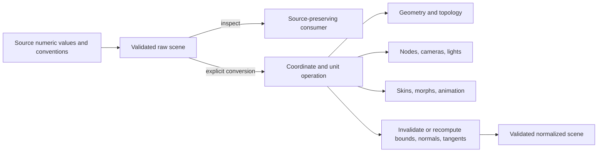

# ADR 0008: Math Types, Scene Space, Units, and Numeric Policy

## Context

Coordinate conventions are part of the asset's meaning. A model can have numerically valid
positions and still render incorrectly when handedness, front-face winding, UV origin, tangent
basis, units, or matrix conventions are implicit. Animation time also needs more precision than
renderer-oriented geometry buffers.

## Decision

Baozi exposes small Baozi-owned math types. Public IR types do not expose a parser backend, SIMD
type, `glam`, `nalgebra`, or `cgmath`. Optional ecosystem adapters are conversions, not IR owners.

Public math semantics are fixed independently from memory layout:

| Topic | Canonical meaning |
| --- | --- |
| vectors | right/left handedness comes from `SceneSpace`, not the vector type |
| matrices | column vectors; `p_parent = M_local_to_parent * p_local`; indexed accessors name row and column |
| quaternion | `(x, y, z, w)` component meaning, finite unit rotation within documented tolerance; named constructors avoid positional ambiguity |
| angles | radians |
| normals | inverse-transpose under non-uniform scale |
| bounds | closed axis-aligned minimum/maximum in the declared owner space |

No `repr(C)`, SIMD alignment, column-major byte storage, or binary ABI follows from these semantic
rules; ADR 0009 keeps memory layout private.

Numeric storage is deliberate:

| Value class | Canonical scalar | Rule |
| --- | --- | --- |
| positions, normals, tangents, transforms, and material/color factors | `f32` | reject non-finite values; diagnose material narrowing during import |
| encoded UV, color, and custom attribute storage | ADR 0030 `ComponentType` | preserve admitted width/normalization; built-in evaluated UV/color views use `f32` |
| animation key time and clip duration | `f64` | preserve authored time domain; do not silently resample |
| animation TRS samples, morph weights, and morph deltas | `f32` | retain renderer-independent values while keeping source time in `f64` |
| source unit scale and timing rates | `f64` | finite and positive when known |
| metadata numeric value | typed `i64`, `u64`, or `f64` | no string coercion |

The raw scene preserves source numbers and records a complete `SceneSpace`:

- handedness
- signed up and front axes
- unit scale to meters
- clockwise or counter-clockwise front-face winding
- upper-left or lower-left UV origin, or unknown
- tangent basis convention and handedness encoding, or unknown
- column-vector, local-to-parent transform convention used by the canonical math API

Unknown is an explicit value, never a guessed default. The standard spatial target is right-handed,
positive Y up, meters, and counter-clockwise front faces. UV origin and tangent basis are preserved
unless the requested target explicitly names them; generated tangents use the documented Baozi
basis. Reaching any target requires an explicit postprocess operation.

Validation rejects signed up/front axes on the same underlying axis. When both are known, they and
the declared handedness must derive one finite orthonormal side axis; a complete-space claim cannot
retain `Unknown`. Front-face winding remains an explicit independent convention, while tangent-basis
orientation must agree with its declared normal/UV axes and handedness encoding. Every Baozi
quaternion field, including future static TRS fields, obeys the same finite-unit rule; normalization
outside tolerance is an explicit diagnosed recovery, not a constructor side effect.

The unit-quaternion rule applies to rotation sample values, not cubic interpolation derivatives.
Rotation cubic tangents are finite `Vec4<f32>` derivatives in authored component order and are not
normalized or interpreted as rotations. ADR 0031 owns channel cardinality and tangent layout.

Coordinate conversion is atomic across every affected domain. It updates base positions, normals,
tangents, morph position/normal/tangent deltas, spatial mesh-instance attributes, winding, node
transforms, inverse bind and correction matrices, cameras, lights, animation values, and scene-space
metadata together. It invalidates derived data it cannot recompute. An operation that cannot convert
a present semantic fails or reports policy-approved loss; it never returns a scene whose metadata
claims a conversion that only base geometry received.

A basis transform with negative determinant reverses topology winding when required to preserve the
declared front face and updates tangent handedness consistently. The operation validates the output
space descriptor and geometric orientation together before commit.

Floating-point snapshots use deterministic ordering and per-field documented absolute/relative or
angular tolerances. Tolerances are test comparison policy, not permission to clamp imported data.

## Considered Options

### Option A: Expose one ecosystem math crate

This gives rich operators and SIMD quickly, but turns that crate's versions and feature choices into
Baozi's public compatibility burden. Rejected.

### Option B: Normalize every format while parsing

This simplifies renderer examples, but loses source truth and duplicates conversion logic across
importers, especially for skins and tangent bases. Rejected.

### Option C: Baozi math, explicit source space, explicit conversion

This keeps parser output auditable and lets tools choose source-preserving or normalized workflows.
Chosen.

## Consequences

- Geometry remains efficient for common graphics consumers while animation retains `f64` timing.
- Importers must populate known space fields and leave unknown fields explicit.
- Matrix and tangent conventions become normative and tested rather than comments on individual
  importers.
- High-precision CAD geometry is outside this canonical IR; supporting it requires a separate
  domain decision, not a generic scalar parameter.

## Risks and Mitigations

| Risk | Severity | Mitigation |
| --- | --- | --- |
| `f32` narrows large or precise source geometry | High | Check conversion range/precision, diagnose material loss, and reject non-finite results. |
| Partial coordinate conversion corrupts animation or skinning | High | Use operation read/write sets and integration fixtures containing all spatial domains. |
| Unknown source conventions invite caller guesses | Medium | Preserve `Unknown`, allow explicit caller-supplied source overrides, and record them in provenance. |
| Platform float behavior changes snapshots | Medium | Use scalar reference tests, deterministic ordering, and field-specific tolerances. |

## Success Metrics

| Metric | Target | Measurement |
| --- | --- | --- |
| Time fidelity | Distinct authored `f64` times never collapse through `f32` conversion | long-time and close-key fixtures |
| Space completeness | A complete-space claim has no unknown or contradictory convention | exact/excess field validation tests |
| Conversion completeness | Every declared spatial domain is converted or the transaction fails | all-domain coordinate fixture and invalidation report |

## Acceptance Criteria

- Public API inspection finds no third-party math types.
- Raw fixtures preserve declared handedness, axes, units, winding, UV origin, and tangent basis.
- Coordinate conversion fixtures cover nodes, geometry, topology, skins, animation, cameras, lights,
  and derived-data invalidation in one transaction.
- Animation times that differ below `f32` precision remain distinct after import.
- NaN, infinity, invalid unit scales, and invalid quaternions fail validation deterministically.
