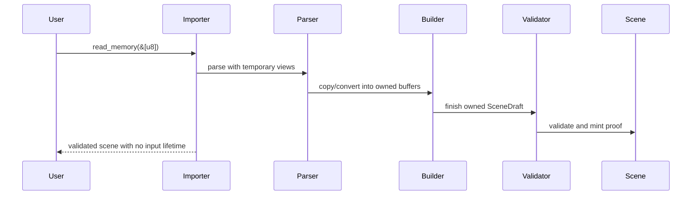

# ADR 0009: Data Ownership, Zero-Copy, Lifetimes, and Memory Layout

## Context

Asset importers often parse large binary buffers, sidecar files, embedded images, and mesh attribute
arrays. It is tempting to expose borrowed slices into the original input for speed. However,
borrowed public scenes would push lifetimes through the entire API, complicate dependency lifetimes
and post-processing, and constrain any future container adapter. ADR 0037 remains Proposed and this
ADR does not authorize archive/container support.

Baozi needs a memory model that allows parser-level optimization without making users manage input
buffer lifetimes.

## Decision

Baozi's public `ValidatedScene` will be fully owned. Parser implementations may use borrowed views and
zero-copy decoding internally during one import operation, but the returned scene must not borrow
from user input, session resource snapshots, parser ASTs, or third-party backend objects.

The public API will not expose lifetime-parameterized scene types such as `Scene<'a>` in the main
facade.

Core policy:

- returned scenes own their nodes, mesh instances, logical meshes, materials, images, samplers,
  textures, animations, and metadata
- mesh attribute buffers are contiguous owned buffers
- every admitted image owns its immutable encoded bytes; large payloads may use shared ownership such
  as `Arc<[u8]>`
- dense IDs provide stable references inside one validated scene generation
- public memory layout is not an ABI promise
- zero-copy is an internal optimization boundary, not a public contract
- parsers reserve through the import-domain ledger, backed by `baozi-operation`'s runtime-neutral
  reservation/state-machine mechanism, and use fallible `try_reserve*` paths only after checked
  source-count and byte/cell bounds
- typed byte casting is allowed only behind explicit endian, alignment, length, and plain-data checks

## Architecture




## Public Ownership Rules

### Scene

`ValidatedScene` owns its canonical `Scene` storage, including:

- node storage
- logical meshes, which own primitive storage, plus scene-owned mesh instances
- material storage
- image payloads, samplers, textures, and material bindings
- animation data
- camera and light data
- metadata

The scene may be cheap to move but is not required to be cheap to clone. Cloning large scenes should
be explicit.

### Mesh Buffers

Dense mesh attributes use owned contiguous storage, while sparse attributes use owned checked index
and value buffers:

```text
AttributePayload::Dense(OwnedBuffer<T>)
AttributePayload::Sparse { indices: OwnedBuffer<u32>, values: OwnedBuffer<T>, logical_count }
IndexStream: OwnedBuffer<u32>
```

The concrete storage type may evolve, but each validated payload has one owner or immutable shared
owner, deterministic cardinality, and typed read views suitable for validation and processing.
Attribute source byte order is decoded at import. Ordinary canonical scalar buffers expose logical
typed values and have no per-stream endian flag. If a future named packed encoding stores bytes, its
registered schema fixes byte width and byte order; opaque source-endian payloads cannot masquerade as
canonical attributes. ADR 0030 owns the complete format and payload contract.

Use `u32` indices in the accepted canonical model and reject input that exceeds the representable or
configured limit. Importers must not hide overflow by splitting geometry. Any future wider index or
explicit split operation requires its own accepted contract, loss policy, provenance, and remaps.

### Byte Payloads

Embedded image payloads, compressed buffers, and retained raw sidecar data can use:

```text
Arc<[u8]>
```

Rationale:

- avoids lifetime propagation
- allows cheap sharing between image/resource records and internal decode caches
- makes memory ownership explicit
- works across sync and async import paths

Every canonical `Image` produced by import contains an immutable owned encoded payload. External
images are authorized, opened, bounded, and snapshotted by the import session; publication transfers
the snapshot bytes into scene ownership. Embedded and data-URI images materialize the same owned
payload shape. A sanitized logical locator may remain as a provenance/reload hint, but it conveys no
authority, does not promise byte equality, and is never required to inspect or decode the returned
scene. Missing, denied, or intentionally unretained image bytes therefore produce explicit
unsupported/loss evidence or no `Image`; they never produce a nominally usable dangling image.

### Names and Strings

Names and metadata strings should be owned `String` values in the public scene. String interning may
be added internally later, but it must not change public semantics.

### SceneBuilder

`SceneBuilder` is the mutable construction surface. It can accept borrowed parser data and convert it
into owned storage.

Rules:

- builder methods may copy, validate, and perform representation-preserving canonicalization;
  source repair requires diagnostics and provenance, while semantic normalization belongs to ADR
  0013 postprocess
- builder records source identity and provenance through ADR 0036 rather than overloading dense IDs
  or names
- builder finish returns an owned `SceneDraft` or structured construction errors; ADR 0003's central
  validator alone can turn a draft into `ValidatedScene`
- builder internals are not stable public memory layout

## Zero-Copy Policy

Allowed:

- parser borrows from an input buffer during parsing
- binary parser creates temporary typed views after validating alignment and length
- session-owned immutable resource snapshots may share bytes through `Arc<[u8]>`
- image payloads are carried as `Arc<[u8]>` without decoding
- format backend AST borrows internally before conversion

Typed byte casting helpers such as `bytemuck` may be introduced behind parser-private modules or
optional backends when all checks are true:

- source byte order matches the target representation, or conversion is performed explicitly
- buffer length is an exact multiple of the target element size
- alignment is valid, or the helper safely handles unaligned input without undefined behavior
- target type has a reviewed plain-data contract
- the cast does not create public ABI or serialization promises
- malformed input cannot trigger panic or unchecked slicing

When these checks are not true, parsers must use explicit decoding such as `from_le_bytes`.

Not allowed in the main public API:

- `Scene<'a>` borrowing from input
- mesh attributes referencing parser buffers
- material strings borrowing from a temporary file buffer
- image bytes borrowing from a released session resource snapshot
- third-party parser AST nodes reachable from `Scene`

## Memory Layout and ABI Policy

Baozi does not promise stable memory layout for scene structs before an explicit FFI ADR.

Rules:

- avoid `repr(C)` unless there is a concrete FFI or bytemuck-style reason
- do not expose raw struct layout as serialization format
- keep binary cache design separate from in-memory layout
- use typed accessors or documented fields based on invariants, not layout concerns

SIMD backends may use internal aligned buffers or structure-of-arrays transformations. These must not
change public `Scene` semantics.

## Allocation Policy

Parsers must avoid unbounded growth patterns on large assets:

- validate declared counts and checked `count * element_size`/cell totals before reservation
- use ADR 0022's owning-domain protocol: charge attempted work before an action, obtain live capacity
  reservations before `try_reserve` or `try_reserve_exact`, and record committed output only at
  successful publication; these evidence classes are never interchangeable
- propagate allocation failure as a typed resource error; input-derived `Vec::with_capacity` is
  forbidden because capacity allocation may panic or abort outside the failure contract
- release phase-live reservations when temporary storage is dropped without refunding consumed work
- record benchmark and peak-live evidence before adding pooling or custom allocators

## Mutation Policy

Canonical public flow:

```text
SceneBuilder -> SceneDraft -> central validator -> ValidatedScene
             -> SceneEdit -> central validator -> new ValidatedScene
```

`SceneEdit` is the only canonical mutation transaction. It shares unchanged owned storage, builds
affected replacements privately, and publishes a new generation only after central validation.
Postprocess and user-authored changes use this same boundary; neither mutates a `ValidatedScene` in
place. This ADR supplies the lower-level ownership and representation boundary consumed by ADR 0032;
exact remap, rollback, and derived-data rules remain authoritative there. The reference is not a
reverse normative dependency from storage policy to postprocess policy.

Possible future APIs:

- specialized borrowed read-only inspection views
- streaming import for extremely large assets

These possible read/import surfaces do not replace the owned canonical result or `SceneEdit` mutation
contract.

## Alternatives Considered

### Option A: Public borrowed scene model

Pros:

- Avoids copying some input data.
- Can be faster for simple inspection.
- Fits memory-mapped file use cases.

Cons:

- Infects the API with lifetimes.
- Makes sidecar and any future async/container resource lifetimes difficult.
- Makes post-processing and validation harder.
- Third-party parser backends can leak into public model.

Decision: rejected for the main facade.

### Option B: Fully owned validated scene with internal zero-copy parsing and edit transactions

Pros:

- Simple user API.
- Works across primary/dependency snapshots and does not constrain future admitted adapters.
- Keeps parser backends replaceable.
- Allows internal optimization without public lifetime churn.

Cons:

- Some data must be copied.
- Very large assets may need streaming or chunking later.
- Requires careful allocation profiling.

Decision: chosen.

### Option C: Two public scene models: borrowed and owned

Pros:

- Gives advanced users maximum control.
- Supports low-copy inspection paths.
- Can be useful for tooling.

Cons:

- Doubles API and test surface.
- Hard to keep post-process behavior consistent.
- Premature before first stable importers exist.

Decision: deferred. A borrowed inspection API can be reconsidered after the owned model is stable.

## Success Metrics

| Metric | Target | Measurement |
| --- | --- | --- |
| Lifetime simplicity | Public facade returns owned `ValidatedScene`, not `Scene<'a>` | public API review |
| Backend isolation | Scene does not expose parser AST or borrowed backend data | public API review |
| Post-process usability | Steps replace affected buffers through `SceneEdit` without mutating input | integration tests |
| Large payload sharing | Embedded bytes can be shared without copies after import | tests over embedded images |
| Session independence | External image bytes remain usable after resolver, session, and input snapshots are dropped | external-image lifetime tests |
| Memory visibility | allocations and peak memory are benchmarked for large fixtures | Criterion benchmarks |
| Fallible growth | Every input-derived capacity uses ledger reservation plus `try_reserve*` | exact/excess/allocation-failure tests |
| Safety | parser temporary views cannot outlive import context | compile-time API shape |

## Risks and Mitigations

| Risk | Severity | Likelihood | Mitigation |
| --- | --- | --- | --- |
| Copying hurts very large assets | Medium | Medium | Benchmark early; use `Arc<[u8]>` for payloads and optimize hot conversions |
| Owned model blocks streaming workflows | Medium | Medium | Add streaming reader later as separate API, not main scene facade |
| Mesh buffers need different layouts for SIMD | Medium | Medium | Keep SIMD layout internal and convert at algorithm boundaries |
| Public fields expose layout too early | Medium | Medium | Use accessors where invariants matter and reserve ABI promises |
| `u32` indices are insufficient for huge meshes | Medium | Low | Reject above the admitted limit and revisit through a dedicated index-width decision; never split silently. |
| Cloning scenes is expensive | Low | High | Document clone cost and expose shared byte buffers where useful |

## Implementation Plan

### Phase 0: Owned Core Storage

- Define owned `Scene`, `ValidatedScene`, `SceneBuilder`, dense IDs, and attribute buffers.
- Use owned strings and metadata.
- Use shared byte payloads for embedded assets.

### Phase 1: Parser Boundary

- Allow parsers to use borrowed views internally.
- Convert parser output to owned scene data at builder boundaries.
- Add tests that imported scenes outlive input buffers.

### Phase 2: Performance Visibility

- Add allocation and throughput benchmarks.
- Optimize hot copies only after measurements.
- Keep zero-copy parser optimizations behind internal modules.
- Measure affected-set `SceneEdit` peak-live storage independently from parser decode storage.

## Consequences

Positive:

- User API is simple and runtime-neutral.
- Format backends remain replaceable.
- Post-processing and validation operate on stable owned generations through one edit transaction.

Negative:

- Some zero-copy opportunities are intentionally not public.
- Huge asset workflows may need specialized future APIs.
- Baozi must measure allocation cost instead of assuming it is fine.

## Open Questions

1. Should mesh indices support `u64`?
   Recommendation: not under this decision. Use `u32` and reject above limits until a measured
   index-width proposal defines its complete processing cost.
2. Should `ValidatedScene` implement `Clone`?
   Recommendation: only if clone cost is explicit and large buffers share storage where appropriate.
3. Should a borrowed inspection API exist later?
   Recommendation: defer until stable importers reveal real demand.

## Amendment History

### 2026-07-19: Correct the storage-to-edit dependency direction

- Affected headings: frontmatter dependency metadata and the `SceneEdit` authority paragraph.
- Previous rule: this lower-level storage-representation ADR normatively depended on ADR 0032's
  higher-level postprocess transaction contract, creating a cycle once retained physical ownership
  became a dependency of postprocess.
- New rule: ADR 0009 owns the lower-level ownership, borrowing, sharing, and representation boundary.
  ADR 0032 depends on that boundary for edit semantics; this ADR keeps ADR 0032 only as related
  navigation to its remap and rollback authority.
- Compatibility impact: none; this corrects architectural authority metadata before release.
- Required review: ADR dependency-cycle gate and ownership-boundary review.
- Rationale: representation policy must be reusable below import and postprocess transactions rather
  than depend on either consumer.
