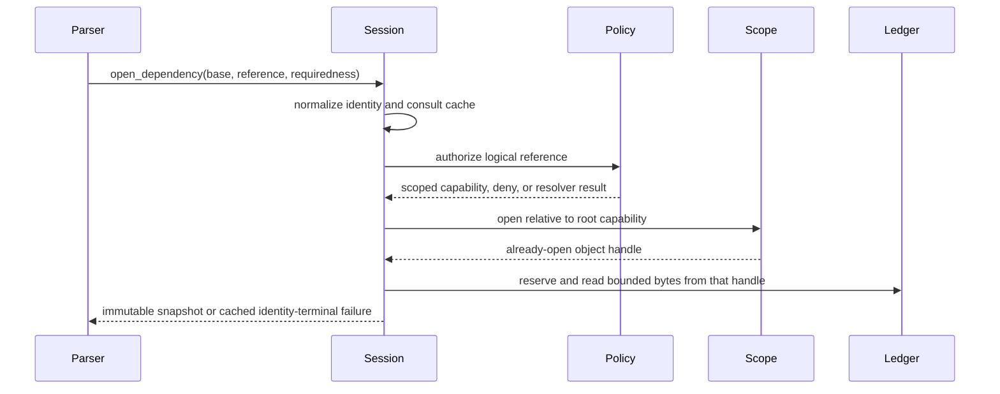

# ADR 0010: Asset IO, Virtual Filesystem, URI, and Path Security

## Status and Authority

This accepted ADR is the authority for asset IO capabilities, path authorization, and binding an
authorization decision to the opened object. Acceptance defines the required replacement contract;
it does not certify the prototype path-based filesystem adapter. `native-fs` cannot claim
conformance until the bound-handle adapter implements and passes the platform-local admission gates.

## Context

Model files can reference material libraries, buffers, and images. Those references are attacker
controlled whenever the primary asset is untrusted. A lexical path check is necessary, but it is not
an authorization boundary: an attacker can replace a symlink, junction, mount point, or directory
between a check and a later path-based open.

Baozi also needs the same importer to work with immutable memory bundles, host databases, and native
filesystems. Format crates must not own host path policy or gain ambient filesystem authority.

Archive and container behavior is deliberately outside this accepted decision. ADR 0037 is a
non-authoritative proposal until it has an implementation tracer and is promoted under the ADR
lifecycle rules.

## Decision

Baozi uses a root-capability `AssetIo` boundary. A logical asset name is not authority. Native
filesystem authorization starts from an open directory capability and returns an already-open object
handle; parsing reads that same object. There is no authorize-by-string followed by reopen-by-string.

The canonical rules are:

- format crates access primary and dependent resources only through an import-session capability
- `AssetPath` is a normalized logical identity, never proof that a host object is authorized
- `AssetScope` owns an opaque Baozi directory capability that Baozi constructed and validated as a
  directory; public `native-fs` APIs do not accept unverifiable raw handles or `std::fs::File` values
- on Windows, Baozi opens every root capability without `FILE_SHARE_DELETE`; a handle whose share
  mode cannot be verified never enters the public native adapter
- the first successful open yields the exact handle from which bytes are read and snapshotted
- the first identity-terminal failure for a normalized dependency identity is cached for the session
- `exists` and metadata probes are advisory only and never authorize a later open
- filesystem, memory, and custom backends share the same identity, limit, and evidence contract
- remote fetching is host-owned and excluded from the Baozi facade
- unsupported security primitives fail closed; `canonicalize` is never a security fallback

Authority is split deliberately:

| Authority | Owned decision |
| --- | --- |
| ADR 0010 | `AssetIo` capabilities, path authorization, authorize/open object binding, and the physical dependency-open/cache mechanism keyed by normalized identity |
| ADR 0020 | session construction before IO, stage ownership, and one final outcome |
| ADR 0029 | primary snapshot, Probe behavior, detect/parse byte sharing, and detection failure evidence |
| ADR 0022 | attempted/consumed/live/committed accounting and refund semantics |
| ADR 0036 | public source identity, provenance, aliases, and redaction |

## Capability Flow




## Identity and Authority

Baozi distinguishes four concepts:

| Concept | Purpose | Security meaning |
| --- | --- | --- |
| Raw reference | Text from a source file or caller | Hostile data; no authority |
| `AssetPath` | Bounded, normalized logical identity | Cache and diagnostics key only |
| `AssetScope` | Open root capability or memory namespace | Authority ceiling |
| Opened resource | Handle plus immutable session snapshot | Object authorized for parsing |

An `AssetUri` can label a source, but URI syntax does not grant access. `file:`, drive, UNC, NT
namespace, device, or remote URI strings are rejected at the format-facing boundary. A host custom
resolver may support additional schemes only by returning a bounded identity and an authorized
opener or immutable bytes. It must not return a path for Baozi to reopen with ambient authority.

## Dependency Policy

The external-reference policy is data-bearing rather than a payload-free flag:

```text
ExternalReferencePolicy
|- Deny
|- WithinScope(scope capability)
|- AllowListedScopes([scope capability])
`- Resolver(trusted host resolver)
```

Defaults:

- memory imports deny external references unless the caller supplies a memory bundle or resolver
- native path helpers scope sidecars to the primary asset directory
- absolute source references and references that escape their logical base are denied
- optional dependency denial produces bounded evidence and may preserve geometry
- a required structural dependency failure is fatal

Policy evaluation happens before backend IO. The open, byte limit, immutable snapshot, identity
cache, and required/optional classification are one session operation so format crates cannot bypass
part of the policy.

The cache's first failure is terminal only for that normalized dependency identity: it prevents a
second physical open but does not itself end the import. ADR 0020 owns disposition. An optional failure
accepted by format and loss policy is a non-abort unavailable outcome; a required or policy-rejected
failure becomes a session-terminal `ScopeAbort`.

## Native Filesystem Admission

The admitted implementation direction is `cap-std` 4.0.2 behind `baozi-io/fs`, with an exact direct
`rustix` 1.1.4 dependency used only for the portable `OFlags::NONBLOCK` value on Unix-like targets.
The adapter passes that value through `cap_std::fs::OpenOptionsExt`; it does not use a numeric flag,
a documentation-hidden dependency API, or an additional filesystem extension crate. The detailed
blocking review is recorded in
[`native-filesystem-bound-handle-admission.md`](../research/native-filesystem-bound-handle-admission.md).
It satisfies Baozi's license and MSRV gates and keeps platform `unsafe` outside Baozi-owned crates.
The adapter's conformance gate must machine-lock the reviewed `cap-std`, `cap-primitives`, and
`rustix` releases, checksums, features, and complete target-specific resolved dependency closure
before the adapter can claim conformance. A path-resolution, open-flag, special-file, unsafe-scope,
or target-relevant closure change reopens dependency admission.

Required behavior by platform family:

| Platform | Bound-open strategy | Fail-closed boundary |
| --- | --- | --- |
| Linux 5.6+ | directory fd plus `openat2(RESOLVE_BENEATH)`; magic-link protection is mandatory | no path-based reopen; unsupported resolution flags cannot be silently dropped |
| Older Linux and macOS | component-at-a-time relative opens while retaining directory handles and handling links inside the capability root | a backend unable to prove containment returns an error; `realpath` is not a substitute |
| FreeBSD with proven semantics | runtime-check `openat(O_RESOLVE_BENEATH)` behavior, normally on FreeBSD 14+, and otherwise use the capability handle walk | FreeBSD 13's incompatible `..` behavior and historical `O_BENEATH` are not accepted as proof |
| Windows MSVC | relative `NtCreateFile`/`RootDirectory` handle opens with explicit reparse handling | Win32/NT device namespaces, alternate streams, reserved device aliases, and ambiguous trailing-dot/space names are rejected before IO |
| Other targets | memory/custom `AssetIo` only unless separately admitted | enabling `native-fs` must not fall back to `std::fs::canonicalize` |

Baozi additionally rejects NUL and control characters, absolute and drive-relative paths, UNC paths,
Win32 extended/device prefixes, NT object-manager paths, alternate data stream separators, reserved
device basenames including extension aliases, and trailing dot/space aliases. The final opened object
must be a regular file; directories, devices, FIFOs, and sockets are not parser input.

On Unix-like targets, regular-file enforcement is an availability boundary as well as a type check.
Baozi performs one capability-relative `O_RDONLY | O_NONBLOCK` open, validates regular-file type from
metadata attached to that returned handle, and reads that same handle. It never performs
`metadata(path)` or `stat(path)` as an authorization or file-type preflight, because a later open can
name a replacement and opening a replacement FIFO can block before it can be rejected. Directory,
FIFO, socket, and device handles produce typed failures, and deadline tests must prove that FIFO
rejection does not wait for a writer. Windows likewise validates regular-file type on the exact
handle returned by the capability-relative native open; it never reopens a validated pathname.

The public native adapter's root-taking constructor accepts only Baozi's opaque
`NativeDirectoryCapability`. The only path-taking root convenience constructs that capability,
validates the root, and returns it before hostile references are processed; facade path helpers may
delegate to that operation. In particular, Baozi does not wrap an arbitrary `std::fs::File`, raw file
descriptor, raw Windows handle, or public `cap-std` type.
This restriction is required because `cap-std` documents that a Windows directory supplied through
`Dir::from_std_file` must have been opened without `FILE_SHARE_DELETE`, a property Baozi cannot infer
from an arbitrary safe Rust file value. A future external-handle constructor requires a separate
verifiable contract and platform tests before admission.

A hard link whose directory entry is inside an authorized root is inside that filesystem capability.
Hosts requiring content ownership stronger than directory-entry authority must provide an immutable
bundle or stronger process sandbox. Mounts and writable scope roots are also host trust decisions.

## Portable Boundary

Byte and memory-bundle imports are the portable baseline. They must not imply filesystem, remote,
archive, or process capabilities. Browser `wasm32-unknown-unknown` has no native filesystem adapter.
WASI callers should provide preopened-capability-backed custom IO; Baozi does not reinterpret a WASI
path string as authority. ADR 0034 owns exact target support levels.

## Session Integration Constraints

The lifecycle, detection, ledger, and public identity details belong to the authorities above. Their
implementations must satisfy these IO integration constraints within one import session:

1. The primary object is opened once and read into one bounded immutable backing store.
2. Detection and parsing use views over that same snapshot.
3. A normalized dependency identity is resolved and opened at most once physically.
4. The first snapshot or identity-terminal failure is reused for repeated logical references.
5. Attempted IO and work remain monotonic even when an optional resource is skipped.

These rules prevent detect/parse byte drift and repeated-open replacement. They do not make a mutable
custom backend trustworthy; a trusted host backend is required to honor the returned object and
identity contract.

## URI and Data URI Rules

- Percent decoding is format-specific but checked and bounded.
- Data URIs are decoded through the session ledger and fail before over-budget allocation.
- The original hostile reference is retained only in bounded, escaped diagnostics.
- HTTP(S), authentication, redirects, proxies, TLS, and network caches belong to host adapters.
- A remote adapter is trusted in-process code and must return a stable session snapshot; Baozi does
  not provide SSRF protection for arbitrary host resolvers.

## Archive Boundary

Accepted importers do not gain archive extraction authority from this ADR. If a future container
adapter is implemented, it must enter through the same logical identity, immutable snapshot, and
ledger boundary. Path rules, decompression limits, duplicate-entry behavior, and container profiles
remain proposals in ADR 0037 and are not current guarantees.

## Alternatives Considered

### Option A: `canonicalize` then `starts_with` then `File::open`

Pros:

- Uses only the standard library.
- Easy to understand and test without platform code.

Cons:

- Authorizes one object and can open a replacement object.
- Has different symlink, junction, case, and namespace semantics across platforms.
- Cannot bind a custom resolver's authorization to the consumed bytes.

Decision: rejected because the check/open race is in the primary attacker-controlled path.

### Option B: Baozi-owned syscall implementations using `rustix` and `windows-sys`

Pros:

- Maximum control over resolution flags and diagnostics.
- Small dependency API surface.

Cons:

- Requires a custom cross-platform symlink and reparse resolver.
- Introduces Baozi-owned `unsafe` on Windows and a large race-test burden.
- `rustix` does not provide the complete Windows capability abstraction.

Decision: rejected for the first canonical implementation. Reconsider only with a measured blocker
and a separate unsafe review.

### Option C: Capability-rooted IO backed by `cap-std`

Pros:

- Binds relative opens to directory handles across Linux, macOS, Windows, and FreeBSD.
- Supports in-root symlinks without authorizing escapes.
- Compatible license and MSRV; used as a WASI capability foundation.
- Keeps ambient opening and platform `unsafe` at an explicit adapter boundary.

Cons:

- Adds a security-sensitive dependency.
- Windows relies on native `NtCreateFile` behavior rather than only high-level Win32 APIs.
- Requires Baozi-specific device-name filtering and platform race tests.

Decision: chosen, subject to the executable acceptance gates in the admission record.

## Success Metrics

| Metric | Target | Measurement |
| --- | --- | --- |
| Ambient IO | no first-party format crate opens host paths | dependency and source audit |
| Object binding | authorization and reads use the same opened object | injected replacement/race tests |
| Session stability | primary and repeated dependencies reuse their first snapshot/failure | mutable-backend integration tests |
| Deny ordering | denied references cause zero backend opens | recording-backend tests |
| Platform path safety | escape, symlink, junction, reparse, namespace, and device cases fail | per-target adversarial suites |
| Special-file availability | directory, FIFO, socket, and device inputs fail by deadline without a blocking pathname preflight | same-handle type and deadline tests |
| Root capability integrity | only Baozi-constructed, directory-validated roots enter the adapter; Windows roots exclude `FILE_SHARE_DELETE` | API-shape, root-type, and replacement tests |
| Dependency identity | the resolved `cap-std`, `cap-primitives`, and direct `rustix` security-sensitive closure matches the admitted versions, checksums, features, and sources | target-filtered lockfile admission checker |
| Portable bytes | memory imports compile without native filesystem dependencies | WASM feature checks |
| Failure honesty | unavailable primitives return a typed failure, never a weaker fallback | negative capability tests |

## Risks and Mitigations

| Risk | Severity | Likelihood | Mitigation |
| --- | --- | --- | --- |
| Capability dependency regresses containment | Critical | Low | machine-lock the admitted resolved closure and checksums, re-admit relevant updates, and run the race corpus on each supported native OS |
| Platform-specific filesystem semantics differ | High | Medium | explicit target profiles and fail-closed unsupported cases |
| A hostile FIFO blocks before type validation | Critical | Medium | capability-relative `O_NONBLOCK` open, same-handle regular-file validation, and deadline tests |
| Legitimate Windows names are rejected | Medium | Medium | conservative documented policy; custom memory backend for exceptional assets |
| Host resolver returns mutable or overpowered resources | High | Medium | resolver is explicitly trusted; session snapshots first result and bounds diagnostics |
| Writable roots change during import | High | Medium | handle-relative open, immutable snapshots, and host guidance to use read-only roots |
| Capability abstraction is mistaken for process sandboxing | Critical | Medium | threat model states trusted-code boundary and process-isolation requirement |

## Implementation and Verification

- Replace path-based `AssetScope::resolve_existing` with a directory-capability-backed adapter.
- Introduce `NativeDirectoryCapability` as a Baozi-owned opaque type whose constructors validate the
  root object; the native adapter's root-taking constructor accepts only this type.
- Put path-based ambient setup on the opaque capability (with facade path helpers delegating to it);
  do not expose raw/std-handle ingestion in the public native API.
- On Windows, construct root and descendant directory handles without `FILE_SHARE_DELETE` and test
  that textual root replacement cannot redirect the retained capability.
- Make dependency resolution return an authorized resource operation, not a reopenable path.
- Remove authorization use of `exists`.
- On Unix-like targets, open through `cap-std` with `O_RDONLY | O_NONBLOCK`, sourcing
  `OFlags::NONBLOCK` from direct `rustix` 1.1.4, then validate regular-file type on the returned
  handle. Do not add a path-metadata preflight, a numeric native flag, a documentation-hidden API,
  `cap-fs-ext`, or a pathname reopen.
- On Windows, validate regular-file type on the handle returned by the relative native open and
  reject directories, devices, pipes, and unresolved reparse objects without reopening by name.
- Charge path-component work and the admitted backend's conservative retry allowance before opening.
- Add deterministic path, non-regular-file deadline, and concurrent replacement tests from the
  admission record.
- Keep `cap-std` and direct `rustix` behind `baozi-io/fs` and facade `native-fs`; verify them and
  transitive `cap-primitives` are absent from byte-only/WASM dependency trees.
- Pin direct `rustix` to exactly 1.1.4 and verify its crates.io checksum
  `b6fe4565b9518b83ef4f91bb47ce29620ca828bd32cb7e408f0062e9930ba190`.
- Resolve `cap-std` with default features disabled on admitted Linux, Windows MSVC, macOS, and
  FreeBSD targets. Resolve direct `rustix` only on admitted Unix-like targets with default features
  disabled and exactly the `std` and `fs` features; Windows obtains no direct `rustix` edge.
- Check the complete resolved native-filesystem dependency closure for Linux, Windows MSVC, macOS,
  and FreeBSD against the admitted versions, features, sources, and checksums; any
  path-resolution-, open-flag-, special-file-, or target-relevant change reopens admission.
- Fail CI if a format crate uses direct `std::fs` outside an approved adapter.

## Consequences

Positive:

- Filesystem authorization is tied to the object actually parsed.
- Memory, custom, and filesystem sources share stable session semantics.
- Format crates remain portable and do not implement security policy.

Negative:

- Native filesystem support has a security-sensitive dependency and target-specific tests.
- Some path names and exotic filesystems are intentionally rejected.
- Host-provided in-process resolvers remain part of the trusted computing base.

## Sources

The living operating-system documentation below is navigation to the official pages whose exact
2026-07-10 final response-body lengths and SHA-256 digests are captured in the linked
[native filesystem admission record](../research/native-filesystem-bound-handle-admission.md#living-official-document-capture).
Dependency source links use immutable commit identities.

- [Linux `openat2(2)` resolution flags](https://man7.org/linux/man-pages/man2/openat2.2.html)
- [Microsoft `NtCreateFile` relative `RootDirectory` behavior](https://learn.microsoft.com/en-us/windows-hardware/drivers/ddi/wdm/nf-wdm-zwcreatefile)
- [Microsoft file naming and device namespace rules](https://learn.microsoft.com/en-us/windows/win32/fileio/naming-a-file)
- [FreeBSD `openat(2)` and `O_RESOLVE_BENEATH`](https://man.freebsd.org/cgi/man.cgi?query=open&sektion=2&format=html)
- [Apple `open(2)` and `O_NOFOLLOW`](https://developer.apple.com/library/archive/documentation/System/Conceptual/ManPages_iPhoneOS/man2/open.2.html)
- [`cap-std` capability and platform design at the reviewed commit](https://github.com/bytecodealliance/cap-std/tree/715e4ed607ae9a93c7446b0fa63296f7898831c2)
- [`rustix` 1.1.4 source at the packaged commit](https://github.com/bytecodealliance/rustix/tree/c4caf5caaa7e93828a2e4a4cdba1dd0171e45717)
