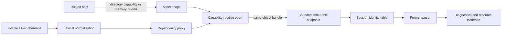
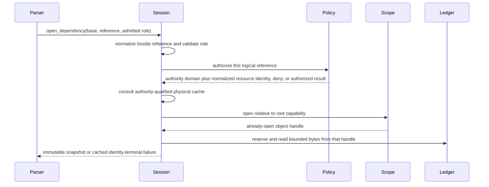
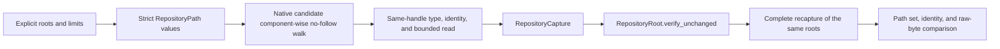

# ADR 0010: Asset IO, Virtual Filesystem, URI, and Path Security

## Status and Authority

This accepted ADR is the authority for asset IO capabilities, path authorization, and binding an
authorization decision to the opened object. Acceptance defines the required replacement contract;
it does not certify a filesystem adapter or target. ADR 0034 exclusively owns candidate/registered
target sets, exact target predicates, feature support claims, and promotion/demotion. Every target
that ADR 0034 considers must independently satisfy this ADR's object-bound security contract.

## Context

Model files can reference material libraries, buffers, and images. Those references are attacker
controlled whenever the primary asset is untrusted. A lexical path check is necessary, but it is not
an authorization boundary: an attacker can replace a symlink, junction, mount point, or directory
between a check and a later path-based open.

Baozi also needs the same importer to work with immutable memory bundles, host databases, and native
filesystems. Format crates must not own host path policy or gain ambient filesystem authority.

Archive and container behavior is deliberately outside this accepted decision. ADR 0037 is a
non-authoritative proposal until it has an implementation tracer and is promoted under the ADR
lifecycle rules.

## Decision

Baozi uses a root-capability `AssetIo` boundary. A logical asset name is not authority. Native
filesystem authorization starts from an open directory capability and returns an already-open object
handle; parsing reads that same object. There is no authorize-by-string followed by reopen-by-string.

The canonical rules are:

- format crates access primary and dependent resources only through an import-session capability
- `AssetPath` is a normalized logical identity, never proof that a host object is authorized
- `AssetScope` owns an opaque Baozi directory capability that Baozi constructed and validated as a
  directory; public `native-fs` APIs do not accept unverifiable raw handles or `std::fs::File` values
- on Windows, Baozi opens every root capability without `FILE_SHARE_DELETE`; a handle whose share
  mode cannot be verified never enters the public native adapter
- the first successful open yields the exact handle from which bytes are read and snapshotted
- an opened backend reports length as either `Exact` or `Hint`; immutable memory resources may use
  `Exact`, while native same-handle metadata is only a `Hint` because the object can change during a
  read. Exact length is enforced at EOF and overrun, a hint is never an upper bound, and neither can
  raise the session or backend hard limit
- snapshot reads reuse unused preauthorized byte capacity across legal short reads. Attempted byte
  credit is never refunded or charged again merely because a backend returns less than requested;
  consumed bytes record only the credibly observed completed prefix. Serial acquisition carries
  unspent admission across resource boundaries using each existing ledger dimension's
  `attempted - consumed` balance. Resource-class and total-byte admission are topped up independently;
  an aggregate limit therefore bounds actual completed payload without stranding an earlier short
  resource's unspent allowance. Attempted credit rejected by a ledger limit is never reusable
- each read call, including EOF validation, is separately admitted as one `WorkUnits` action with a
  cooperative control checkpoint. At an exhausted resource/backend or aggregate byte limit, a
  nonempty one-byte EOF probe may return zero successfully; a positive result is a typed limit
  failure and is never appended to the snapshot. This probe is validation/read work, not payload
  storage: every successfully retained payload byte remains within preauthorized byte credit
- a positive probe retains truthful observed excess in existing byte counters where their contracts
  allow it; failed counter admission preserves the earlier consumed prefix without inventing
  consumption. Exact-length truncation/overrun and backend contract failures remain typed errors
- an opened reader returning more bytes than the provided buffer, overflowing its cumulative count,
  or violating an exact-length contract fails as a typed trusted-backend contract error before the
  import layer slices or allocates from that value
- the first snapshot or identity-terminal failure is cached only under an authority-qualified
  dependency key `(authority domain, normalized resource identity)`
- a cached failure atomically freezes its Baozi-owned negative observation as `proof` or `none`; no
  later lookup may attach, replace, or upgrade proof for that cache entry
- every admitted negative-proof scheme declares hard canonical-byte, temporary-memory,
  construction-work, and verification-work caps; ADR 0047 accounting is precharged before proof
  construction or verification, and excess is session-terminal
- every logical reference is normalized, role-checked, and authorized before a cache lookup; a cache
  hit never bypasses the current reference's policy or loss decision
- `exists` and metadata probes are advisory only and never authorize a later open
- filesystem, memory, and custom backends share the same identity, limit, and evidence contract
- remote fetching is host-owned and excluded from the Baozi facade
- unsupported security primitives fail closed; `canonicalize` is never a security fallback

Authority is split deliberately:

| Authority | Owned decision |
| --- | --- |
| ADR 0010 | `AssetIo` capabilities, path authorization, authorize/open object binding, and the physical dependency-open/cache mechanism keyed by authority-qualified identity |
| ADR 0046 | session construction before IO, stage ownership, and one final outcome |
| ADR 0029 | primary snapshot, Probe behavior, detect/parse byte sharing, and detection failure evidence |
| ADR 0047 | attempted/consumed/live/committed accounting and refund semantics |
| ADR 0036 | public source identity, provenance, aliases, and redaction |

## Capability Flow





## Identity and Authority

Baozi distinguishes these concepts:

| Concept | Purpose | Security meaning |
| --- | --- | --- |
| Raw reference | Text from a source file or caller | Hostile data; no authority |
| `AssetPath` | Bounded, normalized logical identity | One component of cache and diagnostic identity; never authority |
| `AssetScope` | Open root capability or memory namespace | Authority ceiling |
| Resolver semantic identity | Stable identity of the resolver implementation, namespace semantics, and admitted negative-proof scheme | Reproducibility subject input; never authority by itself |
| Authority-qualified dependency key | Opaque authority-domain identity plus normalized resource identity | Session-local physical cache key only; not public provenance |
| Opened resource | Handle plus immutable session snapshot | Object authorized for parsing |

An `AssetUri` can label a source, but URI syntax does not grant access. `file:`, drive, UNC, NT
namespace, device, or remote URI strings are rejected at the format-facing boundary. A host custom
resolver may support additional schemes only by returning a bounded identity and an authorized
opener or immutable bytes. It must not return a path for Baozi to reopen with ambient authority.

An admitted resolver may additionally return one inert negative observation together with a terminal
authorized failure. ADR 0010 owns resolver semantic identity, proof-scheme admission, verification
against the exact authorized namespace/reference, and atomic binding of `proof | none` to the first
cache result. ADR 0041 consumes that inert result when it builds the public resource graph and
replay-classified manifest; it does not change the authorized cache result or issue a producer/build
identity. ADR 0046 owns its bounded staging and terminal transport.

### Resolver, Normalizer, Proof, and Cause Semantic Schemas

ADR 0010 owns the registry membership, typed subject fields, equality, and semantic meaning of every
IO-facing identity that ADR 0041 may consume. ADR 0041 alone owns manifest framing, the
`semantic-identity-v1` adapter, subject-record field order, and subject digest bytes. This ADR does
not consume that downstream encoding and therefore does not depend normatively on ADR 0041.

A registry entry is admitted only when one Accepted authority fixes its complete typed subject,
bounded stable identifiers, version, semantic equality, resource caps, and independent semantic
vectors. A display name, Rust type name/discriminant, callback address, registration ordinal, or
caller-chosen digest is never an admitted semantic identity.

V1 has these exact owned schema identities:

| Subject | ADR 0041 consumer-adapter identity | Required ADR 0010 semantic content |
| --- | --- | --- |
| Resolver | `baozi.asset-io` / `resolver-semantic` / `1` | resolver contract ID/version, namespace-semantics ID, normalizer identity, canonical semantic-parameter schema/digest, and sorted admitted proof-scheme identities |
| Reference normalizer | `baozi.asset-io` / `reference-normalizer` / `1` | normalizer contract ID/version, namespace-semantics ID, canonicalization profile ID, and canonical semantic-parameter schema/digest |
| Negative-proof scheme | `baozi.asset-io` / `negative-proof-scheme` / `1` | scheme ID/version, validity-rule ID, proof-subject kind, proof-payload schema/digest algorithm, and exact byte/memory/construction/verification caps |

The adapter identities in the middle column describe how the downstream manifest consumer maps these
subjects; they grant no authority back to this ADR. A semantic-parameter schema is itself an ADR 0010
registry entry with exact typed fields, equality, and semantic vectors; it cannot mean arbitrary
opaque bytes. Changing any listed semantic field changes the typed subject and therefore changes any
ADR 0041 adapter digest. A custom resolver or normalizer without an admitted entry may still run
within its capability boundary, but it cannot emit an admitted negative proof. ADR 0036 and ADR 0041
consumers classify its public identity as session-opaque without changing the IO decision here.

The initial static registry contains exactly one normalizer, one resolver profile, and one negative-
proof scheme:

| Entry | Exact v1 semantic fields |
| --- | --- |
| Portable asset-path normalizer | contract `baozi.asset-path.resolve-from-file / 1`; namespace semantics `baozi.asset-path.portable-logical`; canonicalization profile `baozi.asset-path.portable-v1`; parameter schema `baozi.asset-path.normalizer-parameters.none / 1`; zero-field parameter record `asset-path-normalizer-parameters-v1` |
| Same-authority resolver | contract `baozi.same-authority-resolver / 1`; namespace semantics `baozi.asset-path.portable-logical`; exact normalizer above; parameter schema `baozi.same-authority-resolver.parameters.none / 1`; zero-field parameter record `same-authority-resolver-parameters-v1`; admitted negative-proof-scheme set contains exactly the immutable-memory namespace-absence scheme below |
| Immutable-memory namespace absence | scheme `baozi.immutable-memory-namespace-absence / 1`; validity rule `baozi.immutable-memory-namespace-membership-v1`; subject kind `namespace-snapshot`; payload schema `baozi.immutable-memory-namespace-absence-proof / 1`; digest algorithm `sha256`; caps `canonical bytes = 16,384`, `temporary bytes = 0`, `construction work = 1`, `verification work = 1` |

The normalizer's independent semantic vectors are exact: origin `models/scene.obj` plus reference
`textures/albedo.png` yields `models/textures/albedo.png`; reference `../shared/albedo.png` yields
`shared/albedo.png`; and NFC `caf\u{e9}.png` remains byte-distinct from NFD
`cafe\u{301}.png`. The resolver returns the normalized path unchanged as its public identity and
binds the operational identity to the declaring `AssetIo` authority. The default asset import entry
selects this profile inside the import session. The public custom `DependencyResolver` interface
does not accept registry IDs, schemas, or semantic digests and therefore remains unregistered and
session-opaque.

The initial proof producer is the concrete immutable in-memory namespace. Construction consumes its
complete unique path table, canonicalizes it by exact `AssetPath` order, and seals both the table and
its SHA-256 namespace-snapshot digest behind one shared authority. Mutable `MemoryAssetIo`, custom
`AssetIo` implementations, and wrappers cannot self-admit this proof merely by reproducing its data
shape or stable IDs. A missing target is verified by exact downcast to that sealed backend, exact
target absence, exact registered resolver/scheme/cause identity, and a proof digest framed from the
resolver, scheme, namespace digest, target bytes, and cause. ADR 0041 owns the canonical public proof
record and its resolver semantic digest.

ADR 0010 also owns the IO/policy membership and normative meaning of unavailable cause IDs. Cause
class and code are registered as one bounded stable pair. Backend-native error numbers/text are
mapped synchronously to a registered Baozi pair or to one registered bounded generic pair; they never
become stable IDs directly. ADR 0041 owns the stricter `canonical-id-v1` admission and transcript
field for any pair entering a manifest, while ADR 0046 only transports the sealed pair.

The initial v1 IO/policy pairs are exact:

| Class | Code | Meaning |
| --- | --- | --- |
| `baozi.reference` | `normalization-rejected` | hostile reference failed the admitted normalizer |
| `baozi.policy` | `denied` | external-reference policy denied the normalized target |
| `baozi.io` | `missing` | authorized target is absent under the observed namespace |
| `baozi.io` | `open-failed` | authorized object-bound open failed for a non-missing reason |
| `baozi.io` | `read-failed` | same-object bounded read failed |
| `baozi.io` | `remote-failed` | admitted host resolver reported a remote acquisition failure |
| `baozi.io` | `backend-failed` | bounded generic mapping for another admitted backend failure |

Adding or changing a pair's meaning requires an Accepted amendment and new vectors. ADR 0041 owns
the separate manifest-facing acquisition-budget pairs and may derive them only from ADR 0047
accounting facts interpreted by the import session.

## Dependency Policy

The external-reference policy is data-bearing rather than a payload-free flag:

```text
ExternalReferencePolicy
|- Deny
|- WithinScope(scope capability)
|- AllowListedScopes([scope capability])
`- Resolver(trusted host resolver)
```

Defaults:

- direct-byte imports deny external references; callers needing sidecars use an explicit memory
  bundle or custom `AssetIo` plus resolver entry path
- native candidate callers choose the trusted root capability before passing a relative primary
  path to `read_asset`; that same authority resolves sidecars
- absolute source references and references that escape their logical base are denied
- optional dependency denial produces bounded evidence and may preserve geometry
- a required structural dependency failure is fatal

Policy evaluation happens before both cache lookup and backend IO. Each logical reference first
validates its hostile spelling and descriptor-admitted role, then policy selects an authorized scope
or resolver namespace and produces an authority-qualified resource identity. Only that key may query
the physical snapshot/failure cache. Two scopes or resolver namespaces with the same logical path
never share a cache entry, and a previously authorized alias cannot satisfy a later denied reference.
Requiredness and loss disposition are deliberately not part of the physical key; they are evaluated
for every logical reference after observing the shared physical result. The open, byte limit,
immutable snapshot, cache, and required/optional classification remain one session operation so
format crates cannot bypass part of the policy.

The cache's first failure is terminal only for that authority-qualified dependency identity: it
prevents a second physical open in that authority domain but does not itself end the import. ADR 0046
owns disposition. An optional failure accepted by format and loss policy is a non-abort unavailable
outcome; a required failure or an optional omission rejected by the sealed role/loss contract becomes
a session-terminal `ScopeAbort`.

A policy denial is semantically frozen only when ADR 0016's compiled policy binds every deciding
input in sealed typed evidence. ADR 0041, as the downstream replay consumer, alone decides whether
that evidence matches its registered `frozen-policy-denial` adapter. A decision made by a mutable
allowlist, host callback, or process state is session-dependent when the sealed role/loss contract
permits optional continuation; ADR 0041 renders it `ObservedOnly`, and it cannot carry negative proof.
Cancellation and deadline observations remain `ScopeAbort` and never become an unavailable-success
outcome.

The first authorized resolution returns one indivisible cache value:

```text
PhysicalResolution =
    Snapshot(immutable bytes)
  | Failure(stable class/code, sanitized identity evidence, NegativeObservation::Proof | None)
```

`Proof` is admitted only when the resolver's sealed semantic identity and proof scheme validate a
namespace-snapshot or per-reference assertion for the exact normalized target and exact failure
class/code. The observation contains no callback, credential, native handle, host path, or executable
verifier. A mutable filesystem error, timestamp, HTTP status, backend message, or stable error code
alone is `None`. Cache reuse returns the frozen observation unchanged; a later host claim cannot
upgrade `None`, swap proof namespaces, or relabel the failure. A fresh session must resolve and verify
its own observation.

Proof admission is not an unmetered trusted callback. The scheme's fixed hard caps and the session's
remaining ADR 0047 limits are checked before the resolver or verifier may construct canonical proof
state. Each bounded construction/verification step spends work, all temporary and retained bytes use
fallible admitted storage, and any cap, arithmetic, allocation, panic, or contract failure aborts the
session before publishing or caching a failure. Optionality cannot convert proof-verification failure
into an unproven successful omission.

## Native Filesystem Admission

The admitted runtime-asset implementation direction is `cap-std` 4.0.3 inside the unpublished
standalone `baozi-native-io-candidate` workspace, with an exact direct `rustix` 1.1.4 dependency used only for the portable
`OFlags::NONBLOCK` value on Unix-like targets. The runtime adapter passes that value through
`cap_std::fs::OpenOptionsExt`; it does not use a numeric flag, a documentation-hidden dependency
API, or an additional filesystem extension crate. The detailed blocking review is recorded in
[`native-filesystem-bound-handle-admission.md`](../research/native-filesystem-bound-handle-admission.md).
The native candidate also directly calls the public work-envelope helper in its explicit local
`cap-primitives` 4.0.3 patch. That dependency retains the upstream source and licenses, adds bounded
link reads, and isolates the Windows synchronous reparse-query FFI and checked byte parsing in
the existing low-level crate. Baozi's own adapter and portable crates continue to forbid unsafe
code. The patch is part of the security review surface; its original archive checksum is upstream
provenance, not the modified source identity.
The adapter's conformance gate must machine-lock the reviewed registry releases/checksums,
unique local backend path/version/provenance, features, and complete target-specific resolved
dependency closure before the adapter can claim conformance. A path-resolution, open-flag, special-file, unsafe-scope,
or target-relevant closure change reopens dependency admission.

Dependency admission is necessary but does not register a platform. ADR 0034 may register a release
feature only after the target's complete platform-local adversarial matrix below passes without
skips and durable evidence is linked. Current target membership, blockers, and runner status belong
to ADR 0034's evidence records rather than this security mechanism contract.

Required behavior by platform family:

| Platform | Bound-open strategy | Fail-closed boundary |
| --- | --- | --- |
| Linux 5.6+ | directory fd plus `openat2(RESOLVE_BENEATH)`; magic-link protection is mandatory | no path-based reopen; unsupported resolution flags cannot be silently dropped |
| Older Linux and macOS | component-at-a-time relative opens while retaining directory handles and handling links inside the capability root | a backend unable to prove containment returns an error; `realpath` is not a substitute |
| Future FreeBSD proposal, not a current runtime candidate | runtime-check `openat(O_RESOLVE_BENEATH)` behavior, normally on FreeBSD 14+, and otherwise use the capability handle walk | FreeBSD 13's incompatible `..` behavior and historical `O_BENEATH` are not accepted as proof |
| Windows MSVC | relative `NtCreateFile`/`RootDirectory` handle opens with explicit reparse handling | Win32/NT device namespaces, alternate streams, reserved device aliases, and ambiguous trailing-dot/space names are rejected before IO |
| Other targets | memory/custom `AssetIo` only unless separately admitted | a candidate feature must fail closed and must not fall back to `std::fs::canonicalize` |

Baozi additionally rejects NUL and control characters, absolute and drive-relative paths, UNC paths,
Win32 extended/device prefixes, NT object-manager paths, alternate data stream separators, reserved
device basenames including extension aliases, and trailing dot/space aliases. The final opened object
must be a regular file; directories, devices, FIFOs, and sockets are not parser input.

On Unix-like targets, regular-file enforcement is an availability boundary as well as a type check.
Baozi performs one capability-relative `O_RDONLY | O_NONBLOCK` open, validates regular-file type from
metadata attached to that returned handle, and reads that same handle. It never performs
`metadata(path)` or `stat(path)` as an authorization or file-type preflight, because a later open can
name a replacement and opening a replacement FIFO can block before it can be rejected. Directory,
FIFO, socket, and device handles produce typed failures, and deadline tests must prove that FIFO
rejection does not wait for a writer. Windows likewise validates regular-file type on the exact
handle returned by the capability-relative native open; it never reopens a validated pathname.

The candidate native adapter's root-taking constructor accepts only Baozi's opaque
`NativeDirectoryCapability`. The only path-taking root convenience constructs that capability,
validates the root, and returns it before hostile references are processed. Native applications
compose this adapter through the ordinary public `read_asset` seam. Baozi does not wrap an arbitrary `std::fs::File`, raw file
descriptor, raw Windows handle, or public `cap-std` type.
This restriction is required because `cap-std` documents that a Windows directory supplied through
`Dir::from_std_file` must have been opened without `FILE_SHARE_DELETE`, a property Baozi cannot infer
from an arbitrary safe Rust file value. A future external-handle constructor requires a separate
verifiable contract and platform tests before admission.

A hard link whose directory entry is inside an authorized root is inside that filesystem capability.
Hosts requiring content ownership stronger than directory-entry authority must provide an immutable
bundle or stronger process sandbox. Mounts and writable scope roots are also host trust decisions.

### Repository Evidence Input Closure

The repository capture mechanism has a different contract from hostile runtime asset IO. It
discovers a complete, deterministic closure under explicit roots, rejects every symlink or reparse
component and every hard-link alias, and compares a complete recapture against the original. The
runtime `AssetIo` adapter intentionally permits an in-root symlink and therefore cannot implement
this contract without changing its accepted semantics.

`baozi-native-io-candidate` is the sole owner of native filesystem dependencies. Its `repository-capture`
feature exposes `RepositoryRoot`, `RepositoryCapture`, and the bounded capture/verification API as
a public Internal/backend-tier candidate mechanism under ADR 0006. This mechanism exists separately
from the runtime adapter and remains subject to its platform qualification and fail-closed rules.

`baozi-xtask` has no IO edge or native filesystem backend dependency. It checks Cargo metadata,
lockfile data, and reviewed dependency baselines without capturing source trees, hashing source
files, or running a repository collector. Its single, featureless normal/build dependency closure
must exclude IO and native backends. Declaration checks reject every package's repository
feature requests and forwarding, including renamed, development, and build dependencies. Format,
import, core, postprocess, facade, and xtask dependency edges must not activate the repository
candidate.

The repository candidate uses exact `cap-std` 4.0.3 plus exact `cap-fs-ext` 4.0.3 with its explicit
`std` feature. It uses only the extension crate's public no-follow, directory, metadata, and
nonblocking interfaces. Repository capture does not call low-level `cap-primitives` APIs or
documentation-hidden hooks; the runtime's public bound helper is its only direct use. The adapter
retains `forbid(unsafe_code)`, with the reviewed link-read FFI isolated in the recorded vendored
dependency patch. `cap-fs-ext` controls only the final path component, so Baozi walks
one validated normal component at a time, retains each opened directory capability, and applies
no-follow to every step. The default runtime candidate dependency closure remains independently frozen
and must not acquire `cap-fs-ext` transitively.



The mechanism enforces all of these rules:

- the admitted portable repository profile accepts only non-empty ASCII, forward-slash, relative
  normal-component paths; it preserves accepted spelling and rejects Unicode, dot components,
  case aliases, reserved names, non-portable spelling, and over-limit bytes before IO. A broader
  Unicode profile requires a separately admitted normalization and cross-filesystem collision proof
- roots are explicit, unique, non-overlapping paths captured under one retained ambient root
  capability; host paths and native handles never enter stable evidence
- traversal is iterative and deterministic; directory names are bounded before sorting, and file,
  directory, root, depth, path-byte, single-file-byte, total-byte, and work ceilings fail closed
- authorization and object classification use the opened handle; directories are opened one
  component at a time without following the final component, regular files are read from that same
  handle, and special objects never reach a blocking unbounded read
- the opaque physical identity is used only for capture-local alias and replacement checks; it is
  not serialized, hashed, or treated as a durable source identity. A platform that cannot supply
  the admitted comparison semantics fails closed
- the 64-bit Windows file index is not qualified as a complete ReFS replacement identity, and the
  admitted safe API cannot establish the filesystem contract from that handle. Windows repository
  capture therefore fails before traversal until a separately reviewed safe full-width
  `FILE_ID_INFO` plus filesystem-qualification adapter exists; target compilation does not waive it
- every retained byte vector uses checked sizing and fallible reservation before reading; a length
  hint is not trusted as EOF, and one byte beyond the admitted limit is a typed rejection
- recapture enumerates the complete original root set again. Comparing only previously observed
  files is insufficient because it cannot detect additions or deletions

Source selection policy, digest framing, text normalization, toolchain identity, and evidence output
are caller policy outside the IO mechanism. xtask implements no capture consumer. A caller that
hashes captures must retain raw-byte drift detection; text normalization requires its own declared
and validated encoding policy.

Two equal captures prove equality at those observation boundaries. They do not prove that a mutable
tree never changed and changed back between observations, nor that Cargo consumed the captured
handle bytes. A production evidence schema must either state a trusted static-worktree premise or
run the probe from an isolated tree materialized from the captured bytes. It may not claim continuous
immutability from endpoint recapture alone.

## Portable Boundary

Byte and memory-bundle imports are the portable baseline. They must not imply filesystem, remote,
archive, or process capabilities. Browser `wasm32-unknown-unknown` has no native filesystem adapter.
WASI callers should provide preopened-capability-backed custom IO; Baozi does not reinterpret a WASI
path string as authority. ADR 0034 owns exact target support levels.

## Session Integration Constraints

The lifecycle, detection, ledger, and public identity details belong to the authorities above. Their
implementations must satisfy these IO integration constraints within one import session:

1. An IO-backed primary is opened once and read into one bounded immutable backing store. Direct
   bytes perform zero physical opens and are copied once, after admission, into the same kind of
   session-owned backing store under ADR 0029.
2. Detection and parsing use views over that same snapshot.
3. Each logical dependency reference is role-checked and authorized before cache lookup.
4. One authority-qualified dependency identity is resolved and opened at most once physically; its
   first snapshot or identity-terminal failure is reused only inside that authority domain.
5. Attempted IO and work remain monotonic even when an optional resource is skipped.

These rules prevent detect/parse byte drift and repeated-open replacement. They do not make a mutable
custom backend trustworthy; a trusted host backend is required to honor the returned object and
identity contract.

## URI and Data URI Rules

- Percent decoding is format-specific but checked and bounded.
- Data URIs are decoded through the session ledger and fail before over-budget allocation.
- The original hostile reference is retained only in bounded, escaped diagnostics.
- HTTP(S), authentication, redirects, proxies, TLS, and network caches belong to host adapters.
- A remote adapter is trusted in-process code and must return a stable session snapshot; Baozi does
  not provide SSRF protection for arbitrary host resolvers.

## Archive Boundary

Accepted importers do not gain archive extraction authority from this ADR. If a future container
adapter is implemented, it must enter through the same logical identity, immutable snapshot, and
ledger boundary. Path rules, decompression limits, duplicate-entry behavior, and container profiles
remain proposals in ADR 0037 and are not current guarantees.

## Alternatives Considered

### Option A: `canonicalize` then `starts_with` then `File::open`

Pros:

- Uses only the standard library.
- Easy to understand and test without platform code.

Cons:

- Authorizes one object and can open a replacement object.
- Has different symlink, junction, case, and namespace semantics across platforms.
- Cannot bind a custom resolver's authorization to the consumed bytes.

Decision: rejected because the check/open race is in the primary attacker-controlled path.

### Option B: Baozi-owned syscall implementations using `rustix` and `windows-sys`

Pros:

- Maximum control over resolution flags and diagnostics.
- Small dependency API surface.

Cons:

- Requires a custom cross-platform symlink and reparse resolver.
- Introduces Baozi-owned `unsafe` on Windows and a large race-test burden.
- `rustix` does not provide the complete Windows capability abstraction.

Decision: rejected for the first canonical implementation. Reconsider only with a measured blocker
and a separate unsafe review.

### Option C: Capability-rooted IO backed by `cap-std`

Pros:

- Upstream binds relative opens to directory handles across Linux, macOS, Windows, and FreeBSD;
  Baozi currently runs the adapter only on its three exact runtime candidates and audits the
  FreeBSD dependency closure without exporting runtime code.
- Supports in-root symlinks without authorizing escapes.
- Compatible license and MSRV; used as a WASI capability foundation.
- Keeps ambient opening and platform `unsafe` at an explicit adapter boundary.

Cons:

- Adds a security-sensitive dependency.
- Windows relies on native `NtCreateFile` behavior rather than only high-level Win32 APIs.
- Requires Baozi-specific device-name filtering and platform race tests.

Decision: chosen, subject to the executable acceptance gates in the admission record.

### Option D: Give `baozi-xtask` direct native filesystem dependencies

Pros:

- keeps repository-only code near its evidence policy
- avoids a cross-workspace tool dependency

Cons:

- creates a second owner for capability and platform opening semantics
- bypasses the native dependency, target, checksum, and unsafe-boundary gate
- permits repository evidence and runtime IO to drift onto incompatible backend versions

Decision: rejected. Native dependencies remain private to `baozi-native-io-candidate`; xtask inspects dependency data
and has no IO dependency or repository collector.

### Option E: Reuse runtime `AssetIo` for repository closure discovery

Pros:

- reuses an existing public abstraction
- adds no native dependency

Cons:

- `AssetIo` opens one logical resource and has no deterministic tree enumeration contract
- the runtime adapter permits safe in-root links, while repository evidence rejects all links and
  aliases
- `AssetPath` normalizes spellings that repository evidence must reject as distinct input attempts

Decision: rejected. The repository candidate is a separate internal mechanism under the same IO
owner.

### Option F: Implement repository walking with Baozi-owned syscalls

Pros:

- can expose full native identifiers and platform-specific flags directly
- avoids an extension crate

Cons:

- introduces Baozi-owned unsafe and a second platform resolver
- substantially increases Windows reparse, sharing, Unix fallback, and MSRV review burden
- duplicates public no-follow and metadata capabilities already provided by the admitted cap family

Decision: rejected while the exact public `cap-std`/`cap-fs-ext` pair satisfies the candidate
contract. Reconsider only after a measured blocker and a separate unsafe/dependency admission.

## Success Metrics

| Metric | Target | Measurement |
| --- | --- | --- |
| Ambient IO | no first-party format crate opens host paths | dependency and source audit |
| Object binding | authorization and reads use the same opened object | injected replacement/race tests |
| Session stability | primary and repeated dependencies reuse their first snapshot/failure | mutable-backend integration tests |
| Cache authority isolation | equal logical paths in different scopes/resolver namespaces never share bytes or failures, and a denied alias never hits an allowed cache entry | dual-scope, resolver-namespace, and allowed-then-denied tests |
| Negative observation atomicity | every cached failure freezes exactly one verified proof or none; cache hits and later host claims cannot upgrade it | proof/no-proof, post-cache-upgrade, stale/wrong-target/cross-namespace tests |
| Negative proof admission | proof construction and verification allocate or execute only after exact byte/memory/work admission and never leave a cached partial result | exact/excess, arithmetic, allocation, panic, and verifier-contract fixtures |
| Semantic subject registry | every replay-capable resolver, normalizer, proof scheme, and unavailable cause resolves to one registered typed subject and independent semantic vectors; ADR 0041 separately proves adapter bytes | registry mutation, unknown-schema, semantic-vector, and downstream-adapter fixtures |
| Mutable policy honesty | mutable allowlist/callback/process-state denial is always session-dependent and never replayable | frozen-versus-mutable policy and cancellation/deadline fixtures |
| Deny ordering | denied references cause zero backend opens | recording-backend tests |
| Platform path safety | escape, symlink, junction, reparse, namespace, and device cases fail | per-target adversarial suites |
| Special-file availability | directory, FIFO, socket, and device inputs fail by deadline without a blocking pathname preflight | same-handle type and deadline tests |
| Root capability integrity | only Baozi-constructed, directory-validated roots enter the adapter; Windows roots exclude `FILE_SHARE_DELETE` | API-shape, root-type, and replacement tests |
| Dependency identity | the native closure matches admitted registry versions/checksums/features and the unique local patched backend identity with separate upstream provenance | target-filtered lockfile admission checker |
| Repository mechanism ownership | only the standalone candidate directly depends on native filesystem backends; xtask reaches neither IO nor native backends; root packages cannot depend on the candidate or request/forward retired native features | manifest and resolved metadata negative fixtures |
| Repository closure completeness | additions, deletions, same-content replacements, raw-byte changes, hard-link aliases, overlapping roots, and every symlink/reparse component fail the before/after closure gate | Linux/macOS platform-local no-skip capture and recapture matrix; Windows typed pre-traversal fail-closed test |
| Repository resource bounds | exact limit succeeds and one-over root/file/directory/depth/path/single-file/total-byte/work cases fail before excess retention or read | boundary, allocation-failure, and hostile-size fixtures |
| Portable bytes | memory imports compile without native filesystem dependencies | WASM feature checks |
| Failure honesty | unavailable primitives return a typed failure, never a weaker fallback | negative capability tests |

## Risks and Mitigations

| Risk | Severity | Likelihood | Mitigation |
| --- | --- | --- | --- |
| Capability dependency regresses containment | Critical | Low | machine-lock the admitted resolved closure and checksums, re-admit relevant updates, and run the race corpus on each supported native OS |
| Platform-specific filesystem semantics differ | High | Medium | explicit target profiles and fail-closed unsupported cases |
| A hostile FIFO blocks before type validation | Critical | Medium | capability-relative `O_NONBLOCK` open, same-handle regular-file validation, and deadline tests |
| Legitimate Windows names are rejected | Medium | Medium | conservative documented policy; custom memory backend for exceptional assets |
| Host resolver returns mutable or overpowered resources | High | Medium | resolver is explicitly trusted; session snapshots first result and bounds diagnostics |
| Resolver retrofits proof after observing a useful failure | Critical | Medium | atomically cache failure plus proof/none, prohibit mutation/upgrades, and require a fresh session for a new observation |
| Proof is valid for another namespace, target, or cause | Critical | Medium | verify sealed resolver/scheme identity and exact namespace/reference/class/code before cache publication |
| Proof verification allocates or loops outside the session budget | Critical | Medium | scheme hard caps, ADR 0047 precharge, fallible temporary storage, bounded steps, and fail-before-cache publication |
| Two implementations derive different resolver or cause identities | Critical | Medium | one admitted typed-subject registry and semantic vectors here, plus independent ADR 0041 adapter vectors |
| Mutable host policy is mislabeled deterministic | Critical | Medium | require the registered frozen-policy basis; classify mutable policy/callback/process-state omission as session-dependent |
| Writable roots change during import | High | Medium | handle-relative open, immutable snapshots, and host guidance to use read-only roots |
| Capability abstraction is mistaken for process sandboxing | Critical | Medium | threat model states trusted-code boundary and process-isolation requirement |
| Repository snapshot code becomes a second IO stack | High | Medium | keep native capture beside the runtime adapter in one standalone candidate, keep xtask limited to dependency data checks, and reject native dependencies in the root workspace |
| Endpoint recapture is mistaken for continuous immutability | Critical | Medium | freeze the static-worktree premise in the evidence schema or run from a captured isolated tree; never infer the stronger claim |
| Platform file identity is truncated or unavailable | High | Low | use identity only as a fail-closed ephemeral comparison, pair it with raw-byte closure equality, and reject an unqualified identity backend |

## Acceptance Criteria

- A first authorized failure atomically stores stable class/code, sanitized target evidence, and
  exactly one admitted negative proof or `None` under its authority-qualified cache key.
- Cache hits reproduce the stored proof state byte-for-byte; a later resolver callback cannot attach
  proof to `None`, replace a proof, or change target/class/code without a fresh session.
- Stale, forged, wrong-target, wrong-class, cross-namespace, unadmitted-scheme, and executable proof
  values fail before cache publication and cannot be recovered by optionality.
- Exact/excess proof canonical-byte, temporary-memory, construction-work, and verification-work tests
  prove no verifier callback, allocation, partial proof, or cache entry occurs before admission and
  every mid-verification failure is session-terminal.
- Two fresh sessions over the same immutable namespace proof produce the same ADR 0041 replay-proof
  evidence; a namespace/proof change changes that evidence or fails closed.
- Resolver, normalizer, proof-scheme, and cause-ID registry vectors pin every typed semantic field and
  stable ID/version. Unknown schema, arbitrary semantic digest, changed parameter semantics, or
  changed scheme cap cannot retain the same subject; ADR 0041 adapter vectors separately prove it
  cannot retain the same manifest identity or replay claim.
- Frozen-policy denial emits complete sealed typed deciding evidence; only ADR 0041 may adapt it into
  a deterministic replay basis. Mutable allowlist, callback, and process-state denials are
  session-dependent, and the downstream manifest is `ObservedOnly`; cancellation and deadline always
  latch `ScopeAbort`.
- Public resolver/IO evidence exposes no authority domain, capability, credential, native handle,
  host path, callback, or backend object.
- Repository capture rejects every non-normal path component, link/reparse component, hard-link
  alias, overlapping root, special object, and one-over resource limit without a weaker fallback.
- Windows repository capture returns a typed identity-capability failure before traversal until the
  full-width same-handle identity and filesystem contract are separately admitted; it never falls
  back to a 64-bit file index or pathname reopen.
- Cargo metadata checks reject IO or native backend reachability from the single xtask profile and reject
  repository-feature requests or forwarding by any package. These checks inspect dependency data;
  compiler and platform-local behavior tests continue to qualify native candidate availability.
- Capturing and recapturing the same explicit roots compares the complete sorted path set, opaque
  capture-local identities, and raw bytes; an added or deleted file cannot escape the comparison.
- Production evidence identifies whether it assumes a static worktree or executes from an isolated
  captured tree. Endpoint equality alone never qualifies a continuous-immutability claim.

## Implementation and Verification

- Replace path-based `AssetScope::resolve_existing` with a directory-capability-backed adapter.
- Introduce `NativeDirectoryCapability` as a Baozi-owned opaque type whose constructors validate the
  root object; the native adapter's root-taking constructor accepts only this type.
- Put path-based ambient setup on the opaque candidate capability;
  do not expose raw/std-handle ingestion in the public native API.
- On Windows, construct root and descendant directory handles without `FILE_SHARE_DELETE` and test
  that textual root replacement cannot redirect the retained capability.
- Make dependency resolution return an authorized resource operation, not a reopenable path.
- Give admitted resolvers a sealed semantic identity and optional negative-observation result; bind
  the verified `proof | none` to the first failure in the same cache publication transaction.
- Give every admitted proof scheme fixed byte/memory/work caps and execute construction and
  verification through ADR 0047 precharged fallible storage/work permits before cache publication.
- Implement one sealed resolver/normalizer/proof/cause registry whose entries expose exact typed
  subjects and independent semantic vectors; ADR 0041 alone adapts admitted entries to its
  owner/schema/version records, while unknown/custom entries remain operationally usable only without
  a replay claim.
- Emit frozen policy-denial evidence only from a compiled policy that binds every deciding input;
  expose no replay classification here. Map mutable policy, callback, and process-state omission to
  session-dependent typed evidence and keep cancellation/deadline terminal; ADR 0041 alone adapts
  those outcomes into replay status.
- Derive the physical dependency cache key from the selected authority domain and normalized resource
  identity only after authorization; authorize every logical reference before lookup, while keeping
  requiredness and loss disposition outside the physical key.
- Remove authorization use of `exists`.
- On Unix-like targets, open through `cap-std` with `O_RDONLY | O_NONBLOCK`, sourcing
  `OFlags::NONBLOCK` from direct `rustix` 1.1.4, then validate regular-file type on the returned
  handle. Do not add a path-metadata preflight, a numeric native flag, a documentation-hidden API,
  `cap-fs-ext`, or a pathname reopen.
- On Windows, validate regular-file type on the handle returned by the relative native open and
  reject directories, devices, pipes, and unresolved reparse objects without reopening by name.
- Charge path-component work and the admitted backend's conservative retry allowance before opening.
- Require a pure positive `AssetIo::open_work_bound` for the exact backend/path, and admit that
  conservative billing weight through the existing `WorkUnits` permit before primary and fresh
  dependency opens. Normal `Ok`/`Err` returns complete the weight; unwind does not. Bound errors
  are terminal extension failures. Cache hits and direct-byte primaries do not query or open again.
- Bound manual link target reads before expansion. The standalone candidate's explicit local
  `cap-primitives` 4.0.3 patch uses fixed buffers, at most 40/63 expansions, and 4096 Unix-byte or
  Windows-UTF-16-unit targets. Include all four Linux fast attempts plus manual fallback. Record
  patched source identity separately from upstream archive provenance; no RSS, syscall-latency,
  kernel-iteration or exact-syscall-count claim follows from the billing envelope.
- Add deterministic path, non-regular-file deadline, and concurrent replacement tests from the
  admission record.
- Keep `cap-std` and direct `rustix` inside the unpublished standalone candidate workspace;
  verify them and transitive `cap-primitives` are absent from every public facade feature union,
  including byte-only/WASM dependency trees. Keep all native feature aliases out of the facade
  and portable `baozi-io`; support promotion is a separate decision.
- Pin direct `rustix` to exactly 1.1.4 and verify its crates.io checksum
  `b6fe4565b9518b83ef4f91bb47ce29620ca828bd32cb7e408f0062e9930ba190`.
- Resolve `cap-std` with default features disabled for every runtime-candidate and audit-only target
  in the machine-readable admission baseline. Resolve direct `rustix` only where the target uses the
  admitted Unix flag path, with default features disabled and exactly the reviewed features.
- Check the complete resolved native-filesystem dependency closure for every target in that baseline
  against the admitted versions, features, sources, and checksums; any
  path-resolution-, open-flag-, special-file-, or target-relevant change reopens admission.
- Retain the candidate's `repository-capture` as a separately audited capability using exact
  `cap-fs-ext` 4.0.3 with `default-features = false, features = ["std"]`; preserve the existing
  independently reviewed default runtime closure.
- Implement strict repository paths, component-wise public no-follow traversal, bounded iterative
  enumeration, same-handle regular-file reads, opaque alias identity, and full-root recapture in
  `baozi-native-io-candidate`. Root specifications and limits are caller inputs; evidence policy and digests remain
  outside IO. xtask has no capture consumer or repository-feature activation edge.
- Extend native dependency gates with a distinct repository profile, exact checksums/features/source
  closure, unsupported-target failures, and platform-local no-skip alias/reparse/resource tests.
- Fail CI if a format crate uses direct `std::fs` outside an approved adapter.

## Consequences

Positive:

- Filesystem authorization is tied to the object actually parsed.
- Memory, custom, and filesystem sources share stable session semantics.
- Format crates remain portable and do not implement security policy.

Negative:

- Native filesystem support has a security-sensitive dependency and target-specific tests.
- Some path names and exotic filesystems are intentionally rejected.
- Host-provided in-process resolvers remain part of the trusted computing base.

## Amendment History

### 2026-10-31: Remove the unused xtask repository-input feature

- Architecture change: remove xtask's unused `repository-input-candidate` and optional IO edge.
  Its dependency checks consume Cargo metadata, lockfile data, and reviewed baselines; they forbid
  xtask IO/native reachability and repository-feature requests or forwarding by every package.
- Retained: the actual `baozi-io/repository-fs-candidate` capture/verification mechanism, independent
  runtime/repository dependency checks, and Windows pre-traversal identity failure. Candidate target
  membership and release registration are unchanged; this amendment does not promote runtime IO.
- Historical collector and U4c descriptions below record the earlier architecture. They do not
  assign a capture or source-hashing role to the current xtask.

### 2026-08-19: Admit immutable-memory namespace absence proofs

- Affected: `Identity and Authority`, registry membership, proof admission, success metrics,
  acceptance criteria, and implementation verification.
- Previous: the same-authority resolver advertised no proof scheme, so even a fully immutable
  in-memory namespace could only publish an unproven negative input.
- New: the registry admits one namespace-snapshot absence scheme with exact semantic fields and hard
  caps. Only `ImmutableMemoryAssetIo` can produce it; mutable/custom backends remain no-proof. The
  import session pre-admits all four proof dimensions, verifies the exact target/cause/namespace,
  and atomically freezes the proof with the first physical failure.
- Impact: repeated missing optional dependencies reuse one immutable proof without reopening or
  re-verifying. The proof removes the unproven-negative-input reason, but an ordinary caller-named
  primary remains session-opaque under ADR 0036 until a separate caller-identity schema is admitted.
- Review: U4.5 resource-graph implementation against ADR 0010 and ADR 0041.
- Rationale: replayable absence needs a concrete immutable authority and independently frozen
  semantics, not a callback assertion from an arbitrary backend.

### 2026-07-26: Separate bounded repository evidence capture from runtime asset IO

- Affected: `Native Filesystem Admission`, `Repository Evidence Input Closure`, alternatives,
  success metrics, risks, acceptance criteria, and implementation verification.
- Previous: native filesystem dependencies were correctly private to `baozi-io`, but the ADR owned
  only runtime `AssetIo`; it had no contract for complete repository evidence capture.
- New: `baozi-io` also owns a separately featured, public-API-only no-follow capture mechanism using
  exact `cap-fs-ext` 4.0.2, while xtask owns source selection, hashing, comparison policy, and
  evidence. Unix candidates provide complete capture; Windows compiles and fails before traversal
  until safe full-width identity is admitted. Runtime `fs-candidate` behavior and closure remain
  independent.
- Impact: U4c can bind a bounded complete repository input closure without duplicating native IO or
  misusing runtime symlink semantics, and endpoint recapture cannot overclaim continuous immutability.

### 2026-07-17: Freeze IO semantic schema ownership and mutable-policy replay

- Affected: `Identity and Authority`, `Dependency Policy`, `Success Metrics`,
  `Risks and Mitigations`, `Acceptance Criteria`, and `Implementation and Verification`.
- Previous: resolver, normalizer, proof-scheme, and cause identities were described as stable without
  one versioned canonical registry, and mutable policy denial had no exhaustive replay class.
- New: ADR 0010 owns exact admitted semantic-schema membership and cause meaning; ADR 0041 owns their
  framing. Mutable policy/callback/process-state omission is session-dependent, while cancellation and
  deadline remain terminal.
- Impact: independent implementations cannot invent equivalent-looking semantic digests or promote
  ambient policy results to replayable evidence.
- Review: 2026-07-17 canonical input-manifest and replay-classification review.
- Rationale: stable labels are not stable semantics without one owner, version, encoder, and vector.

### 2026-07-16: Own atomic resolver negative observations

- Affected: `Decision`, `Identity and Authority`, `Dependency Policy`, `Success Metrics`,
  `Risks and Mitigations`, `Acceptance Criteria`, and `Implementation and Verification`.
- Previous: the physical cache froze snapshots/failures but did not define who could attach a
  cross-session negative observation or whether it could be upgraded later.
- New: ADR 0010 owns resolver semantic identity, proof-scheme validation and hard resource caps, and
  atomic caching of the first failure with `proof | none`; ADR 0041 alone canonicalizes its public
  replay evidence.
- Impact: same-session cache stability can no longer be mistaken for replay evidence, and post-cache
  proof upgrades are forbidden.
- Review: 2026-07-16 negative-input replay and resource-graph architecture review.
- Rationale: proof creation belongs at the authorized physical resolution boundary, while public
  reproducibility semantics remain with the input-closure authority.

## Sources

The living operating-system documentation below is navigation to the official pages whose exact
2026-07-10 final response-body lengths and SHA-256 digests are captured in the linked
[native filesystem admission record](../research/native-filesystem-bound-handle-admission.md#living-official-document-capture).
Dependency source links use immutable commit identities.

- [Linux `openat2(2)` resolution flags](https://man7.org/linux/man-pages/man2/openat2.2.html)
- [Microsoft `NtCreateFile` relative `RootDirectory` behavior](https://learn.microsoft.com/en-us/windows-hardware/drivers/ddi/wdm/nf-wdm-zwcreatefile)
- [Microsoft file naming and device namespace rules](https://learn.microsoft.com/en-us/windows/win32/fileio/naming-a-file)
- [FreeBSD `openat(2)` and `O_RESOLVE_BENEATH`](https://man.freebsd.org/cgi/man.cgi?query=open&sektion=2&format=html)
- [Apple `open(2)` and `O_NOFOLLOW`](https://developer.apple.com/library/archive/documentation/System/Conceptual/ManPages_iPhoneOS/man2/open.2.html)
- [`cap-std` capability and platform design at the reviewed commit](https://github.com/bytecodealliance/cap-std/tree/715e4ed607ae9a93c7446b0fa63296f7898831c2)
- [`rustix` 1.1.4 source at the packaged commit](https://github.com/bytecodealliance/rustix/tree/c4caf5caaa7e93828a2e4a4cdba1dd0171e45717)
