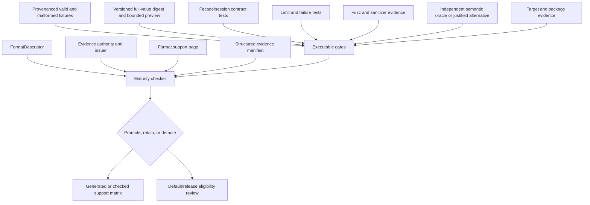

# ADR 0011: Format Maturity and Evidence Charter

## Status and Authority

This accepted ADR is the sole authority for format maturity levels, capability statuses, evidence
requirements, promotion/demotion, and user-facing format support claims.

`Accepted` means the charter governs format work; it does not promote any current format. Actual
maturity is declared by structured evidence and checked against code, docs, fixtures, and CI.
Transient test counts and work-unit status stay in verification records.

In this ADR, compatibility means conformance to Baozi's declared source-semantic contract. It does
not mean byte-for-byte output, memory-layout compatibility, API compatibility, or behavioral
identity with Assimp. Public API compatibility belongs solely to ADR 0006.

## Context

"Supports OBJ" or "supports glTF" is not a useful engineering claim. One implementation may parse a
triangle while silently dropping materials, hierarchy, sidecars, typed ranges, or required
extensions. Another may handle common files but panic or allocate without bounds on malformed data.
Crate existence, sample success, test count, and parser-backend reputation therefore cannot define
maturity.

Baozi needs support claims tied to a declared semantic subset and independent, executable evidence.
The same evidence must expose silent degradation, not merely prove that an importer produced an
object with plausible counts.

## Decision

Every first-party format inventory entry has an evidence-authority state, a complete capability
matrix, a durable support page, structured machine-readable evidence, and code-side
`FormatDescriptor`. Every active Baozi maturity claim has exactly one level and requires
`BaoziVerified`; an `Unverified` candidate has no Baozi maturity level. Those views must agree before
promotion or release.

ADR 0004 owns parser/backend admission. ADR 0005 and ADR 0026 own test and snapshot mechanisms. ADR
0007 owns feature membership. ADR 0034 owns targets. This ADR composes their evidence into a format
maturity decision without redefining those underlying contracts.

### Evidence Authority

Maturity level answers how mature a declared profile is; evidence authority answers who made and
verified that claim. They are independent fields with exactly these authority states:

| Authority | Meaning | Baozi support implication |
| --- | --- | --- |
| `Unverified` | no currently valid Baozi-managed verification record exists, whether absent, stale, failing, expired, or withdrawn | discovery metadata only; no Baozi maturity claim |
| `SelfAttested` | a named registrant asserts a level/profile and supplies its own evidence reference | display only with issuer and authority; never presented as Baozi Beta/Stable |
| `BaoziVerified` | Baozi's managed inventory binds the exact implementation/profile identity to reviewed evidence and passing gates | eligible for first-party maturity and release decisions |

An evidence profile has two canonical, machine-comparable identities. Its subject identity includes
the format ID and declared specification/subset, importer and backend artifact or source identity,
enabled feature composition, complete compiled option profile including defaults, recovery and loss
modes, and target/toolchain set. Its verification-record identity includes the evidence manifest and
corpus digests plus gate, harness, and oracle versions.

Support and maturity claims are keyed by `(format ID, evidence-profile subject identity)`, never by
format ID alone. Any subject change that can alter accepted input, canonical output, diagnostics,
dependency behavior, resource/safety behavior, or loss semantics creates a new unverified subject.
Adding evidence revises the verification record for the same subject; changing gate semantics
invalidates the old record until that exact subject passes the new gate. A runtime request outside
every verified subject remains `Unverified` or issuer-scoped `SelfAttested` and cannot inherit the
default profile's claim.

Loss of exact identity, an evidence withdrawal/expiry, or a failing required gate atomically removes
the `BaoziVerified` token and transitions that subject to `Unverified`; the old record remains
historical evidence only. The public Baozi maturity claim is removed in the same change. If baseline
safety still holds, the implementation may remain discoverable without a Baozi maturity level while
verification is rebuilt; a baseline-safety failure follows the disable/unregister rule below.

An external implementation is not permanently barred from `BaoziVerified`, but only Baozi's managed
inventory can bind one exact subject and verification record to that authority. A runtime descriptor
or plugin cannot issue `BaoziVerified` to itself.

### Evidence Flow

Importer-generated output is never its own only oracle. Shape/count assertions and self-generated
snapshots are useful regression signals but cannot independently prove semantic correctness.

### Admission Safety Before Maturity

Maturity classifies only a parser path already admitted to the first-party inventory. ADR 0004 owns
backend admission and ADR 0014 owns baseline hostile-data safety. At every maturity level, an admitted
path must bound attacker-controlled work and allocation, contain admitted malformed input as a typed
failure rather than panic or abort, route IO through the session, and prevent invalid validated
success.

A known baseline-safety failure is not an Experimental limitation. The affected path must be disabled
and unregistered, rejected, replaced, or isolated outside the in-process first-party inventory until
it passes admission again. Missing non-safety evidence such as semantic breadth, an independent
oracle, sustained campaign history, target promotion, or packaged-consumer proof may keep an admitted
format Experimental without weakening that baseline.

### Maturity Levels

| Level | Meaning | Minimum claim |
| --- | --- | --- |
| Experimental | safely admitted real import behavior exists for a narrow, changing slice | baseline admission safety, opt-in behavior, explicit unknowns/limits, no silent known loss, and baseline fixture/failure evidence |
| Beta | the declared common subset is usable and bounded through production paths | complete capability declaration plus facade, golden, malformed, limit, target, and sanitizer evidence for that subset |
| Stable | the declared subset is independently validated, portable on its target tier, packageable, and release-gated | all Beta evidence plus independent conformance/differential evidence, tolerated-difference records, sustained fuzz/security evidence, and packaged-consumer proof |
| Deprecated | a previously released support contract is intentionally being retired | reason, replacement or removal plan, release note, and continued truthfulness until removal |

The tier applies to the declared supported subset, not to the entire file-format specification. A
Stable importer can explicitly reject unsupported extensions. It cannot label unknown or silently
ignored semantics as Stable support.

Because Baozi has no released compatibility contract during the canonical v1 reset, obsolete
prototype parsers are deleted rather than placed in Deprecated. Deprecation exists for a future
released contract, not as storage for unfinished code.

### Capability Statuses

Each format classifies every capability dimension using exactly one status:

| Status | Contract |
| --- | --- |
| `Supported` | intended to preserve the declared semantics and covered by direct plus facade evidence |
| `Partial` | supported subcases and rejected/unsupported subcases are enumerated and tested |
| `ParsedLossy` | accepted only with an explicit structured loss diagnostic/report and strict fail-on-loss behavior |
| `IgnoredWithDiagnostic` | skipped intentionally with a stable diagnostic; never silent |
| `Unsupported` | rejected or unavailable through an explicit, tested outcome |
| `Unknown` | not yet investigated; allowed only at Experimental maturity |

The required dimensions are:

- geometry topology, logical meshes, primitives, and attribute domains
- hierarchy, transforms, instancing, and scene selection
- materials, images, textures, samplers, and external references
- cameras and lights
- animation, skinning, morph targets, and other deformers
- metadata and source provenance
- compression, containers, coordinate systems, and units
- malformed-input diagnostics and required-extension handling
- resource, graph, allocation, and external-resource limits
- declared target and platform behavior

Format-specific dimensions are added when the generic list cannot express a source-semantic
contract. Adding detail never permits omitting a generic dimension.

### Evidence Record

Each format evidence record identifies exact test targets/artifacts rather than prose such as
"covered". At minimum it records:

1. format ID, crate/implementation identity, feature, maturity, evidence authority and issuer,
   backend, dependency/license, supported spec/profile versions, targets, and gate/tool versions
2. a support page with complete capability statuses and known limitations
3. Baozi-owned or explicitly licensed fixture provenance for each declared semantic slice
4. parser-local grammar tests and facade/session success/failure tests
5. versioned, domain-separated stable digests of complete canonical values with bounded human
   previews; counts, key lists, or substrings alone are insufficient
6. malformed, truncation, overflow, invalid-reference, sidecar, required-extension, and exact-limit
   boundary cases applicable to the format
7. resource-ledger assertions and scale/work evidence for parser-specific structures
8. a public fuzz target, corpus provenance, sanitizer execution status, and crash-to-regression links
9. target-tier compile/test results and package-consumer evidence required for the claimed level
10. an independent normalized oracle or differential suite, plus explicit tolerated-difference
    records; if a comparison is inapplicable, a reviewed alternative must validate the semantics

Optional Assimp comparison runs only as a sandboxed external oracle over trusted, licensed fixtures.
It is non-authoritative, never linked into production, never the sole oracle, and never receives
arbitrary fuzz input. A backend parser and snapshots produced by that same backend do not count as
independent evidence.

### Promotion and Demotion

A maturity change is one reviewed change across descriptor, structured evidence, support page,
matrix, feature/release implications, and tests.

Promotion rules:

- every requirement of the target level is present and passing; waivers are explicit, scoped,
  expiring evidence records rather than untracked prose
- `Unknown` capability status blocks promotion beyond Experimental
- missing non-safety maturity evidence retains Experimental status and cannot be relabeled as an
  admission exception
- a known silent loss or required-extension drop must become an explicit rejection, supported
  recovery, or structured loss before any maturity claim; a panic, abort, unbounded allocation, or
  validation bypass invokes baseline-safety removal rather than merely blocking Beta/Stable
- Stable requires semantic evidence independent from the implementation under test
- Baozi Beta/Stable and every first-party maturity claim require `BaoziVerified`; a
  `SelfAttested` level remains visibly issuer-scoped even when its evidence is extensive
- Stable makes a format eligible for a released support promise; it does not automatically place it
  in `default-formats`, which ADR 0007 governs

Demotion rules:

- a newly discovered violation updates the evidence and user-facing claim in the same change
- a stale, expired, withdrawn, or failing required verification record transitions the exact subject
  to `Unverified` and removes its Baozi maturity claim atomically; a previous level is history only
- a baseline-safety failure disables and unregisters the affected path or moves it behind an admitted
  process boundary; maturity demotion alone is insufficient
- a non-safety semantic or evidence regression may demote immediately without a compatibility shim
- a temporary CI outage does not rewrite durable maturity, but the affected release/promotion is
  blocked until evidence is restored
- removal of a released Stable/Beta contract follows ADR 0006; removal of an unpublished prototype
  is direct

### Support Matrix

The support matrix is derived from or mechanically checked against structured evidence and
`FormatDescriptor`. It is a human-readable view, not an independent authority. Hand-editing a maturity
cell without matching evidence must fail the checker.

## Alternatives Considered

### Option A: Treat file-extension recognition as support

Pros:

- easy to market and maintain
- maximizes apparent format count

Cons:

- hides semantic loss and malformed-input failures
- gives users no actionable contract
- rewards shallow parser shells

Decision: rejected.

### Option B: Require complete specification coverage for Stable

Pros:

- simple interpretation of the Stable label
- avoids partial-support caveats

Cons:

- unrealistic for extensible or historically broad formats
- prevents reliable, useful subsets from earning stability
- conflates unsupported explicit rejection with incorrect behavior

Decision: rejected.

### Option C: Let test count or backend maturity determine the tier

Pros:

- cheap to automate
- leverages ecosystem reputation

Cons:

- counts do not prove semantic coverage
- backend tests do not prove Baozi conversion, policy, or facade behavior
- self-generated snapshots can preserve the same bug indefinitely

Decision: rejected.

### Option D: Stable declared subsets backed by structured independent evidence

Pros:

- produces honest, machine-checkable user promises
- supports incremental breadth without silent loss
- keeps promotion tied to source semantics and production paths
- permits backend replacement without redefining maturity

Cons:

- requires fixtures, goldens, fuzzing, docs, and independent oracles per format
- some formats remain Experimental longer

Decision: chosen.

## Consequences

Positive:

- users can distinguish parser existence from trustworthy support
- known unsupported semantics become explicit outcomes rather than silent drops
- maturity survives private backend replacement only when semantics still conform
- default and release decisions consume one structured source of evidence

Negative:

- every format carries ongoing evidence and documentation cost
- Stable promotion requires independent validation beyond regression snapshots
- newly discovered correctness issues may require visible demotion

## Risks and Mitigations

| Risk | Severity | Likelihood | Mitigation |
| --- | --- | --- | --- |
| Support docs drift from code | High | High | checker joins descriptor, evidence, matrix, feature, and tests by stable format ID |
| Third-party self-attestation appears to be a Baozi guarantee | High | Medium | store maturity level and evidence authority separately; reserve `BaoziVerified` construction for the managed inventory checker |
| Evidence is reused across behavior-changing profiles | Critical | Medium | key claims by canonical subject identity including compiled defaults, recovery/loss modes, backend/features, and targets |
| Snapshot proves only shape/counts | High | Medium | require complete canonical-value digest and mutation tests beyond bounded preview |
| Oracle reproduces importer/backend assumptions | High | Medium | require independent normalized source expectations and classify tolerated differences |
| Assimp is treated as ground truth | Medium | Medium | sandbox it externally, keep it optional/non-authoritative, and record oracle limitations |
| Stable gate becomes checkbox theater | High | Medium | evidence entries point to executable artifacts and negative checker tests |
| Simple formats face disproportionate overhead | Low | Medium | right-size fixtures while preserving every evidence category |
| Safety regression remains hidden behind Experimental maturity | Critical | Low | disable/unregister or process-isolate the path and remove it from first-party inventory until admission passes again |

## Acceptance Criteria

| Contract | Measurable evidence |
| --- | --- |
| Single maturity authority | ADR checker finds maturity definitions only here and references from backend/feature ADRs point here |
| Admission before maturity | checker fixtures reject assigning any maturity, including Experimental, to a first-party path that fails baseline admission safety |
| Complete declaration | every first-party format declares every required capability dimension; each verified Baozi claim has exactly one maturity, while an unverified candidate has none |
| Evidence authority | external registrations default to `Unverified`, self-attested fixtures retain issuer identity, and only an exact passing managed-inventory entry can construct `BaoziVerified` |
| Profile identity | changing any default, recovery/loss mode, backend/feature composition, target, or semantic option prevents reuse of the prior verified token; adding corpus evidence revises only the verification record |
| Evidence reachability | every structured evidence pointer resolves to a test, fixture, golden, fuzz target, provenance record, or reviewed exception |
| Semantic golden | mutation beyond the bounded preview changes the versioned full-value digest; count-only snapshots fail negative tests |
| Independent confidence | Beta/Stable gates reject importer-generated snapshots as the sole oracle; Stable has differential/conformance evidence or reviewed equivalent |
| Failure truthfulness | known unsupported/lossy semantics are explicit errors or structured diagnostics under strict policy |
| Atomic promotion | mismatched descriptor, evidence, matrix, feature/release status, or maturity value fails xtask |

## Implementation Evidence

These links locate evolving evidence; they do not themselves assert a maturity level:

- [Format support template](../formats/_template.md)
- [Format support matrix](../formats/support-matrix.md)
- [Canonical architecture refactor plan](../plans/2026-07-10-001-refactor-baozi-canonical-architecture-plan.md)
- [Testing and differential strategy](0005-testing-fuzzing-and-differential-oracle-strategy.md)
- [Validation, snapshot, and fuzz gates](0026-validation-snapshot-and-fuzz-gates.md)
