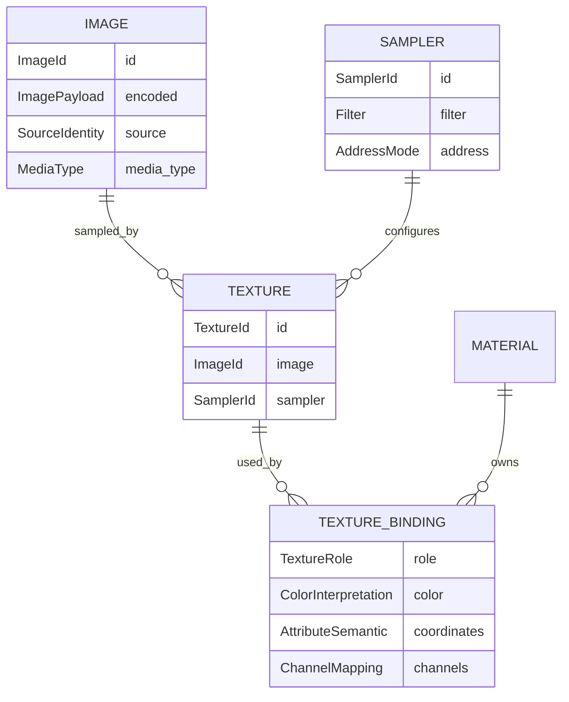

# ADR 0012: Material, Image, Texture, Sampler, and Color-Space Policy

## Context

The previous model combined image source bytes and sampler state in one `Texture`, then repeated a
new texture for each material slot. Assimp likewise exposes embedded bytes through
[`aiTexture`](https://github.com/assimp/assimp/blob/bcc62230fc0471475528d732f4ad108a59bb7f6c/include/assimp/texture.h)
and sampling/usage through material properties. That broad compatibility is useful evidence, but
conflating resource identity, sampling behavior, and material interpretation prevents faithful
reuse when one image is sampled in multiple ways or used once as color and once as data.

## Decision

The canonical scene has three separate dense identities:

- `Image` identifies one immutable owned encoded-image payload. `ImagePayload::Encoded` is a bounded
  shared byte buffer plus media/encoding hints and an optional content digest. Dimensions or encoded
  metadata may be present when known. Decoded pixels are not required for model import success and,
  if introduced as a cache, use ADR 0032's derived-data contract.
- `Sampler` identifies minification, magnification, mip filtering, and address modes. An explicit
  canonical default sampler exists when the source omits one.
- `Texture` pairs exactly one `ImageId` with one `SamplerId`. It has no material role or color-space
  interpretation.

A material `TextureBinding` references `TextureId` and owns usage semantics: role, UV or other
mapping source, coordinate set, transform, channel mapping, color interpretation, scale/strength,
blend operation when representable, and bounded source key.

Texture bindings are an ordered, material-owned semantic sequence. Stored order preserves source
order; a source key identifies a source slot but never determines order or authority. Every canonical
v1 role admits exactly one binding in a material workflow and uses `Replace`. The current appearance
domain is closed: a second binding for a role or an unrepresented behavior requires explicit
unsupported/loss evidence. Introducing a layer descriptor requires a concrete producer, owned typed
storage, central validation, snapshot traversal, and edit/remap rules in the same change. Its contract
must define accumulator seed, factor combination, strength meaning, allowed blend operations, and
unique layer authority. A bare schema identifier does not supply those semantics.

Equal texture, image, URI, source-key text from another material, or sampled content never authorizes
binding deduplication or reordering. Canonical roles reject incompatible color/data interpretations;
image encoding/profile claims remain preserved separately and produce diagnostics rather than
implicit pixel conversion.

The canonical two-dimensional transform uses column-vector semantics:
`uv' = offset + R(rotation_radians) * (scale component-wise-multiplied by uv)`, rotating about
`(0, 0)` in the declared UV coordinate basis. Adapters convert source pivot, origin, sign, and
operation order into this form. An unrepresentable source transform requires explicit
unsupported/loss evidence until a complete behavior descriptor is admitted.

Material factors are linear numeric values. A binding declares whether sampled values are sRGB
color, linear color, or uninterpreted data. Base-color, diffuse, and emissive bindings default to
sRGB only when the format specifies that rule or the format's normative convention does. Normal,
metallic, roughness, occlusion, mask, height, and displacement bindings are data. Image-level ICC,
transfer, or encoding metadata records what bytes claim; it does not replace the binding's usage
interpretation.

Canonical v1 role semantics are explicit. Central Scene validation checks the declared role,
color/data interpretation, channel mapping and lane count, factor, strength, and unit without
decoding an encoded `Image`. Samples are decode/evaluation-time values taken after channel mapping
and any declared color transfer. The decoder/evaluator rejects non-finite or role-incompatible
sample values with a typed decode/evaluation failure rather than clamping them; import success does
not claim that encoded samples were decoded or validated.

| Role | Required sampled lanes | Canonical combination |
| --- | --- | --- |
| Base color, diffuse | RGB or RGBA color | linear sampled RGB multiplied component-wise by its typed material factor and a binding strength in `[0, 1]`; mapped alpha contributes only through the opacity rule below |
| Specular | RGB color | linear sampled RGB multiplied component-wise by its typed material factor and a binding strength in `[0, 1]` |
| Emissive, sheen color | RGB color | linear sampled RGB multiplied component-wise by its nonnegative finite material factor and nonnegative finite binding strength |
| Metallic, roughness, clearcoat, clearcoat roughness, transmission, sheen roughness | one data lane in `[0, 1]` | unit-interval material factor multiplied by the sample; canonical binding strength is one |
| Metallic-roughness | exactly two explicitly mapped data lanes in `[0, 1]` | metallic and roughness factors multiply their named lanes independently; canonical binding strength is one |
| Occlusion | one data lane in `[0, 1]` | with strength `s` in `[0, 1]`, factor is `1 + s * (sample - 1)` |
| Opacity | one data lane in `[0, 1]` | effective opacity is material opacity times active base/diffuse alpha times `1 + s * (sample - 1)`, with strength `s` in `[0, 1]` |
| Normal, clearcoat normal | two or three data lanes | finite signed strength scales tangent-space X/Y before checked normal reconstruction/normalization; no color transfer applies |
| Displacement | one finite data lane | signed Scene-unit offset is `sample * strength`; nonzero bias or unknown units require an admitted schema or explicit loss/failure |
| Thickness | one data lane in `[0, 1]` | nonnegative Scene-unit material thickness multiplied by the sample; canonical binding strength is one |

`MetallicRoughness` is mutually exclusive with either separate `Metallic` or `Roughness` authority in
the same material workflow. The declared `ShadingModel` selects the active base-color or diffuse
factor family. `Opacity` is an explicit multiplier under the formula above, not a competing override
of mapped color alpha. Any other cross-role combination that writes the same evaluated factor is
rejected until a complete typed descriptor defines and validates the composition.

`Height` and `Lightmap` are not canonical v1 roles. `Height` lacks a format-independent zero, unit,
and direction; `Lightmap` conflates irradiance color, ambient occlusion, shadow masks, and
engine-specific baking products. A format maps the actual semantic to a precise role or reports
unsupported/loss. Historical slot names are never behavioral authority.

PBR base/diffuse/specular colors, metallic, roughness, glossiness, opacity, and alpha cutoff use the
closed unit interval. Emissive and legacy ambient/diffuse/specular/emissive values are finite and
nonnegative and may exceed one to preserve high-dynamic-range source truth; legacy shininess is
finite and nonnegative. Canonical construction never clamps a source value into range.

Typed material fields cover stable cross-format concepts. Legacy fields remain source truth and PBR
approximations never erase them. Rare or source-specific properties use ADR 0023's bounded,
namespaced extension values only when they are descriptive. A source texture behavior without a
represented canonical role returns structured unsupported/loss evidence under caller policy.
Producerless `Namespaced` variants and empty schema-snapshot placeholders are not retained in the
appearance API. Metadata alone never pretends to preserve rendering behavior and no unknown role is
mislabeled as known. ADR 0023 defines the admission requirements for a future typed descriptor.

One retained appearance owner holds five typed row tables and two contiguous pools: encoded image
bytes and UTF-8 text. Shared domain values serve authoring, central validation, and public reads
directly; duplicate `*Kind` enums and channel-mapping wrappers are unnecessary. Images preserve source
identity independently of equal content. Text is ordered by image media declarations, binding source
keys, then material names; optional empty names remain distinct from absence. Unchanged edits share
the complete owner, and readers borrow its actual payloads without a record decoder or projection.
Closed material and binding behavior values are owned by their semantic values; only names and
descriptive source keys borrow producer text. This keeps authoring lifetimes tied to actual text
ownership and permits temporary validated behavior values without reference scaffolding.

Embedded and external images use the same owned payload shape. External resolution occurs through
the import session, which authorizes and snapshots the exact encoded bytes before transferring them
to the scene. An optional sanitized `ReloadHint` and source identity remain provenance only: they are
not a resolver capability, do not promise equal future content, and are not required for result
availability. The canonical scene does not require PNG, JPEG, WebP, KTX, DDS, or EXR decoding.

## Considered Options

### Option A: One texture object per material slot

This is easy for importers, but duplicates image bytes and sampler state and cannot express shared
identity accurately. Rejected.

### Option B: Image plus role-specific texture objects

This separates bytes but still puts color space and role on a reusable texture, making the same
image/sampler pairing impossible to use with different interpretations. Rejected.

### Option C: Image, sampler, texture, and material binding

This mirrors the independent concepts used by modern formats while still representing Assimp-style
legacy slots and embedded payloads. Chosen.

### Option D: Unordered role bag with filename or content deduplication

This appears convenient for legacy slots, but destroys layer evaluation order, aliases equal-looking
resources across different material authorities, and cannot represent source transform conventions.
Rejected.

## Consequences

- Importers deduplicate identities only when the source identities are genuinely shared; matching
  filenames alone are insufficient.
- Material snapshot tests must cover the full binding, not just a URI and role.
- Image decode and GPU upload stay outside canonical import success.
- The breaking cutover deletes the combined image/sampler `TextureSource` model rather than keeping
  parallel legacy types.

## Risks and Mitigations

| Risk | Severity | Mitigation |
| --- | --- | --- |
| More IDs complicate simple rendering | Low | Provide convenience access from a binding to its texture, sampler, and image. |
| Color interpretation conflicts with embedded profiles | High | Preserve both claims, diagnose conflict, and never transform pixels implicitly. |
| External resource identity leaks host paths | High | Use sanitized logical resource identity and keep backend handles/report details private. |
| Legacy blend semantics are not representable | Medium | Return explicit unsupported/loss evidence; admit a future descriptor only with complete production, validation, snapshot, and remap support. |
| Layer order or authority is inferred from a map/key | High | Preserve material-owned sequence order and canonical single-role authority; reject unrepresented layers. |
| Combined and separate roles both write one factor | High | Enforce the canonical cross-role mutual exclusions and opacity composition rules before publication. |

## Success Metrics

| Metric | Target | Measurement |
| --- | --- | --- |
| Identity separation | One image can participate in multiple sampler pairs and binding interpretations without byte duplication | shared-image fixture and allocation counts |
| Session independence | Every published image's encoded bytes remain readable after import resources are dropped | external/embedded/data-URI lifetime tests |
| Color correctness | Color/data interpretation exists only on bindings and never silently transforms encoded bytes | binding snapshots and decode-spy tests |
| Binding fidelity | ordered bindings, source keys, and represented source transforms survive canonical snapshots; unrepresented layers fail explicitly | material and UV-transform fixtures |

## Acceptance Criteria

- A fixture reuses one image with two samplers without duplicating image content.
- A fixture reuses one texture as both color and data through two bindings with distinct semantics.
- Embedded compressed image import succeeds without image decoding.
- External encoded image bytes remain owned and usable after the import session and resolver are
  dropped; changing the reload target does not change the published payload.
- Normal/data bindings never receive implicit sRGB conversion.
- Canonical-role import fixtures cover every declared lane count, color/data compatibility,
  unit-range factor, nonnegative HDR factor, role formula, unit, and finite signed
  normal/displacement strength without requiring image decode; invalid declarations fail rather than
  clamp.
- Separate decode/evaluation fixtures cover role-specific sample finiteness and ranges; invalid
  decoded samples produce typed failure and never retroactively turn encoded-image import into a
  decode requirement.
- Source `Height` and `Lightmap` slots cannot enter as generic canonical roles: precise displacement,
  irradiance, occlusion, and other known uses become precise roles or admitted schemas, while unknown
  uses produce explicit unsupported/loss evidence.
- An unknown source texture behavior produces explicit unsupported/loss evidence until a complete
  typed descriptor is admitted; metadata-only preservation fails the contract.
- Every texture, image, sampler, and binding reference is range-validated and resource-bounded.
- Ordered binding fixtures preserve source order and reject multiple bindings for a role whose
  represented contract has no layer semantics.
- Metallic-roughness versus separate-role conflicts fail; opacity fixtures prove the exact
  material-factor, active color-alpha, texture-sample, and strength composition.
- Pivot/origin/order variants normalize to the canonical UV formula or produce explicit
  unsupported/loss evidence; none is interpreted with Assimp's or a backend's implicit pivot.
