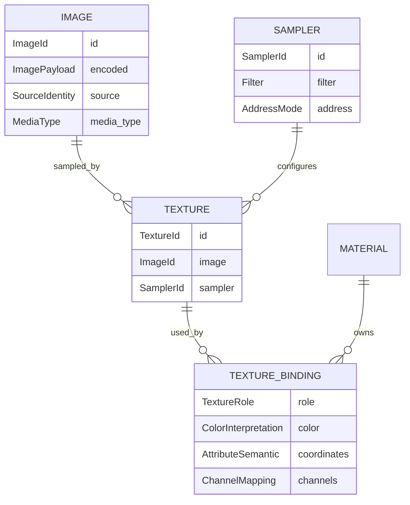

# ADR 0012: Material, Image, Texture, Sampler, and Color-Space Policy

## Context

The previous model combined image source bytes and sampler state in one `Texture`, then repeated a
new texture for each material slot. Assimp likewise exposes embedded bytes through
[`aiTexture`](https://github.com/assimp/assimp/blob/bcc62230fc0471475528d732f4ad108a59bb7f6c/include/assimp/texture.h)
and sampling/usage through material properties. That broad compatibility is useful evidence, but
conflating resource identity, sampling behavior, and material interpretation prevents faithful
reuse when one image is sampled in multiple ways or used once as color and once as data.

## Decision

The canonical scene has three separate dense identities:

- `Image` identifies one immutable owned encoded-image payload. `ImagePayload::Encoded` is a bounded
  shared byte buffer plus media/encoding hints and an optional content digest. Dimensions or encoded
  metadata may be present when known. Decoded pixels are not required for model import success and,
  if introduced as a cache, use ADR 0032's derived-data contract.
- `Sampler` identifies minification, magnification, mip filtering, and address modes. An explicit
  canonical default sampler exists when the source omits one.
- `Texture` pairs exactly one `ImageId` with one `SamplerId`. It has no material role or color-space
  interpretation.

A material `TextureBinding` references `TextureId` and owns usage semantics: role, UV or other
mapping source, coordinate set, transform, channel mapping, color interpretation, scale/strength,
blend operation when representable, and bounded source key.

Material factors are linear numeric values. A binding declares whether sampled values are sRGB
color, linear color, or uninterpreted data. Base-color, diffuse, and emissive bindings default to
sRGB only when the format specifies that rule or the format's normative convention does. Normal,
metallic, roughness, occlusion, mask, height, and displacement bindings are data. Image-level ICC,
transfer, or encoding metadata records what bytes claim; it does not replace the binding's usage
interpretation.

Typed material fields cover stable cross-format concepts. Legacy fields remain source truth and PBR
approximations never erase them. Rare or source-specific properties use ADR 0023's bounded,
namespaced extension values. A source texture behavior without a canonical role remains a typed
binding with a validated namespaced role and representable usage parameters. If its behavior cannot
be represented, import returns structured unsupported/loss evidence under caller policy; metadata
alone never pretends to preserve rendering behavior and no unknown role is mislabeled as known.

Embedded and external images use the same owned payload shape. External resolution occurs through
the import session, which authorizes and snapshots the exact encoded bytes before transferring them
to the scene. An optional sanitized `ReloadHint` and source identity remain provenance only: they are
not a resolver capability, do not promise equal future content, and are not required for result
availability. The canonical scene does not require PNG, JPEG, WebP, KTX, DDS, or EXR decoding.

## Considered Options

### Option A: One texture object per material slot

This is easy for importers, but duplicates image bytes and sampler state and cannot express shared
identity accurately. Rejected.

### Option B: Image plus role-specific texture objects

This separates bytes but still puts color space and role on a reusable texture, making the same
image/sampler pairing impossible to use with different interpretations. Rejected.

### Option C: Image, sampler, texture, and material binding

This mirrors the independent concepts used by modern formats while still representing Assimp-style
legacy slots and embedded payloads. Chosen.

## Consequences

- Importers deduplicate identities only when the source identities are genuinely shared; matching
  filenames alone are insufficient.
- Material snapshot tests must cover the full binding, not just a URI and role.
- Image decode and GPU upload stay outside canonical import success.
- The breaking cutover deletes the combined image/sampler `TextureSource` model rather than keeping
  parallel legacy types.

## Risks and Mitigations

| Risk | Severity | Mitigation |
| --- | --- | --- |
| More IDs complicate simple rendering | Low | Provide convenience access from a binding to its texture, sampler, and image. |
| Color interpretation conflicts with embedded profiles | High | Preserve both claims, diagnose conflict, and never transform pixels implicitly. |
| External resource identity leaks host paths | High | Use sanitized logical resource identity and keep backend handles/report details private. |
| Legacy blend semantics are not representable | Medium | Preserve a typed extension and record conversion loss instead of inventing a close role. |

## Success Metrics

| Metric | Target | Measurement |
| --- | --- | --- |
| Identity separation | One image can participate in multiple sampler pairs and binding interpretations without byte duplication | shared-image fixture and allocation counts |
| Session independence | Every published image's encoded bytes remain readable after import resources are dropped | external/embedded/data-URI lifetime tests |
| Color correctness | Color/data interpretation exists only on bindings and never silently transforms encoded bytes | binding snapshots and decode-spy tests |

## Acceptance Criteria

- A fixture reuses one image with two samplers without duplicating image content.
- A fixture reuses one texture as both color and data through two bindings with distinct semantics.
- Embedded compressed image import succeeds without image decoding.
- External encoded image bytes remain owned and usable after the import session and resolver are
  dropped; changing the reload target does not change the published payload.
- Normal/data bindings never receive implicit sRGB conversion.
- An unknown source texture behavior remains a namespaced typed binding or produces explicit
  unsupported/loss evidence; metadata-only preservation fails the contract.
- Every texture, image, sampler, and binding reference is range-validated and resource-bounded.
