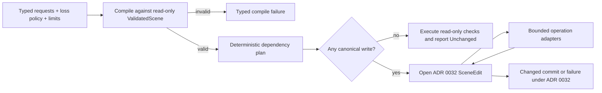

# ADR 0013: Direct Postprocess Operations, Composition, and Triangulation Boundary

## Context

Importers must preserve source meaning while post-processing performs explicit normalization,
repair, derivation, and renderer-oriented lowering. The previous pipeline represented operations as
unit enum flags, silently reordered them through one fixed global list, and mutated an owned `Scene`
directly. That model could not express parameters, loss policy, conflicts, remaps, cancellation, or
derived-data invalidation. It also made validation look like an optional pipeline step even though a
successful scene must already carry a validation proof.

Triangulation is the first operation that makes those defects unsafe. A triangle fan is wrong for
concave polygons, and an unchecked tessellator can silently accept self-intersection, non-finite
coordinates, or a different winding. Baozi therefore needs a private geometry kernel behind
Baozi-owned preconditions and independent output checks.

Delivery plan F starts with one concrete operation against one primitive. Requiring a general
dependency scheduler, replay engine, or plugin system before that operation would add machinery
without an execution-order problem to solve. Composition remains a separate extension with explicit
requirements when multiple implemented operations need it.

## Authority Boundary

This ADR owns the importer/post-process separation, request compilation, preset rules, execution
orchestration, and triangulation backend admission. It imports, rather than redefines, these
authorities:

| Contract | Authority |
| --- | --- |
| `SceneConstruction`, `SceneDraft`, `ValidatedScene`, and `SceneEdit` states | ADR 0045 |
| scene-space and numeric conventions | ADR 0008 |
| primitive topology and Vertex/Corner/Face/Instance domains | ADR 0030 |
| operation descriptors, read/write sets, remaps, loss records, invalidation, and `SceneEdit` transaction/commit/rollback | ADR 0032 |
| cancellation, progress, callback safety, and work checkpoints | ADR 0033 |

Terms from those contracts retain exactly the meaning assigned by their authority.

## Decision

### Importer Boundary

Importers produce source-preserving validated scenes. They may decode format-required structures,
resolve declared dependencies, preserve source topology, perform bounded structural repair required
by the format, and reject unsafe input. Any repair is diagnosed.

Importers do not silently triangulate polygons, normalize coordinates or units, flip winding or UVs,
generate normals or tangents, merge vertices, optimize graphs, or remove degenerates for renderer
convenience. A format-required exception must be documented by that format and represented in
provenance or diagnostics.

### Direct Typed Operations Before General Composition

A direct typed operation may validate its parameters and inspect the input `ValidatedScene`
read-only, derive a concrete bounded plan, and execute through `SceneEdit`. A single operation does
not require a dependency DAG, generic descriptor registry, replay engine, or plugin system. Its
concrete plan still declares reads, writes, remaps, preservation/invalidation, losses, and checked
resource bounds before replacement storage is constructed.

`baozi-postprocess` owns its direct-operation, report, and failure vocabulary. Those types reuse
runtime-neutral operation mechanisms from `baozi-operation`; they do not reinterpret `baozi-import`
reports or outcomes. Diagnostic, loss-policy, and composed-step types belong with concrete operations
that need them, rather than empty public placeholders.

When composition demonstrates a dependency or conflict requirement, a caller may submit multiple
typed operation requests, a postprocess-owned loss policy, and operation limits to a shared compiler.
The compiler would inspect the input read-only and return an ordered plan or a typed compile
failure before editing. Each request resolves to its ADR 0032 operation effects. That compiler:

1. canonicalizes composable duplicates and rejects every other duplicate or contradictory request;
2. validates every parameter and required input capability;
3. checks dependencies, conflicts, declared losses, read/write sets, and invalidation obligations;
4. calculates checked output, scratch, peak-live, and work bounds before reserving or mutating;
5. builds a dependency directed acyclic graph and rejects cycles; and
6. emits one deterministic topological order, using stable operation key and then canonical
   parameter key as tie-breakers for independent operations.

There is no fixed global operation order. For composed requests, dependencies cause visible plan
edges; conflicts are compile errors rather than hidden reordering. Request order is not a semantic
tie-breaker. Operations that are not provably independent through their descriptors must declare a
dependency or conflict.
A canonical parameter key is a schema-defined typed total order, never `Debug` text, map iteration,
or a process-random hash. Duplicate composition must be order-independent; otherwise duplicates are
rejected.
A validator is not a user-requestable transformation: the input is already validated, and successful
`SceneEdit` commit performs final central validation.

Public request types contain only implemented operations. A future operation lands together with its
typed parameters, descriptor, implementation, report schema, and tests; an unimplemented enum value
or silent no-op is forbidden.

The public composed outcome distinguishes three successful states:

- `NotRequested`: no postprocess request was submitted; no plan, edit, or postprocess report exists,
  and the imported validated scene retains its generation;
- `Unchanged`: postprocess was requested and reports its compiled plan and step outcomes, but no
  canonical write was required; no `SceneEdit` is committed and the input proof, digest, and
  generation are returned unchanged; and
- `Changed`: at least one declared write commits through `SceneEdit`, so ADR 0032 publishes a newly
  validated scene with a fresh generation.

An operation that is inapplicable or already satisfied may produce an explicit, coded unchanged step
outcome; it cannot disappear silently. Compile or execution failure remains a failure and publishes
no new scene. Each direct operation or composed plan determines whether canonical writes are needed
before replacement construction, so an empty or effect-free invocation never mints identity merely
because postprocess was invoked.

The following replay rules apply when an executor supports cross-invocation history lookup. They
are not prerequisites for the first direct operation, which reevaluates the live target and never
uses detached reports or an "already ran" flag to skip execution.

Replay is determined by normalized operation identity (operation ID, semantic version, and normalized
parameter digest), the current pre-invocation semantic-input stamp, an ADR 0032-qualified prior
application record's post-write semantic-input stamp, and its postcondition; a prior-invocation flag
is never execution authority. Every operation declares whether it is state-idempotent or
intentionally repeatable.

Every descriptor defines a versioned semantic-input-stamp schema over its complete declared read set
and a versioned postcondition. The compiler recomputes that deterministic stamp from semantic values,
not scene-generation tokens or process-local identity, before each invocation. It compares that
current pre-invocation stamp only with a record selected by ADR 0032's deterministic conservative
lookup; missing, deleted, or conflicting evidence forces execution, and the prior pre-write stamp is
audit evidence. Operation identity, stamp schema, and postcondition version are machine-comparable
parts of the compiled plan and step outcome; an opaque `already-ran` marker is insufficient.

Replaying a state-idempotent operation with the same identity yields a coded unchanged step when its
current pre-invocation stamp equals the qualified record's post-write stamp and its independently
recomputed postcondition still holds. It performs no canonical write and appends no provenance. A
changed declared input, parameter digest, or semantic version requires reevaluation. Missing or
ambiguous history also reevaluates rather than guessing. A repeatable operation is reevaluated on
every request and cannot be suppressed solely by matching history. A replayed plan is `Unchanged`
only when every step is unchanged.

The following diagram describes composed execution; a direct operation performs its own concrete
preflight and uses the same edit boundary.

### Execution Orchestration and Reports

Postprocess never mutates canonical scene storage directly. It executes read-only/unchanged steps
without opening an edit, and executes any operation with a canonical write only through the
`SceneEdit` transaction owned by ADR 0032. A direct operation owns its runtime and report assembly;
a composed executor coordinates those operations when composition exists. ADR 0032 exclusively
defines staging, commit, rollback, remap publication, derived-data validity, and preservation of the
input generation on failure.

A successful direct `PostProcessReport` contains `PostProcessOperation::Triangulate { target }`,
the explicit `Unchanged` or `Changed` disposition, input/output generations, real resource evidence,
and the actual retained triangulation remap when changed. The descriptor records the operation
evaluated against that exact input; it is neither an executable plan nor replay authority.
`Unchanged` reports contain no fabricated remap or committed-output evidence. Post-processing does
not mutate, relabel, or return an `ImportReport`; import outcome ownership remains separate.
A direct operation's input-to-final relation is complete without compiled-step wrappers, a generic
remap-composition engine, or an intermediate Scene generation. A future composed executor must define
its own concrete report requirements alongside its implementation.

`convert_scene_space` is a direct whole-Scene operation. Its descriptor contains the exact input
generation and `SpaceConversionOptions`; it does not manufacture a single-primitive target. Known
source declarations and explicit assumptions resolve before collection traversal. The same closed
Scene-edit transaction then prepares one exact-source plan for nodes, geometry, deformation,
animation, spatial declarations, and owner provenance.
The changed report owns centrally validated source/target facts, actual assumption fields, and
triangle-lane reversal evidence independently of either Scene. An already satisfied target with no
assumed source fields is `Unchanged`; filling unknown declarations is a canonical change even when
numeric coordinates already match. A source conflict, numeric failure, unsupported present
semantic, resource failure, or cancellation returns the original Scene and available terminal
evidence. ADR 0008 defines the arithmetic and ADR 0032 defines the current capability boundary.

The following sequence applies when a composed executor is introduced.

### Presets Are Inspectable Recipes

`Raw` means no post-process request; import validation is already mandatory. Other convenience
presets are constructors for explicit typed requests, not special execution paths. Their expansion
is inspectable before execution and repeated in the report.

A named preset is exposed only when every operation in its expansion is implemented. Preset names
must not advertise future behavior, multiple quality names must not alias the same placeholder
subset, and expansion changes require snapshot and integration-test updates. Callers may edit the
expanded requests before compilation.

### First F Increment: One Primitive

The concrete entry point is
`triangulate_primitive(input: ValidatedScene, target: PrimitiveId, control)`. It targets every face of
one `Polygons` primitive, including the target's exact generation and logical-mesh owner. Other
primitive topologies are rejected; an existing `TriangleList` or an empty polygon primitive returns
the original Scene as `Unchanged`. Selecting or scheduling multiple primitives is outside this
increment.

Postprocess starts one operation against the input's existing physical account before inspecting
the target or constructing scratch and origins. It owns the runtime, polygon checks, and report.
Core extends its closed `SceneEdit` program with a typed geometry replacement, validates the actual
candidate and retained origin relation, and uses the existing joint generation/freeze/handoff
boundary. The operation does not re-author the input through fresh Scene construction or maintain a
second canonical Scene representation.

A changed report owns the actual rooted origin relation, not a reconstruction from diagnostics:
one source-corner ordinal per output corner and source-face output-triangle prefix offsets.
ADR 0032 defines its ownership, endpoint qualification, and independent lifetime. The failure value
returns the exact original immutable `ValidatedScene`, including on startup rejection, cancellation,
resource failure, or containment. A failure publishes no candidate Scene or successful remap;
containment remains distinct from an ordinary rich failure or minimal fallback.

Authored normals and tangents are source fields. Vertex values retain their identity and order;
Corner/Face fields follow the explicit origins without recomputation. Preserving those values
does not claim that geometric normals or tangents were generated for the new triangles.

The direct triangulation increment does not implement general scheduling, cross-invocation replay,
coordinate/unit conversion, or unification of corner attributes into application vertex tuples.
Triangulation alone does not complete plan F or promise a GPU-ready vertex/index layout.

`generate_normals` provides typed Flat/Smooth, authored-normal preservation/replacement, and
tangent rejection/removal policies. It shares the same geometry
publication transaction rather than introducing a scheduler or a second Scene representation.
ADR 0032 defines its attribute-owner mapping, metadata deletion, provenance parents, and retained
operation-specific report evidence. Normal generation remains an explicit caller operation after
triangulation; importers do not perform it silently.

### Triangulation Contract

Triangulation operates per polygon face and keeps the public and core boundary independent of any
tessellation crate. The private adapter accepts one projected simple ring and returns only indices
into its working ring. Canonical positions remain owned by the primitive.

Before calling a backend, Baozi must:

- enforce per-polygon corner, scratch, output, work, and cancellation bounds, including a
  conservative peak-live allowance for backend-internal buffers before entry;
- validate all source indices and finite 3D positions;
- compute a stable plane and reject a degenerate or materially non-planar ring under a documented,
  scale-aware tolerance;
- project in `f64`, retain a working-corner to source-corner map, and prove a non-zero signed area;
- reject non-adjacent intersections, overlapping edges, and other non-simple rings;
- handle consecutive duplicate or zero-length edges only through an explicit reject-or-repair
  option whose repair is admitted by the loss policy and recorded in the corner remap; and
- keep long collinear boundary chains when they still form a valid simple polygon, without relying
  on the backend to diagnose degeneracy.

After the backend returns for a retained working ring of `n` corners, Baozi checks all of the
following inside the declared postflight work cap:

- exactly `n - 2` triangles for the simple no-hole ring, with checked arithmetic;
- every index in range, three distinct corners per triangle, and finite non-zero triangle area;
- every retained working corner, and therefore every non-repaired source corner, referenced by at
  least one triangle; repaired-away corners remain visible in loss/remap evidence;
- every ring boundary edge used exactly once in source direction after reorientation, and every
  interior edge used exactly twice in opposite directions;
- the triangulated disk satisfies `V - E + F = 1`, with `F` counting output triangles and excluding
  the exterior face;
- no improper crossing or overlap between output edges, no triangle interior outside the projected
  ring, and no pair of triangle interiors overlapping; and
- consistent source winding, polygon/triangle area agreement within the declared scale-aware
  tolerance, and deterministic indices.

These index, incidence, Euler, intersection, winding, and area checks are cross-validation rather
than interchangeable heuristics. Backend output is reoriented to match source face winding before
the directed-edge checks. Any failed postcondition is a typed backend fault handled by the ADR 0032
transaction.

Triangulation leaves vertex-domain attributes unchanged, maps every output corner to its source
corner, duplicates face-domain values and material binding for each produced triangle, and publishes
the one-source-face-to-many-output-faces remap required by ADR 0032. It may not silently invent or
drop domain data. Supported dense and sparse encodings retain their scalar kind, scalar bits,
explicit sparse entries, and defaults. Unsupported present data must cause rejection rather than
loss or an implicit precision conversion.

Canonical polygon faces do not currently model interior holes. Adding holed faces requires a new
canonical topology decision and a repeated admission test. An external backend's hole API would
not by itself establish a public promise.

### Concrete Kernel and Historical Backend Admission

The first F operation uses the private Baozi kernel in
`crates/baozi-postprocess/src/triangulation.rs`. It performs ear clipping on a single simple planar
ring without holes, uses caller-admitted scratch and output slices, and returns only source-corner
indices. The kernel allocates no storage internally. Projection and predicates use normalized
`f64`; numerically unresolved geometry is rejected conservatively rather than repaired or accepted
under an exact-predicate claim.

The caller derives checked per-face scratch, output, and work bounds before entry. The kernel and
independent postflight poll the operation's control at input-dependent loop checkpoints. Partial
scratch or output remains private candidate data and is discarded on any error. The private kernel
does not generate points, remove source corners, repair intersections, bridge holes, or fall back to
a triangle fan.

Independent postflight checks the geometric contract above before core receives the origin
relation. Core then checks the retained indices and Corner/Face values against that same relation
as part of final candidate validation. Kernel, adapter, correspondence, cancellation, and lifetime
tests are required integration evidence; this ADR amendment is not a claim that those gates have
all passed.

The earlier decision selected GeoRust `earcut` 0.4.10 behind Baozi checks. Its package/source,
portability, license, and failure analysis remain historical evidence in
`docs/research/triangulation-backend-admission.md`; they do not describe the current F execution
path. An external backend is not a prerequisite for this direct operation, and there is no runtime
fallback to that historical selection. Introducing or refreshing an external backend requires an
explicit admission decision with exact dependency identity, notice preservation, portability,
sanitizer, and adapter-conformance evidence. Historical evidence alone does not authorize it.

## Alternatives Considered

### Option A: GeoRust `earcut` behind Baozi validation and output checks

Pros:

- Correct concave simple-ring results in both source windings after adapter reorientation.
- Native `f64`, source indices, reusable buffers, `no_std`, and a small dependency graph.
- Maintenance captured by the admission record, compatible license, MSRV, and WASM evidence.

Cons:

- Unit-returning API does not report invalid geometry.
- Invalid rings can produce plausible but wrong triangles.
- Internal unsafe code and documented panic preconditions require a narrow audited boundary.

Decision: historical conditional selection; superseded for the first F operation by the private
kernel below. Its admission record remains available for a future explicit backend decision.

### Option B: `lyon_tessellation`

Pros:

- Mature, maintained fill tessellator with a typed error enum.
- Handles path intersections for graphics filling and compiles for WASM.

Cons:

- Core path/tessellation coordinates are `f32`.
- It emits a generated vertex buffer rather than source-corner indices and may add an intersection
  vertex for a self-intersecting path.
- Debug and release behavior differed for non-finite spike inputs; infinity succeeded in release.
- The dependency graph and mapping adapter are materially larger than `earcut` for this use case.

Decision: rejected as the initial backend; retained only as an explicit future replacement candidate.

### Option C: `i_triangle`

Pros:

- Actively maintained pure-Rust project with robust integer geometry machinery and `f64` input.
- Repairs complex outlines and can produce high-quality triangulations.

Cons:

- Float input is quantized into an integer core, reordered, and returned with a new point buffer.
- Default validation repairs a bow-tie by inserting intersection points instead of rejecting it.
- Duplicate and collinear points are removed, so source-corner identity is not preserved directly.
- Its larger overlay/tree/sort stack solves a broader problem than Baozi needs.

Decision: rejected for the source-preserving post-process boundary.

### Option D: Keep the hand-written triangle fan

Pros:

- No external dependency and complete local control.

Cons:

- A fan is incorrect for concave polygons.
- It cannot establish the required corner, winding, and area contract for general simple rings.

Decision: rejected; a fan is not an execution path or fallback.

### Option E: Bounded private ear clipping with independent postflight

Pros:

- Caller-owned scratch/output and cooperative work checkpoints fit the existing operation runtime.
- Source-corner indices preserve domain identity without generating or repairing geometry.
- One concrete operation can land without a scheduler or dependency backend.

Cons:

- Baozi owns numeric admission, clipping, and independent postflight maintenance.
- Conservative predicates reject uncertain geometry rather than providing exact geometric predicates.
- Kernel tests alone do not establish Scene transaction, ownership, or publication correctness.

Decision: chosen for the first F increment, subject to its complete integration gates. The supported
input remains simple planar rings without holes.

## Consequences

Positive:

- Parsing and transformation remain independently testable and source-preserving.
- Operation order, loss, budgets, and capability failures are visible before mutation.
- Failed pipelines cannot publish partially transformed or falsely validated scenes.
- Concave polygon support keeps the kernel private and validates its output independently.

Negative:

- Every operation needs concrete effect declarations, preflight, staging, and report evidence.
- Triangulation pays for Baozi-owned planarity, simplicity, mapping, and output checks in addition to
  backend work.
- Preset expansion is a compatibility surface that requires tests and documentation.

## Risks and Mitigations

| Risk | Severity | Likelihood | Mitigation |
| --- | --- | --- | --- |
| Hidden plan reorder changes semantics | High | Medium | Dependency DAG plus deterministic visible expansion; conflicts fail compilation. |
| A step leaves stale derived data | High | Medium | ADR 0032 read/write and invalidation enforcement at compile and commit. |
| Pipeline bypasses transactional publication | Critical | Low | Require the ADR 0032 `SceneEdit` boundary and integration tests that reject direct storage mutation. |
| Backend accepts malformed geometry | High | High | Baozi finite/planar/simple preflight and checked output/area/winding postflight. |
| Tessellation work becomes quadratic denial of service | High | Medium | Per-ring corner/work caps, checked reservations, cancellation checkpoints, scale tests. |
| A future dependency backend regresses | High | Low | Reopen exact-version admission, sanitizer/fuzz execution, advisory/source audit, and adapter conformance. |
| A future backend's source or release artifact drops a required notice | High | Low | Inspect the exact admitted dependency package and preserve its notices in packages/releases. |
| Presets drift or advertise no-ops | Medium | Medium | Implemented-only recipes and expansion snapshots; remove aliases with no semantic difference. |
| False idempotence suppresses required work | High | Medium | Bind replay to operation semantic version, normalized parameters, declared input stamp, postcondition, and explicit idempotence class. |

## Acceptance Criteria

| Contract | Testable acceptance |
| --- | --- |
| Compile before mutation | Invalid parameters, dependencies, conflicts, loss, or budgets fail with the input generation/digest unchanged. |
| Deterministic plan | The direct operation has one explicit target/step; a future composed executor orders equivalent request sets through documented dependencies and visible edges. |
| Transactional integration | Injected step failure, cancellation, budget exhaustion, backend panic, and final validation failure prove the pipeline uses ADR 0032 without publishing staging. |
| Evidence completeness | Every requested success returns operation stats, diagnostics, losses, explicit step outcomes, and a valid scene proof; only `Changed` includes committed remaps/invalidation/recompute publication evidence. |
| Replay semantics | Direct triangulation reevaluates the live target and returns `Unchanged` for a triangle list or empty polygon; a future history-based executor must meet the qualified-stamp and postcondition rules above. |
| Preset honesty | Every exposed preset expands only to implemented typed requests and its expansion is snapshot tested. |
| Concave geometry | Clockwise and counter-clockwise fixtures match source area and winding after triangulation. |
| Domain preservation | Material, Face, Corner, and Vertex data plus source-face remaps survive triangulation deterministically. |
| Source normals | Authored normals/tangents retain their values through domain origins; no normal/tangent generation or recomputation is implied. |
| Retained origins | A changed report owns the actual rooted relation and remains queryable after both Scenes are dropped; foreign owners/generations are rejected. |
| Failure input | Rejection, cancellation, budget exhaustion, startup failure, and containment return the original immutable Scene without successful candidate remaps. |
| Explicit rejection | Self-intersecting, overlapping, materially non-planar, non-finite, and degenerate rings fail before publication. |
| Bounded work | Zero/exact/excess corner, output, scratch, peak-live, and tessellation-work limits are exercised without unchecked allocation. |
| Kernel portability and dependencies | The concrete kernel passes supported-target checks; any future dependency backend additionally requires explicit exact-package admission and notice-preservation gates. |

## Atomic Cutover Contract

The canonical cutover replaces the old flags, canonical-order list, direct owned-scene mutation,
explicit validation step, triangle fan, and placeholder preset aliases. The first concrete replacement
is the direct single-primitive operation with semantic, malformed-ring, remap, failure, and lifetime
tests. A general compiled scheduler is not a cutover prerequisite. Kernel details remain private;
any future dependency backend must satisfy the admission rules above.

The empty-only `PostProcessRequests` compile/execute API, `CompiledPostProcessRun`,
`CompiledPostProcessPlan`, and `CompiledPostProcessStep` are removed. The direct operation uses one
same-account retained runtime, without a separate coordinator ledger or legacy compile/execution
failure hierarchy. Reports expose no empty diagnostic/loss collections or synthetic step outcomes.
Cancellation, deadlines, original-input failure ownership, generation binding, retained-evidence
lifetime, thread transfer, and tracing equivalence are tested through actual direct operations.

## Amendment History

### 2026-10-30: Add direct normal generation and typed geometry evidence

- Previous rule: triangulation was the only concrete geometry edit, and all changed evidence
  exposed triangulation origin accessors.
- New rule: `generate_normals` derives one Corner Normal field with explicit source-field policy.
  The two concrete operations share transaction mechanics and return distinct evidence owners.
- Compatibility impact: the hidden geometry integration evidence becomes a closed enum with
  operation-specific payloads; no compatibility adapter preserves invalid cross-operation access.
- Required review: numeric stability, smoothing identities, canonical attribute insertion,
  tangent/metadata deletion, provenance parent sets, cancellation, and retained report lifetime.
- Rationale: the type of an owned result should determine which facts and references are valid.

### 2026-10-30: Remove the empty pipeline facade

- Previous rule: an empty request could compile and execute through a separate coordinator, while
  direct triangulation encoded its report as a one-step compiled plan.
- New rule: the public entry point is the concrete direct operation. Its report identifies the
  operation and target, disposition, input/output generations, resources, and actual changed remap.
- Compatibility impact: the obsolete empty request/run/plan/step types, their error hierarchy,
  and unused diagnostic/loss placeholders are removed without compatibility adapters.
- Required review: direct-operation control, original Scene ownership, evidence lifetime and
  generation binding, thread transfer, and tracing result equivalence.
- Rationale: only implemented operation semantics justify public API and runtime machinery.

### 2026-10-30: Deliver the direct single-primitive F increment

- Previous rule: every request required a general compiled dependency plan and history-based replay,
  and the selected execution backend was `earcut` 0.4.10.
- New rule: one concrete typed operation may preflight and execute through the existing `SceneEdit`
  boundary without scheduler, replay, or plugin prerequisites. The first F operation uses the
  private bounded kernel, preserves source fields, and publishes actual owned origin evidence.
- Compatibility impact: this is a pre-release contract update; normal generation, space conversion,
  vertex unification, and general composition remain separate unimplemented work.
- Required review: independent geometric postflight, actual candidate correspondence, failure input
  preservation, rooted-evidence lifetime, and the existing central publication boundary.
- Rationale: the first operation needs complete semantics and ownership, while a general scheduler
  is justified only by concrete dependency/conflict requirements.
