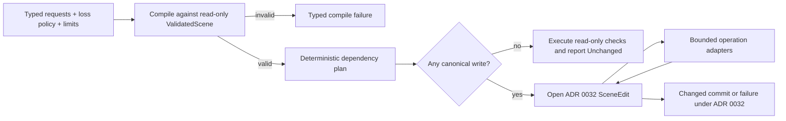
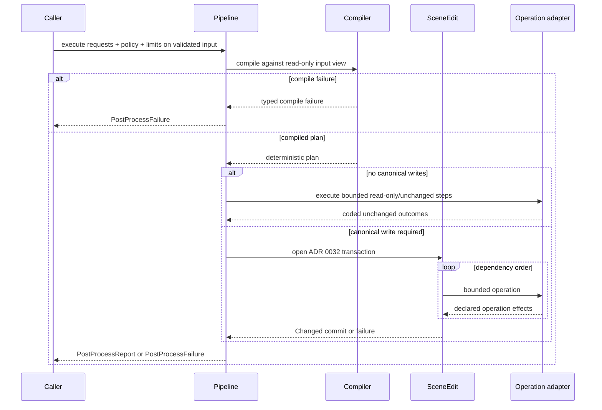

# ADR 0013: Compiled Post-Process Pipelines and Triangulation Boundary

## Context

Importers must preserve source meaning while post-processing performs explicit normalization,
repair, derivation, and renderer-oriented lowering. The previous pipeline represented operations as
unit enum flags, silently reordered them through one fixed global list, and mutated an owned `Scene`
directly. That model could not express parameters, loss policy, conflicts, remaps, cancellation, or
derived-data invalidation. It also made validation look like an optional pipeline step even though a
successful scene must already carry a validation proof.

Triangulation is the first operation that makes those defects unsafe. A triangle fan is wrong for
concave polygons, while a mature tessellator can still silently accept self-intersection, non-finite
coordinates, or a different winding. Baozi therefore needs both a backend-neutral geometry boundary
and an admitted implementation behind Baozi-owned checks.

## Authority Boundary

This ADR owns the importer/post-process separation, request compilation, preset rules, execution
orchestration, and triangulation backend admission. It imports, rather than redefines, these
authorities:

| Contract | Authority |
| --- | --- |
| `SceneConstruction`, `SceneDraft`, `ValidatedScene`, and `SceneEdit` states | ADR 0045 |
| scene-space and numeric conventions | ADR 0008 |
| primitive topology and Vertex/Corner/Face/Instance domains | ADR 0030 |
| operation descriptors, read/write sets, remaps, loss records, invalidation, and `SceneEdit` transaction/commit/rollback | ADR 0032 |
| cancellation, progress, callback safety, and work checkpoints | ADR 0033 |

Terms from those contracts retain exactly the meaning assigned by their authority.

## Decision

### Importer Boundary

Importers produce source-preserving validated scenes. They may decode format-required structures,
resolve declared dependencies, preserve source topology, perform bounded structural repair required
by the format, and reject unsafe input. Any repair is diagnosed.

Importers do not silently triangulate polygons, normalize coordinates or units, flip winding or UVs,
generate normals or tangents, merge vertices, optimize graphs, or remove degenerates for renderer
convenience. A format-required exception must be documented by that format and represented in
provenance or diagnostics.

### Typed Requests Compile Before Editing

A caller submits parameterized operation requests, a postprocess-owned loss policy, and operation
limits. The compiler inspects the input `ValidatedScene` read-only and either returns a
`CompiledPostProcessPlan` or a typed compile failure before a `SceneEdit` begins.

`baozi-postprocess` owns its loss-policy, diagnostic, step-outcome, report, and failure vocabulary.
Those types may reuse runtime-neutral operation mechanisms from `baozi-operation`, but they do not
depend on or reinterpret `baozi-import` loss, diagnostic, phase, or outcome types. Facade presets may
compose both domains while preserving their distinct policies and reports.

Each request resolves to the ADR 0032 operation descriptor. The compiler:

1. canonicalizes composable duplicates and rejects every other duplicate or contradictory request;
2. validates every parameter and required input capability;
3. checks dependencies, conflicts, declared losses, read/write sets, and invalidation obligations;
4. calculates checked output, scratch, peak-live, and work bounds before reserving or mutating;
5. builds a dependency directed acyclic graph and rejects cycles; and
6. emits one deterministic topological order, using stable operation key and then canonical
   parameter key as tie-breakers for independent operations.

There is no fixed global operation order. Dependencies cause visible plan edges; conflicts are
compile errors rather than hidden reordering. Request order is not a semantic tie-breaker. Operations
that are not provably independent through their descriptors must declare a dependency or conflict.
A canonical parameter key is a schema-defined typed total order, never `Debug` text, map iteration,
or a process-random hash. Duplicate composition must be order-independent; otherwise duplicates are
rejected.
A validator is not a user-requestable transformation: the input is already validated, and successful
`SceneEdit` commit performs final central validation.

Public request types contain only implemented operations. A future operation lands together with its
typed parameters, descriptor, implementation, report schema, and tests; an unimplemented enum value
or silent no-op is forbidden.

The public composed outcome distinguishes three successful states:

- `NotRequested`: no postprocess request was submitted; no plan, edit, or postprocess report exists,
  and the imported validated scene retains its generation;
- `Unchanged`: postprocess was requested and reports its compiled plan and step outcomes, but no
  canonical write was required; no `SceneEdit` is committed and the input proof, digest, and
  generation are returned unchanged; and
- `Changed`: at least one declared write commits through `SceneEdit`, so ADR 0032 publishes a newly
  validated scene with a fresh generation.

An operation that is inapplicable or already satisfied may produce an explicit, coded unchanged step
outcome; it cannot disappear silently. Compile or execution failure remains a failure and publishes
no new scene. The compiler marks whether a plan has canonical writes before execution so an empty or
effect-free plan never mints identity merely because the pipeline was invoked.

Replay is determined by normalized operation identity (operation ID, semantic version, and normalized
parameter digest), the current pre-invocation semantic-input stamp, an ADR 0032-qualified prior
application record's post-write semantic-input stamp, and its postcondition; a prior-invocation flag
is never execution authority. Every operation declares whether it is state-idempotent or
intentionally repeatable.

Every descriptor defines a versioned semantic-input-stamp schema over its complete declared read set
and a versioned postcondition. The compiler recomputes that deterministic stamp from semantic values,
not scene-generation tokens or process-local identity, before each invocation. It compares that
current pre-invocation stamp only with a record selected by ADR 0032's deterministic conservative
lookup; missing, deleted, or conflicting evidence forces execution, and the prior pre-write stamp is
audit evidence. Operation identity, stamp schema, and postcondition version are machine-comparable
parts of the compiled plan and step outcome; an opaque `already-ran` marker is insufficient.

Replaying a state-idempotent operation with the same identity yields a coded unchanged step when its
current pre-invocation stamp equals the qualified record's post-write stamp and its independently
recomputed postcondition still holds. It performs no canonical write and appends no provenance. A
changed declared input, parameter digest, or semantic version requires reevaluation. Missing or
ambiguous history also reevaluates rather than guessing. A repeatable operation is reevaluated on
every request and cannot be suppressed solely by matching history. A replayed plan is `Unchanged`
only when every step is unchanged.

### Execution Orchestration and Reports

The pipeline never mutates canonical scene storage directly. It executes read-only/unchanged steps
without opening an edit, and executes any plan with a canonical write only through the `SceneEdit`
transaction owned by ADR 0032. The pipeline coordinates operation adapters and report assembly. ADR
0032 exclusively defines staging, commit, rollback, remap publication, derived-data validity, and
preservation of the input generation on failure.

A successful `PostProcessReport` contains the explicit `Unchanged` or `Changed` outcome, expanded
plan, deterministic orchestration statistics, postprocess-owned diagnostics and losses, and the
remaps, derived-data outcomes, resource evidence, and validated generation defined by ADRs 0032 and
0033. `Unchanged` reports contain no fabricated remap or committed-output evidence. Post-processing
does not mutate, relabel, or return an `ImportReport`; import outcome ownership remains separate.

### Presets Are Inspectable Recipes

`Raw` means no post-process request; import validation is already mandatory. Other convenience
presets are constructors for explicit typed requests, not special execution paths. Their expansion
is inspectable before execution and repeated in the report.

A named preset is exposed only when every operation in its expansion is implemented. Preset names
must not advertise future behavior, multiple quality names must not alias the same placeholder
subset, and expansion changes require snapshot and integration-test updates. Callers may edit the
expanded requests before compilation.

### Triangulation Contract

Triangulation operates per polygon face and keeps the public and core boundary independent of any
tessellation crate. The private adapter accepts one projected simple ring and returns only indices
into its working ring. Canonical positions remain owned by the primitive.

Before calling a backend, Baozi must:

- enforce per-polygon corner, scratch, output, work, and cancellation bounds, including a
  conservative peak-live allowance for backend-internal buffers before entry;
- validate all source indices and finite 3D positions;
- compute a stable plane and reject a degenerate or materially non-planar ring under a documented,
  scale-aware tolerance;
- project in `f64`, retain a working-corner to source-corner map, and prove a non-zero signed area;
- reject non-adjacent intersections, overlapping edges, and other non-simple rings;
- handle consecutive duplicate or zero-length edges only through an explicit reject-or-repair
  option whose repair is admitted by the loss policy and recorded in the corner remap; and
- keep long collinear boundary chains when they still form a valid simple polygon, without relying
  on the backend to diagnose degeneracy.

After the backend returns for a retained working ring of `n` corners, Baozi checks all of the
following inside the declared postflight work cap:

- exactly `n - 2` triangles for the simple no-hole ring, with checked arithmetic;
- every index in range, three distinct corners per triangle, and finite non-zero triangle area;
- every retained working corner, and therefore every non-repaired source corner, referenced by at
  least one triangle; repaired-away corners remain visible in loss/remap evidence;
- every ring boundary edge used exactly once in source direction after reorientation, and every
  interior edge used exactly twice in opposite directions;
- the triangulated disk satisfies `V - E + F = 1`, with `F` counting output triangles and excluding
  the exterior face;
- no improper crossing or overlap between output edges, no triangle interior outside the projected
  ring, and no pair of triangle interiors overlapping; and
- consistent source winding, polygon/triangle area agreement within the declared scale-aware
  tolerance, and deterministic indices.

These index, incidence, Euler, intersection, winding, and area checks are cross-validation rather
than interchangeable heuristics. Backend output is reoriented to match source face winding before
the directed-edge checks. Any failed postcondition is a typed backend fault handled by the ADR 0032
transaction.

Triangulation leaves vertex-domain attributes unchanged, maps every output corner to its source
corner, duplicates face-domain values and material binding for each produced triangle, and publishes
the one-source-face-to-many-output-faces remap required by ADR 0032. It may not silently invent or
drop domain data.

Canonical polygon faces do not currently model interior holes. Adding holed faces requires a new
canonical topology decision and a repeated admission test; the private backend's hole API is not a
public promise.

### Admitted Backend

The admitted backend is GeoRust `earcut` version 0.4.10 behind the private adapter. Its exact
[crates.io package artifact](https://crates.io/api/v1/crates/earcut/0.4.10/download) checksum is
`7d71866fffb1c6d539cc36ef323109416cdc5686e17df0252d98c5e83641efc8`; the reviewed upstream
implementation is fixed at commit
[`a381ffb8cf93db0eaa62ca7dadd52b7985c7e8ce`](https://github.com/georust/earcut/blob/a381ffb8cf93db0eaa62ca7dadd52b7985c7e8ce/src/lib.rs).
The decision is conditional on all Baozi preconditions and postconditions above; `earcut` is not an
input validator and no public type names it.

The admission evidence establishes that version 0.4.10:

- exposes generic `Float` input and compiles with `Earcut::<f64>`;
- preserves input index identity for valid single rings;
- is `no_std`, has a small pure-Rust dependency graph, and compiles for
  `wasm32-unknown-unknown` on Baozi's Rust 1.95 MSRV;
- declares `MIT OR Apache-2.0`, bundles the upstream `LICENSE-ISC` notice for Mapbox-derived
  portions, and passes the repository dependency policy; source packages and release artifacts must
  preserve that bundled notice; and
- is maintained in a non-archived GeoRust repository with a 2026-05-07 release.

The same evidence also proves why the wrapper is mandatory: 0.4.10 normalizes output winding,
returns `()` rather than `Result`, silently emits output for self-intersecting and non-finite rings,
and documents panics for malformed hole indices or excessive vertex counts. Its implementation is
pure Rust/no FFI but contains internal `unsafe` indexed-node access. Baozi makes the documented panic
preconditions unreachable with an empty hole list and much smaller resource cap, contains unwindable
backend panics where the platform permits, validates every output, and keeps dependency sanitizer and
audit gates. Correctness never depends on panic containment under `panic=abort`.

The backend exposes no cooperative checkpoint inside one call. The adapter charges a checked
conservative quadratic work envelope, reserves its peak-live allowance, and polls cancellation
immediately before and after entry. It does not advertise bounded mid-call cancellation; the strict
per-ring cap is the backstop required by ADR 0033.

There is no automatic second backend. Divergent runtime fallback would make output depend on a hidden
failure path. `lyon_tessellation` remains a documented replacement candidate only; selecting it
requires a new admission result through the same adapter conformance suite.

Before the backend is used in a canonical implementation, and after every dependency refresh, the
resolved package must match the admitted identity and pass the lockfile, MSRV/WASM, dependency-policy,
bundled-`LICENSE-ISC`, and complete adapter-conformance gates. Any `earcut` package version, feature
set, source, fork, checksum, or reviewed source-commit drift reopens the complete backend selection
and admission matrix. Transitive dependency drift does not silently reuse old evidence: it reruns the
lockfile, policy, portability, notice, and adapter-conformance gates.

## Alternatives Considered

### Option A: GeoRust `earcut` behind Baozi validation and output checks

Pros:

- Correct concave simple-ring results in both source windings after adapter reorientation.
- Native `f64`, source indices, reusable buffers, `no_std`, and a small dependency graph.
- Maintenance captured by the admission record, compatible license, MSRV, and WASM evidence.

Cons:

- Unit-returning API does not report invalid geometry.
- Invalid rings can produce plausible but wrong triangles.
- Internal unsafe code and documented panic preconditions require a narrow audited boundary.

Decision: chosen conditionally behind the mandatory adapter.

### Option B: `lyon_tessellation`

Pros:

- Mature, maintained fill tessellator with a typed error enum.
- Handles path intersections for graphics filling and compiles for WASM.

Cons:

- Core path/tessellation coordinates are `f32`.
- It emits a generated vertex buffer rather than source-corner indices and may add an intersection
  vertex for a self-intersecting path.
- Debug and release behavior differed for non-finite spike inputs; infinity succeeded in release.
- The dependency graph and mapping adapter are materially larger than `earcut` for this use case.

Decision: rejected as the initial backend; retained only as an explicit future replacement candidate.

### Option C: `i_triangle`

Pros:

- Actively maintained pure-Rust project with robust integer geometry machinery and `f64` input.
- Repairs complex outlines and can produce high-quality triangulations.

Cons:

- Float input is quantized into an integer core, reordered, and returned with a new point buffer.
- Default validation repairs a bow-tie by inserting intersection points instead of rejecting it.
- Duplicate and collinear points are removed, so source-corner identity is not preserved directly.
- Its larger overlay/tree/sort stack solves a broader problem than Baozi needs.

Decision: rejected for the source-preserving post-process boundary.

### Option D: Keep the hand-written triangle fan or replace it with local ear clipping

Pros:

- No external dependency and complete local control.

Cons:

- A fan is incorrect for concave polygons.
- A robust local implementation would recreate intersection, degeneracy, numeric, hole, and fuzz
  work already maintained by geometry projects.
- Baozi would own an additional security-sensitive algorithm without independent corpus evidence.

Decision: rejected; the canonical cutover deletes the triangle-fan implementation.

## Consequences

Positive:

- Parsing and transformation remain independently testable and source-preserving.
- Operation order, loss, budgets, and capability failures are visible before mutation.
- Failed pipelines cannot publish partially transformed or falsely validated scenes.
- Concave polygon support uses a maintained implementation without leaking it into the public API.

Negative:

- Every operation needs a descriptor, compile rules, staging implementation, and report evidence.
- Triangulation pays for Baozi-owned planarity, simplicity, mapping, and output checks in addition to
  backend work.
- Preset expansion is a compatibility surface that requires tests and documentation.

## Risks and Mitigations

| Risk | Severity | Likelihood | Mitigation |
| --- | --- | --- | --- |
| Hidden plan reorder changes semantics | High | Medium | Dependency DAG plus deterministic visible expansion; conflicts fail compilation. |
| A step leaves stale derived data | High | Medium | ADR 0032 read/write and invalidation enforcement at compile and commit. |
| Pipeline bypasses transactional publication | Critical | Low | Require the ADR 0032 `SceneEdit` boundary and integration tests that reject direct storage mutation. |
| Backend accepts malformed geometry | High | High | Baozi finite/planar/simple preflight and checked output/area/winding postflight. |
| Tessellation work becomes quadratic denial of service | High | Medium | Per-ring corner/work caps, checked reservations, cancellation checkpoints, scale tests. |
| Dependency unsafe code regresses | High | Low | Exact resolved-version gate, sanitizer/fuzz execution, advisory/source audit, narrow adapter. |
| A source or release artifact drops the upstream ISC notice | High | Low | Inspect the exact admitted dependency package and require third-party notice preservation in every package/release gate. |
| Presets drift or advertise no-ops | Medium | Medium | Implemented-only recipes and expansion snapshots; remove aliases with no semantic difference. |
| False idempotence suppresses required work | High | Medium | Bind replay to operation semantic version, normalized parameters, declared input stamp, postcondition, and explicit idempotence class. |

## Acceptance Criteria

| Contract | Testable acceptance |
| --- | --- |
| Compile before mutation | Invalid parameters, dependencies, conflicts, loss, or budgets fail with the input generation/digest unchanged. |
| Deterministic plan | Request permutations with the same dependency semantics compile to the documented stable order and visible edges. |
| Transactional integration | Injected step failure, cancellation, budget exhaustion, backend panic, and final validation failure prove the pipeline uses ADR 0032 without publishing staging. |
| Evidence completeness | Every requested success returns operation stats, diagnostics, losses, explicit step outcomes, and a valid scene proof; only `Changed` includes committed remaps/invalidation/recompute publication evidence. |
| Replay semantics | A second state-idempotent call whose current pre-invocation stamp matches an ADR 0032-qualified prior post-write stamp and whose live postcondition holds is fully `Unchanged`; changed input/parameter/version or missing/ambiguous evidence reevaluates it, while repeatable operations always execute. |
| Preset honesty | Every exposed preset expands only to implemented typed requests and its expansion is snapshot tested. |
| Concave geometry | Clockwise and counter-clockwise fixtures match source area and winding after triangulation. |
| Domain preservation | Material, Face, Corner, and Vertex data plus source-face remaps survive triangulation deterministically. |
| Explicit rejection | Self-intersecting, overlapping, materially non-planar, non-finite, and degenerate rings fail before publication. |
| Bounded work | Zero/exact/excess corner, output, scratch, peak-live, and tessellation-work limits are exercised without unchecked allocation. |
| Backend portability and notices | Resolved backend passes the adapter conformance suite, Rust 1.95 native and `wasm32-unknown-unknown` checks, repository `cargo deny` policy, and exact-package/source/release notice-preservation gates. |

## Atomic Cutover Contract

The canonical cutover replaces the old flags, canonical-order list, direct owned-scene mutation,
explicit validation step, triangle fan, and placeholder preset aliases as one breaking change. The
replacement begins with failing compiled-plan, concave/remap, malformed-ring, and rollback tests.
Backend algorithm details remain private; every dependency refresh reruns adapter conformance and
reopens full backend admission on identity drift as described above.
