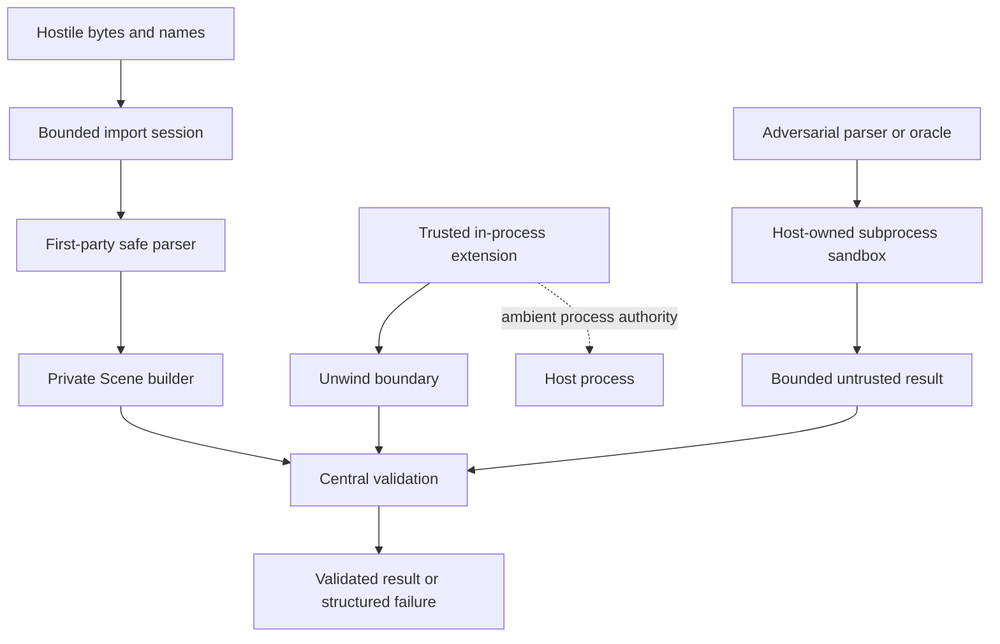

# ADR 0014: Parser Security, Unsafe, FFI, and Panic Boundaries

## Status and Authority

This accepted ADR owns the parser hostile-data, unsafe, FFI, and panic-boundary policy. Acceptance is
a normative implementation gate. A first-party path must pass baseline admission safety before it is
registered or inventoried, while later maturity evidence may still be incomplete.

## Context

Baozi parses hostile, complex bytes. Rust memory safety removes many corruption classes, but it does
not prevent panics, allocation aborts, integer overflow, algorithmic denial of service, path abuse,
semantic corruption, or failures in unsafe dependencies.

Two trust boundaries must not be conflated:

1. Asset bytes, names, counts, offsets, and dependency references are hostile data.
2. Code registered inside the host process is trusted code with bugs, not sandboxed adversary code.

A facade validation boundary can reject a bad Scene returned by an extension. It cannot prevent that
extension from calling `std::fs`, using `unsafe`, exhausting the process, deadlocking, aborting, or
reading unrelated memory. Adversarial code requires process isolation owned by the host.

## Decision

First-party parser paths are safe-by-default, panic-averse, limit-aware, and fuzzable. Baozi catches
unwindable panics at the extension/facade boundary to preserve failure evidence, but a caught panic is
still a bug. Unsafe and FFI are allowed only in isolated, opt-in, reviewed boundaries. No Baozi API
claims to sandbox in-process code.

### First-Party Admission Is Not a Maturity Tier

ADR 0004 owns parser/backend admission, ADR 0007 owns first-party inventory, and ADR 0011 owns
maturity. A known panic, abort, unbounded attacker-controlled allocation/recursion, ambient-IO bypass,
or invalid-success path must be disabled and unregistered, rejected/replaced, or isolated outside the
in-process first-party inventory. It cannot remain reachable through a format feature or
`all-formats` merely because the descriptor says Experimental.

After that baseline passes, missing non-safety evidence such as broader semantic conformance, an
independent oracle, sustained fuzz/RSS history, target promotion, or packaged-consumer proof may keep
the format Experimental. An opaque-backend allowance accounts for expected memory; it does not prove
or waive admission safety. A finite Baozi-enforced preflight envelope or an admitted process boundary
is required when the backend cannot enforce the hostile-data bounds itself.

## Hostile-Data Rules

All public and backend parser paths must:

- validate declared counts, strides, offsets, and ranges before allocation or slicing
- use checked arithmetic for byte and cell calculations
- use fallible reservation before input-sized growth
- make every input-controlled loop consume input or spend a bounded work budget
- implement graph traversal iteratively with separate node, edge, depth, and work limits
- validate required text encodings and bound recovery diagnostics
- route dependencies through ADR 0010's session capability and object-bound IO contract; this ADR
  does not define a second filesystem opening algorithm
- preserve monotonic attempted work when optional resources fail
- convert dependency errors into Baozi-owned structured failures
- validate every successful Scene centrally, including third-party results

`unwrap`, `expect`, unchecked indexing, `unreachable_unchecked`, and debug-only assertions are not
allowed on paths reachable from hostile data. They are allowed in tests and in genuinely
construction-proven internal invariants only when the proof is local and cannot be invalidated by a
public extension.

## Panic Boundary

First-party parser panics are defects and become minimized regression tests. `catch_unwind` is not
parser control flow.

The facade invokes object-safe extension code behind an unwind boundary when the build uses
`panic = "unwind"`. A caught payload is discarded, converted to a bounded backend failure, and the
report retains stage, diagnostics, detection evidence, and resource statistics. The boundary must
not expose panic text that can contain secrets or unbounded attacker data.

This boundary has explicit limits:

- it cannot catch `panic = "abort"`
- it cannot catch process aborts, stack overflow, OOM abort, signals, access violations, or UB
- it does not roll back extension side effects
- `UnwindSafe` is not evidence that hostile code is isolated
- poisoned shared state remains a host concern

## Unsafe Policy

Baozi-owned core, IO contracts, import orchestration, and first-party format crates use
`#![forbid(unsafe_code)]` by default. An exception requires all of the following:

1. a measured need that safe code or an admitted dependency cannot satisfy
2. a dedicated private module or crate with the smallest practical API
3. a safety invariant immediately adjacent to every unsafe operation
4. malformed, boundary, and concurrency tests that exercise the invariant
5. parser-reachable fuzz coverage and applicable sanitizer execution
6. an ownership and lifetime model reviewed independently
7. feature isolation and a safe default path

`unsafe` in transitive dependencies remains part of the trusted computing base. Dependency admission
must check license, MSRV, target support, maintenance, advisories, unsafe scope, panic behavior, and
replacement cost. A crate-level `forbid` lint is not a dependency-tree security claim.

For a security-sensitive dependency, admission attaches to the complete target-specific resolved
closure, not only to a top-level semver requirement. The repository records exact package versions,
sources, checksums, enabled features, and relevant unsafe/native entry points, and compares the
lockfile resolution against that record in CI. An update that changes path resolution, unsafe scope,
native calls, panic behavior, target support, or the resolved security-sensitive closure reopens
admission before merge.

An explicitly patched native dependency records its actual unique local path/version and reviewed
patch surface separately from the original registry archive's checksum provenance. The standalone
native candidate's bounded-link `cap-primitives` patch follows ADR 0010: its synchronous Windows
reparse query retains adjacent safety invariants, safe bounded byte decoding, malformed/native
tests and independent review. It remains outside portable production graphs and release
registration. The original upstream checksum must never be presented as the modified source's hash;
passing portable parser fuzz does not qualify that Windows native boundary.

Security-relevant flag constants are dependencies too; numeric constants, documentation-hidden
transitive interfaces, and unreviewed extension crates do not satisfy admission. ADR 0010 owns the
native-filesystem package, version, feature, open-flag, and resolved-closure selection to which this
generic dependency rule applies.

## FFI Policy

FFI parsers and codecs are never part of default formats. They live in dedicated opt-in backend
crates and must document native build requirements, linked licenses, ABI ownership, thread safety,
and failure behavior.

In-process FFI cannot be made safe by `catch_unwind`; foreign exceptions, memory faults, aborts, and
undefined behavior can terminate or corrupt the host. For a backend expected to receive adversarial
assets, the preferred boundary is a separate executable with:

- no network
- only explicitly preopened read-only inputs
- bounded request and response frames
- wall-clock, CPU, memory, process, and output limits
- termination on timeout or protocol violation
- Baozi validation of every returned result as untrusted bytes

The host owns this sandbox and admission control. Baozi may provide a protocol later, but does not
promise process isolation in the library facade.

## Allocation and Availability

Rust cannot reliably recover from every allocator failure. Baozi therefore bounds predictable work
before allocation and keeps an explicit conservative allowance for opaque backend decoding. Limits
cover at least snapshots, decoded bytes, canonical output, scratch, peak-live storage, graph work,
attribute and topology cells, animation, metadata, strings, and diagnostics.

A known path that can allocate or recurse without a Baozi-enforced finite envelope is not made safe by
reserving an allowance or recording RSS after the fact. It fails first-party admission until disabled,
bounded, replaced, or process-isolated.

Per-import budgets do not cap aggregate process use. A service accepting concurrent imports must
enforce host-level queue depth, concurrency, memory, CPU, and deadline admission. Cancellation inside
the library is cooperative; a hard deadline or hard RSS ceiling requires process isolation.

ADR 0002 owns concurrent-session admission and ADR 0033 owns cooperative operation controls. This ADR
records their security consequence rather than defining a second concurrency or cancellation API.

## Diagnostics and Confidentiality

- Diagnostic count and total bytes are bounded.
- Host paths, panic payloads, environment values, and arbitrary backend messages are not exposed by
  default.
- Hostile strings are escaped for control characters and truncated with explicit evidence.
- Failure reports preserve useful source identity without revealing an absolute scope root.
- Telemetry callbacks are trusted host code; callback panics are contained where possible and never
  run while security-critical locks are held.

## Fuzz and Regression Gates

Every public parser must have parser-local malformed tests and a facade/session-reachable fuzz path.
Baseline admission includes deterministic malformed/limit evidence and no unresolved known crash,
hang, invalid success, excessive allocation, or non-linear work finding. Any such finding disables the
affected first-party path until fixed and regressed. Sustained sanitizer campaigns on the declared
authority platform are additional maturity evidence; fuzz-target compilation alone cannot promote a
format. Every finding becomes a minimized corpus seed and a deterministic regression test.

Fuzz inputs are hostile bytes. External differential tools are not loaded in-process for arbitrary
fuzz corpora; they run only as bounded subprocesses over explicitly trusted fixtures.

## Alternatives Considered

### Option A: Rely on Rust memory safety and validation after parsing

Pros:

- Minimal process and implementation cost.
- Rust prevents common use-after-free and data-race defects.

Cons:

- Does not prevent panic, OOM, CPU exhaustion, path abuse, or semantic corruption.
- Validation after unbounded allocation is too late.
- Unsafe dependencies and FFI can bypass language guarantees.

Decision: rejected.

### Option B: Treat all registered code as adversarial inside the library

Pros:

- Appears to offer a single strong security promise.
- Encourages defensive validation around extensions.

Cons:

- Impossible in a shared native process: code already has process authority.
- `catch_unwind` is not a sandbox and cannot contain abort or UB.
- Creates misleading guarantees for hosts processing truly hostile plugins.

Decision: rejected. Registered code is trusted but fallible; hostile code runs out of process.

### Option C: Safe first-party core, bounded data boundary, isolated optional native backends

Pros:

- Gives hostile bytes enforceable limits and centralized validation.
- Keeps the default dependency and failure surface auditable.
- Preserves a path to complex codecs without misrepresenting in-process isolation.

Cons:

- Requires continuous test, fuzz, and dependency-review work.
- Hard availability guarantees require a host subprocess.
- Some optimizations wait for evidence and review.

Decision: chosen.

## Success Metrics

| Metric | Target | Measurement |
| --- | --- | --- |
| Malformed input | no panic, hang, invalid success, or unbounded growth | fixtures, fuzz, and scale tests |
| Admission boundary | baseline-unsafe parser/backend paths have no first-party registration, inventory entry, or facade feature | negative inventory and feature-graph fixtures |
| Checked work | input-sized loops and allocations have explicit budgets | review and counter assertions |
| Extension boundary | invalid or unwind-panicking importers never return validated success | facade contract tests |
| Unsafe visibility | Baozi-owned exceptions have ADR, safety comments, tests, and fuzz evidence | lint and audit |
| Dependency closure | security-sensitive resolved packages, features, sources, and checksums match their admission record | lockfile admission checker |
| Default FFI | absent from default dependency and feature trees | `cargo tree -e features` |
| Filesystem availability | ADR 0010's object-bound IO contract passes its per-target no-skip matrix | same-handle and deadline evidence owned by ADR 0010 |
| Failure confidentiality | diagnostics are bounded, escaped, and root-redacted | snapshot tests |
| Concurrency honesty | docs and APIs assign aggregate admission to host | threat-model and API review |

## Risks and Mitigations

| Risk | Severity | Likelihood | Mitigation |
| --- | --- | --- | --- |
| Panic boundary is mistaken for a sandbox | Critical | Medium | explicit non-goal and subprocess guidance |
| Opaque parser allocates before Baozi admission | High | Medium | disable/unregister until finite preflight bounds or process isolation exist; allowance and RSS maturity tests are not waivers |
| Host runs too many individually bounded imports | High | High | host queue/concurrency admission and process limits |
| Unsafe dependency regresses | Critical | Low | exact resolved-closure gate, advisory/license audit, upgrade re-admission, and fuzz/sanitizer gates |
| Special-file open hangs before parser limits apply | Critical | Medium | require ADR 0010 object-bound opening and its no-skip deadline evidence before target registration |
| Fuzz smoke is too shallow | High | Medium | regression corpus plus scheduled sustained campaigns |
| Diagnostics leak host data | High | Medium | typed errors, escaping, truncation, and root redaction |

## Consequences

Positive:

- The hostile-data contract is strong without making impossible claims about native code.
- Parser failures preserve evidence and remain testable.
- Unsafe and FFI costs are visible and isolated.

Negative:

- Security gates add implementation and CI work to every parser.
- Hosts needing hard availability or hostile plugins must operate subprocesses.
- Dependency updates can require security re-admission.

## Sources

- [Rust `catch_unwind` limitations](https://doc.rust-lang.org/std/panic/fn.catch_unwind.html)
- [Rust Nomicon: FFI](https://doc.rust-lang.org/nomicon/ffi.html)
- [Rust Reference: panic behavior](https://doc.rust-lang.org/reference/panic.html)
- [Baozi parser threat model](../security/parser-threat-model.md)
