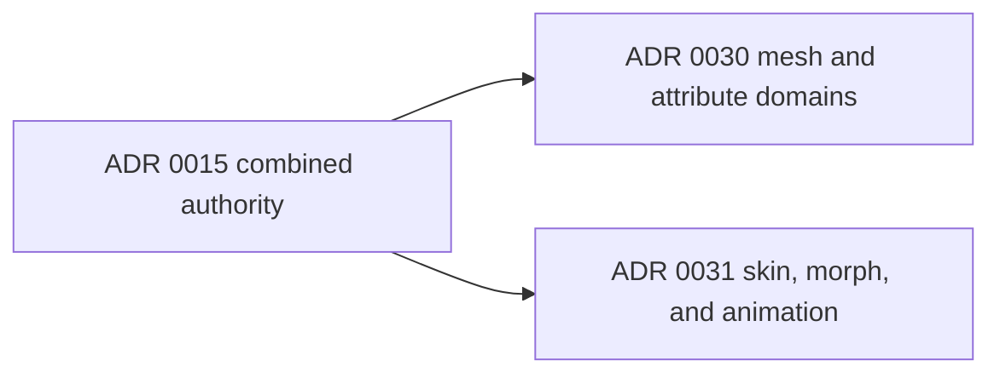

# ADR 0015: Mesh, Attribute, Skinning, and Animation Semantics

## Context

This ADR originally selected source-preserving topology, structure-of-arrays attributes, broad
skinning, and unevaluated animation. It correctly rejected triangle-only geometry and fixed
renderer layouts, but it left contradictory implementation escape hatches: one primitive per mesh,
vertex-only custom attributes, fixed-four influence fields, and `f32` normalized seconds.

Those ambiguities are no longer acceptable for the canonical breaking cutover.

## Supersession Decision

ADR 0030 replaces topology and attribute authority with logical meshes that own one or more
homogeneous primitives and explicit vertex/corner/face/instance domains. ADR 0031 replaces
skinning, morph, and animation authority with variable influences, explicit matrix spaces, `f64`
source time, and instance morph overrides.

No implementation may cite this ADR to retain the current single-primitive or fixed-four fields.

## Historical Options

### Option A: Canonical triangle meshes with fixed renderer attributes

This minimized implementation work but lost polygons, corner seams, arbitrary properties, and
source influence counts. Rejected.

### Option B: Preserve each format's native mesh and animation model

This maximized local fidelity but eliminated common validation and postprocess behavior. Rejected.

### Option C: One broad source-preserving model

This was chosen, but its underspecified ownership and cardinality have now been replaced by ADRs
0030 and 0031.

## Consequences

- This document is historical context only and carries no normative implementation requirements.
- The old `Mesh.topology`, fixed built-in vectors, fixed-four joint fields, and `f32` animation-time
  shape are historical implementation facts, not compatibility obligations.
- Acceptance is defined exclusively by ADR 0030 and ADR 0031 tests.

## Residual Risks

| Risk | Severity | Mitigation |
| --- | --- | --- |
| A contributor cites this ADR to retain a transitional field | High | Governance records reciprocal supersession and authoritative ADRs name the replacement contract. |
| Mesh and deformation authority drift apart | High | Cross-format fixtures combine multi-primitive geometry, skinning, morph defaults, and instance animation. |

## Supersession Acceptance

- Governance checks the reciprocal `superseded_by`/`supersedes` links.
- No accepted ADR normatively depends on this document.
- Canonical API tests contain no single-primitive, fixed-four, or `f32` animation-time compatibility
  surface after the canonical Scene IR cutover.
