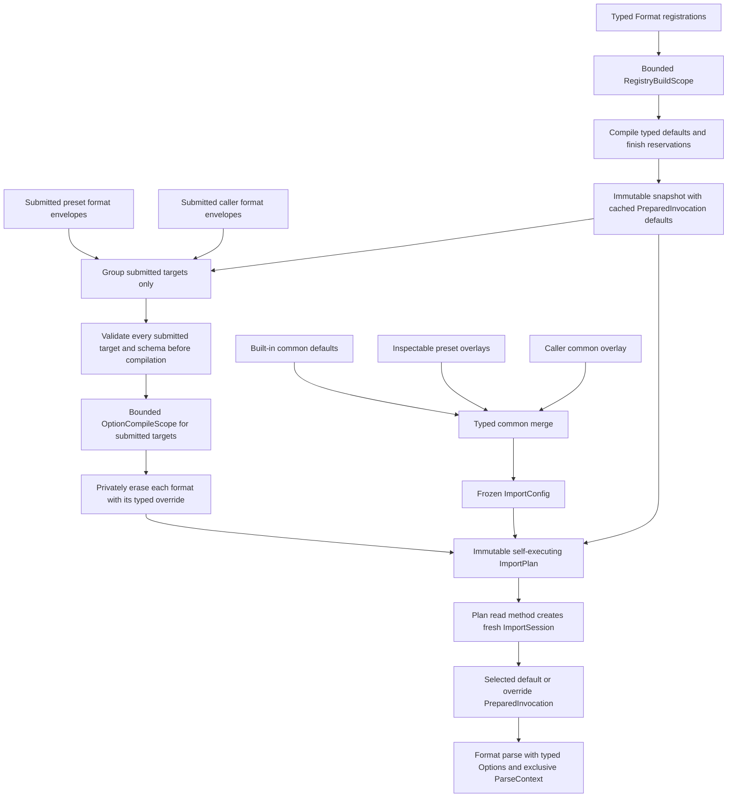

# ADR 0016: Import Options, Presets, and Configuration Precedence

## Context

Import policy spans common limits, dependency access, diagnostics, format selection, operation
control, post-processing, and format-owned parser behavior. A global property bag is unsafe under
concurrency and gives misspelled or disabled options surprising runtime behavior. Each format needs
one concrete option type through compilation and parsing, while exposing every format's option type
from the facade would couple the public crate graph to optional formats.

The configuration must be immutable by session start, reject invalid format configuration before any
IO, and let each format crate own its concrete type without weakening the registry boundary.

## Decision

Baozi uses typed common overlays plus versioned, format-keyed envelopes. `Format` binds an associated
`Options` type: default and submitted-layer compilation return `CompiledOptions<Self::Options>`, and
parsing receives `&Self::Options`. The registry privately erases the format and its typed options
together in a prepared invocation. Each snapshot caches one bounded compiled default per format;
requests compile only their submitted preset/caller envelopes against those defaults before
`ImportSession` or asset IO. ADR 0021 owns freeze, snapshot publication, and registration health.

Successful request compilation returns an immutable, self-executing `ImportPlan` bound to its own
snapshot. Typed envelopes, precedence, bounded compilation, and prepared invocations are
authoritative. Top-level request serialization is outside the current architecture; the unused BZIR
request-wire experiment is retired.

### Canonical Ownership Boundary

This ADR is the sole owner of common and format envelope shape, schema/version transport, precedence,
typed option compilation, `RegistryBuildScope` and `OptionCompileScope` resource contracts,
`CompiledOptions<T>` admission, prepared override selection, and normal typed compile errors. A format
ADR may define its concrete option type and optional local schema, but cannot define a second
envelope, precedence chain, compiler scope, or configuration store.

ADR 0021 is the sole owner of registry builder/freeze/snapshot/unload lifecycle, callable extension
trust, private registration/invocation erasure, unwind containment and phase mapping for format
panics, the shared registration health latch, and permanent poison. An option-compiler unwind
delegates to ADR 0021. ADR 0046 owns plan execution and session lifecycle after successful request
compilation, and ADR 0033 owns live operation control.

### Common Configuration

`baozi-import` owns the canonical `ImportConfig`, request `ResourceLimits`, effective import budget,
`ConformancePolicy`, and `LossPolicy` types. The facade may construct or re-export those types but may
not define a second semantic representation. `baozi-io` owns only path/backend/handle policy and
non-configurable backend-local hard caps; it enforces effective limits carried by an authorized
session capability. Common fields use explicit overlay types. Absence is represented by `None`;
equality with a default value never means "unset".

Common precedence, from lowest to highest, is:

1. Baozi built-in defaults;
2. the fully inspectable preset overlay; and
3. the caller's explicit per-request overlay.

The result is one immutable `ImportConfig`. Library code never reads environment variables, mutable
process globals, or configuration files. CLI applications may translate those sources into an
explicit request before calling Baozi.

Common `ImportConfig` fields are merged directly by `baozi-import`; they never pass through a format
option compiler. Registry default compilation and request format-envelope compilation therefore
cannot alter, duplicate, or charge format-option work for common configuration.

Operation cancellation and progress callbacks are live capabilities, not configuration values; ADR
0033 owns them.

`ConformancePolicy` and `LossPolicy` are common frozen semantic configuration and use this same
default/preset/caller precedence. They decide whether a format-permitted recovery or loss may be
accepted. The concrete recovery mode is format-owned configuration because only the selected format
can define its legal choices and source semantics.

`ImportLossKind` keeps independent authorities for optional-dependency omission, format recovery,
source-semantic loss, and provenance-evidence loss. `ProvenanceEvidenceLoss` authorizes replacing
otherwise complete source/provenance detail with an exact typed count plus stable digest; it does not
authorize dropping retained source semantics, filtering a retained animation channel, or accepting a
format recovery. Conversely, `SourceSemanticLoss` does not authorize provenance/detail collapse.
`LossPolicy::preserve_or_fail()` denies every category. Each additional category is an explicit
caller choice rather than an implication of `ConformancePolicy` or another allowed loss kind.

### Format-Owned Typed Options

Each registered `Format` owns its concrete `Options` type, default/layer compilation, and optional
wire schema. `baozi-import` owns the trait, compilation scopes, host-created `CompiledOptions<T>`,
envelopes, and error transports. Relevant trait signatures are shown below; default bodies and
detection methods are omitted:

```rust
pub trait Format: Send + Sync + RefUnwindSafe + 'static {
    type Options: Send + Sync + RefUnwindSafe + 'static;

    fn descriptor(&self) -> FormatDescriptor;
    fn option_schema(&self) -> Option<FormatOptionSchema>;
    fn compile_defaults(
        &self,
        scope: &mut RegistryBuildScope<'_>,
    ) -> Result<CompiledOptions<Self::Options>, OptionCompileError>;
    fn compile_options(
        &self,
        scope: &mut OptionCompileScope<'_>,
        defaults: &Self::Options,
        layers: FormatOptionLayers<'_>,
    ) -> Result<CompiledOptions<Self::Options>, OptionCompileError>;
    fn parse(&self, options: &Self::Options, context: &mut ParseContext<'_>) -> ParseResult<()>;
}
```

The required properties are:

- `RegistryBuilder::register<F: Format>` retains the association between `F` and `F::Options`;
  heterogeneous storage uses private adapters, without requiring a public heterogeneous trait object;
- `option_schema()` returns `Option<FormatOptionSchema>`, captured once with the descriptor at
  registration; its default is `None`, which rejects submitted envelopes with
  `RequestError::OptionsUnsupported`; the default `compile_options` also rejects layers;
- schema identity is the stable `FormatOptionSchemaKey` tuple `(owner FormatId, local schema ID)`;
  schema versions and envelope versions are explicit `NonZeroU32` values;
- `FormatOptionEnvelope` has private target, schema, version, and bounded payload storage, populated
  through fallible constructors;
- payload decoding is deterministic and size-bounded;
- `RegistryBuildScope` independently bounds default compilation for every registration, including
  aggregate/per-registration work, decoded cells/bytes, recursion, fallible live reservations, bounded
  ordinary error detail, and result size;
- `OptionCompileScope` is the only request-time admission path for submitted payload reads, decoded
  cells/bytes, recursion, compilation work, fallible live reservations, and bounded error detail; it
  exposes no asset IO, import outcome, registry mutation, or session diagnostic capability;
- the request compiler validates public envelopes and presents an opaque `FormatOptionLayers` view
  with distinct optional preset/caller payloads; formats obtain readers through the compile scope and
  never receive an unrestricted envelope payload slice;
- each compilation phase returns `CompiledOptions<Self::Options>` through its scope's one-shot
  `finish(value, retained_bytes)`; this checks all outstanding live reservations, including zero-byte
  tokens, and charges per-registration/target and aggregate result bytes;
- `CompiledOptions<T>` has no public constructor; formats without configurable options use
  `NoFormatOptions::compile_defaults`, which charges work and finishes through the build scope;
- `Registration<F>` and `PreparedInvocation` are private registry implementation details; the prepared
  adapter retains `CompiledOptions<F::Options>` with the same concrete format and passes
  `&F::Options` directly to `parse`; and
- the snapshot caches the default prepared invocation, while the plan retains only submitted-target
  overrides and falls back to that exact shared default. Parsing performs no option downcast.

### Typed Default and Request Compilation

When ADR 0021's registry freeze invokes `Format::compile_defaults`, the call runs inside a bounded
`RegistryBuildScope` and returns `CompiledOptions<Self::Options>`. The generic adapter retains that
value in the default prepared invocation. Rust rejects a different option type at compilation;
build-scope budget, allocation, payload, or unfinished-reservation failures remain bounded typed
results. ADR 0021 exclusively defines stable iteration, atomic snapshot publication, panic mapping,
and registration poisoning. An allocating `Default` call cannot bypass bounded admission.

`RegistrySnapshot::plan(&ImportRequest, OptionCompileLimits)` resolves common overlays and groups only
submitted preset/caller format envelopes. It checks envelope count/bytes, forced/preferred selection,
and every target's availability, health, schema owner, schema key, and version before invoking any
target's `compile_options`. Targets compile once each in stable `FormatId` order against their
snapshot-cached typed defaults, with preset and caller presence preserved. All submitted layers must
compile before a plan is returned, even if detection later selects a different format. Unknown,
disabled, duplicate, schema/version/owner, and payload failures are bounded typed pre-session errors;
ADR 0021 owns the distinct unwind path.

When a request supplies no format-specific layer for a candidate, planning never invokes or probes
that format's option compiler. Selection reuses the snapshot's cached prepared invocation, including
its original typed value. The plan's private override map contains only submitted targets; no
registry-wide option compilation or default reconstruction occurs. An unsubmitted option compiler
cannot poison planning through an invocation that never occurs.

`ImportPlan` owns the snapshot, resolved `ImportConfig`, prepared overrides, stable override order,
and storage-account factory. It executes its own `read_bytes`, `read_asset`, and
`read_asset_with_resolver` methods. It retains no input, active work, or mutable operation control;
each read starts a fresh session. Clones share prepared invocations and the live-account admission
limit. Execution never pairs the plan with another importer. ADR 0046 owns execution capabilities,
candidate submission, and terminal outcomes.

Both scopes may reuse runtime-neutral checked reservation and counter mechanisms from
`baozi-operation`, but neither is an import ledger, creates session evidence, or transfers counters
into a later session. First-party and admitted extension compilers must perform input-derived work and
decoded-model allocation through their active scope, using checked work charges plus live
reservations or a reviewed conservative allowance. This is a cooperative in-process contract
enforced by API shape, conformance tests, dependency review, and promotion evidence; Rust cannot
prevent trusted extension code from allocating through the global allocator. A format that is not
trusted to honor this contract must run behind a process boundary with host-enforced limits.

The format-specific precedence is the snapshot's compiled typed default, then an optional preset
envelope, then an optional caller envelope. More than one envelope for the same `(layer, FormatId)` is
a typed `ImportRequestBuildError::DuplicateFormatOption` at layer construction; order within a
collection never changes the result. An explicitly present field equal to its default still overrides
the lower layer.

`FormatOptionSchema::envelope_from_canonical_payload` seals the target to the schema owner. On dynamic
input, planning verifies that the schema owner exactly equals the envelope target before choosing
the target compiler. Relabeling an OBJ schema/payload as glTF, or an equivalent cross-format pairing,
returns `RequestError::WrongSchemaOwner` before any target compiler runs.

The public library API has no generic string property bag. A CLI or plugin manifest may decode a
versioned external representation, but it must produce the same envelope and pass the same compiler
before session creation.

### Pre-IO Compilation Failures

The complete common request plus every submitted format envelope is validated and compiled against
one immutable registry snapshot before any primary or dependency open. All submitted metadata is
validated before any format-option compiler runs, and every submitted target compiles before session
creation. Planning does not stop after a forced or likely target or defer validation until detection.
The following fail through typed construction or planning errors in every mode:

- unknown or malformed `FormatId`;
- option target not registered or disabled by the feature graph;
- submitted options for a format whose `option_schema()` is `None`;
- unknown schema, unsupported schema version, or malformed payload;
- schema owner or sealed typed-envelope owner different from the target `FormatId`;
- duplicate envelope at one precedence layer;
- a format envelope attempting to set a common security, IO, budget, or lifecycle field; and
- envelope, compilation work, decoded model, recursion, live capacity, result-byte, or allocation
  limits exceeded, or outstanding compilation reservations.

Option type disagreement is a Rust compile error, with no runtime-key negotiation. A format compiler
must report ordinary payload failures through the typed compile result. If it unwinds instead,
ADR 0021 owns containment, phase-specific error mapping, registration poisoning, and
the no-reinvocation rule. The composed request boundary still creates no `ImportSession`, import
ledger, diagnostic stream, or `ImportFailure`, and performs zero asset IO. Abort, process exit,
infinite loops, and arbitrary allocation by trusted extension code remain outside in-process
containment.

There is no permissive path that converts these programming/configuration errors into parser
diagnostics. Strictness controls source recovery, not request validity.

### Conformance, Loss, Recovery, and Wire Exclusion

`ConformancePolicy` and `LossPolicy` remain typed common configuration. Each format recovery profile
remains inside that format's versioned typed envelope. For example, ADR 0035's OBJ/MTL invalid-UTF-8
recovery can be chosen only by the OBJ-owned typed option, then is accepted only if the common
conformance/loss policies allow it. glTF's descriptor exposes no such recovery choice.

A descriptor `TextProfile` owns lexical rules and immutable format hard caps, not a competing request
budget. For every matching dimension the effective decoder limit is
`min(TextProfile hard cap, ImportConfig ResourceLimits)`. A format envelope may select only an
advertised recovery mode and may never raise either bound.

The pre-release BZIR request wire has no production producer or consumer and duplicates the typed
configuration authority above. U4g deletes its encoder, decoder, hidden package reachability, and
wire-only vectors together. Baozi retains no compatibility shim, reserved namespace, or regression
obligation for that retired protocol. Format-owned option, preset, precedence, and compilation tests
remain the durable configuration evidence.

Any later stable request wire requires a new Accepted architecture update, a real facade or
production consumer, explicit field/variant identifiers, canonical ordering, bounded payloads,
strict unknown-field/version rejection, packaged-consumer tests, compatibility vectors,
version-evolution rules, and public documentation. A Rust `serde` derive or struct layout is never by
itself a configuration contract.

### Presets

Presets are named, pure overlay constructors. Expansion is inspectable before execution and produces
the same common and format-envelope layers a caller could build explicitly. A facade preset may
compose an import loss policy with a postprocess plan and its separate postprocess loss policy, but
this ADR owns only the import-side values and transport. Presets may not enable FFI, external
resource access, or an unsafe backend outside fields visibly present in the expanded request.



## Ownership Matrix

| Option family | Owner | Formats may do |
| --- | --- | --- |
| Request resource limits and effective import budget | `baozi-import` | Read the frozen values only |
| Backend-local hard caps and path/handle validity | `baozi-io` | Nothing; formats receive only authorized resources |
| Dependency optionality, scope, and session policy | `baozi-import` | Request a classified dependency through `ParseExecution` |
| Detection and forced/preferred format | Import registry/session | Nothing |
| Import conformance and source-ingestion loss policy | `baozi-import`; facade constructs/re-exports only | Emit coded source facts; never override policy |
| Parser semantics and format-permitted recovery | Individual format crate | Define and compile typed options within descriptor capabilities |
| Post-process requests, loss policy, diagnostics, and outcomes | `baozi-postprocess`; facade composes only | Nothing during parsing |
| Cancellation/progress/deadline mechanism | `baozi-operation`; owning operation supplies policy | Poll/report through capability-limited scope |

## Alternatives Considered

Separate erased option values would require runtime identity agreement at the parser boundary.
The chosen generic registration erases a format with its correctly typed options, while retaining
versioned envelopes and bounded compilation for dynamic configuration.

## Historical Alternatives Considered (2026-07-09)

These alternatives record the original decision. The 2026-11-02 amendment supersedes their public
codec and object-safety choice.

### Option A: Mutable global property map

It resembles legacy importer APIs and is easy for a CLI, but is nondeterministic under concurrency,
stringly typed, and impossible to validate before IO reliably. Rejected.

### Option B: Generic option methods on `FormatImporter`

This gives direct static typing but destroys trait object safety or requires one facade enum containing
all optional format types. Rejected.

### Option C: Versioned typed envelopes compiled by object-safe format codecs

This keeps format ownership and static concrete types behind an object-safe registry, provides a
versioned typed boundary, and fails invalid requests before IO without forcing a stable top-level
wire. Chosen.

## Consequences

Positive:

- Concurrent sessions cannot observe configuration mutation.
- Format crates evolve typed options without leaking parser types through the facade.
- Unknown, disabled, duplicate, and version-mismatched configuration fails before touching assets.
- Broken format defaults are rejected before a registry snapshot exists; planning invokes only
  compilers with submitted layers.
- Plans retain only submitted-target overrides and share immutable cached defaults.
- Presets remain inspectable rather than becoming hidden code paths.

Negative:

- Every configurable format maintains its optional wire schema and typed compiler.
- Every format must expose a bounded compilable default; ADR 0021's freeze may reject the proposed
  snapshot when that integration fails.
- External configuration needs a separately admitted versioned serialization layer.
- Adding a format option requires merge and round-trip conformance tests.

## Risks and Mitigations

| Risk | Severity | Mitigation |
| --- | --- | --- |
| A prepared invocation uses another format's options | High | Bind `CompiledOptions<F::Options>` to `Registration<F>` before private erasure; pass options directly to `F::parse`. |
| Envelope payloads become an allocation attack | High | Bound envelope count and bytes, use fallible decoding, and compile before IO. |
| Invalid options for one target affect unrelated requests | High | Planning invokes only submitted targets and otherwise reuses cached defaults; ADR 0021 owns extension health and poison behavior. |
| Planning recompiles unsubmitted defaults | High | Cache prepared defaults in the snapshot and retain only submitted-target overrides in the plan. |
| Preset and caller precedence becomes field-order dependent | Medium | Explicit overlay fields and all-permutation merge tests. |
| Schema version changes silently reinterpret data | High | Stable schema identity, exact version checks, and explicitly versioned format compilers. |
| Dynamic CLI keys become a second semantic API | Medium | CLI translation ends at the canonical envelope; no dynamic map reaches parsers. |
| A cloned plan resets admission or executes with a foreign registry | High | The plan executes its own snapshot and shares its storage-account factory across clones. |

## Acceptance Criteria

| Contract | Testable acceptance |
| --- | --- |
| Typed association | Custom formats with distinct associated `Options` coexist through private adapters; wrong default, override, or parse option types fail Rust compilation. |
| Precedence | Default/preset/caller permutations produce one deterministic frozen value per field; an explicitly present default-valued field overrides the lower layer. |
| Pre-IO rejection | Unknown, disabled, duplicate, wrong-schema, wrong-version, malformed, and cross-relabeled wrong-format envelopes cause zero backend opens. |
| Default compile contract | Every format, including `NoFormatOptions`, uses `RegistryBuildScope` and returns `CompiledOptions<Self::Options>` through bounded admission; ADR 0021 tests atomic snapshot and unwind behavior. |
| Optional schema | A format with no wire schema compiles metered defaults, accepts no envelopes, and rejects submitted options before session/IO. |
| Cached defaults | A no-envelope automatic plan invokes zero option compilers and selection reuses the exact cached prepared invocation and typed default. |
| Submitted-only invocation | Adding unsubmitted registrations does not add request option-compilation calls; each submitted target compiles once against its cached default. |
| Multi-target admission | Preset/caller envelopes for several formats all compile before session/IO even when forced or automatic detection later selects only one. |
| Metadata admission | A later invalid target/schema/version prevents every target's option compiler from running, even when an earlier target is valid. |
| Bounded compilation | Oversized decoded cells/bytes, recursion, work, live capacity, and result bytes fail through the phase-appropriate build/request scope before snapshot or session. |
| Reservation completion | Both scopes reject outstanding reservations, including forgotten zero-byte tokens, and repeated `finish`; result bytes count against per-registration/target and aggregate bounds. |
| Unwind delegation | Cross-ADR tests prove default and submitted-layer unwinds follow ADR 0021's phase mapping and permanent-poison contract; this ADR defines no competing panic or health state. |
| Unsubmitted compiler isolation | A format with no submitted layer is never called for option compilation during planning; unrelated compiler code cannot run through that path. |
| Common config isolation | Starting from the same frozen snapshot, changing only common defaults/preset/caller fields invokes zero format-option compilers. |
| Type isolation | The selected private invocation passes only its own `&F::Options` to `F::parse`; no public option store, runtime type key, or parse-side downcast is required. |
| Executable plan | Plan read methods use the owned snapshot and start independent sessions; clones share prepared invocations and the live storage-account limit, and need no importer/plan pairing API. |
| No global input | Parallel tests prove environment or another request cannot change a session config. |
| Preset transparency | Expanding a preset and supplying the resulting overlays explicitly yields an equal frozen request. |
| Loss authority separation | Allowing one loss kind never authorizes another; provenance/detail collapse requires `ProvenanceEvidenceLoss`, while filtered retained-domain semantics require `SourceSemanticLoss`. |
| No speculative request wire | Source, rustdoc, feature, and packaged-consumer gates cannot reach a BZIR request encoder, decoder, envelope, or wire-only vector; typed option and preset conformance remains green without them. |

## Amendment History

### 2026-11-02: Bind options to typed formats and executable plans

- Affected: current decision, ownership, option signatures, compilation, diagram, risks, and acceptance.
- Previous: a public `FormatOptionCodec`, sealed `OptionRuntimeTypeKey`, erased
  `CompiledFormatOptions`, and private `FormatOptionStore` supported object-safe `FormatImporter`
  values with parse-side checked downcasts; `PreparedImportRequest` required separate execution.
- New: `Format::Options` remains concrete through bounded `CompiledOptions<Self::Options>` admission.
  Private `Registration<F>` and `PreparedInvocation` erase format and options together; an optional
  `FormatOptionSchema` admits wire layers, and an immutable `ImportPlan` executes its own snapshot.
- Impact: the former importer, codec, key, and store contracts are replaced without compatibility
  aliases; `ImportPlan` also replaces `PreparedImportRequest` without an alias. Resource bounds,
  reservation completion, precedence/presence, schema/version checks, cached defaults, complete
  pre-IO target admission, and ADR 0021's poison/reentrancy rules remain.
  The original alternative discussion above remains historical.
- Review basis: the [typed-format/context design](../research/2026-11-02-typed-format-context-design.md)
  and the production sources listed above. Source inspection does not establish executed compiler,
  runtime, performance, or release results.
- Rationale: bind the concrete type once before erasure and keep configuration immutable through
  plan execution.
