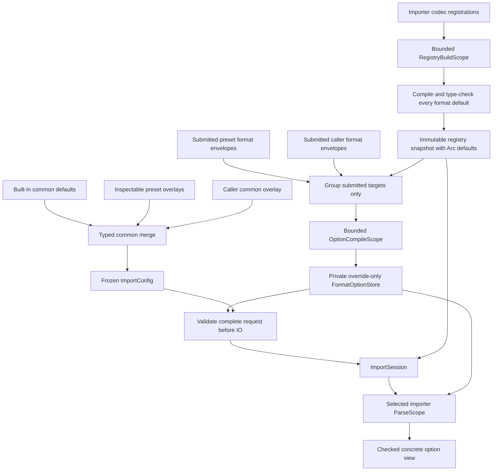

# ADR 0016: Import Options, Presets, and Configuration Precedence

## Context

Import policy spans common limits, dependency access, diagnostics, format selection, operation
control, post-processing, and format-owned parser behavior. A global property bag is unsafe under
concurrency and gives misspelled or disabled options surprising runtime behavior. Directly adding a
generic typed method to `FormatImporter` would make the registry trait non-object-safe, while exposing
every format's option type from the facade would couple the public crate graph to optional formats.

The configuration must be immutable by session start, reject invalid format configuration before any
IO, and let each format crate own its concrete type without weakening the registry boundary.

## Decision

Baozi uses typed common option overlays plus versioned, format-keyed envelopes and importer-provided
object-safe codecs. Each codec compiles one bounded typed default for a registry snapshot, and each
request compiles only the preset/caller format envelopes it actually submitted against that default,
before `ImportSession` or asset IO. ADR 0021 owns when registry freeze invokes default compilation,
snapshot publication, and registration health.

Accepted means this transport and precedence are authoritative; it does not claim the replacement API
has already landed.

### Canonical Ownership Boundary

This ADR is the sole owner of common and format envelope shape, schema/version transport, precedence,
`FormatOptionCodec` input/output semantics, `RegistryBuildScope` and `OptionCompileScope` resource
contracts, compiled-value type verification, the private request option store, and normal typed
compile errors. A format ADR may define its concrete option type and local schema, but cannot define a
second envelope, precedence chain, compiler scope, or store.

ADR 0021 is the sole owner of registry builder/freeze/snapshot/unload lifecycle, callable extension
trust, unwind containment and phase mapping for codec panics, the shared registration health latch,
and permanent poison. A codec unwind is therefore not a second option-compilation policy in this ADR:
the registry/request integration delegates it to ADR 0021. ADR 0020 owns session lifecycle after
successful request compilation, and ADR 0033 owns live operation control.

### Common Configuration

`baozi-import` owns the canonical `ImportConfig`, request `ResourceLimits`, effective import budget,
`ConformancePolicy`, and `LossPolicy` types. The facade may construct or re-export those types but may
not define a second semantic representation. `baozi-io` owns only path/backend/handle policy and
non-configurable backend-local hard caps; it enforces effective limits carried by an authorized
session capability. Common fields use explicit overlay types. Absence is represented by `None`;
equality with a default value never means "unset".

Common precedence, from lowest to highest, is:

1. Baozi built-in defaults;
2. the fully inspectable preset overlay; and
3. the caller's explicit per-request overlay.

The result is one immutable `ImportConfig`. Library code never reads environment variables, mutable
process globals, or configuration files. CLI applications may translate those sources into an
explicit request before calling Baozi.

Common `ImportConfig` fields are merged directly by `baozi-import`; they never pass through a format
codec. Registry default compilation and request format-envelope compilation therefore cannot alter,
duplicate, or charge codec work for common configuration.

Operation cancellation and progress callbacks are live capabilities, not configuration values; ADR
0033 owns them.

`ConformancePolicy` and `LossPolicy` are common frozen semantic configuration and use this same
default/preset/caller precedence. They decide whether a format-permitted recovery or loss may be
accepted. The concrete recovery mode is format-owned configuration because only the selected format
can define its legal choices and source semantics.

### Format-Owned Typed Options

Each registered importer exposes an object-safe codec and owns its concrete option type and schema.
`baozi-import` owns the codec capability, registry-build/request-compile scopes, sealed runtime type
key, compiled-value wrapper, store, and error transports; each format crate owns its codec
implementation and concrete option value:

```rust
pub struct FormatOptionEnvelope {
    pub format: FormatId,
    pub schema: FormatOptionSchemaId,
    pub version: u32,
    pub payload: Box<[u8]>,
}

pub trait FormatOptionCodec: Send + Sync {
    fn descriptor(&self) -> FormatOptionSchema;
    fn runtime_type_key(&self) -> OptionRuntimeTypeKey;
    fn compile_defaults(
        &self,
        scope: &mut RegistryBuildScope<'_>,
    ) -> Result<CompiledFormatOptions, OptionCompileError>;
    fn compile_layers(
        &self,
        scope: &mut OptionCompileScope<'_>,
        defaults: &CompiledFormatOptions,
        layers: FormatOptionLayers<'_>,
    ) -> Result<CompiledFormatOptions, OptionCompileError>;
}
```

These names illustrate the contract, not public layout. The required properties are:

- `FormatImporter` remains object-safe;
- schema identity is the stable tuple `(owner FormatId, local schema ID)`, and schema version is
  explicit in every envelope;
- payload decoding is deterministic and size-bounded;
- `RegistryBuildScope` independently bounds default compilation for every registration, including
  aggregate/per-codec work, decoded cells/bytes, recursion, fallible live reservations, bounded
  ordinary error detail, and result size;
- `OptionCompileScope` is the only request-time admission path for submitted payload reads, decoded
  cells/bytes, recursion, codec work, fallible live reservations, and bounded error detail; it exposes
  no asset IO, import outcome, registry mutation, or session diagnostic capability;
- the request compiler consumes public envelopes and presents an opaque, precedence-ordered
  `FormatOptionLayers` view; codecs obtain payload ranges/readers only through the compile scope and
  never receive an unrestricted envelope payload slice;
- the codec compiles typed defaults through the registry scope and applies typed preset/caller overlay
  merge through the request scope against that immutable compiled default;
- `OptionRuntimeTypeKey` is a sealed process-local identity derived from the concrete `'static` type;
  it is never serialized or used as schema identity;
- the importer expectation, codec descriptor, and actual erased value carry the same runtime type
  key, and the wrapper verifies the erased value's concrete identity before store insertion;
- the immutable registry snapshot stores one `Arc<CompiledFormatOptions>` default per importer, while
  the per-request `FormatOptionStore` has no public constructor and stores only submitted-target
  overrides accepted from registered codecs; and
- only the selected importer's `ParseScope` may checked-downcast its compiled value to the concrete
  format-owned type.

### Typed Default and Request Compilation

When ADR 0021's registry freeze invokes `compile_defaults`, this ADR requires the call to run inside a
bounded `RegistryBuildScope`, verify the returned runtime type key and erased concrete type, and
produce one immutable `Arc<CompiledFormatOptions>` candidate. Type mismatch and build-scope
budget/allocation failure are bounded typed failures. ADR 0021 exclusively defines stable iteration,
atomic snapshot publication, panic mapping, and registration poisoning.

Request compilation receives an already frozen snapshot. It groups and validates only format-specific
envelopes actually present in the expanded preset or caller request. For each submitted target it calls
`compile_layers` once with that target's cached default and precedence-ordered submitted layers. It
validates every submitted target before creating a session, even if automatic detection later selects
a different format. Unknown, disabled, duplicate, and schema/version/owner/type failures are bounded
typed request errors with zero session and asset IO; ADR 0021 owns the distinct unwind path.

When a request supplies no format-specific layer for a candidate, request compilation neither invokes
nor probes that codec. If the candidate is later selected, `ParseScope` reads the snapshot's precompiled
default `Arc` directly. The request option store therefore contains only compiled overrides and falls
back to the selected descriptor's snapshot default. An irrelevant unsubmitted codec cannot poison a
request merely by being present in the registry, and request codec work is
`O(submitted envelope count + submitted payload bytes/work)`, not `O(registry size)`.

Both scopes may reuse runtime-neutral checked reservation and counter mechanisms from
`baozi-operation`, but neither is an import ledger, creates session evidence, or transfers counters
into a later session. First-party and admitted extension codecs must perform input-derived work and
decoded-model allocation through their active scope, using checked work charges plus live
reservations or a reviewed conservative allowance. This is a cooperative in-process contract
enforced by API shape, conformance tests, dependency review, and promotion evidence; Rust cannot
prevent trusted extension code from allocating through the global allocator. A codec that is not
trusted to honor this contract must run behind a process boundary with host-enforced limits.

The format-specific precedence is the snapshot's compiled codec default, then an optional preset
envelope, then an optional caller envelope. More than one envelope for the same `(layer, FormatId)` is
a duplicate request error; order within a collection never changes the result.

A typed envelope factory seals its owner `FormatId`. On dynamic input, the request compiler resolves
the schema identity first and verifies that its owner exactly equals the envelope target before
selecting a codec. Relabeling an OBJ schema/payload as glTF, or any equivalent cross-format pairing,
is `WrongFormatOptions`; it is not offered to the target codec as malformed local data.

The public library API has no generic string property bag. A CLI or plugin manifest may decode a
versioned external representation, but it must produce the same envelope and pass the same codec
before session creation.

### Pre-IO Compilation Failures

The complete common request plus every submitted format envelope is validated and compiled against
one immutable registry snapshot before any primary or dependency open. Multiple submitted format
targets are all compiled before session creation; request compilation does not stop after a forced or
likely target and does not defer validation until detection. The following are typed request errors in
every mode:

- unknown or malformed `FormatId`;
- option target not registered or disabled by the feature graph;
- unknown schema, unsupported schema version, or malformed payload;
- schema owner or sealed typed-envelope owner different from the target `FormatId`;
- duplicate envelope at one precedence layer;
- a format envelope attempting to set a common security, IO, budget, or lifecycle field; and
- codec output whose runtime type does not match the importer's declared option type.

A codec must report ordinary payload/schema/type failures through the typed compile result. If it
unwinds instead, ADR 0021 owns containment, phase-specific error mapping, registration poisoning, and
the no-reinvocation rule. The composed request boundary still creates no `ImportSession`, import
ledger, diagnostic stream, or `ImportFailure`, and performs zero asset IO. Abort, process exit,
infinite loops, and arbitrary allocation by trusted extension code remain outside in-process
containment.

There is no permissive path that converts these programming/configuration errors into parser
diagnostics. Strictness controls source recovery, not request validity.

### Conformance, Loss, Recovery, and Serialization

The top-level serializable request has its own explicit configuration schema version. Its common
section serializes `ConformancePolicy` and `LossPolicy`; each format recovery profile remains inside
that format's versioned envelope. For example, ADR 0035's OBJ/MTL invalid-UTF-8 recovery can be chosen
only by the OBJ-owned typed option, then is accepted only if the common conformance/loss policies
allow it. glTF's descriptor exposes no such recovery choice.

A descriptor `TextProfile` owns lexical rules and immutable format hard caps, not a competing request
budget. For every matching dimension the effective decoder limit is
`min(TextProfile hard cap, ImportConfig ResourceLimits)`. A format envelope may select only an
advertised recovery mode and may never raise either bound.

Serialization uses stable field/variant identifiers defined by the configuration schema, canonical
map ordering, bounded payload sizes, and strict unknown-field/version rejection. A Rust `serde`
derive or struct layout is not itself a stable config contract. Decode followed by encode is
canonical; encode followed by decode reproduces an equal frozen semantic request.

### Presets

Presets are named, pure overlay constructors. Expansion is inspectable before execution and produces
the same common and format-envelope layers a caller could build explicitly. Presets may select a
post-process plan and a loss policy, but may not enable FFI, external resource access, or an unsafe
backend outside fields visibly present in the expanded request.



## Ownership Matrix

| Option family | Owner | Format codecs may do |
| --- | --- | --- |
| Request resource limits and effective import budget | `baozi-import` | Read the frozen values only |
| Backend-local hard caps and path/handle validity | `baozi-io` | Nothing; formats receive only authorized resources |
| Dependency optionality, scope, and session policy | `baozi-import` | Request a classified dependency through `ParseScope` |
| Detection and forced/preferred format | Import registry/session | Nothing |
| Conformance and loss policy | `baozi-import`; facade constructs/re-exports only | Emit coded source facts; never override policy |
| Parser semantics and format-permitted recovery | Individual format crate | Define and compile typed options within descriptor capabilities |
| Post-process requests | Postprocess crate | Nothing during parsing |
| Cancellation/progress/deadline mechanism | `baozi-operation`; owning operation supplies policy | Poll/report through capability-limited scope |

## Alternatives Considered

### Option A: Mutable global property map

It resembles legacy importer APIs and is easy for a CLI, but is nondeterministic under concurrency,
stringly typed, and impossible to validate before IO reliably. Rejected.

### Option B: Generic option methods on `FormatImporter`

This gives direct static typing but destroys trait object safety or requires one facade enum containing
all optional format types. Rejected.

### Option C: Versioned envelopes compiled by object-safe format codecs

This keeps format ownership and static concrete types behind an object-safe registry, provides a
versioned external boundary, and fails invalid requests before IO. Chosen.

## Consequences

Positive:

- Concurrent sessions cannot observe configuration mutation.
- Format crates evolve typed options without leaking parser types through the facade.
- Unknown, disabled, duplicate, and version-mismatched configuration fails before touching assets.
- Broken codec defaults are rejected before a registry snapshot exists, while unrelated codecs are not
  invoked for requests that submit no layer for them.
- Request codec cost scales with submitted envelopes rather than registry size.
- Presets remain inspectable rather than becoming hidden code paths.

Negative:

- Every configurable format maintains a schema and object-safe codec.
- Every codec must expose a bounded compilable default; ADR 0021's freeze may reject the proposed
  snapshot when that integration fails.
- External configuration needs an explicit versioned serialization layer.
- Adding a format option requires merge and round-trip conformance tests.

## Risks and Mitigations

| Risk | Severity | Mitigation |
| --- | --- | --- |
| A type-erased value is forged or downcast by the wrong importer | High | Private store constructors, registry-issued selected-importer capability, and checked type identity. |
| Envelope payloads become an allocation attack | High | Bound envelope count and bytes, use fallible decoding, and compile before IO. |
| Invalid options for one target affect unrelated requests | High | Request compiler invokes only submitted targets and otherwise reuses cached defaults; ADR 0021 owns extension health and poison behavior. |
| Large registry makes every request linear in format count | High | Store defaults in the snapshot and build an override-only request store keyed from submitted envelopes. |
| Preset and caller precedence becomes field-order dependent | Medium | Explicit overlay fields and all-permutation merge tests. |
| Schema version changes silently reinterpret data | High | Stable schema identity, exact version checks, and explicit new-version codecs. |
| Dynamic CLI keys become a second semantic API | Medium | CLI translation ends at the canonical envelope; no dynamic map reaches parsers. |

## Acceptance Criteria

| Contract | Testable acceptance |
| --- | --- |
| Object safety | A registry stores heterogeneous `dyn FormatImporter` values while each format reads its concrete options. |
| Precedence | Default/preset/caller permutations produce one deterministic frozen value per field. |
| Pre-IO rejection | Unknown, disabled, duplicate, wrong-schema, wrong-version, malformed, and cross-relabeled wrong-format envelopes cause zero backend opens. |
| Default compile contract | Every codec default compilation uses `RegistryBuildScope`, returns a type-checked immutable value, and reports budget/allocation/type failure through bounded typed results; ADR 0021 tests atomic snapshot and unwind behavior. |
| Cached defaults | A no-envelope automatic request invokes zero codecs and the selected parser observes the exact snapshot-cached `Arc<CompiledFormatOptions>`. |
| Submitted-only cost | Instrumented registries of different sizes perform equal codec calls/work for the same submitted envelope set; complexity follows submitted count/bytes, not registry size. |
| Multi-target admission | Preset/caller envelopes for several formats all compile before session/IO even when forced or automatic detection later selects only one. |
| Bounded codec execution | Oversized decoded cells/bytes, recursion, work, and live capacity fail through the phase-appropriate build/request scope before snapshot or session. |
| Runtime type agreement | Registry default and submitted-layer compilation reject importer/codec/value type-key disagreement before snapshot/session; a parser never discovers it after primary IO. |
| Codec unwind delegation | Cross-ADR tests prove default and submitted-layer unwinds follow ADR 0021's phase mapping and permanent-poison contract; this ADR defines no competing panic or health state. |
| Irrelevant codec isolation | A codec with no submitted request layer is never called during request compilation and cannot poison that request. |
| Common config isolation | Starting from the same frozen snapshot, changing only common defaults/preset/caller fields invokes zero format codecs. |
| Type isolation | A selected importer cannot access another format's compiled value; a wrong downcast is an internal contract failure. |
| No global input | Parallel tests prove environment or another request cannot change a session config. |
| Preset transparency | Expanding a preset and supplying the resulting overlays explicitly yields an equal frozen request. |
| Serializable profiles | Versioned common conformance/loss and format recovery profiles pass canonical round-trip, unknown-field, and version-mismatch tests. |
