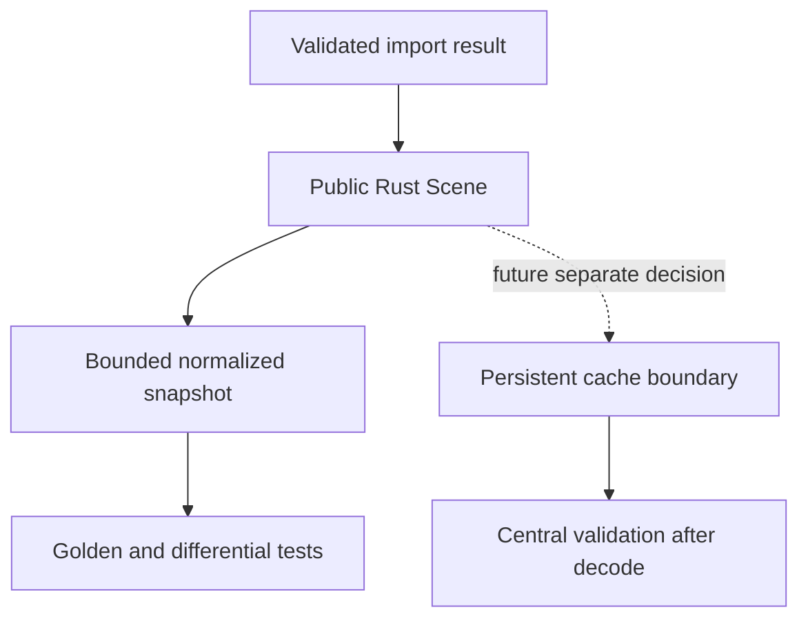

# ADR 0017: Serialization, Snapshot, and Cache Boundary

## Context

Baozi needs several representations of an imported Scene:

- public Rust types used by applications
- normalized test snapshots used for golden and differential evidence
- optional serialized options or tooling data
- a possible binary cache for repeated imports

These representations have different compatibility and security contracts. Treating derived serde or
debug output as a stable schema would freeze early implementation details. Treating snapshots as a
cache would make test readability and runtime performance compete.

Interchange export is outside this ADR. ADR 0038 is a non-authoritative proposal until an exporter
implementation tracer exists; no accepted serialization or cache decision implies export behavior.

## Decision

Baozi separates the public Rust API and normalized snapshot schema, and reserves a distinct decision
boundary for any future persistent cache.

- Public Scene types are not a stable serialized file format.
- Baozi exposes no public Serde representation today. Any future Serde support must be opt-in and
  feature-gated; derived representations are unstable unless a separate schema explicitly says
  otherwise.
- Golden snapshots use a dedicated normalized representation owned by test support.
- This ADR does not authorize a persistent cache API, artifact schema, lookup key, storage owner,
  eviction policy, fallback mode, or public feature.
- Any persistent cache requires a separate Accepted implementation decision with production tracers.
  Its decoded Scene must pass central validation before publication.
- Snapshot readers treat their bytes as untrusted input; any future cache reader must do the same.
- Neither snapshots nor any future cache artifact are interchange export.

ADR 0026 is the sole authority for snapshot field coverage, schema/domain versioning, digest
behavior, float normalization, redaction, deterministic ordering, memory bounds, mutation tests, and
scale gates. This ADR owns only the separation between representations and does not restate that
evidence contract.

## Public API and Serde Boundary

- Source compatibility follows ADR 0006, not a derived field layout.
- `Debug` output is diagnostic convenience and never a golden or cache schema.
- Core types do not derive serialization by default.
- A feature-gated serde representation may change before a separately declared stable schema exists.
- Stable serialized envelopes have their own version, unknown-field policy, size limits, and tests.

## Snapshot Boundary

Snapshots are test-support representations rather than `Debug`, derived serde, cache, or public
interchange schemas. Applications must not consume them as compatibility artifacts. ADR 0026 owns
what snapshot evidence contains and how its determinism, digest, normalization, redaction, bounds,
mutation sensitivity, and scale behavior are verified.

## Deferred Cache Boundary

No persistent cache exists in the accepted architecture. In particular, this ADR does not choose a
cache key, candidate-hit protocol, artifact schema, storage/eviction owner, failure fallback, crate,
feature, or public API. ADR 0041's successful manifest and ADR 0043's Proposed post-discovery identity
cannot be treated as a pre-import lookup key merely because they contain digests.

Before any persistent cache enters a production or default path, a separate decision must identify a
real consumer and freeze ownership, complete input equality, candidate verification, schema and
compatibility, resource admission, corruption behavior, concurrency, storage/eviction, and release
evidence. That decision must have implementation, test, and CI tracers before it becomes Accepted.

Only these negative safety invariants are accepted now: cache bytes would be untrusted input; decoded
Scene data could not bypass central validation; and a cache artifact could not open plugins, resolve
ambient paths, execute code, or carry a forged validation proof. ADR 0010's bounded session-local
physical observation cache is an IO deduplication mechanism, not the deferred persistent cache here.

## Alternatives Considered

### Option A: Derive serde for every public type and treat it as stable

Pros:

- Minimal implementation work.
- Convenient for tools and debugging.

Cons:

- Freezes internal ownership and field layout.
- Lacks explicit schema, resource, and unknown-field policy.
- Produces noisy or incomplete golden evidence.

Decision: rejected.

### Option B: Use one binary format for snapshots and caches

Pros:

- One encoder and decoder.
- Compact and potentially fast.

Cons:

- Binary fixtures are difficult to review.
- Snapshot normalization can hide information needed for cache reconstruction.
- Cache performance changes would destabilize test evidence.

Decision: rejected.

### Option C: Separate public types and snapshots while predefining a versioned cache

Pros:

- Gives future cache work an early key, schema, and ownership direction.
- Keeps cache bytes distinct from review snapshots.

Cons:

- Freezes a hypothetical consumer's lookup and storage requirements.
- Makes an Accepted ADR appear to authorize a cache that has no implementation tracers.

Decision: rejected as speculative.

### Option D: Separate current representations and reserve a future cache decision

Pros:

- Public types and test evidence have one purpose each today.
- Cache identity, ownership, and compatibility remain free to follow a real consumer.
- Negative safety prerequisites prevent a later cache from bypassing validation.

Cons:

- A later cache cannot start until its own design and evidence are accepted.
- No preselected cache interface is available to downstream experiments.

Decision: chosen.

## Success Metrics

| Metric | Target | Measurement |
| --- | --- | --- |
| Representation separation | snapshots are produced by test-support adapters, never `Debug` or derived serde | dependency/source audit |
| Evidence delegation | snapshot schema, digest, coverage, and bounds have one authority in ADR 0026 | Direct ADR review |
| Cache non-authority | no production API, crate, feature, or docs claim a persistent cache under this ADR | API, feature, and documentation audit |
| Feature isolation | builds without serde omit serde dependencies, and no persistent-cache feature or dependency exists | feature-tree checks |
| Boundary honesty | docs and APIs do not describe snapshot/cache/serde as export | ADR/doc checker |

## Risks and Mitigations

| Risk | Severity | Likelihood | Mitigation |
| --- | --- | --- | --- |
| Snapshot becomes accidental public schema | Medium | Medium | keep test-support ownership and explicit non-goal |
| Snapshot evidence rules drift between ADRs | High | Medium | delegate all evidence semantics and gates exclusively to ADR 0026 |
| A speculative cache key becomes accidental architecture | Critical | Medium | defer key and ownership to a separate Accepted decision with a real consumer and tracers |
| Future cache decode bypasses validation | Critical | Low | retain mandatory central validation as a prerequisite for any later cache decision |
| Proposed export is mistaken for accepted behavior | High | Medium | only nonnormative related link to Proposed ADR 0038 |

## Consequences

Positive:

- Tests remain reviewable without freezing the Rust model.
- A future cache cannot silently inherit authority from snapshots, manifests, or producer identity.
- Users are not misled into treating implementation output as interchange format.

Negative:

- A later cache design must make and verify its own ownership, identity, and compatibility decisions.
- Optional serde users receive no implicit stable file-format promise.
- Persistent cache implementation remains absent pending a separate Accepted decision and tracers.

## Amendment History

### 2026-07-17: Remove speculative persistent-cache ownership

- Affected: `Decision`, `Deferred Cache Boundary`, metrics, risks, and consequences.
- Previous: this ADR preselected cache-key inputs, fallback behavior, and host storage/eviction despite
  having no persistent-cache implementation or consumer.
- New: this ADR owns only representation separation and negative safety prerequisites; every positive
  persistent-cache contract is deferred to a separate implementation-backed decision.
- Impact: current snapshot and IO-cache work keep their existing owners, while no Accepted ADR can be
  cited as authority for a persistent cache, lookup identity, crate, feature, or API.
- Review: 2026-07-16 architecture ownership review and 2026-07-17 authority follow-up.
- Rationale: a hypothetical cache should not constrain canonical Scene or resource-manifest refactoring
  before its consumer, lookup semantics, and evidence model exist.
