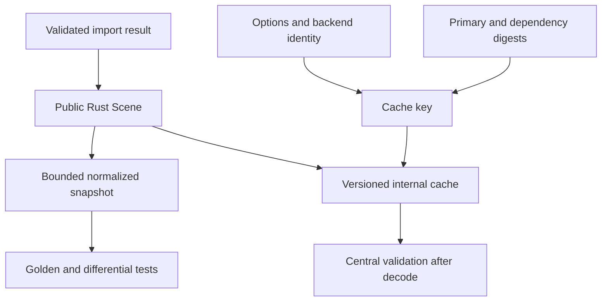

# ADR 0017: Serialization, Snapshot, and Cache Boundary

## Context

Baozi needs several representations of an imported Scene:

- public Rust types used by applications
- normalized test snapshots used for golden and differential evidence
- optional serialized options or tooling data
- a possible binary cache for repeated imports

These representations have different compatibility and security contracts. Treating derived serde or
debug output as a stable schema would freeze early implementation details. Treating snapshots as a
cache would make test readability and runtime performance compete.

Interchange export is outside this ADR. ADR 0038 is a non-authoritative proposal until an exporter
implementation tracer exists; no accepted serialization or cache decision implies export behavior.

## Decision

Baozi separates the public Rust API, normalized snapshot schema, and internal cache schema.

- Public Scene types are not a stable serialized file format.
- Serde support is opt-in and feature-gated; derived representations are unstable unless a separate
  schema explicitly says otherwise.
- Golden snapshots use a dedicated normalized representation owned by test support.
- A persistent cache, if added, is a separately versioned internal artifact and is always validated
  after decode.
- Snapshot and cache readers treat their bytes as untrusted input.
- Neither representation is interchange export.

ADR 0026 is the sole authority for snapshot field coverage, schema/domain versioning, digest
behavior, float normalization, redaction, deterministic ordering, memory bounds, mutation tests, and
scale gates. This ADR owns only the separation between representations and does not restate that
evidence contract.

## Public API and Serde Boundary

- Source compatibility follows ADR 0006, not a derived field layout.
- `Debug` output is diagnostic convenience and never a golden or cache schema.
- Core types do not derive serialization by default.
- A feature-gated serde representation may change before a separately declared stable schema exists.
- Stable serialized envelopes have their own version, unknown-field policy, size limits, and tests.

## Snapshot Boundary

Snapshots are test-support representations rather than `Debug`, derived serde, cache, or public
interchange schemas. Applications must not consume them as compatibility artifacts. ADR 0026 owns
what snapshot evidence contains and how its determinism, digest, normalization, redaction, bounds,
mutation sensitivity, and scale behavior are verified.

## Cache Contract

A persistent cache requires a separate implementation decision before introduction. Its key includes:

- Baozi and cache schema versions
- primary and normalized dependency content digests
- frozen import and postprocess option digests
- format/backend identity and relevant feature set
- target representation identity only when bytes are target-dependent

Cache decode is an untrusted parser path with byte, allocation, graph, string, metadata, and work
limits. A cache hit does not bypass central Scene validation. Corruption or incompatibility falls back
to import unless the caller explicitly requested cache-only behavior.

The cache cannot open plugins, resolve ambient paths, execute code, or carry a forged validation
proof. Cache storage and eviction belong to the host unless a future cache component is admitted.

## Alternatives Considered

### Option A: Derive serde for every public type and treat it as stable

Pros:

- Minimal implementation work.
- Convenient for tools and debugging.

Cons:

- Freezes internal ownership and field layout.
- Lacks explicit schema, resource, and unknown-field policy.
- Produces noisy or incomplete golden evidence.

Decision: rejected.

### Option B: Use one binary format for snapshots and caches

Pros:

- One encoder and decoder.
- Compact and potentially fast.

Cons:

- Binary fixtures are difficult to review.
- Snapshot normalization can hide information needed for cache reconstruction.
- Cache performance changes would destabilize test evidence.

Decision: rejected.

### Option C: Separate public types, review snapshots, and versioned cache

Pros:

- Each representation has one purpose and honest compatibility.
- Internal refactoring does not automatically change golden or cache policy.
- Security limits can match each parser/encoder path.

Cons:

- More than one schema and tool may need maintenance.
- Behavior-complete snapshots require deliberate design.

Decision: chosen.

## Success Metrics

| Metric | Target | Measurement |
| --- | --- | --- |
| Representation separation | snapshots are produced by test-support adapters, never `Debug` or derived serde | dependency/source audit |
| Evidence delegation | snapshot schema, digest, coverage, and bounds have one authority in ADR 0026 | ADR checker and review |
| Cache safety | corrupt, stale, incompatible, or over-budget cache never returns unvalidated success | malformed/cache-key tests |
| Feature isolation | builds without serde/cache behavior omit their dependencies | feature-tree checks |
| Boundary honesty | docs and APIs do not describe snapshot/cache/serde as export | ADR/doc checker |

## Risks and Mitigations

| Risk | Severity | Likelihood | Mitigation |
| --- | --- | --- | --- |
| Snapshot becomes accidental public schema | Medium | Medium | keep test-support ownership and explicit non-goal |
| Snapshot evidence rules drift between ADRs | High | Medium | delegate all evidence semantics and gates exclusively to ADR 0026 |
| Cache key misses dependencies/options | Critical | Medium | derive key from session dependency table and frozen option identities |
| Cache decode bypasses validation | Critical | Low | internal proof constructors and mandatory central validation |
| Proposed export is mistaken for accepted behavior | High | Medium | only nonnormative related link to Proposed ADR 0038 |

## Consequences

Positive:

- Tests remain reviewable without freezing the Rust model.
- A future cache has an explicit validation and invalidation boundary.
- Users are not misled into treating implementation output as interchange format.

Negative:

- Snapshot and future cache tooling have separate schemas.
- Optional serde users receive no implicit stable file-format promise.
- Persistent cache implementation remains deferred pending its own tracer and decision.
