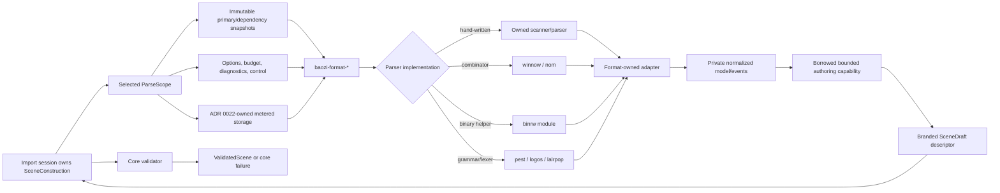
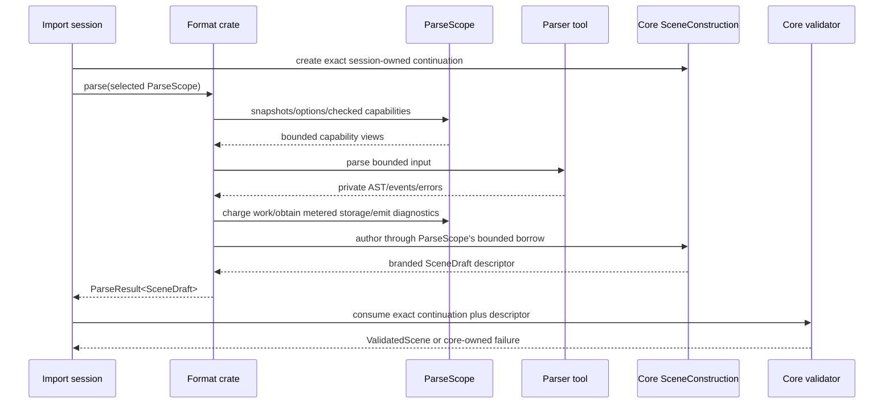

# ADR 0018: Parser Tooling and Format-Owned Parser Policy

## Context

Baozi will eventually need parsers for formats where the Rust ecosystem does not provide a mature,
well-licensed, WASM-compatible, replaceable loader. ADR 0004 already allows Baozi-owned parsers.
This ADR defines when those owned parsers should be hand-written and when they should use mature
parser tooling such as `binrw`, `winnow`, `nom`, `pest`, `logos`, or `lalrpop`.

The important boundary is ownership: a parser generator or parser-combinator crate may help a
format crate parse bytes, but it must not define Baozi's public importer traits, diagnostics,
scene IR, feature flags, or support promises.

Current metadata observed from crates.io API on 2026-07-09:

| Crate | Version | License | Rust version | Initial recommendation |
| --- | --- | --- | --- | --- |
| `binrw` | 0.15.1 | MIT | 1.70 | Candidate for record-oriented binary subparsers |
| `winnow` | 1.0.3 | MIT | 1.65.0 | Candidate for text parsers where combinators improve clarity |
| `nom` | 8.0.0 | MIT | 1.65.0 | Mature alternative to `winnow`; use when it fits local style better |
| `pest` | 2.8.7 | MIT OR Apache-2.0 | 1.83 | Candidate for grammar-shaped text formats after audit |
| `logos` | 0.16.1 | MIT OR Apache-2.0 | 1.80.0 | Candidate lexer for token-heavy text formats |
| `lalrpop` | 0.23.1 | Apache-2.0 OR MIT | 1.86 | Eligible after format-specific audit; no longer blocked by Baozi MSRV 1.95 |

## Decision

Baozi will use parser tooling selectively behind format crate boundaries.

Core rules:

- every parser remains format-owned and converts tool-native state into a format-private normalized
  model, Baozi-owned diagnostics/loss facts, and a `SceneDraft` through the selected `ParseScope`
- parser tooling and backend selection are private implementation details; public features select
  admitted format capabilities and never expose a backend choice
- simple formats should start with small hand-written parsers when that yields clearer limits and
  diagnostics
- mature parsing crates may be used when they reduce real complexity without weakening resource
  limits, WASM compileability, the documented MSRV 1.95, or panic safety
- parser generators such as `lalrpop` are allowed by MSRV policy, but still require per-format audit
  because generated code can make resource limits and error mapping less obvious
- generated parsers must be checked in only when generation is deterministic and the generator is
  also available through a documented development workflow
- parser adapters obtain primary/dependency snapshots, selected options, work charges, live
  reservations, diagnostics, cancellation, progress, and a bounded borrow of core-owned Scene
  authoring only through their selected `ParseScope`; they receive no raw `AssetIo`, mutable import
  coordinator, retained owner, or ledger
- the import session owns the opaque `SceneConstruction` continuation; the parser returns only its
  branded, non-owning `SceneDraft` descriptor, and core's central validator is the sole proof
  constructor
- first-party and admitted parser paths cooperatively honor checked charges/reservations or reviewed
  conservative allowances; hostile or untrusted parser code requires process isolation because an
  in-process API cannot prevent arbitrary allocation, looping, abort, or process exit

### ParseScope-Bound Metered Storage

Format-owned parsers compose the ParseScope-bound metered storage governed exclusively by ADR 0022.
Parser tooling does not create a second capacity, reservation, transfer, rollback, or release
protocol. A format-specific wrapper may add source semantics, but all storage accounting remains
behind ADR 0022's `baozi-import` interface.

Recommended first choices by format shape:

| Format shape | Preferred approach |
| --- | --- |
| Small fixed binary, such as STL | Hand-written byte parser first |
| Record-structured binary with many typed fields | Hand-written core plus optional `binrw` submodules after audit |
| Simple line/token text, such as early OBJ/MTL slices | Hand-written scanner or `winnow`/`nom` if it improves error handling |
| Grammar-heavy text with nested constructs | `pest` or `lalrpop` only after MSRV/license/WASM review |
| Token-heavy text where lexer clarity matters | `logos` plus Baozi-owned parser state machine |
| XML/JSON/container formats | Use domain libraries for XML/JSON/container decoding, then Baozi-owned normalization |

## Architecture

## Adoption Checklist

A parser tool may be added to a production crate only when all checks pass:

- license fits Baozi's downstream `MIT OR Apache-2.0` intent or is explicitly documented as compatible
- MSRV does not exceed Baozi's documented MSRV 1.95 unless a separate MSRV decision accepts the raise
- `wasm32-unknown-unknown` bytes-path build passes for the relevant format feature
- dependency does not add native FFI, process-global runtime, threads, or filesystem assumptions to
  the default parser path
- malformed input becomes a stable format-owned cause admitted through the selected `ParseScope`, or
  bounded diagnostics/loss facts, rather than a backend-native error or panic
- the adapter propagates opaque session-terminal capability-produced `ScopeAbort` values and never
  catches or reclassifies them as format failures; a permitted optional-dependency unavailable
  outcome is an explicit resolver success branch, not an abort to suppress
- all input-derived work and allocation is covered by checked charges, live reservations, or a
  reviewed conservative allowance before an opaque parser/backend allocation occurs
- parser output remains private and is converted into Baozi-owned draft data without backend types
  crossing the format boundary
- tests cover happy path, malformed input, budget exhaustion, cancellation, central validation, and
  at least one deterministic snapshot

Diagnostic, streaming, and generated-code requirements are defined in
[`ADR 0019`](0019-parser-diagnostic-streaming-and-generated-code-contract.md). The operational
review checklist lives in
[`docs/architecture/parser-tool-audit-checklist.md`](../architecture/parser-tool-audit-checklist.md).
That checklist covers generated-code workflow, source-span diagnostics, full-buffer versus streaming
parsing, supply-chain review, and tool-specific pain points.

## Alternatives Considered

### Option A: Hand-write every parser

Pros:

- maximum control over diagnostics, limits, and WASM behavior
- smallest dependency tree
- easiest clean-room reasoning

Cons:

- slow for grammar-heavy formats
- increases maintenance burden for complex grammars
- risks ad hoc parser bugs where mature tooling would help

Decision: rejected as an absolute rule, but preferred for small first slices such as STL.

### Option B: Adopt parser tooling as the default parser strategy

Pros:

- faster to build complex parsers
- mature crates can reduce grammar and binary-layout boilerplate
- grammar files can document format structure

Cons:

- dependencies can raise MSRV or affect WASM compatibility
- generated parsers may obscure resource-limit enforcement
- crate-specific errors and ASTs can leak into architecture if not contained

Decision: rejected as the default policy. Tooling must be selected per format and stay private.

### Option C: Format-owned parser boundary with selective tooling

Pros:

- keeps Baozi API stable and tool-agnostic
- allows mature parser tools where they materially reduce complexity
- preserves diagnostics, limits, validation, and clean-room ownership
- lets each format choose the right parsing style

Cons:

- requires per-format audits
- different format crates may use different parser styles
- test and fuzz discipline must stay consistent across tools

Decision: chosen.

## Success Metrics

| Metric | Target | Measurement |
| --- | --- | --- |
| API isolation | No public Baozi type exposes parser-tool ASTs or errors | rustdoc/API review |
| Feature hygiene | Disabling a format removes its parser-tool dependencies | `cargo tree -e features` |
| MSRV hygiene | Parser tools do not accidentally raise documented MSRV | dependency metadata review and MSRV check |
| WASM hygiene | Format bytes path compiles for `wasm32-unknown-unknown` | target-specific `cargo check` |
| Error quality | Malformed inputs return stable format causes or bounded diagnostics | malformed fixture tests |
| Resource control | Admitted adapters charge or reserve before input-derived work/allocation | budget tests, allocation probes, fuzz seeds |
| Validation authority | Parser APIs return only the branded `SceneDraft` descriptor, never the construction owner or parser-supplied proof | API-shape, foreign-descriptor, and invalid-draft tests |

## Risks and Mitigations

| Risk | Severity | Likelihood | Mitigation |
| --- | --- | --- | --- |
| Parser tool raises MSRV | High | Medium | Gate additions through ADR 0007 and dependency metadata review |
| Tool AST leaks into public API | High | Low | Keep tools private to format crates and convert immediately |
| Generated parser hides allocation behavior | Medium | Medium | Require resource-limit tests and fuzz seeds before maturity promotion |
| Different parser styles fragment maintenance | Medium | Medium | Keep `ParseScope`, diagnostics, snapshots, budgets, and central validation shared |
| A hostile in-process extension ignores cooperative limits | Critical | Medium | Treat extensions as trusted code; require process isolation for hostile plugins |
| Tool is not WASM-friendly | High | Medium | Require bytes-path target check before enabling the format feature |

## Consequences

Positive:

- Baozi can self-write parsers without reinventing every parsing technique.
- Mature crates are allowed when they earn their place through measurable constraints.
- Public API remains stable even if a format crate swaps parsing implementation later.

Negative:

- Each parser-tool adoption requires an audit instead of a blanket approval.
- Contributors need to understand the format-owned adapter boundary before adding dependencies.

## Sources

- crates.io API: [`binrw`](https://crates.io/api/v1/crates/binrw)
- crates.io API: [`winnow`](https://crates.io/api/v1/crates/winnow)
- crates.io API: [`nom`](https://crates.io/api/v1/crates/nom)
- crates.io API: [`pest`](https://crates.io/api/v1/crates/pest)
- crates.io API: [`logos`](https://crates.io/api/v1/crates/logos)
- crates.io API: [`lalrpop`](https://crates.io/api/v1/crates/lalrpop)

## Amendment History

### 2026-08-01: Align parser tooling with the opaque construction boundary

- Affected: `Decision`, `Architecture`, and `Success Metrics`.
- Previous: parser adapters were described as driving an importer-facing `SceneBuilder` that owned
  unvalidated construction state.
- New: the import session owns one opaque core `SceneConstruction`; `ParseScope` lends only bounded
  authoring authority, and parsers return a branded non-owning `SceneDraft` descriptor.
- Impact: the pre-release parser boundary becomes narrower and prevents format code from retaining or
  finalizing canonical storage independently.
- Review: 2026-08-01 fixed-range architecture and parser-boundary review.
- Rationale: this preserves the format-owned parser policy while aligning it with ADR 0003 and ADR
  0020's single canonical lifecycle rather than selecting a new parser architecture.
