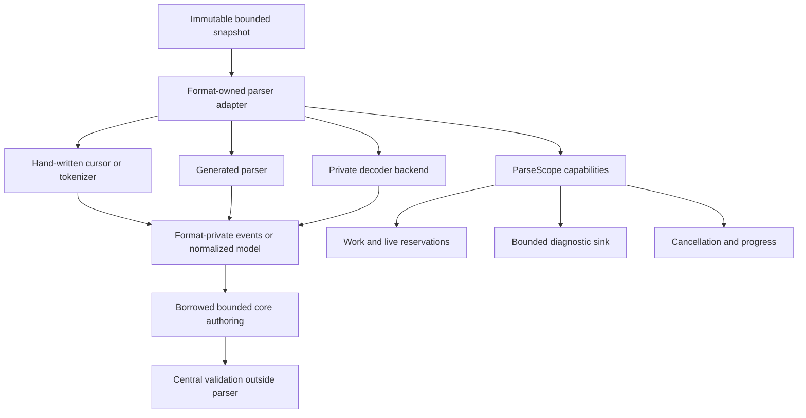

# ADR 0019: Parser Diagnostics, Input Consumption, and Generated Code

## Context

Hand-written parsers, generated grammars, and third-party decoder backends expose different error,
location, allocation, and recovery models. If those models escape a format crate, public behavior
changes whenever a parser tool is replaced. Unbounded recovery diagnostics or a generated parser's
hidden AST can also defeat otherwise correct resource limits.

Baozi's canonical primary input is an immutable bounded snapshot. The word "streaming" therefore
describes how a parser consumes that snapshot or dependency snapshots; it does not authorize a parser
to reopen the primary source, own a seek cursor, or bypass the import session.

## Decision

Every production parser, whether hand-written, generated, or dependency-backed, satisfies one
Baozi-owned contract for input consumption, diagnostics, recovery, allocation, and verification.
Tool-specific types and messages remain private.

Accepted records the required contract, not the implementation maturity of every format.

### Allowed Input Consumption Modes

| Mode | Suitable for | Contract |
| --- | --- | --- |
| Snapshot view | Small/simple bounded binary or text formats | Borrow the immutable primary/dependency bytes; no copy for cursor ownership. |
| Bounded cursor | Binary records and random access | Cursor state is parser-local over a snapshot and every range is checked. |
| Incremental tokenizer/event decoder | Large line/record-oriented syntax | Retain bounded token/event state; do not build an unnecessary full AST. |
| Hybrid normalized model | Containers such as glTF | Backend state is private and converted into a bounded format-owned model. |

True one-pass IO streaming, where the complete primary snapshot never exists, is a separate future
contract. A parser may not claim streaming merely because a library exposes an iterator over an
already unbounded AST.

### Diagnostic Contract

Parser diagnostics are structured events sent through `ParseScope`; parsers do not log source
warnings or construct final reports. Each stored diagnostic contains:

- a stable Baozi-owned code and severity;
- the import phase and normalized source identity;
- a raw byte range when the format can identify one;
- line and column only as a derived view from bounded line-index data;
- an optional canonical object/property path;
- a bounded, escaped human message; and
- structured bounded details when callers need machine-readable values.

Backend exception names, host absolute paths, debug dumps, source substrings, and unbounded offending
tokens do not become public diagnostic fields. Byte ranges remain authoritative after text recovery;
ADR 0035 defines decoding and raw-to-decoded span mapping.

Diagnostics have both a count limit and a total encoded-byte limit. Attempted diagnostic count and
bytes are monotonic ledger counters even after storage is full. Once capped, the sink increments
`dropped` counters and does not allocate the omitted messages. A bounded summary in the report exposes
the number dropped. Strict/loss policy may promote a diagnostic to failure, but promotion does not
erase earlier diagnostics or ledger evidence.

### Error and Recovery Boundary

The parser distinguishes:

- fatal structural or required-resource failures, returned as typed causes;
- recoverable source quality or explicitly authorized loss, emitted as diagnostics; and
- internal/backend contract failures, translated at the trusted extension boundary.

Recovery is permitted only when the format policy names it, the caller authorizes it, and the
resulting draft can pass central validation. A generated parser's automatic recovery mode is disabled
unless its exact skip/insert behavior has stable codes, work bounds, and conformance fixtures. A
parser cannot downgrade a resource, cancellation, path-policy, or invariant failure to a warning.

### Allocation and Progress

Before growing a token buffer, AST collection, decoded record array, or generated parser stack, the
adapter must perform checked arithmetic and acquire the appropriate live reservation. Counts derived
from input are charged as attempted work before the operation that uses them. Tooling that allocates
an uninspectable unbounded structure before Baozi can reserve it is unsuitable for an in-process
production path.

Every potentially long loop consumes deterministic work units and checks cancellation at the bound
defined by ADR 0033. Empty or zero-width successful records must still advance source position or
terminate; non-progress is a parser error.

### Generated Code

- Grammar sources and generator configuration are version-controlled.
- Regeneration is deterministic; CI either regenerates and diffs or builds directly from the grammar.
- Generated files are private to the format crate and receive normal review, lint, malformed-input,
  fuzz, and resource-limit coverage.
- Generator dependencies remain build-time or format-feature-local.
- Generated public symbols, error types, ASTs, and feature flags do not leak from Baozi's API.
- A generator upgrade is reviewed as a parser-backend change, including output size, unsafe code,
  MSRV, WASM, recovery, and allocation behavior.

## Format Review Record

Before promotion beyond Experimental, each format records and tests:

- its selected input mode and retained intermediate structures;
- location precision and line-index strategy;
- all allowed recovery modes and losses;
- bounds for lines, tokens, nesting, records, strings, diagnostics, and AST/model storage;
- generated-code or backend regeneration/update workflow;
- malformed corpus and sanitizer evidence; and
- the replacement trigger when a tool cannot satisfy this ADR.

## Alternatives Considered

### Option A: Expose each parser tool's native errors and recovery

This minimizes adapter code but makes public behavior backend-dependent and bypasses uniform limits.
Rejected.

### Option B: Require one parser framework for every format

This creates surface consistency but forces binary, line-oriented, and container formats into an
ill-fitting allocation model. Rejected.

### Option C: Format-selected tools behind one Baozi parser contract

This preserves format-specific engineering choices while freezing diagnostics, budgets, and public
behavior. Chosen.

## Consequences

Positive:

- Parser backends remain replaceable without changing public outcomes.
- Diagnostics and source locations are comparable across formats.
- Generated and hand-written code face the same security and fuzz gates.
- Snapshot, tokenizer, and normalized-model implementations can be chosen by format.

Negative:

- Format adapters must translate backend errors and locations.
- Some convenient parser libraries are inadmissible due to opaque allocation or recovery.
- Generated-code upgrades require conformance review rather than a dependency-only bump.

## Risks and Mitigations

| Risk | Severity | Mitigation |
| --- | --- | --- |
| Diagnostic flooding consumes memory after the count cap | High | Enforce count and encoded-byte caps before message allocation; count drops monotonically. |
| Derived line/column scans become quadratic | High | Build a bounded line index once or maintain line state during tokenization. |
| Automatic recovery publishes fabricated semantics | High | Disable by default; require named recovery, loss evidence, and central validation. |
| Generated parser allocates before budget checks | High | Inspect generated paths, wrap with admission, or reject/replace the tool. |
| Tool-specific wording breaks snapshots | Medium | Snapshot stable codes, locations, and bounded structured details rather than native messages. |

## Acceptance Criteria

| Contract | Testable acceptance |
| --- | --- |
| Backend isolation | Public API and rustdoc contain no parser-backend error, AST, or generated type. |
| Bounded diagnostics | Huge repeated errors respect count/byte caps and report exact attempted/stored/dropped counters. |
| Location stability | Malformed fixtures assert byte ranges and deterministic derived line/column values. |
| Non-progress safety | Empty repeated productions and zero-width records terminate with bounded work. |
| Allocation admission | Oversized token/record/AST counts fail before capacity growth in instrumented tests. |
| Cancellation | Large loops stop within the declared work interval and preserve diagnostics/stats. |
| Generated reproducibility | Regeneration produces no diff and all generated parser fuzz targets compile and execute in the required sanitizer tier. |
