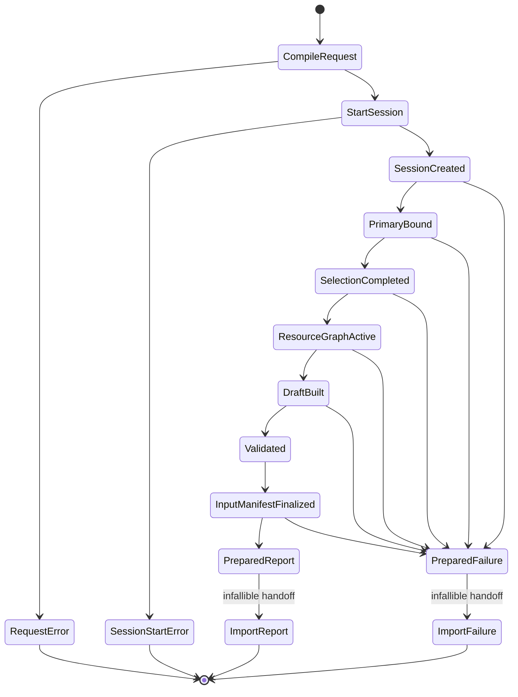

# ADR 0020: Import Lifecycle, ParseScope, and Outcome Contract

## Context

If a parser can open arbitrary resources, construct a report, assign a lifecycle enum, or declare its
own Scene valid without the central core validator, facade helpers cannot enforce one security and
correctness boundary. Creating context only after opening/detection also means early failures lose
diagnostics, resource evidence, and a single finalization path.

Older documents used conceptual names such as RawImported, ValidatedImported, PostProcessed, and
ValidatedOutput. This ADR is the sole authority for import lifecycle and import outcomes. It does not
own post-process internal stages, which belong to the post-process contract, and a validated Scene
proof is not an assignable lifecycle stage.

## Decision

After request/options compilation, Baozi performs one fallible session-bootstrap transition before
primary binding or detection. Only a successful bootstrap creates `ImportSession`.
The session owns the only outcome builder, stable primary input, selected-format evidence, optional
source-scope evidence, dependency resolver, ledger, bounded diagnostics, and operation control. It
grants the selected trusted importer only a capability-limited `ParseScope`.

The parser returns `ParseResult<SceneDraft>`. The public central validator in `baozi-core` is the only
constructor of `ValidatedScene` proof; downstream code may legitimately call it, but cannot directly
construct or forge proof. `ImportSession` is the only import outcome/stage/provenance finalizer. It
always invokes the core validator on the returned draft and, after bootstrap succeeds, finalizes
exactly one success or failure.

Accepted establishes authority; it does not claim the current prototype context already enforces it.

### Lifecycle

Compiling and validating the complete common and format-option request is a pre-session admission step.
An invalid request returns a typed `RequestError`, creates no session, and performs no asset IO. After
successful admission, the import lifecycle is:

During request compilation, an unwindable submitted-layer codec panic, compile-budget exhaustion,
runtime option-type mismatch, or other codec/request defect is a bounded `RequestError`, never an
`ImportFailure`; default-codec failures occurred earlier as `RegistryBuildError` and cannot exist in
the frozen snapshot. Neither path has an import ledger, lifecycle phase, diagnostics stream, finalizer,
or asset open.

`ImportSession::try_start` then obtains either a host-supplied admitted physical account or creates a
private account through ADR 0042's explicit host-owned account factory, creates the real operation
ledger, performs both admissions for one minimal terminal envelope, and fallibly allocates/binds that
envelope. Failure before all of those owners exist returns fixed-size `SessionStartError`. That error
has no heap allocation, account lease, ledger snapshot, lifecycle phase, diagnostic stream, or asset
open; it distinguishes invalid/bootstrap limits, account-control admission/allocation, operation-
ledger start, terminal-envelope admission, and terminal-envelope allocation. It is neither
`RequestError` nor `ImportFailure`, and formatting it requires no allocation.

1. successfully bootstrap the session and private outcome builder with one pre-admitted account-bound
   minimal terminal envelope, or return `SessionStartError` before a session exists;
2. bind one immutable primary snapshot and its session-issued root-origin capability through either
   policy-authorized IO acquisition or admitted direct-byte copying;
3. build one shared probe and select/force a format with evidence;
4. create `ParseScope` for only the selected importer;
5. acquire required/optional dependencies through session-issued origin-qualified capabilities and
   parse into format-private state as needed;
6. construct a Scene draft only through the core construction capability;
7. have `ImportSession` call the public central `baozi-core` validator, whose successful result is the
   unforgeable `ValidatedScene` proof;
8. prepare and infallibly hand off one `ImportReport`; or
9. from any point after successful session bootstrap, prepare and infallibly hand off one
   `ImportFailure` with
   rich bounded evidence or the pre-admitted minimal terminal envelope.

Last-completed phase is a sealed read-only evidence value constructed by the session. It is present so
callers can understand a failure, not so callers or parsers can advance state. Public code may obtain
`ValidatedScene` only by successfully calling the core validator; it cannot directly construct proof
or attach import phase/provenance to it. Only the session can construct import phase evidence, reports,
or failures.



The state diagram is internal authority flow, not a public mutable state machine.

### Phase Types and Mapping

Three sealed phase vocabularies are intentionally distinct:

- `ImportPhaseEvidence` is the coarse authority boundary retained as `last_completed` in an outcome;
- `ImportLedgerPhase` attributes current/high-water reservations and attempted/consumed work; and
- `ImportProgressPhase` labels transient observer events.

The session owns all three import vocabularies. `baozi-operation` stores owner-supplied phase keys but
does not define their meaning. A ledger transition or progress event can never advance lifecycle
evidence. Only successful completion of an atomic session boundary performs that advancement:

| Work underway | Last completed `ImportPhaseEvidence` | `ImportLedgerPhase` examples | `ImportProgressPhase` examples |
| --- | --- | --- | --- |
| Session created, primary not yet bound | `SessionCreated` | `PrimarySnapshot` | `AcquirePrimary` |
| Primary complete, selection underway | `PrimaryBound` | `Detection` | `Detect` |
| Parser/dependency/backend/normalization/build work | `SelectionCompleted` | `DependencyAcquisition`, `BackendDecode`, `FormatNormalization`, `SceneConstruction` | `AcquireDependency`, `Decode`, `Normalize`, `BuildDraft` |
| Draft complete, validation underway | `DraftBuilt` | `Validation` | `Validate` |
| Validation complete, outcome finalizing | `Validated` | `OutcomeFinalization` | `Finalize` |

Formats without a distinct backend or normalized model simply never enter those ledger/progress
phases; they do not fabricate lifecycle milestones. Failure retains the last boundary completed before
the failing work. Outcome finalization does not create a later public phase because the report or
failure itself proves finalization.

### DetectionScope Capabilities

Every detector invocation receives the same immutable `Probe` and hint plus a session-created
`DetectionScope`. Each invocation receives a fresh scope view over the session's shared coordinator
and terminal latch. The scope exposes only cancellation/deadline polling and linear detection-work
admission; it cannot open resources, mutate detection evidence, inspect another registration, or
construct an outcome/failure category.

`DetectionScope::begin_work(amount)` first verifies that the session is active, rejects a second
outstanding permit, polls operation control, rejects zero or more than 4 KiB of work, and charges
attempted `DetectionWork`. Exactly one linear permit represents that admitted chunk. Calling
`complete()` charges consumed work before a post-work control poll. Polling while a permit is live,
requesting zero work, requesting another permit, dropping an unfinished permit, or leaving a permit
outstanding when the detector returns is a descriptor-contract violation and latches the session.

The first control, ledger, reentrancy, or permit-contract failure is retained as the terminal scope
cause. `DetectionAbort` is opaque and non-constructible by extensions. Catching or discarding it and
returning a match cannot recover the session: the session checks the latch before accepting the
detector result, and an abort without a latched cause is itself a descriptor-contract failure.

### Registered Importer Invocation Contract

This ADR owns the exact detector/parser invocation shapes used after ADR 0021 registration and
request admission:

```rust
pub type DetectionResult<T> = Result<T, DetectionAbort>;
pub type ParseResult<T> = Result<T, ParseFailure>;

pub trait FormatImporter: Send + Sync + RefUnwindSafe + 'static {
    fn detect(
        &self,
        probe: &Probe<'_>,
        hint: &ReadHint,
        scope: &DetectionScope<'_>,
    ) -> DetectionResult<DetectionOutcome>;

    fn parse(&self, scope: &mut ParseScope<'_>) -> ParseResult<SceneDraft>;
}
```

Descriptor and option-codec access may use separate registry-owned views, so auxiliary methods need
not match this sketch. The two domain return shapes and borrowed scope capabilities are normative.
Detection cannot return a bare outcome that bypasses its latch, and parse cannot return a backend
error, `ValidatedScene`, validation proof, report, or arbitrary associated error. The registry health
wrapper passes these invocation values unchanged and may observe unwind versus return, but cannot
inspect or relabel the domain result.

### ParseScope Capabilities

`ParseScope` is valid only for the selected importer and session lifetime. It may expose:

- the immutable primary snapshot, normalized source identity, and opaque session-issued root origin;
- classified required/optional dependency requests through the session resolver, using only an
  origin capability returned by this session;
- the selected importer's checked concrete option view;
- checked work charging and live reservations;
- bounded diagnostic emission and loss facts;
- one sealed, bounded source-scope evidence submission;
- cancellation polling and progress reporting; and
- a Scene construction capability whose output is only `SceneDraft` and cannot mint or submit
  validation proof.

It does not expose raw `AssetIo`, unrestricted path resolution, registry mutation, another format's
options, resource-graph/cache internals, graph-node construction, caller-selected base paths,
manifest or proposed identity builders, the outcome builder, report/failure constructors, lifecycle
advancement, validation-proof constructors, or post-process execution.

### Source-Scope Evidence Transport

This ADR consumes ADR 0039's semantic `SourceScopeRecord` through one fallible ledger-charged builder,
one sealed `ParseScope` submission capability, and atomic storage in both `ImportReport` and
`ImportFailure`. It cannot redefine the meaning or completeness of source-scene selection,
retained/omitted object-kind counts, or scope-versus-loss classification. ADR 0036 owns the source
identities, stable digests, provenance, and loss representations carried by the record.

An import has zero or one finalized source-scope record. Zero means the selected format has not
declared a source-scope projection or selection did not complete; it never means an empty projection.
The builder is an incremental, ledger-bound capability borrowed from `ParseScope`; it checks and
charges count, detail-cell, string, digest-work, and live-capacity growth before copying caller data.
The mandatory outcome, exact typed retained/omitted counts, and stable digest are never collapsed.
Optional identity/detail retention has exactly two fidelity states:

```text
SourceScopeEvidenceFidelity =
    Exact
  | DigestCollapsed(ProvenanceEvidenceLossId)

ImportLossSubject =
    RawRange(SourceIdentity, ByteRange)
  | SourceScope(DocumentIdentity, SourceScopeDigest)
```

The names describe the required semantic shape, not a frozen public Rust layout. A source-scope
collapse uses the typed `SourceScope` subject and never fabricates a raw byte range. It is permitted
only when the frozen `LossPolicy` allows `ImportLossKind::ProvenanceEvidenceLoss`; otherwise budget
exhaustion latches a session-terminal scope cause. An authorized collapse retains exact counts and
digest, emits one bounded loss fact and diagnostic, and records that loss ID in the fidelity state.
It does not authorize ADR 0039 source-semantic loss.

Finalization prepares and reserves the record, loss fact, diagnostic, and all container growth before
publishing any of them. If validation, charging, reservation, allocation, loss-evidence retention, or
diagnostic preparation fails, no partial record is submitted and the first cause is latched. Final
submission is one-way: a duplicate, invalid, or uncharged record also latches a session-terminal scope
cause. Once submitted, the parser cannot replace it, and any later parse, construction, validation,
cancellation, or finalization failure retains the same record in the terminal `ImportFailure`. This
channel does not change the normative
`ParseResult<SceneDraft>` return shape or grant the parser access to an outcome constructor.

Dependency access has one result domain regardless of the selected role's runtime requirement. The
names below describe the required semantic shape, not the public Rust layout:

```text
dependency(origin, role, hostile_reference) -> ParseResult<DependencyOutcome>

DependencyOutcome =
    Available(DependencySnapshot)
  | Unavailable(OptionalDependencyEvidence)
```

For a `Required` role, every unavailable physical result becomes a latched `ScopeAbort`, so
`DependencyOutcome::Unavailable` is unreachable. For an `Optional` role, that variant is returned
only after the frozen role table and caller loss policy authorize omission. A single return type lets
the runtime role table own requiredness without making method selection or a generic type parameter a
second requiredness input.

The resolver may return `Unavailable` only when the selected format contract classifies that
dependency role as optional and the caller's loss policy permits the resulting omission. The scope
records one bounded diagnostic/loss fact and preserves the normalized identity, original lower-layer
cause owner, cached-failure disposition, and ADR 0010's atomically frozen negative observation
(`proof | none`) in `OptionalDependencyEvidence`. `Unavailable` is a
successful resolver outcome, not a `ParseFailure`; it does not latch the session and the importer may
continue building geometry. A denied, missing, failed-open, or over-budget optional acquisition still
consumes its non-refundable accounting under ADR 0022. Acquisition-byte/work exhaustion is marked
session-dependent and makes ADR 0041 input replay status `ObservedOnly`. Cycle, depth, node, edge,
graph-work, proof, manifest, finalization, cancellation, and deadline failures terminate regardless
of optionality. Once a snapshot is `Available`, format-owned
content decoding and recovery follow the separate diagnostic/loss contract; malformed content is not
reclassified as a resolver miss.

Requiredness tokens, outcome/evidence constructors, and loss disposition are private to the session
resolver. Format code may submit only a dependency role admitted by its frozen descriptor contract;
it cannot forge `Unavailable`, relabel a required role, or attach a fabricated lower-layer cause.

After every logical reference has independently passed role and policy authorization, the dependency
table caches the first immutable snapshot or identity-terminal failure by ADR 0010's
authority-qualified key `(authority domain, normalized resource identity)`. Here
*identity-terminal* means that later authorized references to that same key observe the same snapshot
or failure without another physical open; it does not by itself make the import session terminal.
References in another scope or resolver namespace never share the entry, and a denied alias cannot
consult it. Requiredness and loss disposition remain per-reference decisions outside the physical
key. A required request for a cached failure, an optional omission rejected by format or loss policy,
cancellation/deadline, or any capability failure for which safe continuation is forbidden is instead
returned as a session-terminal `ScopeAbort` and latched before control returns to the importer.
Required and optional requests therefore share one physical result only inside one authority domain
without conflating cache stability with outcome finalization.

Rust has no friend-crate visibility. A format crate can call the same public core validator as any
downstream crate, but `FormatImporter::parse` has no `ValidatedScene` return path and the session never
accepts parser-supplied proof. Any such internal proof is irrelevant to import authority: the parser
must still return a draft, and the session validates that draft again before outcome finalization.

Work, reservation, cancellation, deadline, and progress operations are borrowed capability views over
`baozi-operation`; they do not expose the coordinator or ledger state machine itself. This lets core
construction and validation consume the same low-level capabilities without depending upward on
`baozi-import`.

An in-process importer, IO backend, resolver, option codec, or callback is trusted extension code.
Baozi catches its panic only when the platform can unwind and converts it to a typed boundary failure.
This does not contain abort, process exit, infinite loop, arbitrary allocation, or hostile IO; hosts
must use process isolation for hostile plugins.

### Resource-Graph Evidence Transport

This ADR owns the concrete session capability, staging, and success/failure transport used for
resource-graph evidence. ADR 0041 owns origin semantics, graph invariants, structural completeness,
unavailable replay classification, and canonical manifest content. Adding
that evidence does not give format code access to the graph builder or move graph meaning into this
lifecycle ADR.

The session creates exactly one private resource-graph builder with the bound primary root. A
`DependencySnapshot` returned by `ParseScope` carries only the opaque origin capability needed for
references authored in that snapshot. Format code can pass such a capability back with a stable role
and hostile reference; `ParseScope` derives requiredness only from that role's sealed frozen
descriptor contract. Format code cannot inspect, serialize, forge, retain across
sessions, compare/hash/order/render it for semantic branching, or substitute a caller-created path
for that capability.

Terminal-edge evidence capacity is prepared before acquisition. If the session cannot retain and
canonicalize one complete terminal edge, it latches `ScopeAbort` even when the format role is
optional. Once that envelope exists, a typed acquisition outcome may continue as optional only under
the descriptor/loss rules below and ADR 0041. This transport rule prevents aggregate edge,
manifest-byte, or finalization-work exhaustion from being mistaken for an ordinary optional miss.

The prepared envelope has a sealed slot for ADR 0010's first physical result and its inseparable
negative observation. Publication stages `Snapshot` or `Failure(..., Proof | None)` exactly as
returned by the authority-qualified cache; it cannot ask the resolver again, append proof after a
cache hit, upgrade `None`, or rewrite namespace/target/class/code. ADR 0041 canonicalizes the staged
inert proof and derives input replay status only after the complete graph is ready.

Successful finalization atomically publishes exactly one structurally complete
`SuccessfulInputManifest`. The Scene, manifest, diagnostics/losses, source-scope evidence, and ledger
evidence are prepared as one publication bundle; no field becomes visible if manifest
finalization, validation, charging, allocation, cancellation, or publication preparation fails. Once
the bundle is prepared, its ownership handoff is infallible.

Capability-time graph failures reached through `ParseScope` latch its opaque `ScopeAbort`. DAG
validation, quotienting, canonicalization, allocation, ledger finalization, or publication-preparation failures
detected after parser return are import-owned finalization causes created directly by `ImportSession`;
they do not masquerade as parser-produced `ParseFailure` values.

Failure finalization retains only bounded terminal partial graph evidence accumulated before the
first cause. It never constructs a `SuccessfulInputManifest` or complete-input claim. The session
pre-admits one minimal terminal envelope before risky work; if rich failure-outcome preparation itself
fails, all partial rich evidence is destroyed and that envelope records the preparation cause without
another fallible allocation. Unfinished graph states are discarded before the immutable failure is
published. Both success and failure evidence are Baozi-owned inert values and retain no resolver
callback, authority token, native handle, cache entry, backend object, or foreign destructor.

### Parse Failure Transport

The object-safe parser signature is frozen as:

```rust
pub type ParseResult<T> = Result<T, ParseFailure>;
```

`baozi-import` owns `ParseFailure`. Its representation and classification constructors are private, so
extension code cannot forge an IO, budget, cancellation, validation, or format category. It has two
session-internal branches with distinct cause ownership:

1. A session-terminal `ScopeAbort` is produced only by `ParseScope` and the IO, dependency, budget,
   control, diagnostic, SceneBuilder, or core capability methods it exposes after the capability has
   determined that the session cannot safely continue. Those methods return `ParseResult<T>` directly,
   making `?` the normal propagation path. The abort retains the original lower-layer cause and owner;
   an IO error remains IO-owned, cancellation remains operation-owned, and a builder/core error remains
   core-owned rather than becoming a format parse error. A permitted optional-dependency `Unavailable`
   outcome is deliberately outside this branch.
2. `FormatFailureEnvelope` seals the selected descriptor identity, a validated stable code, and
   bounded packed structured details into a Baozi-owned inert `FormatFailureEvidence` value. The
   selected `ParseScope` reserves the packed-detail storage, validates the code, and invokes a
   borrowed format detail producer synchronously through a bounded sink. It never retains that
   producer, its concrete format error, a backend/library error, or another object with foreign
   methods or destruction behavior. No generic `From<dyn Error>` or arbitrary category constructor
   exists.

A failure returned by the session's final central-validator call is not parser transport and does not
enter `ParseFailure`; it remains a core-owned validation cause finalized directly by `ImportSession`.
The `ScopeAbort` core branch covers construction-time core/SceneBuilder capability failures reached
while the parser is still running.

A session-terminal capability-produced abort is also latched before it is returned. A trusted parser
may inspect or accidentally catch the opaque error, but discarding it and returning `Ok(SceneDraft)`
cannot turn the operation into success; the finalizer observes the first terminal latch. This makes
`?` ergonomic without relying on every extension to preserve the classification manually. In
contrast, an importer continues after `DependencyOutcome::Unavailable` through an explicit
success branch, never by catching or suppressing `ParseFailure`.

A borrowed detail producer writes only stable enums, bounded scalars, IDs, ranges, and admitted
strings through the scope-owned sink rather than returning an input-sized preformatted `String`.
Packing is fallible and bounded by the import diagnostic/detail budget. When the constructor returns,
no reference to the producer or its native source remains; the adapter drops native errors before
returning `ParseFailure`.

`FormatFailureEvidence` contains only Baozi-owned declarative data and may implement `Error` so
`Error::source(&FormatFailureEnvelope)` returns that one inert host-defined cause. The envelope offers
typed stable code/detail inspection, but no concrete-source downcast and no backend/library source
chain. It contains no `Box<dyn Error>`, extension trait object, callback, function pointer, native
handle, or plugin-owned destructor. `Debug`, `Display`, serialization, and reporting all derive from
the same sanitized descriptor/code/details representation.

The import finalizer consumes `ParseFailure` and preserves its branch, cause owner, accumulated phase,
diagnostics, and ledger evidence in `ImportFailure`. The facade composes that failure rather than
copying it into another format-error enum. Option-codec failures remain pre-session `RequestError`
values only for submitted request layers; registry-default failures are `RegistryBuildError` under ADR
0016. Neither enters `ParseFailure`.

### Prepared Outcome Publication

The session finalizer has a fallible preparation boundary and an infallible ownership-handoff
boundary. Success preparation validates and freezes the `ValidatedScene`, successful input manifest,
diagnostics/losses, source-scope evidence, ledger snapshot, account brand, physical leases, committed-
canonical destinations, and published-outcome-evidence destinations. Failure preparation validates
and freezes the cause, last phase, bounded partial evidence, ledger snapshot, account brand, physical
leases, zero committed canonical output, and published outcome-evidence destinations.

Preparation performs every allocation, validation, checked arithmetic operation, ledger/account
admission, reservation transition, cancellation poll, and user/extension callback. It returns a
linear `PreparedImportOutcome`. Consuming that value for handoff performs none of those actions, does
not acquire a lock through a fallible protocol, cannot invoke extension code, and cannot return an
error or panic under the published contract. Dropping or unwinding a prepared value before handoff
publishes nothing and destroys its unpublished aggregates before pending admissions roll back.

The session creates one minimal terminal envelope before primary IO. It is already allocated, bound
to the session's physical account, and admitted for one fixed-size failure cause plus the minimum
ledger/phase evidence. If rich failure-outcome preparation fails, the finalizer destroys all partial
rich evidence, fills that envelope without allocation, and prepares it through prevalidated slots.
There is no recursive attempt to allocate another `ImportFailure`.

`CommittedCanonicalOutput` and `PublishedOutcomeEvidence` are independent ledger destinations. A
success report normally has both. An ordinary failure and a rich-failure-preparation failure have zero
committed canonical output and nonzero-or-zero published outcome evidence. All three handoffs end with
zero operation-live attribution while their physical leases remain bound to returned storage.

### Success Outcome

`ImportReport` is immutable and contains at least:

- `ValidatedScene`, never an unvalidated mutable Scene;
- selected immutable format descriptor;
- complete sorted detection evidence;
- bounded diagnostics and explicit loss evidence;
- an immutable attempted, consumed, peak-live, committed-canonical-output,
  published-outcome-evidence, and final-current ledger snapshot;
- sealed import phase/source/provenance evidence;
- one structurally complete successful input manifest with typed replay status.

No production report field exposes the Proposed ADR 0043 producer, closure-token, or import-build-
identity types.

The report does not contain a setter, `map_scene`, `map_scene_with`, arbitrary stage transition, or a
parser-supplied stats object. Structural edits consume the validation proof through the core edit
contract and yield a new proof outside this import lifecycle.

Successful preparation releases all scratch/opaque reservations and freezes committed canonical
output and published outcome evidence separately. The subsequent infallible handoff transfers the
validated scene and bounded report evidence out of session ownership and reaches zero session-owned
live usage. The ledger's peak still includes output while it overlapped with snapshot, backend,
normalized, validation, or report storage.

### Failure Outcome

`ImportFailure` contains:

- a typed cause category and owning lower-layer cause;
- last completed import phase;
- normalized source identity and selected format when known;
- complete detection evidence accumulated before the failure;
- bounded diagnostics/loss evidence;
- bounded terminal partial resource-graph evidence without a successful-manifest claim; and
- immutable ledger evidence including attempted and consumed counters, peak-live, zero committed
  canonical output, typed nonzero-or-zero published outcome evidence, and zero final session-owned
  live usage after cleanup.

Unsupported format, detection failure, dependency failure, parse failure, validation failure,
resource exhaustion, cancellation/deadline, and trusted-extension panic remain distinguishable.
Formatting a failure cannot discard its structured cause. If rich failure-outcome preparation failed,
the cause identifies that preparation failure and only the pre-admitted minimal evidence is present;
this is still a successfully published `ImportFailure`, not canonical output and not a second
publication failure.

### Post-Process Boundary

Raw import success means source-oriented canonical IR has passed central validation. Post-processing is
an explicit subsequent operation or explicitly composed facade request and returns its own report.
This ADR does not define post-process internal stages, transactions, remaps, or derived-data semantics.
A composed facade preserves the import report/evidence and post-process report/failure separately; it
does not mutate an `ImportReport.stage` field.

### Crate Error and Capability Ownership

| Crate | Owns | May expose upward | Must not own/construct |
| --- | --- | --- | --- |
| `baozi-operation` | Runtime-neutral control/coordinator, reservation/ledger state machine, physical account, sole concrete `RetainedAllocation<T>`/final-owner implementation, and generic prepared-publication mechanism | Sealed attribution/allocation capabilities, `PhysicalStorageAccount`, and owner-neutral ledger evidence; pending charge and lease controls remain private | Scene, IO, request policy, import/post-process/core phases, format causes, domain outcomes, or a second retained-allocation/final-owner implementation |
| `baozi-core` | Scene draft/build capability, `SceneConstructionOperation`, no-`Drop` canonical `AccountedAllocation<T>` semantic newtype, `CanonicalAllocationGuard`, public central validator, validation proof, and domain validation/edit errors | Typed core causes and `ValidatedScene`; downstream callers may validate drafts through explicit-account or private-account core APIs | Physical protocol or `Drop` duplication, IO, import phase/provenance, registry, parser policy, or facade-composed error |
| `baozi-io` | Asset identity/path, bound handles/snapshots, backend IO errors | Typed IO causes and capability-bound resources | Optionality/loss, Scene, import outcome |
| `baozi-import` | Request config/policy, session, import phase vocabularies, Probe, DetectionScope, ParseScope, resolver, effective budgets, diagnostics, private detection/parse failure classification, and detection/import outcomes | Typed request/import failure and report evidence | Validation-proof construction, shared operation mechanism duplication, format-private model, post-process stage, public facade error duplication |
| `baozi-format-*` | Private decode/normalized model and bounded Baozi format causes/codes | `DetectionResult<DetectionOutcome>` and `ParseResult<SceneDraft>`; synchronous packing of stable failure facts through the selected ParseScope | Raw IO, parser-supplied proof/outcome, arbitrary detection/parse failure classification, phase/provenance construction, or retaining backend/plugin objects in public outcomes |
| `baozi-postprocess` | Post-process phase vocabularies, effective operation budget, compiled plans, step transactions, remaps/losses, report/cause | Distinct typed post-process result using `baozi-operation` mechanisms | Dependency on `baozi-import`, import phase/outcome, shared operation mechanism duplication, or format-private state |
| `baozi` facade | Public request composition and public error composition | Stable ergonomic API preserving lower structured causes | Duplicate domain state or bypass constructors |

Each lower crate owns its domain cause. The facade composes, rather than stringifies or redefines, those
causes for public use.

## Alternatives Considered

### Option A: Let each importer return `ImportReport`

This is locally convenient but lets parsers forge stats, validation, phase, and selection evidence.
Rejected.

### Option B: Keep a public mutable `ImportContext` and assignable stage enum

This requires convention to prevent bypasses and allows helpers to publish invalid transitions.
Rejected.

### Option C: Session-owned lifecycle with capability-limited ParseScope and one finalizer

This centralizes every outcome path and makes parser authority explicit and testable. Chosen.

## Consequences

Positive:

- Open, detection, parse, validation, cancellation, and panic failures share one evidence-rich outcome.
- Parsers cannot bypass dependency policy, budgets, diagnostics, or central validation.
- Validation proof can be obtained only from the core validator and cannot be forged by field/enum
  construction; import lifecycle/provenance evidence remains session-only.
- Post-processing remains explicit and does not rewrite import history.

Negative:

- Existing parser signatures and facade helpers must break in one cutover.
- Capability plumbing is more explicit than a monolithic context.
- Trusted plugin isolation still requires a host process boundary.

## Risks and Mitigations

| Risk | Severity | Mitigation |
| --- | --- | --- |
| A convenience helper bypasses the session | Critical | Keep constructors private and test every public facade path with instrumented IO/invalid drafts. |
| Session bootstrap fails before the terminal envelope exists | Critical | fixed-size allocation-free `SessionStartError`, no asset IO, and exactly-one outcome guarantee begins only after `try_start` succeeds |
| ParseScope grows back into a raw service locator | High | Capability allowlist, private fields, and compile-fail boundary tests. |
| Failure conversion drops lower-layer cause/evidence | High | Exhaustive outcome tests at every lifecycle phase. |
| Public core validator is mistaken for import authority | High | The validator is the sole proof constructor, but accepts/returns no import phase or provenance; the session always validates the returned draft itself. |
| Detector catches a scope abort and returns a match | Critical | `DetectionScope` latches the first terminal cause; zero/repeated/oversized work, polling during work, and unfinished permits are terminal even when the opaque abort is discarded. |
| Parser catches a session-terminal capability abort and returns success | Critical | Capability methods latch the first opaque `ScopeAbort`; finalization fails even if trusted parser code discards the returned value. Permitted optional unavailability uses an explicit non-abort outcome. |
| Optional evidence exhaustion is mislabeled as an unavailable dependency | Critical | Pre-admit the complete terminal edge/finalization envelope; failure to preserve it always latches `ScopeAbort`. |
| Partial graph state is published as a successful manifest | Critical | Only the private finalizer can construct `SuccessfulInputManifest`; failure transport has a distinct bounded partial-evidence type. |
| Failure-outcome preparation recursively needs another allocation | Critical | Pre-admit one minimal account-bound terminal envelope before risky work; destroy partial rich evidence and perform one infallible prepared handoff. |
| Prepared outcome handoff still reaches a failure or panic boundary | Critical | Preparation freezes every destination and performs all allocation, validation, accounting, control, callback, and account work; handoff cannot fail or panic. |
| Failure evidence is counted as canonical output or loses its physical owner | Critical | `PublishedOutcomeEvidence` is independent of zero committed canonical output and every retained slot keeps its account-bound lease. |
| Import code duplicates the physical/canonical allocation protocol | Critical | `baozi-operation` owns the sole concrete retained-allocation/final-owner implementation, core owns only a no-`Drop` semantic newtype and domain guard, and import owns only sealed outcome composition. |
| Import and postprocess authorities overlap | Medium | Import ends at validated raw report; postprocess owns a distinct operation/report. |

## Success Metrics

| Metric | Target | Measurement |
| --- | --- | --- |
| Single visible outcome | after successful bootstrap, exactly one `ImportReport` or `ImportFailure`, with no partial field visibility | fault injection at every lifecycle and preparation boundary |
| Destination independence | success and failure snapshots report exact committed canonical output and `PublishedOutcomeEvidence` separately | three-path publication snapshot matrix |
| Failure fallback | every rich failure-outcome preparation fault returns the pre-admitted terminal envelope without another allocation | allocator counters and terminal-cause assertions |
| Infallible handoff | zero fallible operations, panic sources, or extension callbacks after `PreparedImportOutcome` exists | API-shape checks and injected-failure/panic counters |
| Owner uniqueness | zero import-owned physical charge/lease/canonical allocation implementations | crate graph and production source scans |

## Acceptance Criteria

| Contract | Testable acceptance |
| --- | --- |
| Session-before-IO | Invalid requests create no session and perform zero IO; a primary-open failure observes one created session and one finalizer. |
| Session bootstrap | Invalid/zero/exact account-factory and physical limits plus account-control, ledger, terminal-envelope admission, and allocation fault injection either return one allocation-free `SessionStartError` with zero session/IO or return a session already owning its fallback envelope. |
| Pre-session panic | Submitted-layer codec panic is one bounded `RequestError`; default-codec panic prevents snapshot creation as `RegistryBuildError`; both have zero sessions, finalizers, import ledgers, diagnostic streams, and asset opens. |
| Single finalization | After session creation, success, every failure phase, cancellation, and unwind call the outcome finalizer exactly once. |
| Success report atomicity | Injected failures at every success-preparation allocation, validation, accounting, account-brand, cancellation, and transition point publish no partial field; successful preparation makes the report handoff infallible and commits canonical output and outcome evidence independently. |
| Failure outcome atomicity | Ordinary failures publish zero committed canonical output, exact bounded `PublishedOutcomeEvidence`, zero operation live, and retained physical leases through one infallible prepared handoff. |
| Failure-publication-failure atomicity | Injected rich-failure-outcome preparation faults destroy partial rich storage and publish only the pre-admitted minimal terminal envelope, with zero committed canonical output, typed published outcome evidence, zero operation live, and no recursive allocation. |
| Prepared handoff API | API-shape and instrumentation prove consuming `PreparedImportOutcome` cannot allocate, validate, poll control, invoke a callback, perform a fallible accounting/account transition, return `Result`, or panic under injected internal faults. |
| Capability boundary | Compile-fail/API-shape tests prove detectors and parsers cannot reach raw IO, other options, reports, phases, arbitrary detection/parse failure constructors, dependency-requiredness relabeling, or a parser-supplied proof return path. |
| DetectionResult shape | A heterogeneous `dyn FormatImporter` receives `Probe`, `ReadHint`, and `DetectionScope` and returns exactly `DetectionResult<DetectionOutcome>`; its opaque abort cannot be constructed, sent, or used to suppress the session latch. |
| Detector work permit | Detection permits are single-outstanding and bounded to 4 KiB; begin polls then charges attempted work, complete charges consumed then polls, and zero/repeated/poll-during/drop/forgotten-permit violations latch the first terminal cause. |
| Core proof authority | Public/downstream code can obtain `ValidatedScene` by calling the core validator, while direct proof construction/forgery fails to compile. |
| Core storage authority | Import Scene construction reaches only core's no-`Drop` `AccountedAllocation<T>`/canonical guard over operation's concrete `RetainedAllocation<T>`; source/API scans find no import/core-owned physical charge, lease, rollback, final-owner, or second retained-allocation implementation. |
| Import validation authority | A trusted importer may call the public validator internally, but `parse` can return only a draft; the session revalidates it, and an invalid returned draft cannot produce success. |
| ParseResult shape | A heterogeneous `dyn FormatImporter` returns exactly `ParseResult<SceneDraft>`; capability methods compose with `?` without erasing the lower cause owner. |
| Dependency API shape | ParseScope exposes one `(origin, role, hostile reference) -> ParseResult<DependencyOutcome>` capability; a required role can return only `Available` or a latched error, while only an optional role plus loss authority can return `Unavailable`. |
| Optional dependency continuation | Missing, denied, failed-open, and acquisition-budget-exhausted optional fixtures return `Unavailable` only after complete terminal evidence is admitted and sealed role optionality/loss policy permit; acquisition-budget outcomes are session-dependent and make replay status `ObservedOnly`. Cycle/depth/node/edge/graph-work/proof/manifest/finalization/cancellation/deadline failures terminate the session. Permitted outcomes retain identity/cause/accounting/proof-or-none evidence, emit bounded loss diagnostics, preserve geometry, and perform one physical attempt per authority-qualified identity. |
| Identity versus session terminality | Repeated authorized references in one authority domain reuse an identity-terminal cached failure without reopening; requesting that failure as required or rejecting its optional loss produces and latches a session-terminal `ScopeAbort`. |
| Cache authorization | Equal logical names in two scopes or resolver namespaces remain isolated; every alias and role is authorized before lookup, so an allowed cache entry cannot satisfy a later denied reference. |
| Scope abort latch | Required dependency, IO, budget, cancel, diagnostic, builder, and core session-terminal abort fixtures retain their owning cause/phase and force final failure even when a test importer catches the opaque `ParseFailure`. |
| Evidence preservation | Every post-detection failure retains identical selection evidence plus bounded diagnostics/stats. |
| Source-scope evidence | No-record, one-record, empty projection, exact-budget success, preserve-or-fail excess rejection, authorized detail collapse, loss-evidence/diagnostic-budget failure before submission, duplicate/invalid submission, success, and failure-after-submission fixtures prove one sealed record with exact typed counts/digest, typed fidelity/loss subject, atomic publication, and unchanged `ParseResult<SceneDraft>` shape. |
| Resource-graph capability | Root/dependency origins are opaque, non-comparable, and session-bound; forged, stale, foreign, unavailable, or caller-path origins latch failure before graph/cache/storage access, while nested references use only the origin returned with their snapshot. |
| Resource-graph outcome transport | Success atomically retains one complete manifest and replay status; proof/none is frozen with the first cache failure and cannot be post-attached or upgraded; every injected later failure retains only bounded partial graph evidence and cannot construct a successful-manifest claim. Post-parse finalization errors are direct import causes rather than synthetic parser failures. |
| Phase separation | Tests independently advance ledger/progress phases and prove `last_completed` changes only after the mapped atomic lifecycle boundary succeeds. |
| Format evidence transport | Heterogeneous format errors enter only through the selected-scope synchronous packing constructor; each envelope retains only descriptor/code/bounded details plus an optional Baozi-owned inert standard source, exposes no concrete-source downcast, and contains no backend/plugin object after construction. |
| No legacy transition | Production/public symbol search finds no `map_scene*`, assignable import stage, or parser-owned report constructor. |
| Crate ownership | Dependency and public-API checks find no backend type or executable backend object in public outcomes/stable schemas, no `baozi-operation` upward dependency, no postprocess-to-import edge, and no reversed core dependency. |

## Amendment History

### 2026-07-17: Make exact importer invocation a lifecycle-owned downstream contract

- Affected: `Status and Authority`, `Registered Importer Invocation Contract`,
  `ParseScope Capabilities`, `Parse Failure Transport`, and `Crate Error and Capability Ownership`.
- Previous: registry governance and import lifecycle both described detector/parser invocation and
  failure transport, while the ledger ADR treated the lifecycle mapping as a normative upstream
  input. That made the prose dependency graph cyclic even when frontmatter appeared acyclic.
- New: ADR 0021 owns registered callable identity, slot lifetime, health observation, and poison;
  this ADR alone owns the exact detector/parser method shapes, invocation scopes, domain transport,
  validation call, and import outcome composition. ADR 0022 supplies generic owner-defined ledger
  mechanisms without consuming this lifecycle.
- Impact: the Accepted authority graph is now one-way: registry, ledger, IO, source-scope, and
  resource-graph contracts feed this downstream import orchestrator. No duplicate invocation owner
  or reverse lifecycle dependency remains.
- Review: 2026-07-17 ADR authority-cycle and implementation-boundary review.
- Rationale: callable registration and callable invocation have different reasons to change; the
  lifecycle can consume a healthy registered slot without making registry or accounting depend on
  import outcome semantics.

### 2026-07-17: Make outcome preparation fallible and ownership handoff infallible

- Affected: `Lifecycle`, state diagram, `Resource-Graph Evidence Transport`,
  `Prepared Outcome Publication`, `Success Outcome`, `Failure Outcome`,
  `Crate Error and Capability Ownership`, `Risks and Mitigations`, `Success Metrics`, and
  `Acceptance Criteria`.
- Previous: the single finalizer promised atomic outcomes but did not distinguish all fallible
  preparation work from the final ownership handoff or give retained failure evidence an independent
  ledger destination.
- New: the session pre-admits a minimal account-bound terminal envelope; preparation performs every
  fallible action and returns linear `PreparedImportOutcome`; handoff is infallible; and
  `PublishedOutcomeEvidence` remains independent of `CommittedCanonicalOutput` for success, ordinary
  failure, and rich-failure-preparation failure.
- Impact: the pre-release finalizer and report/failure ledger shape change; a failure outcome may
  publish evidence while canonical committed output remains zero.
- Review: 2026-07-17 lifecycle, storage-owner, terminal-outcome, and failure-publication atomicity
  review.
- Rationale: a one-finalizer contract is atomic only when no allocator, validator, account transition,
  control poll, callback, or other failure source remains after preparation succeeds.

### 2026-07-16: Carry origin-qualified resource graph evidence through one finalizer

- Affected: `Decision / Lifecycle`, state diagram, `Decision / ParseScope Capabilities`,
  `Decision / Resource-Graph Evidence Transport`, `Decision / Success Outcome`,
  `Decision / Failure Outcome`, `Risks and Mitigations`, and `Acceptance Criteria`.
- Previous: the lifecycle exposed classified dependency acquisition and extensible success/failure
  evidence, but did not define the concrete capability and atomic outcome slots for an origin-
  qualified graph, successful input manifest, or bounded partial graph.
- New: one private session graph builder supplies opaque origins through `ParseScope`; staging carries
  ADR 0010's atomic failure-plus-proof/none result without post-cache upgrades; the sole finalizer
  atomically publishes complete success evidence or distinct bounded partial failure evidence while
  ADR 0041 remains the graph/manifest semantic owner and Proposed ADR 0043 stays outside production.
- Impact: closes parser bypass and partial-publication ambiguity with a pre-release capability/report
  shape change; no stable public compatibility promise exists.
- Review: 2026-07-16 lifecycle/graph integration review, independent Codex architecture and security
  reviews, and the repository ADR checker.
- Rationale: this extends ADR 0020's existing session capability and outcome-transport concern; it
  does not move graph semantics into the lifecycle ADR or replace the selected single-finalizer
  architecture.
