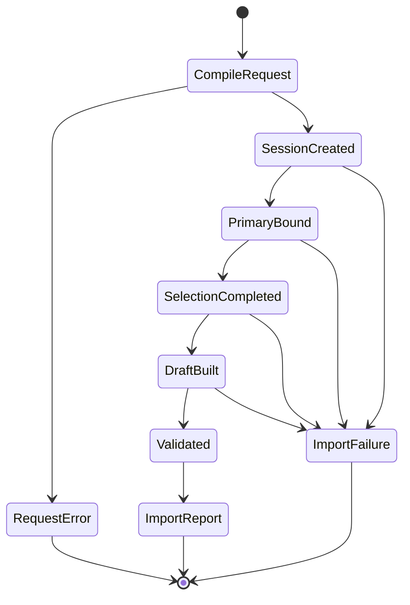

# ADR 0020: Import Lifecycle, ParseScope, and Outcome Contract

## Context

If a parser can open arbitrary resources, construct a report, assign a lifecycle enum, or declare its
own Scene valid without the central core validator, facade helpers cannot enforce one security and
correctness boundary. Creating context only after opening/detection also means early failures lose
diagnostics, resource evidence, and a single finalization path.

Older documents used conceptual names such as RawImported, ValidatedImported, PostProcessed, and
ValidatedOutput. This ADR is the sole authority for import lifecycle and import outcomes. It does not
own post-process internal stages, which belong to the post-process contract, and a validated Scene
proof is not an assignable lifecycle stage.

## Decision

After request/options compilation, Baozi creates one `ImportSession` before primary open or detection.
The session owns the only outcome builder, stable primary input, selected-format evidence, dependency
resolver, ledger, bounded diagnostics, and operation control. It grants the selected trusted importer
only a capability-limited `ParseScope`.

The parser returns `ParseResult<SceneDraft>`. The public central validator in `baozi-core` is the only
constructor of `ValidatedScene` proof; downstream code may legitimately call it, but cannot directly
construct or forge proof. `ImportSession` is the only import outcome/stage/provenance finalizer. It
always invokes the core validator on the returned draft and finalizes exactly one success or failure.

Accepted establishes authority; it does not claim the current prototype context already enforces it.

### Lifecycle

Compiling and validating the complete common and format-option request is a pre-session admission step.
An invalid request returns a typed `RequestError`, creates no session, and performs no asset IO. After
successful admission, the import lifecycle is:

During request compilation, an unwindable submitted-layer codec panic, compile-budget exhaustion,
runtime option-type mismatch, or other codec/request defect is a bounded `RequestError`, never an
`ImportFailure`; default-codec failures occurred earlier as `RegistryBuildError` and cannot exist in
the frozen snapshot. Neither path has an import ledger, lifecycle phase, diagnostics stream, finalizer,
or asset open.

1. create the session and private outcome builder;
2. authorize, open, and bind one immutable primary snapshot;
3. build one shared probe and select/force a format with evidence;
4. create `ParseScope` for only the selected importer;
5. acquire required/optional dependencies and parse into format-private state as needed;
6. construct a Scene draft only through the core construction capability;
7. have `ImportSession` call the public central `baozi-core` validator, whose successful result is the
   unforgeable `ValidatedScene` proof;
8. finalize one `ImportReport`; or
9. from any point after session creation, finalize one `ImportFailure` with all evidence accumulated
   so far.

Last-completed phase is a sealed read-only evidence value constructed by the session. It is present so
callers can understand a failure, not so callers or parsers can advance state. Public code may obtain
`ValidatedScene` only by successfully calling the core validator; it cannot directly construct proof
or attach import phase/provenance to it. Only the session can construct import phase evidence, reports,
or failures.



The state diagram is internal authority flow, not a public mutable state machine.

### Phase Types and Mapping

Three sealed phase vocabularies are intentionally distinct:

- `ImportPhaseEvidence` is the coarse authority boundary retained as `last_completed` in an outcome;
- `ImportLedgerPhase` attributes current/high-water reservations and attempted/consumed work; and
- `ImportProgressPhase` labels transient observer events.

The session owns all three import vocabularies. `baozi-operation` stores owner-supplied phase keys but
does not define their meaning. A ledger transition or progress event can never advance lifecycle
evidence. Only successful completion of an atomic session boundary performs that advancement:

| Work underway | Last completed `ImportPhaseEvidence` | `ImportLedgerPhase` examples | `ImportProgressPhase` examples |
| --- | --- | --- | --- |
| Session created, primary not yet bound | `SessionCreated` | `PrimarySnapshot` | `AcquirePrimary` |
| Primary complete, selection underway | `PrimaryBound` | `Detection` | `Detect` |
| Parser/dependency/backend/normalization/build work | `SelectionCompleted` | `DependencyAcquisition`, `BackendDecode`, `FormatNormalization`, `SceneConstruction` | `AcquireDependency`, `Decode`, `Normalize`, `BuildDraft` |
| Draft complete, validation underway | `DraftBuilt` | `Validation` | `Validate` |
| Validation complete, outcome finalizing | `Validated` | `OutcomeFinalization` | `Finalize` |

Formats without a distinct backend or normalized model simply never enter those ledger/progress
phases; they do not fabricate lifecycle milestones. Failure retains the last boundary completed before
the failing work. Outcome finalization does not create a later public phase because the report or
failure itself proves finalization.

### DetectionScope Capabilities

Every detector invocation receives the same immutable `Probe` and hint plus a session-created
`DetectionScope`. The scope exposes only cancellation/deadline polling and linear detection-work
admission; it cannot open resources, mutate detection evidence, inspect another registration, or
construct an outcome/failure category.

`DetectionScope::begin_work(amount)` first verifies that the session is active, rejects a second
outstanding permit, polls operation control, rejects zero or more than 4 KiB of work, and charges
attempted `DetectionWork`. Exactly one linear permit represents that admitted chunk. Calling
`complete()` charges consumed work before a post-work control poll. Polling while a permit is live,
requesting zero work, requesting another permit, dropping an unfinished permit, or leaving a permit
outstanding when the detector returns is a descriptor-contract violation and latches the session.

The first control, ledger, reentrancy, or permit-contract failure is retained as the terminal scope
cause. `DetectionAbort` is opaque and non-constructible by extensions. Catching or discarding it and
returning a match cannot recover the session: the session checks the latch before accepting the
detector result, and an abort without a latched cause is itself a descriptor-contract failure.

### ParseScope Capabilities

`ParseScope` is valid only for the selected importer and session lifetime. It may expose:

- the immutable primary snapshot and normalized source identity;
- classified required/optional dependency requests through the session resolver;
- the selected importer's checked concrete option view;
- checked work charging and live reservations;
- bounded diagnostic emission and loss facts;
- cancellation polling and progress reporting; and
- a Scene construction capability whose output is only `SceneDraft` and cannot mint or submit
  validation proof.

It does not expose raw `AssetIo`, unrestricted path resolution, registry mutation, another format's
options, the outcome builder, report/failure constructors, lifecycle advancement, validation-proof
constructors, or post-process execution.

Dependency access has two result domains. The names below describe the required semantic shape, not
the public Rust layout:

```text
required dependency -> ParseResult<DependencySnapshot>
optional dependency -> ParseResult<OptionalDependencyOutcome>

OptionalDependencyOutcome =
    Available(DependencySnapshot)
  | Unavailable(OptionalDependencyEvidence)
```

The resolver may return `Unavailable` only when the selected format contract classifies that
dependency role as optional and the caller's loss policy permits the resulting omission. The scope
records one bounded diagnostic/loss fact and preserves the normalized identity, original lower-layer
cause owner, and cached-failure disposition in `OptionalDependencyEvidence`. `Unavailable` is a
successful resolver outcome, not a `ParseFailure`; it does not latch the session and the importer may
continue building geometry. A denied, missing, failed-open, or over-budget optional acquisition still
consumes its non-refundable accounting under ADR 0022. Once a snapshot is `Available`, format-owned
content decoding and recovery follow the separate diagnostic/loss contract; malformed content is not
reclassified as a resolver miss.

Requiredness tokens, outcome/evidence constructors, and loss disposition are private to the session
resolver. Format code may submit only a dependency role admitted by its frozen descriptor contract;
it cannot forge `Unavailable`, relabel a required role, or attach a fabricated lower-layer cause.

After every logical reference has independently passed role and policy authorization, the dependency
table caches the first immutable snapshot or identity-terminal failure by ADR 0010's
authority-qualified key `(authority domain, normalized resource identity)`. Here
*identity-terminal* means that later authorized references to that same key observe the same snapshot
or failure without another physical open; it does not by itself make the import session terminal.
References in another scope or resolver namespace never share the entry, and a denied alias cannot
consult it. Requiredness and loss disposition remain per-reference decisions outside the physical
key. A required request for a cached failure, an optional omission rejected by format or loss policy,
cancellation/deadline, or any capability failure for which safe continuation is forbidden is instead
returned as a session-terminal `ScopeAbort` and latched before control returns to the importer.
Required and optional requests therefore share one physical result only inside one authority domain
without conflating cache stability with outcome finalization.

Rust has no friend-crate visibility. A format crate can call the same public core validator as any
downstream crate, but `FormatImporter::parse` has no `ValidatedScene` return path and the session never
accepts parser-supplied proof. Any such internal proof is irrelevant to import authority: the parser
must still return a draft, and the session validates that draft again before outcome finalization.

Work, reservation, cancellation, deadline, and progress operations are borrowed capability views over
`baozi-operation`; they do not expose the coordinator or ledger state machine itself. This lets core
construction and validation consume the same low-level capabilities without depending upward on
`baozi-import`.

An in-process importer, IO backend, resolver, option codec, or callback is trusted extension code.
Baozi catches its panic only when the platform can unwind and converts it to a typed boundary failure.
This does not contain abort, process exit, infinite loop, arbitrary allocation, or hostile IO; hosts
must use process isolation for hostile plugins.

### Parse Failure Transport

The object-safe parser signature is frozen as:

```rust
pub type ParseResult<T> = Result<T, ParseFailure>;
```

`baozi-import` owns `ParseFailure`. Its representation and classification constructors are private, so
extension code cannot forge an IO, budget, cancellation, validation, or format category. It has two
session-internal branches with distinct cause ownership:

1. A session-terminal `ScopeAbort` is produced only by `ParseScope` and the IO, dependency, budget,
   control, diagnostic, SceneBuilder, or core capability methods it exposes after the capability has
   determined that the session cannot safely continue. Those methods return `ParseResult<T>` directly,
   making `?` the normal propagation path. The abort retains the original lower-layer cause and owner;
   an IO error remains IO-owned, cancellation remains operation-owned, and a builder/core error remains
   core-owned rather than becoming a format parse error. A permitted optional-dependency `Unavailable`
   outcome is deliberately outside this branch.
2. `FormatFailureEnvelope` seals the selected descriptor identity, a validated stable code, bounded
   packed structured details, and the selected format's concrete `FormatFailureSource`. Before
   invoking either trusted source callback, the selected `ParseScope` rejects an outer source payload
   larger than 4 KiB and reserves the source plus packed-detail storage. It then validates the code,
   visits and packs the admitted details fallibly, and retains the source as the envelope's direct
   standard error source. No generic `From<dyn Error>` or arbitrary category constructor exists.

A failure returned by the session's final central-validator call is not parser transport and does not
enter `ParseFailure`; it remains a core-owned validation cause finalized directly by `ImportSession`.
The `ScopeAbort` core branch covers construction-time core/SceneBuilder capability failures reached
while the parser is still running.

A session-terminal capability-produced abort is also latched before it is returned. A trusted parser
may inspect or accidentally catch the opaque error, but discarding it and returning `Ok(SceneDraft)`
cannot turn the operation into success; the finalizer observes the first terminal latch. This makes
`?` ergonomic without relying on every extension to preserve the classification manually. In
contrast, an importer continues after `OptionalDependencyOutcome::Unavailable` through an explicit
success branch, never by catching or suppressing `ParseFailure`.

`FormatFailureSource` is both a retained format-owned cause and a bounded evidence producer. Its
`visit_details` method writes stable enums, bounded scalars, IDs, ranges, and admitted strings through
the scope-owned sink rather than returning an input-sized preformatted `String`. Retained sources use
bounded inline storage or account every owned heap capacity under ADR 0022; constructing a source is
not an escape from the operation ledger.

`Error::source(&FormatFailureEnvelope)` returns the retained format source directly, and
`downcast_ref<T: FormatFailureSource>()` provides read-only access to its concrete outer type. The
format source may preserve a standard backend or library source chain behind it. Stable inspection
and serialization remain descriptor/code/details based: envelope `Debug` and `Display` do not expose
the private source chain, and concrete backend types do not appear in public fields or stable schemas.

The import finalizer consumes `ParseFailure` and preserves its branch, cause owner, accumulated phase,
diagnostics, and ledger evidence in `ImportFailure`. The facade composes that failure rather than
copying it into another format-error enum. Option-codec failures remain pre-session `RequestError`
values only for submitted request layers; registry-default failures are `RegistryBuildError` under ADR
0016. Neither enters `ParseFailure`.

### Success Outcome

`ImportReport` is immutable and contains at least:

- `ValidatedScene`, never an unvalidated mutable Scene;
- selected immutable format descriptor;
- complete sorted detection evidence;
- bounded diagnostics and explicit loss evidence;
- an immutable attempted, consumed, peak-live, committed-output, and final-current ledger snapshot;
  and
- sealed import phase/source/provenance evidence.

The report does not contain a setter, `map_scene`, `map_scene_with`, arbitrary stage transition, or a
parser-supplied stats object. Structural edits consume the validation proof through the core edit
contract and yield a new proof outside this import lifecycle.

Successful finalization releases all scratch/opaque reservations, records committed output, transfers
the validated scene and bounded report evidence out of session ownership, and asserts final
session-owned live usage is zero. The ledger's peak still includes output while it overlapped with
snapshot, backend, normalized, validation, or report storage.

### Failure Outcome

`ImportFailure` contains:

- a typed cause category and owning lower-layer cause;
- last completed import phase;
- normalized source identity and selected format when known;
- complete detection evidence accumulated before the failure;
- bounded diagnostics/loss evidence; and
- immutable ledger evidence including attempted and consumed counters, peak-live, zero committed
  canonical output, and zero final session-owned live usage after cleanup.

Unsupported format, detection failure, dependency failure, parse failure, validation failure,
resource exhaustion, cancellation/deadline, and trusted-extension panic remain distinguishable.
Formatting a failure cannot discard its structured cause.

### Post-Process Boundary

Raw import success means source-oriented canonical IR has passed central validation. Post-processing is
an explicit subsequent operation or explicitly composed facade request and returns its own report.
This ADR does not define post-process internal stages, transactions, remaps, or derived-data semantics.
A composed facade preserves the import report/evidence and post-process report/failure separately; it
does not mutate an `ImportReport.stage` field.

### Crate Error and Capability Ownership

| Crate | Owns | May expose upward | Must not own/construct |
| --- | --- | --- | --- |
| `baozi-operation` | Runtime-neutral control/coordinator and reservation/ledger state-machine mechanisms | Borrowed checkpoint/reservation capabilities and owner-neutral ledger-evidence snapshots | Scene, IO, request policy, import/post-process phases, format causes, or outcomes |
| `baozi-core` | Scene draft/build capability, the public central validator, validation proof, domain validation/edit errors | Typed core causes and `ValidatedScene`; downstream callers may validate drafts through the central API | IO, import phase/provenance, registry, parser policy, facade-composed error |
| `baozi-io` | Asset identity/path, bound handles/snapshots, backend IO errors | Typed IO causes and capability-bound resources | Optionality/loss, Scene, import outcome |
| `baozi-import` | Request config/policy, session, import phase vocabularies, Probe, DetectionScope, ParseScope, resolver, effective budgets, diagnostics, private detection/parse failure classification, and detection/import outcomes | Typed request/import failure and report evidence | Validation-proof construction, shared operation mechanism duplication, format-private model, post-process stage, public facade error duplication |
| `baozi-format-*` | Private decode/normalized model and bounded Baozi format causes/codes | `DetectionResult<DetectionOutcome>` and `ParseResult<SceneDraft>`; controlled retention and packing of `FormatFailureSource` through the selected ParseScope | Raw IO, parser-supplied proof/outcome, arbitrary detection/parse failure classification, phase/provenance construction, or backend types in public fields/stable schemas |
| `baozi-postprocess` | Post-process phase vocabularies, effective operation budget, compiled plans, step transactions, remaps/losses, report/cause | Distinct typed post-process result using `baozi-operation` mechanisms | Dependency on `baozi-import`, import phase/outcome, shared operation mechanism duplication, or format-private state |
| `baozi` facade | Public request composition and public error composition | Stable ergonomic API preserving lower structured causes | Duplicate domain state or bypass constructors |

Each lower crate owns its domain cause. The facade composes, rather than stringifies or redefines, those
causes for public use.

## Alternatives Considered

### Option A: Let each importer return `ImportReport`

This is locally convenient but lets parsers forge stats, validation, phase, and selection evidence.
Rejected.

### Option B: Keep a public mutable `ImportContext` and assignable stage enum

This requires convention to prevent bypasses and allows helpers to publish invalid transitions.
Rejected.

### Option C: Session-owned lifecycle with capability-limited ParseScope and one finalizer

This centralizes every outcome path and makes parser authority explicit and testable. Chosen.

## Consequences

Positive:

- Open, detection, parse, validation, cancellation, and panic failures share one evidence-rich outcome.
- Parsers cannot bypass dependency policy, budgets, diagnostics, or central validation.
- Validation proof can be obtained only from the core validator and cannot be forged by field/enum
  construction; import lifecycle/provenance evidence remains session-only.
- Post-processing remains explicit and does not rewrite import history.

Negative:

- Existing parser signatures and facade helpers must break in one cutover.
- Capability plumbing is more explicit than a monolithic context.
- Trusted plugin isolation still requires a host process boundary.

## Risks and Mitigations

| Risk | Severity | Mitigation |
| --- | --- | --- |
| A convenience helper bypasses the session | Critical | Keep constructors private and test every public facade path with instrumented IO/invalid drafts. |
| ParseScope grows back into a raw service locator | High | Capability allowlist, private fields, and compile-fail boundary tests. |
| Failure conversion drops lower-layer cause/evidence | High | Exhaustive outcome tests at every lifecycle phase. |
| Public core validator is mistaken for import authority | High | The validator is the sole proof constructor, but accepts/returns no import phase or provenance; the session always validates the returned draft itself. |
| Detector catches a scope abort and returns a match | Critical | `DetectionScope` latches the first terminal cause; zero/repeated/oversized work, polling during work, and unfinished permits are terminal even when the opaque abort is discarded. |
| Parser catches a session-terminal capability abort and returns success | Critical | Capability methods latch the first opaque `ScopeAbort`; finalization fails even if trusted parser code discards the returned value. Permitted optional unavailability uses an explicit non-abort outcome. |
| Import and postprocess authorities overlap | Medium | Import ends at validated raw report; postprocess owns a distinct operation/report. |

## Acceptance Criteria

| Contract | Testable acceptance |
| --- | --- |
| Session-before-IO | Invalid requests create no session and perform zero IO; a primary-open failure observes one created session and one finalizer. |
| Pre-session panic | Submitted-layer codec panic is one bounded `RequestError`; default-codec panic prevents snapshot creation as `RegistryBuildError`; both have zero sessions, finalizers, import ledgers, diagnostic streams, and asset opens. |
| Single finalization | After session creation, success, every failure phase, cancellation, and unwind call the outcome finalizer exactly once. |
| Capability boundary | Compile-fail/API-shape tests prove detectors and parsers cannot reach raw IO, other options, reports, phases, arbitrary detection/parse failure constructors, dependency-requiredness relabeling, or a parser-supplied proof return path. |
| DetectionResult shape | A heterogeneous `dyn FormatImporter` receives `Probe`, `ReadHint`, and `DetectionScope` and returns exactly `DetectionResult<DetectionOutcome>`; its opaque abort cannot be constructed, sent, or used to suppress the session latch. |
| Detector work permit | Detection permits are single-outstanding and bounded to 4 KiB; begin polls then charges attempted work, complete charges consumed then polls, and zero/repeated/poll-during/drop/forgotten-permit violations latch the first terminal cause. |
| Core proof authority | Public/downstream code can obtain `ValidatedScene` by calling the core validator, while direct proof construction/forgery fails to compile. |
| Import validation authority | A trusted importer may call the public validator internally, but `parse` can return only a draft; the session revalidates it, and an invalid returned draft cannot produce success. |
| ParseResult shape | A heterogeneous `dyn FormatImporter` returns exactly `ParseResult<SceneDraft>`; capability methods compose with `?` without erasing the lower cause owner. |
| Optional dependency continuation | Missing, denied, failed-open, and per-attempt or aggregate-budget-exhausted optional acquisition fixtures return `Unavailable` only when descriptor optionality and loss policy permit; they retain identity/cause/accounting evidence, emit bounded loss diagnostics, preserve geometry, and perform one physical attempt per authority-qualified identity. |
| Identity versus session terminality | Repeated authorized references in one authority domain reuse an identity-terminal cached failure without reopening; requesting that failure as required or rejecting its optional loss produces and latches a session-terminal `ScopeAbort`. |
| Cache authorization | Equal logical names in two scopes or resolver namespaces remain isolated; every alias and role is authorized before lookup, so an allowed cache entry cannot satisfy a later denied reference. |
| Scope abort latch | Required dependency, IO, budget, cancel, diagnostic, builder, and core session-terminal abort fixtures retain their owning cause/phase and force final failure even when a test importer catches the opaque `ParseFailure`. |
| Evidence preservation | Every post-detection failure retains identical selection evidence plus bounded diagnostics/stats. |
| Phase separation | Tests independently advance ledger/progress phases and prove `last_completed` changes only after the mapped atomic lifecycle boundary succeeds. |
| Format evidence transport | Heterogeneous bounded format sources enter only through the selected-scope constructor; each envelope retains descriptor/code/details plus the concrete source, exposes the standard source chain and typed outer-source downcast, omits private sources from `Debug`/`Display`, and rejects an outer source payload above 4 KiB before trusted callbacks. |
| No legacy transition | Production/public symbol search finds no `map_scene*`, assignable import stage, or parser-owned report constructor. |
| Crate ownership | Dependency and public-API checks find no backend type in public fields or stable schemas, no `baozi-operation` upward dependency, no postprocess-to-import edge, and no reversed core dependency; private backend causes may remain reachable only through a retained format-owned standard source chain. |
