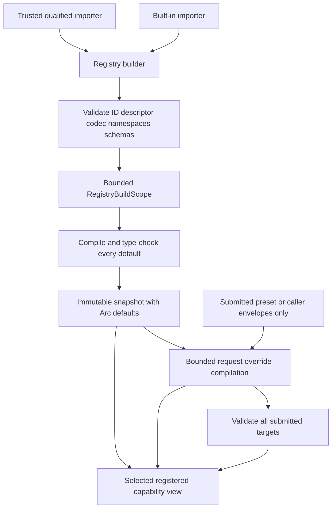

# ADR 0021: Extension Registry, Format Descriptor, and Codec Governance

## Context

Baozi needs heterogeneous built-in and third-party importers without exposing format-backend types or
making a generic option method destroy `FormatImporter` object safety. A mutable registry during an
import would also make detection, option compilation, and evidence depend on races. Finally, support
claims drift when every format invents its own ID, descriptor, maturity, and codec metadata.

Third-party importers execute in-process and therefore are trusted extension code. Registration is an
explicit Rust extension surface, not a dynamic-plugin sandbox or stable C ABI.

## Decision

`baozi-import` owns validated `FormatDescriptor`, registry-bound capability slots for heterogeneous
detector/parser/codec objects, the mutable registry builder, and the immutable registry snapshot. ADR
0016 separately owns option envelopes, codec semantics, precedence, compilation, and the private
typed store; ADR 0020 owns the exact detector/parser invocation traits, scope views, failure
transport, validation call, and lifecycle outcomes; ADR 0029 owns detection semantics and selection.

Accepted freezes these ownership boundaries. It does not promote the extension trait to the stable
facade tier or claim all descriptor tooling is implemented.

### Canonical Ownership Boundary

This ADR is the sole owner of registry registration, builder mutation, freeze ordering and atomicity,
immutable snapshot lifetime, descriptor and namespace claims, extension unloading, callable trust,
the shared registration health latch, unwind containment and phase mapping, permanent poisoning, and
the rule that a poisoned extension is never invoked again. These rules apply uniformly to codec,
detector, and parser call sites.

ADR 0016 is the sole owner of option envelope/schema/version transport, precedence, normal codec
input/output semantics, compiler scopes and budgets, compiled-value verification, and the private
request option store. This ADR attaches that capability to a registry entry and governs its lifetime
and failure health; it does not define another payload grammar, precedence chain, compiler scope, or
ordinary option error taxonomy. ADR 0020 owns parse outcome composition after session creation.

### Registration and Snapshot

Registration occurs on a builder before an import request is compiled. Each registration validates:

- one bounded stable `FormatId`, unique in that registry;
- an immutable descriptor with extensions/media types, encoding/container kind, text profile where
  applicable, dependency policy, capability claims, optional issuer-scoped self-attestation,
  support documentation, and target constraints;
- one bounded immutable dependency-role table whose globally qualified role IDs are unique and map
  each role to exactly one `Required` or `Optional` requirement;
- one object-safe detector/parser implementation;
- one object-safe option codec descriptor, including the no-options codec when applicable;
- exact agreement between the importer expectation and codec descriptor's sealed
  `OptionRuntimeTypeKey`;
- every extension namespace claim and declarative extension schema advertised by the descriptor; and
- consistency between descriptor capability claims and enabled crate features.

Registration may perform these checks eagerly, but immutable-snapshot creation is the non-bypassable
gate. `RegistryBuilder::freeze` runs under a bounded `RegistryBuildScope`, visits every registration in
stable `FormatId` order, invokes its codec's default-layer compilation, verifies the returned runtime
type/concrete erased value, and caches it as `Arc<CompiledFormatOptions>`. Per-codec and aggregate
work, decoded cells/bytes, recursion, live capacity, result bytes, and panic detail are bounded.

Default compilation panic, budget/allocation failure, or runtime-type disagreement is a structured
`RegistryBuildError`. Freeze is atomic and publishes no partial snapshot, so a bad plugin never enters
an immutable registry snapshot. A builder API may surface the same error at eager registration time,
but successful eager checking does not remove the final freeze gate.

`FormatId` uses a bounded lowercase ASCII reverse-DNS grammar for every registered format. Baozi's
built-ins use `org.baozi.<format>`; external registrations use a namespace they control, for example
`org.example.asset-format`. There is no public "first-party" registration escape hatch because a
library API cannot prove the package identity of its caller. Short unqualified IDs are not registrable.
IDs are durable configuration/provenance identities, not display names.

The bounded `FormatId` value object lives in `baozi-core` because validated Scene provenance must
retain it without a core-to-import dependency. `baozi-import` remains the sole owner of registration,
descriptor, option-schema, namespace-claim, and selection authority; core owning the value grammar
does not create a second registry or capability surface. The grammar treats `.` as a non-empty label
separator. Each label contains lowercase ASCII alphanumerics with optional internal `-`; leading,
trailing, or repeated `.` or `-` are invalid.

### Dependency Role Contract

The descriptor owns every dependency role a selected importer may present to the downstream import
dependency capability. A
`DependencyRoleId` is one globally qualified stable lowercase ASCII token of the form
`<format-id>:<local-role>:v<schema-version>`, for example
`org.baozi.obj:material-library:v1`. Local role labels use lowercase ASCII alphanumerics with
optional internal `-`, and the nonzero decimal schema version changes whenever the role's semantic
meaning changes incompatibly.

Each role declaration freezes exactly one requirement (`Required` or `Optional`) plus its bounded
semantic purpose. Requiredness is not a parser-call argument, option value, loss-policy override, or
registry insertion default. A grammar with genuinely different required and optional cases declares
different role IDs. Duplicate, malformed, foreign-format, unknown, or requirement-ambiguous roles
fail registry freeze or terminate the selected session before cache lookup or IO.

The complete ordered role table and requirement mapping are part of
`ImplementationDeclarationIdentity`. ADR 0041 owns graph relations and canonical manifest encoding;
it consumes the exact frozen role ID and derives requirement from this table without redefining role
semantics.

Successful freeze returns an immutable snapshot containing importer/codec/schema objects and one
precompiled default-options `Arc` per importer. Requests and sessions may share that snapshot across
threads, but registration/removal cannot affect them. Detection iteration, descriptor enumeration, and
evidence use stable `FormatId` ordering rather than builder insertion order.

Request compilation never scans or invokes every snapshot codec. It validates and compiles only
format-specific envelopes actually submitted by the expanded preset/caller request, using the target's
cached default as its base. All submitted targets are compiled before session creation and IO, even if
one is forced or another is later selected automatically. A selected format with no submitted layer
uses its cached default `Arc` directly. Thus request codec cost is proportional to submitted envelope
count/bytes/work, not registry size, and an unsubmitted irrelevant codec cannot poison the request.

### Registered Callable and Health Boundary

The registry stores detector, parser, and codec objects behind heterogeneous object-safe,
`Send + Sync + RefUnwindSafe + 'static` capabilities. This ADR owns their registration identity,
snapshot lifetime, invocation health wrapper, unwind latch, and permanent poison state. It does not
own or restate detector/parser method parameters, domain return types, scope semantics, validation,
or outcome composition.

The health wrapper passes the downstream invocation context through unchanged and observes only
whether the callable returned or unwound. It cannot add a second coordinator, inspect or relabel a
domain error, convert a terminal scope failure into registry health, or construct a normal domain
outcome. A panic is mapped to the shared poisoned-registration state before the downstream owner
constructs its bounded failure; an ordinary returned error does not become poison merely because the
registry stored the callable.

The codec is part of the registered importer capability because only that importer can define its
concrete type and schema. It exposes object-safe schema/version/runtime-type inspection and bounded
default/overlay compilation through ADR 0016's `RegistryBuildScope` and `OptionCompileScope`. It does
not own envelope transport, precedence, either scope, compiled-value wrapper/store, or public
configuration parsing. The sealed runtime type key is process-local and never substitutes for the
stable serialized schema identity.

At freeze, a codec receives only the registry-build scope and empty/default layer contract. At request
time, the compiler consumes public envelopes before codec invocation; each submitted target codec
receives its cached default plus ADR 0016's opaque ordered layer view and accesses payloads through
`OptionCompileScope`. A raw envelope payload slice is not part of the codec capability.

An importer/codec descriptor key mismatch fails registration/freeze. ADR 0016 defines erased-value
verification and its ordinary typed failure. This ADR defines the unwind branch: a default codec
panic maps to bounded `RegistryBuildError`, a submitted-layer codec panic maps to bounded
`RequestError`, and both poison the shared registration before returning. Neither path reaches session
creation or asset IO, and the parser never discovers an option type mismatch after detection.

### Domain Failure Non-Ownership

The registry and its health wrapper never construct, classify, retain, or relabel detector/parser
domain failures. They may retain only the inert declaration needed to identify the selected
registration. ADR 0020 owns the opaque parse transport, stable format-failure packing, lower-cause
preservation, validation call, and outcome composition; ADR 0029 owns detection outcomes. No registry
snapshot or poison record retains a backend error object, callback, function pointer, native handle,
or plugin-owned destructor.

### Descriptor Authority

`FormatDescriptor` is the code-level authority for what the registered implementation declares. It
has private fields and validated construction so extensions cannot publish malformed IDs, duplicate
extensions, unbounded notes, or impossible capability combinations.

The registry carries only declaration-time evidence authority: `Unverified`, or a visibly
issuer-scoped `SelfAttested` claim with its own bounded evidence reference. It has no
`BaoziVerified` variant, token, constructor, field, or freeze input. Human support tables and format
pages use ADR 0011's separate managed evidence snapshot to join the declaration identity with current
Baozi evidence. Descriptor construction, registry freeze, and a long-lived registry snapshot cannot
promote, retain, expire, withdraw, or revoke a Baozi maturity claim.

At freeze, the builder derives only the canonical `ImplementationDeclarationIdentity` owned here:
the descriptor's format/specification/profile IDs, compiled defaults and option-profile identity,
text/recovery profile, dependency-role table, extension schema identities, and declared
implementation/backend role. It
does not infer executed artifact/source identity from a package version, commit, plugin filename,
function pointer, feature label, or target display string.

Registry freeze validates only the declaration identity and optional self-attestation. ADR 0011's
managed evidence view independently joins that identity to its exact tested implementation/build
subject and verification record. The registry neither reconstructs nor claims to measure the running
executable, and replacing the managed evidence snapshot does not mutate or invalidate a live registry
snapshot.

Request compilation derives the actual option-profile identity. A valid request outside the
descriptor's verified subjects may execute, but its support evidence is `Unverified` or issuer-scoped
`SelfAttested`. An orphan managed inventory entry is excluded from support publication and fails the
inventory/release checker without changing an unrelated runtime snapshot.

The descriptor owns the immutable identity of a format's text profile and the set of recovery
capabilities it may expose. ADR 0035 owns the decoding meaning of those values, while ADR 0016 owns
their typed option transport and precedence.

ADR 0043 records a Proposed candidate for future producer attestation and closed-input qualification.
While it remains Proposed, no registry entry, maturity token, session, or public/default API may
construct or consume its candidate types. Registry declaration identity is never proof of the
running executable or proof that extension code has no ambient IO path.

### Extension Namespace and Schema Registration

ADR 0023 owns extension value semantics. `baozi-core` owns the closed declarative schema language,
`ExtensionSchemaId`, schema validation, ID-reference/remap rules, and the immutable schema data retained
by a scene. `baozi-import::RegistryBuilder` is the sole owner of namespace claims, schema registration,
duplicate detection, and snapshot lifecycle. A format or plugin cannot create an independent global
schema registry.

Namespace ownership follows deterministic rules:

- `baozi` and every `baozi.*` child namespace are reserved for schemas shipped by `baozi-core`;
- every format owns only the namespace equal to its qualified `FormatId` and optional dot-separated
  child namespaces below that exact prefix;
- a shared cross-format namespace requires a separately reviewed Baozi-owned schema registration; two
  format registrations cannot acquire it by agreement or insertion order.

Each registered typed descriptor uses a stable `(namespace, local_schema_id, schema_version)` identity
and a bounded Baozi-owned declarative schema. The schema may describe closed values, canonical reference
kinds, validation, generation qualification, and ADR 0032 remap obligations. It cannot contain plugin
callbacks, backend objects, native handles, or process-local type identities. A duplicate namespace
claim, duplicate schema identity, conflicting schema body, reserved-prefix claim, or schema outside the
registrant's namespace is a structured registration error even when the duplicate bytes are equal.

Freezing a registry builder creates one immutable, stably ordered
importer/codec/default-options/namespace/schema snapshot. Builder removal or replacement affects only
snapshots created afterward. Existing requests and sessions retain their original importer/codec
objects and compiled-default `Arc` values. A `SceneBuilder` copies the exact Baozi-owned declarative
schema subset needed by retained typed descriptors into the resulting scene generation, so a
`ValidatedScene` can outlive and be edited after the originating plugin code is unloaded. Unloading
code therefore requires dropping every registry snapshot/session that retains its trait objects.
Validated scenes and terminal import outcomes contain only Baozi-owned declarative data, so neither
retains plugin code or becomes invalid after unload.

### Trust and Stability

The extension trait is a deliberate lower-level Rust API with its own stability tier. The facade may
offer explicit registration without re-exporting backend internals. Baozi may break the trait before
its declared stabilization gate rather than maintain duplicate legacy or version-suffixed traits.

Registered importer, detector, and codec capabilities must be semantically reentrant and contain no
cross-session parse or option state. All operation state belongs on the call stack, in format-private
temporary models, or behind the active owner-supplied invocation scope; selected compiled options are
exposed only as an immutable `&T`. A first-party implementation may not hide serialization behind an
internal mutex.
Barrier tests run the same snapshot concurrently with different inputs and options and compare each
result with its serial baseline.

Extension code is trusted and its callable traits require `RefUnwindSafe` in addition to
`Send + Sync`. This ADR requires unwind containment and typed failure evidence at registered codec,
detector, and parser boundaries; ADRs 0020 and 0033 own resolver, IO, and callback boundary outcomes.
Every registration owns one shared, one-way health latch retained by the builder and every snapshot
derived from it. A panic from any callable codec, detector, or parser atomically poisons that
registration. Every later freeze, codec, forced-detection, or parse attempt returns stable
`ExtensionPoisoned` evidence without invoking the instance again. A default-codec panic still
prevents snapshot publication, but it poisons the pending registration so a later freeze cannot retry
the same failed extension.
`AssertUnwindSafe` may cover session-owned staging that is discarded after unwind, but it never
declares a plugin reusable. Panic containment still cannot contain abort, infinite loop, process exit,
arbitrary filesystem access, or unbounded allocation by code already executing in the process.
Hostile extensions require host-managed process isolation.

The shared poison latch applies only to registry-owned codec, detector, and parser registrations that
Baozi retains and may invoke across operations. Host-supplied `AssetIo`, resolver, and per-operation
observer capabilities are not silently enrolled in that registry or retained by Baozi for later
reuse. ADRs 0020 and 0033 own their operation-local failure outcomes; the host decides whether to
reuse or retire its own object after the operation. If Baozi later introduces a shared registry for
those capabilities, an Accepted architecture update must assign its health owner and linearization
rules before reuse.

## Alternatives Considered

### Option A: Closed compile-time enum of all first-party formats

This is easy to type and document but prevents deliberate third-party extension and couples the facade
to every optional format. Rejected.

### Option B: Mutable global registry with string properties

This is plugin-friendly but race-prone, non-reproducible, and incompatible with typed pre-IO option
validation. Rejected.

### Option C: Validated builder plus immutable object-safe registry snapshot

This supports heterogeneous extensions while making descriptor, codec, detection, and session inputs
deterministic. Chosen.

## Consequences

Positive:

- One immutable snapshot governs request compilation and detection.
- Every snapshot contains a bounded, type-checked immutable default-options value for each importer.
- Requests invoke codecs only for submitted format layers and reuse snapshot defaults otherwise.
- Format descriptors, option codecs, namespaces, and declarative schemas have explicit owners.
- Optional format crates remain isolated from the facade's concrete types.
- Registry insertion order cannot change evidence or selection.

Negative:

- Extension authors must implement descriptor and codec contracts even for no-options formats.
- Registry freeze performs bounded default compilation for every registration and can reject the
  proposed snapshot atomically.
- The lower-level trait remains a compatibility surface within its declared pre-stable tier.
- Hostile plugins require a separate process protocol not defined here.

## Risks and Mitigations

| Risk | Severity | Mitigation |
| --- | --- | --- |
| Descriptor claims unsupported Baozi maturity | High | Registry declarations expose only `Unverified` or issuer-scoped `SelfAttested`; ADR 0011's external managed evidence view is the only Baozi maturity authority. |
| Parser relabels a required dependency as optional | Critical | requiredness exists only in the frozen dependency-role table; parser calls carry a role ID but no requirement argument |
| Registry declaration is mistaken for exact executable evidence | Critical | Keep declaration identity here, keep exact tested implementation/build evidence under ADR 0011, and forbid descriptor/package/plugin metadata from claiming runtime measurement. |
| Proposed producer/build identity leaks into production registry APIs | Critical | ADR 0043 remains non-authoritative; API-shape and package checks reject candidate types until one atomic Accepted promotion. |
| Registry mutation races an import | High | Freeze immutable snapshot before request compilation; no session mutation API. |
| Codec type/schema disagrees with parser expectation | High | Registration checks the sealed runtime type key, compile verifies the actual erased type, and selected-importer downcast tests remain a defense in depth. |
| Broken plugin default enters a snapshot | Critical | Atomic bounded freeze compiles every default, rejects panic, budget, allocation, or type failure as `RegistryBuildError`, and permanently poisons a registration whose codec unwinds. |
| Unrelated codec poisons a request | High | Requests call only codecs targeted by submitted envelopes and use cached default `Arc` values for every other candidate. |
| Shared importer leaks state across sessions | Critical | Require semantic reentrancy, immutable selected options, concurrent-versus-serial conformance tests, and no hidden first-party serialization mutex. |
| Panicked plugin instance is invoked again | Critical | Require `RefUnwindSafe`, atomically poison the registration after an unwind, and return stable `ExtensionPoisoned` without reinvocation. |
| Request work scales with registry size | High | Build the override map from submitted envelopes; instrument zero codec calls for a no-envelope request. |
| Registry health wrapper reinterprets a domain result | Critical | the wrapper observes only return versus unwind, never constructs a domain outcome, and cannot convert an ordinary error into poison or a terminal scope failure into success |
| External ID collides with a Baozi-owned ID | Medium | Qualified namespaces plus deterministic duplicate rejection; no caller-asserted first-party registration path. |
| Plugin removal changes schema meaning for an existing scene | High | Scenes retain only immutable Baozi-owned declarative schema data; plugin code remains only in live registry/session snapshots. |
| Two plugins claim one namespace or schema ID | High | Reject duplicate, reserved, and out-of-prefix claims deterministically before snapshot creation. |
| Users mistake panic containment for sandboxing | Critical | Explicit trusted boundary and process-isolation requirement. |

## Acceptance Criteria

| Contract | Testable acceptance |
| --- | --- |
| Object safety | Heterogeneous detector, parser, and codec objects are stored through object-safe `Send + Sync + RefUnwindSafe` capabilities; lifecycle tests under ADR 0020 own the exact detector/parser method shapes. |
| Snapshot immutability | Mutating the builder after snapshot creation cannot affect an existing request/session or its compiled-default `Arc` identity. |
| Registration validation | Duplicate/invalid ID, malformed descriptor, schema/runtime-type mismatch, and impossible claims fail before IO. |
| Dependency role authority | Freeze rejects malformed, duplicate, or ambiguous role tables; selected-scope tests prove calls accept only `(origin, role, hostile reference)`, derive one frozen requirement, and reject unknown/foreign roles before cache or IO. |
| Maturity boundary | Registry API/serialization contains only `Unverified` and issuer-scoped `SelfAttested`; source/API-shape tests find no `BaoziVerified` field, token, constructor, or freeze input. |
| Evidence join boundary | ADR 0011 tooling joins the immutable declaration identity and effective option profile to the current managed evidence snapshot outside registry freeze; orphan or mismatched inventory entries cannot change runtime registration. |
| Identity ownership | Mutation tests prove descriptor/profile/default/schema drift changes the registry declaration while tested source/dependency/config/generated/native/toolchain drift invalidates ADR 0011's managed evidence subject without changing registry identity. |
| Proposed identity isolation | Compile/API-shape and packaged-surface tests prove no ADR 0043 producer, qualification, or build-identity type is accepted or exposed while that ADR remains Proposed. |
| Atomic default freeze | Every registered codec compiles defaults under bounded `RegistryBuildScope`; any panic/type/budget/allocation error yields `RegistryBuildError`, no partial snapshot, and no bad plugin in a snapshot. A default-codec unwind also poisons the builder registration, so later freezes return `ExtensionPoisoned` without reinvocation. |
| Namespace ownership | Baozi-owned, external, reserved, child-prefix, shared-schema, duplicate, and conflicting-body fixtures all use qualified IDs and follow the deterministic ownership rules. |
| Request codec boundary | Submitted-layer scope exhaustion, erased-type disagreement, and unwindable codec panic return bounded pre-session `RequestError` values with zero asset opens. |
| No-envelope selection | Automatic detection with no format envelopes performs zero request codec calls and gives the selected parser its snapshot-cached default `Arc`. |
| Submitted-only complexity | Growing the registry without changing submitted envelopes does not change request codec call/work counts; adding submitted bytes changes only their bounded targets. |
| Multi-format request | Every submitted format target compiles before session/IO even when forced or automatic selection later chooses another target. |
| Common configuration | Starting from the same frozen snapshot, changing only common import overlays invokes no format codec. |
| Stable ordering | All builder insertion permutations produce equal descriptor enumeration and detection evidence. |
| Snapshot and unload | Builder removal cannot affect an existing snapshot/session; after those objects drop, an imported scene still validates and remaps typed descriptors without plugin code. |
| Capability limits | Registry API-shape tests expose no mutation, health-latch, poison-reset, another codec's options, or domain failure/outcome constructor through a registered callable slot. |
| Invocation pass-through | Instrumented integration proves the registry wrapper passes the owner-supplied invocation context unchanged, adds no coordinator, and cannot inspect or reinterpret the returned domain value. |
| Registry-unload isolation | Outcomes composed under ADR 0020 remain printable, source-traversable, and droppable after builder, snapshot, and importer teardown without invoking a registered callable. Exact domain transport, packing, source-chain, and producer-teardown semantics remain exclusively owned by ADR 0020. |
| Backend isolation | Public facade/report/core fields, terminal errors, and stable schemas contain no registry entry, health/poison state, registered callable, or executable backend/plugin object; registry teardown cannot change an existing outcome. |
| Trust boundary | An unwindable default-codec panic is `RegistryBuildError`, submitted-layer codec panic is `RequestError`, and detector/parser panic becomes its session-owned typed failure; docs require process isolation for hostile extensions. |
| Reentrancy | Barrier tests share one snapshot across distinct inputs/options; concurrent results equal their serial baselines, selected options are immutable, and first-party importers contain no session-state fields or hidden serialization mutex. |
| Panic poisoning | Default-codec, request-codec, detector, and parser panic fixtures are invoked once, poison their registration atomically across the builder and all snapshots, and every later entry path returns `ExtensionPoisoned` without calling the object again. |

## Amendment History

### 2026-07-22: Require registry-unload isolation without owning domain transport

- Affected: `Domain Failure Non-Ownership`, `Backend Isolation`, and `Acceptance Criteria`.
- Previous: the format-evidence row allowed an optional Baozi-owned inert source, leaving the public
  source-chain shape ambiguous and duplicating ADR 0020's authority over domain transport.
- New: this ADR requires only the registry-owned observable result: outcomes produced under ADR 0020
  outlive registry/importer teardown without retaining or invoking a registered callable, health
  state, or executable backend object. ADR 0020 alone defines packing, source chains, and producer
  teardown.
- Impact: registry callable identity and object safety are unchanged; public outcomes can no longer
  anchor registered extension code, while their exact error representation remains downstream.
- Review: implementation commit `b1f7608` and independent API/lifecycle review with no remaining
  P0/P1/P2.
- Rationale: registry unload and poison guarantees need an isolation postcondition, not a second
  normative owner for lifecycle transport.

### 2026-07-17: Move exact invocation and domain transport to import lifecycle

- Affected: `Canonical Ownership Boundary`, `Registered Callable and Health Boundary`,
  `Domain Failure Non-Ownership`, `Risks and Mitigations`, and `Acceptance Criteria`.
- Previous: this ADR described the exact detector/parser invocation contract and domain failure
  mapping in addition to registration, snapshot, health, and poison ownership, creating a reverse
  normative dependency on ADR 0020.
- New: this ADR owns only registered slot identity/lifetime plus return-versus-unwind health and
  permanent poison. ADR 0020 exclusively owns detector/parser signatures, invocation scopes,
  lower-cause transport, validation, and lifecycle outcomes.
- Impact: registry freeze remains independent of import orchestration, while every registered
  callable still crosses one shared health wrapper before the downstream lifecycle handles its
  domain result.
- Review: 2026-07-17 ADR authority-cycle and implementation-boundary review.
- Rationale: a registry may decide whether a callable remains admissible after unwind without
  becoming a second owner of the callable's domain contract or terminal import outcome.

### 2026-07-16: Separate declaration identity from execution evidence

- Affected: `Descriptor Authority`, `Risks and Mitigations`, and `Acceptance Criteria`.
- Previous: registry freeze derived a broad default-profile subject from descriptor, backend,
  feature, and target metadata and also consumed a managed verification token.
- New: this ADR owns only `ImplementationDeclarationIdentity`; ADR 0011 owns the exact tested
  implementation/build evidence used for maturity, while ADR 0043 remains a non-authoritative future
  producer/qualification proposal.
- Impact: registry metadata cannot masquerade as executed-artifact evidence, retain a withdrawn
  maturity claim, or prematurely expose a build-identity contract; existing object-safe
  descriptor/codec behavior remains unchanged.
- Review: 2026-07-16 producer-identity and evidence-authority architecture review.
- Rationale: declaration, managed maturity evidence, and a possible future runtime attestation have
  different issuers and lifecycles and must not be collapsed into registry metadata.
