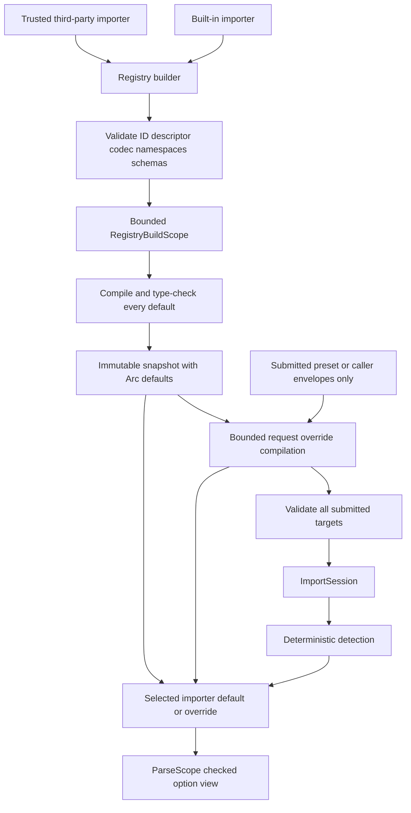

# ADR 0021: Extension Registry, Format Descriptor, and Codec Governance

## Context

Baozi needs heterogeneous built-in and third-party importers without exposing format-backend types or
making a generic option method destroy `FormatImporter` object safety. A mutable registry during an
import would also make detection, option compilation, and evidence depend on races. Finally, support
claims drift when every format invents its own ID, descriptor, maturity, and codec metadata.

Third-party importers execute in-process and therefore are trusted extension code. Registration is an
explicit Rust extension surface, not a dynamic-plugin sandbox or stable C ABI.

## Decision

`baozi-import` owns an object-safe `FormatImporter` capability, validated `FormatDescriptor`,
`FormatOptionCodec` capability, mutable registry builder, and immutable registry snapshot. ADR 0016
separately owns option envelopes, precedence, compilation, and the private typed store; ADR 0029 owns
detection outcomes and selection.

Accepted freezes these ownership boundaries. It does not promote the extension trait to the stable
facade tier or claim all descriptor tooling is implemented.

### Registration and Snapshot

Registration occurs on a builder before an import request is compiled. Each registration validates:

- one bounded stable `FormatId`, unique in that registry;
- an immutable descriptor with extensions/media types, encoding/container kind, text profile where
  applicable, dependency policy, maturity, capability claims, support documentation, and target
  constraints;
- one object-safe detector/parser implementation;
- one object-safe option codec descriptor, including the no-options codec when applicable;
- exact agreement between the importer expectation and codec descriptor's sealed
  `OptionRuntimeTypeKey`;
- every extension namespace claim and declarative extension schema advertised by the descriptor; and
- consistency between descriptor capability claims and enabled crate features.

Registration may perform these checks eagerly, but immutable-snapshot creation is the non-bypassable
gate. `RegistryBuilder::freeze` runs under a bounded `RegistryBuildScope`, visits every registration in
stable `FormatId` order, invokes its codec's default-layer compilation, verifies the returned runtime
type/concrete erased value, and caches it as `Arc<CompiledFormatOptions>`. Per-codec and aggregate
work, decoded cells/bytes, recursion, live capacity, result bytes, and panic detail are bounded.

Default compilation panic, budget/allocation failure, or runtime-type disagreement is a structured
`RegistryBuildError`. Freeze is atomic and publishes no partial snapshot, so a bad plugin never enters
an immutable registry snapshot. A builder API may surface the same error at eager registration time,
but successful eager checking does not remove the final freeze gate.

`FormatId` uses a bounded lowercase ASCII grammar. First-party IDs are short project-assigned values.
Third-party IDs use a reverse-DNS-style prefix plus a format label, for example
`org.example.asset-format`; a short unqualified ID is not available to third parties. IDs are durable
configuration/provenance identities, not display names.

Successful freeze returns an immutable snapshot containing importer/codec/schema objects and one
precompiled default-options `Arc` per importer. Requests and sessions may share that snapshot across
threads, but registration/removal cannot affect them. Detection iteration, descriptor enumeration, and
evidence use stable `FormatId` ordering rather than builder insertion order.

Request compilation never scans or invokes every snapshot codec. It validates and compiles only
format-specific envelopes actually submitted by the expanded preset/caller request, using the target's
cached default as its base. All submitted targets are compiled before session creation and IO, even if
one is forced or another is later selected automatically. A selected format with no submitted layer
uses its cached default `Arc` directly. Thus request codec cost is proportional to submitted envelope
count/bytes/work, not registry size, and an unsubmitted irrelevant codec cannot poison the request.

### Object-Safe Importer Capability

The conceptual trait surface is:

```rust
pub type ParseResult<T> = Result<T, ParseFailure>;

pub trait FormatImporter: Send + Sync + 'static {
    fn descriptor(&self) -> &FormatDescriptor;
    fn option_codec(&self) -> &dyn FormatOptionCodec;
    fn option_runtime_type_key(&self) -> OptionRuntimeTypeKey;
    fn detect(&self, probe: &Probe<'_>, hint: &ReadHint) -> DetectionOutcome;
    fn parse(
        &self,
        scope: &mut ParseScope<'_>,
    ) -> ParseResult<SceneDraft>;
}
```

Auxiliary method/type layout may differ, but the `ParseResult<SceneDraft>` return shape is normative;
it cannot be replaced by a format-generic associated error, backend error, `ValidatedScene`, or report.
Every method remains object-safe and capability-limited. The trait does not expose a generic
format-option method, raw `AssetIo`, report/failure constructors, validation-proof submission,
registry mutation, or post-process execution. Rust visibility cannot prevent a format crate from
calling the public `baozi-core` validator, but this trait has no `ValidatedScene` return path; import
authority always receives a draft and validates it again under ADR 0020.

The codec is part of the registered importer capability because only that importer can define its
concrete type and schema. It exposes object-safe schema/version/runtime-type inspection and bounded
default/overlay compilation through ADR 0016's `RegistryBuildScope` and `OptionCompileScope`. It does
not own envelope transport, precedence, either scope, compiled-value wrapper/store, or public
configuration parsing. The sealed runtime type key is process-local and never substitutes for the
stable serialized schema identity.

At freeze, a codec receives only the registry-build scope and empty/default layer contract. At request
time, the compiler consumes public envelopes before codec invocation; each submitted target codec
receives its cached default plus ADR 0016's opaque ordered layer view and accesses payloads through
`OptionCompileScope`. A raw envelope payload slice is not part of the codec capability.

An importer/codec descriptor key mismatch fails registration/freeze. A default erased-value mismatch
or unwindable default panic is `RegistryBuildError`; an override erased-value mismatch or unwindable
submitted-layer panic is `RequestError`. Neither path reaches session creation or asset IO, and the
parser never discovers an option type mismatch after detection.

### Object-Safe Parse Failure

`baozi-import` owns the opaque `ParseFailure` transport and its private representation. Public
extension code cannot select or construct its classification. The representation distinguishes at
least:

- session-terminal capability-produced `ScopeAbort`, returned directly by ParseScope dependency/IO/
  budget/control/diagnostic/builder/core methods and normally propagated with `?`; and
- `FormatFailureEnvelope`, which contains a concrete format-owned Baozi cause implementing the
  object-safe `FormatFailureSource` interface.

A format crate creates the second branch only through a selected-scope controlled constructor or an
equivalent capability-bearing `From` implementation. That path seals the selected `FormatId`, stable
code, bounded fields, and concrete source. There is no general `From<dyn Error>`, public enum variant,
or constructor that can relabel a scope abort as a format failure. Backend-native errors are
translated inside the format crate and never implement or cross the source interface.

Scope capability methods latch their first session-terminal abort before returning it. Consequently,
catching and discarding the opaque value cannot allow a trusted importer to return successful draft
output. A descriptor-authorized optional dependency failure accepted by caller loss policy instead
uses ADR 0020's explicit `OptionalDependencyOutcome::Unavailable` success branch; an
identity-terminal cached failure is not automatically a session-terminal abort.
The session finalizer distinguishes both branches and preserves the original cause owner, phase,
diagnostics, and ledger evidence. This transport keeps `FormatImporter` object-safe without moving
format semantics into an import-owned public enum. ADR 0020 is authoritative for the representation,
controlled conversion, validation call, lifecycle evidence, and outcome composition.

### Descriptor Authority

`FormatDescriptor` is the code-level authority for what the registered implementation claims. It has
private fields and validated construction so extensions cannot publish malformed IDs, duplicate
extensions, unbounded notes, or impossible maturity/capability combinations.

Human support tables and format pages are derived views or checked mirrors. A maturity claim requires
the structured evidence owned by the support/maturity contracts; descriptor construction alone cannot
promote a format.

The descriptor owns the immutable identity of a format's text profile and the set of recovery
capabilities it may expose. ADR 0035 owns the decoding meaning of those values, while ADR 0016 owns
their typed option transport and precedence.

### Extension Namespace and Schema Registration

ADR 0023 owns extension value semantics. `baozi-core` owns the closed declarative schema language,
`ExtensionSchemaId`, schema validation, ID-reference/remap rules, and the immutable schema data retained
by a scene. `baozi-import::RegistryBuilder` is the sole owner of namespace claims, schema registration,
duplicate detection, and snapshot lifecycle. A format or plugin cannot create an independent global
schema registry.

Namespace ownership follows deterministic rules:

- `baozi` and every `baozi.*` child namespace are reserved for schemas shipped by `baozi-core`;
- a first-party format owns the namespace equal to its `FormatId` and optional dot-separated child
  namespaces below it;
- a third-party format owns only the namespace equal to its reverse-DNS `FormatId` and children below
  that exact prefix; and
- a shared cross-format namespace requires a separately reviewed Baozi-owned schema registration; two
  format registrations cannot acquire it by agreement or insertion order.

Each registered typed descriptor uses a stable `(namespace, local_schema_id, schema_version)` identity
and a bounded Baozi-owned declarative schema. The schema may describe closed values, canonical reference
kinds, validation, generation qualification, and ADR 0032 remap obligations. It cannot contain plugin
callbacks, backend objects, native handles, or process-local type identities. A duplicate namespace
claim, duplicate schema identity, conflicting schema body, reserved-prefix claim, or schema outside the
registrant's namespace is a structured registration error even when the duplicate bytes are equal.

Freezing a registry builder creates one immutable, stably ordered
importer/codec/default-options/namespace/schema snapshot. Builder removal or replacement affects only
snapshots created afterward. Existing requests and sessions retain their original importer/codec
objects and compiled-default `Arc` values. A `SceneBuilder` copies the exact Baozi-owned declarative
schema subset needed by retained typed descriptors into the resulting scene generation, so a
`ValidatedScene` can outlive and be edited after the originating plugin code is unloaded. Unloading
code therefore requires dropping every registry snapshot/session that retains its trait objects, but
it never invalidates an already validated scene or changes its schema meaning.

### Trust and Stability

The extension trait is a deliberate lower-level Rust API with its own stability tier. The facade may
offer explicit registration without re-exporting backend internals. Baozi may break the trait before
its declared stabilization gate rather than maintain duplicate legacy or version-suffixed traits.

Extension code is trusted. Baozi catches unwindable panics at detector, codec, parser, resolver, IO,
and callback boundaries and preserves typed failure evidence, but it cannot contain abort, infinite
loop, process exit, arbitrary filesystem access, or unbounded allocation by code already executing in
the process. Hostile extensions require host-managed process isolation.



## Alternatives Considered

### Option A: Closed compile-time enum of all first-party formats

This is easy to type and document but prevents deliberate third-party extension and couples the facade
to every optional format. Rejected.

### Option B: Mutable global registry with string properties

This is plugin-friendly but race-prone, non-reproducible, and incompatible with typed pre-IO option
validation. Rejected.

### Option C: Validated builder plus immutable object-safe registry snapshot

This supports heterogeneous extensions while making descriptor, codec, detection, and session inputs
deterministic. Chosen.

## Consequences

Positive:

- One immutable snapshot governs request compilation and detection.
- Every snapshot contains a bounded, type-checked immutable default-options value for each importer.
- Requests invoke codecs only for submitted format layers and reuse snapshot defaults otherwise.
- Format descriptors, option codecs, namespaces, and declarative schemas have explicit owners.
- Optional format crates remain isolated from the facade's concrete types.
- Registry insertion order cannot change evidence or selection.

Negative:

- Extension authors must implement descriptor and codec contracts even for no-options formats.
- Registry freeze performs bounded default compilation for every registration and can reject the
  proposed snapshot atomically.
- The lower-level trait remains a compatibility surface within its declared pre-stable tier.
- Hostile plugins require a separate process protocol not defined here.

## Risks and Mitigations

| Risk | Severity | Mitigation |
| --- | --- | --- |
| Descriptor claims unsupported maturity/capability | High | Validated construction plus structured support/evidence checker. |
| Registry mutation races an import | High | Freeze immutable snapshot before request compilation; no session mutation API. |
| Codec type/schema disagrees with parser expectation | High | Registration checks the sealed runtime type key, compile verifies the actual erased type, and selected-importer downcast tests remain a defense in depth. |
| Broken plugin default enters a snapshot | Critical | Atomic bounded freeze compiles every default and rejects panic, budget, allocation, or type failure as `RegistryBuildError`. |
| Unrelated/stateful codec poisons a request | High | Requests call only codecs targeted by submitted envelopes and use cached default `Arc` values for every other candidate. |
| Request work scales with registry size | High | Build the override map from submitted envelopes; instrument zero codec calls for a no-envelope request. |
| Importer forges or relabels a parse category | Critical | `ParseFailure` representation/variants are private; scope aborts and selected-scope format conversion are the only constructors. |
| Importer catches a capability failure | Critical | Capability methods latch the first terminal `ScopeAbort`; finalization cannot publish success after it is discarded. |
| Third-party ID collides with first-party ID | Medium | Bounded grammar, namespace guidance, and duplicate rejection. |
| Plugin removal changes schema meaning for an existing scene | High | Scenes retain only immutable Baozi-owned declarative schema data; plugin code remains only in live registry/session snapshots. |
| Two plugins claim one namespace or schema ID | High | Reject duplicate, reserved, and out-of-prefix claims deterministically before snapshot creation. |
| Users mistake panic containment for sandboxing | Critical | Explicit trusted boundary and process-isolation requirement. |

## Acceptance Criteria

| Contract | Testable acceptance |
| --- | --- |
| Object safety | Heterogeneous importers and codecs are stored and called through trait objects whose parse method returns exactly `ParseResult<SceneDraft>`. |
| Snapshot immutability | Mutating the builder after snapshot creation cannot affect an existing request/session or its compiled-default `Arc` identity. |
| Registration validation | Duplicate/invalid ID, malformed descriptor, schema/runtime-type mismatch, and impossible claims fail before IO. |
| Atomic default freeze | Every registered codec compiles defaults under bounded `RegistryBuildScope`; any panic/type/budget/allocation error yields `RegistryBuildError`, no partial snapshot, and no bad plugin in a snapshot. |
| Namespace ownership | First-party, reverse-DNS third-party, reserved, child-prefix, shared-schema, duplicate, and conflicting-body fixtures follow the deterministic ownership rules. |
| Request codec boundary | Submitted-layer scope exhaustion, erased-type disagreement, and unwindable codec panic return bounded pre-session `RequestError` values with zero asset opens. |
| No-envelope selection | Automatic detection with no format envelopes performs zero request codec calls and gives the selected parser its snapshot-cached default `Arc`. |
| Submitted-only complexity | Growing the registry without changing submitted envelopes does not change request codec call/work counts; adding submitted bytes changes only their bounded targets. |
| Multi-format request | Every submitted format target compiles before session/IO even when forced or automatic selection later chooses another target. |
| Common configuration | Starting from the same frozen snapshot, changing only common import overlays invokes no format codec. |
| Stable ordering | All builder insertion permutations produce equal descriptor enumeration and detection evidence. |
| Snapshot and unload | Builder removal cannot affect an existing snapshot/session; after those objects drop, an imported scene still validates and remaps typed descriptors without plugin code. |
| Capability limits | Compile-fail/API-shape tests prove an importer cannot access raw IO, registry mutation, report/phase constructors, arbitrary `ParseFailure` constructors, another codec's options, or a parser-supplied proof return path. |
| Core validator access | A test importer may call the public core validator, but can return only `SceneDraft`; session revalidation rejects a subsequently invalid draft. |
| Optional dependency transport | Descriptor-authorized optional unavailability accepted by loss policy is an explicit non-abort outcome with cached identity/cause/accounting evidence; required or policy-rejected disposition becomes session-terminal. |
| Scope abort transport | Every session-terminal capability family composes with `?`, retains its lower cause owner, and forces final failure even when a test importer catches the opaque value. |
| Format error transport | Two format-owned concrete causes enter through selected-scope conversion and traverse one object-safe envelope with stable owner/code/detail and preserved error chaining. |
| Backend isolation | Public facade/report/core types contain no third-party importer/backend types. |
| Trust boundary | An unwindable default-codec panic is `RegistryBuildError`, submitted-layer codec panic is `RequestError`, and detector/parser panic becomes its session-owned typed failure; docs require process isolation for hostile extensions. |
