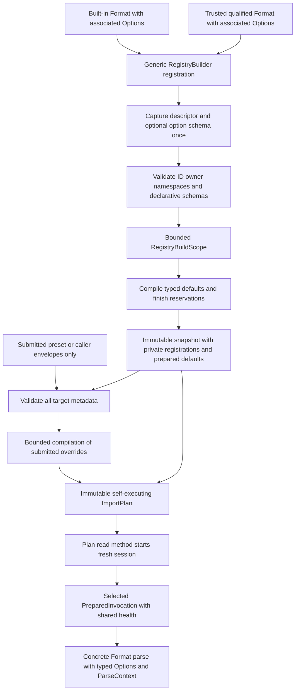

# ADR 0021: Extension Registry and Format Descriptor Governance

## Context

Baozi needs heterogeneous built-in and third-party formats while keeping each format's concrete
option type bound to its parser. A mutable registry during an import would make detection, option
compilation, and evidence depend on races. Support claims also drift when every format invents its
own ID, descriptor, maturity, and option-schema metadata.

Third-party importers execute in-process and therefore are trusted extension code. Registration is an
explicit Rust extension surface, not a dynamic-plugin sandbox or stable C ABI.

## Decision

`baozi-import` owns validated `FormatDescriptor`, the mutable registry builder, immutable registry
snapshots, and private adapters for heterogeneous `Format` implementations. A generic
`Registration<F>` retains the format; a `PreparedInvocation` privately erases it together with
`CompiledOptions<F::Options>`. ADR 0016 separately owns option envelopes, precedence, bounded typed
compilation, and prepared override selection; ADR 0046 owns plan execution, exact detector/parser
invocation methods, context views, failure transport, validation call, and lifecycle outcomes;
ADR 0029 owns detection semantics and selection.

Accepted freezes these ownership boundaries. It does not promote the extension trait to the stable
facade tier or claim all descriptor tooling is implemented.

### Canonical Ownership Boundary

This ADR is the sole owner of registry registration, builder mutation, freeze ordering and atomicity,
immutable snapshot lifetime, descriptor and namespace claims, extension unloading, callable trust,
the shared registration health latch, unwind containment and phase mapping, permanent poisoning, and
the rule that a poisoned extension is never invoked again. These rules apply uniformly to registered
default/option compilation, detection, and parsing.

ADR 0016 is the sole owner of option envelope/schema/version transport, precedence, typed compiler
input/output semantics, scopes and budgets, `CompiledOptions<T>` admission, and prepared override
selection. This ADR owns private registration/invocation erasure, lifetime, and health; it defines no
second payload grammar, precedence chain, compiler scope, or ordinary option error taxonomy.
ADR 0046 owns plan execution and parse outcome composition after session creation.

### Registration and Snapshot

`RegistryBuilder::register<F: Format>` accepts a concrete format before request planning. Each
registration validates:

- one bounded stable `FormatId`, unique in that registry;
- an immutable descriptor with extensions/media types, encoding/container kind, text profile where
  applicable, dependency policy, capability claims, optional issuer-scoped self-attestation,
  support documentation, and target constraints;
- one bounded immutable dependency-role table whose globally qualified role IDs are unique and map
  each role to exactly one `Required` or `Optional` requirement;
- one `Format` implementation with associated `Options`, both
  `Send + Sync + RefUnwindSafe + 'static`;
- optional `FormatOptionSchema` metadata whose owner equals the descriptor's `FormatId`;
- typed default/layer compilation and parsing bound to that same `Options` type;
- every extension namespace claim and declarative extension schema advertised by the descriptor; and
- consistency between descriptor capability claims and enabled crate features.

Descriptor and optional wire-schema metadata are captured exactly once at registration. Freeze and
request planning use those captured values. A metadata unwind returns bounded
`RegistryRegistrationError::ImporterPanicked` before an entry is admitted; a foreign schema owner
returns `OptionSchemaOwnerMismatch`.

Immutable-snapshot creation is the non-bypassable default-compilation gate. `RegistryBuilder::freeze`
visits registrations in stable `FormatId` order and invokes `Format::compile_defaults` under a bounded
`RegistryBuildScope`. Its `CompiledOptions<F::Options>` is retained with `Arc<Registration<F>>` in a
private `PreparedFormat<F>`, then exposed internally through `PreparedInvocation`. Per-registration
and aggregate work, decoded cells/bytes, recursion, live capacity, result bytes, and error/panic detail
remain bounded. Scope `finish` checks outstanding reservations, including zero-byte tokens, before
admitting result bytes. Formats without options use `NoFormatOptions::compile_defaults` through the
same gate.

Default compilation panic, ordinary rejection, budget/allocation failure, or unfinished reservations
produce a structured `RegistryBuildError`. Freeze is atomic and publishes no partial snapshot.
Returning another option type fails Rust compilation; no runtime type-key agreement is required.

`FormatId` uses a bounded lowercase ASCII reverse-DNS grammar for every registered format. Baozi's
built-ins use `org.baozi.<format>`; external registrations use a namespace they control, for example
`org.example.asset-format`. There is no public "first-party" registration escape hatch because a
library API cannot prove the package identity of its caller. Short unqualified IDs are not registrable.
IDs are durable configuration/provenance identities, not display names.

The bounded `FormatId` value object lives in `baozi-core` because validated Scene provenance must
retain it without a core-to-import dependency. `baozi-import` remains the sole owner of registration,
descriptor, option-schema, namespace-claim, and selection authority; core owning the value grammar
does not create a second registry or capability surface. The grammar treats `.` as a non-empty label
separator. Each label contains lowercase ASCII alphanumerics with optional internal `-`; leading,
trailing, or repeated `.` or `-` are invalid.

### Dependency Role Contract

The descriptor owns every dependency role a selected importer may present to the downstream import
dependency capability. A
`DependencyRoleId` is one globally qualified stable lowercase ASCII token of the form
`<format-id>:<local-role>:v<schema-version>`, for example
`org.baozi.obj:material-library:v1`. Local role labels use lowercase ASCII alphanumerics with
optional internal `-`, and the nonzero decimal schema version changes whenever the role's semantic
meaning changes incompatibly.

Each role declaration freezes exactly one requirement (`Required` or `Optional`) plus its bounded
semantic purpose. Requiredness is not a parser-call argument, option value, loss-policy override, or
registry insertion default. A grammar with genuinely different required and optional cases declares
different role IDs. Duplicate, malformed, foreign-format, unknown, or requirement-ambiguous roles
fail registry freeze or terminate the selected session before cache lookup or IO.

The complete ordered role table and requirement mapping are part of
`ImplementationDeclarationIdentity`. ADR 0041 owns graph relations and canonical manifest encoding;
it consumes the exact frozen role ID and derives requirement from this table without redefining role
semantics.

### Prepared Defaults and Plans

Successful freeze returns an immutable snapshot containing captured descriptors, optional option
schemas, private registrations, shared health, and one cached default prepared invocation per format.
Plans and sessions may share that snapshot across threads; builder registration/removal cannot affect
them. Detection, descriptor enumeration, and evidence use stable `FormatId` order.

`RegistrySnapshot::plan(&ImportRequest, OptionCompileLimits)` resolves common configuration and
validates all submitted target metadata before invoking any target's option compiler. It compiles
only submitted preset/caller envelopes, once per target in stable `FormatId` order, against the
cached typed default.
A missing wire schema rejects submitted options; it does not prevent metered default compilation.
Every submitted target must compile before session creation or IO, even if selection later chooses
another format. With no submitted layer, selection reuses the exact shared default invocation;
planning neither scans nor invokes unsubmitted option compilers.

The resulting immutable `ImportPlan` owns the snapshot, resolved configuration, prepared overrides,
stable override order, and storage-account factory. Its own `read_bytes`, `read_asset`, and
`read_asset_with_resolver` methods execute that snapshot, without another importer/plan pairing API.
Clones share prepared invocations and live-account admission limits. A plan holds no input, active
work, or mutable operation control; each read creates a fresh session under ADR 0046.

### Registered Callable and Health Boundary

The registry's private `ErasedRegistration` and `ErasedInvocation` traits provide heterogeneous,
object-safe storage for concrete formats and prepared typed options. The public extension contract
is `Format` with associated `Options`; it requires no public codec, runtime type key, option store,
or parse-side downcast. This ADR owns registration identity, snapshot lifetime, the health wrapper,
and permanent poison. ADR 0046 owns detector/parser parameters, domain returns, context semantics,
validation, and outcome composition.

The health wrapper passes the downstream invocation context unchanged, contains unwind, and checks
registration health before invocation and before accepting a successful return. It cannot add a
second coordinator, inspect or relabel domain error content, convert a terminal scope failure into
registry health, or construct a normal domain outcome. A panic sets shared poison before the
downstream owner constructs bounded failure evidence; an ordinary returned error does not poison
the registration. A racing poison discards apparent success while preserving an already returned
detector scope abort or parser failure under its owning lifecycle rules.

Only the concrete format defines its option type and optional schema. The generic adapter retains
`CompiledOptions<F::Options>` with that format and passes `&F::Options` directly to `Format::parse`.
Private erasure preserves this pairing; it does not define another schema identity, envelope
transport, precedence rule, scope, or public configuration parser.

At freeze, default compilation receives only the bounded registry-build scope. At request time,
`Format::compile_options` receives its cached typed default and ADR 0016's opaque
`FormatOptionLayers` with separate preset/caller presence. Payload access goes through
`OptionCompileScope` readers; an unrestricted envelope payload slice is not passed to the format.

ADR 0016 owns ordinary typed compilation failures. This ADR defines the unwind branch: a default
compiler panic maps to bounded `RegistryBuildError::CodecPanicked`, a submitted-layer compiler panic
maps to bounded `RequestError::CodecPanicked`, and both poison the shared registration before
returning. Ordinary compiler rejection retains the corresponding `CodecRejected` variant. These
error names do not expose a codec capability. Neither compilation path reaches session creation or
asset IO; an option type mismatch cannot be deferred to parsing.

### Domain Failure Non-Ownership

The registry and its health wrapper never construct, classify, retain, or relabel detector/parser
domain failures. They may retain only the inert declaration needed to identify the selected
registration. ADR 0046 owns the opaque parse transport, stable format-failure packing, lower-cause
preservation, validation call, and outcome composition; ADR 0029 owns detection outcomes. No registry
snapshot or poison record retains a backend error object, callback, function pointer, native handle,
or plugin-owned destructor.

### Descriptor Authority

`FormatDescriptor` is the code-level authority for what the registered implementation declares. It
has private fields and validated construction so extensions cannot publish malformed IDs, duplicate
extensions, unbounded notes, or impossible capability combinations.

The registry carries only declaration-time evidence authority: `Unverified`, or a visibly
issuer-scoped `SelfAttested` claim with its own bounded evidence reference. It has no
`BaoziVerified` variant, token, constructor, field, or freeze input. Human support tables and format
pages use ADR 0011's separate managed evidence snapshot to join the declaration identity with current
Baozi evidence. Descriptor construction, registry freeze, and a long-lived registry snapshot cannot
promote, retain, expire, withdraw, or revoke a Baozi maturity claim.

At freeze, the builder derives only the canonical `ImplementationDeclarationIdentity` owned here:
the descriptor's format/specification/profile IDs, compiled defaults and option-profile identity,
text/recovery profile, dependency-role table, extension schema identities, and declared
implementation/backend role. It
does not infer executed artifact/source identity from a package version, commit, plugin filename,
function pointer, feature label, or target display string.

Registry freeze validates only the declaration identity and optional self-attestation. ADR 0011's
managed evidence view independently joins that identity to its exact tested implementation/build
subject and verification record. The registry neither reconstructs nor claims to measure the running
executable, and replacing the managed evidence snapshot does not mutate or invalidate a live registry
snapshot.

Request compilation derives the actual option-profile identity. A valid request outside the
descriptor's verified subjects may execute, but its support evidence is `Unverified` or issuer-scoped
`SelfAttested`. An orphan managed inventory entry is excluded from support publication and fails the
inventory/release checker without changing an unrelated runtime snapshot.

The descriptor owns the immutable identity of a format's text profile and the set of recovery
capabilities it may expose. ADR 0035 owns the decoding meaning of those values, while ADR 0016 owns
their typed option transport and precedence.

ADR 0043 records a Proposed candidate for future producer attestation and closed-input qualification.
While it remains Proposed, no registry entry, maturity token, session, or public/default API may
construct or consume its candidate types. Registry declaration identity is never proof of the
running executable or proof that extension code has no ambient IO path.

### Extension Namespace and Schema Registration

ADR 0023 owns extension value semantics. `baozi-core` owns the closed declarative schema language,
`ExtensionSchemaId`, schema validation, ID-reference/remap rules, and the immutable schema data retained
by a scene. `baozi-import::RegistryBuilder` is the sole owner of namespace claims, schema registration,
duplicate detection, and snapshot lifecycle. A format or plugin cannot create an independent global
schema registry.

Namespace ownership follows deterministic rules:

- `baozi` and every `baozi.*` child namespace are reserved for schemas shipped by `baozi-core`;
- every format owns only the namespace equal to its qualified `FormatId` and optional dot-separated
  child namespaces below that exact prefix;
- a shared cross-format namespace requires a separately reviewed Baozi-owned schema registration; two
  format registrations cannot acquire it by agreement or insertion order.

Each registered typed descriptor uses a stable `(namespace, local_schema_id, schema_version)` identity
and a bounded Baozi-owned declarative schema. The schema may describe closed values, canonical reference
kinds, validation, generation qualification, and ADR 0032 remap obligations. It cannot contain plugin
callbacks, backend objects, native handles, or process-local type identities. A duplicate namespace
claim, duplicate schema identity, conflicting schema body, reserved-prefix claim, or schema outside the
registrant's namespace is a structured registration error even when the duplicate bytes are equal.

Freezing a registry builder creates one immutable, stably ordered
format/default-invocation/namespace/schema snapshot. Builder removal or replacement affects only
snapshots created afterward. Existing plans and sessions retain their original registrations and
shared prepared defaults/overrides. Canonical construction copies the exact Baozi-owned
declarative schema subset needed by retained typed descriptors into the resulting scene generation, so a
`ValidatedScene` can outlive and be edited after the originating plugin code is unloaded. Unloading
code therefore requires dropping every builder, snapshot, plan, or session that retains its private
registration or prepared invocation.
Validated scenes and terminal import outcomes contain only Baozi-owned declarative data, so neither
retains plugin code or becomes invalid after unload.

### Trust and Stability

The extension trait is a deliberate lower-level Rust API with its own stability tier. The facade may
offer explicit registration without re-exporting backend internals. Baozi may break the trait before
its declared stabilization gate rather than maintain duplicate legacy or version-suffixed traits.

Registered format compilation, detection, and parsing must be semantically reentrant and contain no
cross-session parse or option state. All operation state belongs on the call stack, in format-private
temporary models, or behind the active owner-supplied invocation scope; selected compiled options are
exposed only as an immutable `&F::Options`. A first-party implementation may not hide serialization
behind an internal mutex.
Barrier tests run the same snapshot concurrently with different inputs and options and compare each
result with its serial baseline.

Extension code is trusted and its callable traits require `RefUnwindSafe` in addition to
`Send + Sync`. This ADR requires unwind containment and typed failure evidence at registered option
compiler, detector, and parser boundaries; ADRs 0046 and 0033 own resolver, IO, and callback outcomes.
Every registration owns one shared, one-way health latch retained by the builder and every snapshot
derived from it, including their prepared invocations and plans. A panic from registered compilation,
detection, or parsing atomically poisons that registration. Every later freeze, option-compilation,
forced-detection, or parse attempt returns stable `ExtensionPoisoned` evidence without invoking the
instance again. A default-compiler panic prevents snapshot publication and poisons the pending
registration so a later freeze cannot retry the same failed extension. Concurrent invocation
admission is linearized by the shared latch; already admitted calls may overlap, but an observed
racing poison cannot become success.
`AssertUnwindSafe` may cover session-owned staging that is discarded after unwind, but it never
declares a plugin reusable. Panic containment still cannot contain abort, infinite loop, process exit,
arbitrary filesystem access, or unbounded allocation by code already executing in the process.
Hostile extensions require host-managed process isolation.

The shared poison latch applies only to registry-owned format registrations that
Baozi retains and may invoke across operations. Host-supplied `AssetIo`, resolver, and per-operation
observer capabilities are not silently enrolled in that registry or retained by Baozi for later
reuse. ADRs 0046 and 0033 own their operation-local failure outcomes; the host decides whether to
reuse or retire its own object after the operation. If Baozi later introduces a shared registry for
those capabilities, an Accepted architecture update must assign its health owner and linearization
rules before reuse.

## Alternatives Considered

### Option A: Closed compile-time enum of all first-party formats

This is easy to type and document but prevents deliberate third-party extension and couples the facade
to every optional format. Rejected.

### Option B: Mutable global registry with string properties

This is plugin-friendly but race-prone, non-reproducible, and incompatible with typed pre-IO option
validation. Rejected.

### Option C: Validated builder plus immutable snapshot of typed formats

Private generic adapters retain format/option type pairing while heterogeneous registry storage,
captured metadata, prepared defaults, and shared health govern each plan. Chosen.

## Consequences

Positive:

- One immutable snapshot governs request compilation and detection.
- Every snapshot contains a bounded, typed default invocation for each format.
- Plans compile only submitted format layers and reuse snapshot defaults otherwise.
- Format descriptors, typed option compilation, namespaces, and declarative schemas have explicit owners.
- Optional format crates remain isolated from the facade's concrete types.
- Registry insertion order cannot change evidence or selection.

Negative:

- Extension authors must implement descriptor and bounded typed-default contracts; no-options formats
  use the host's metered helper without declaring a wire schema.
- Registry freeze performs bounded default compilation for every registration and can reject the
  proposed snapshot atomically.
- The lower-level trait remains a compatibility surface within its declared pre-stable tier.
- Hostile plugins require a separate process protocol not defined here.

## Risks and Mitigations

| Risk | Severity | Mitigation |
| --- | --- | --- |
| Descriptor claims unsupported Baozi maturity | High | Registry declarations expose only `Unverified` or issuer-scoped `SelfAttested`; ADR 0011's external managed evidence view is the only Baozi maturity authority. |
| Parser relabels a required dependency as optional | Critical | requiredness exists only in the frozen dependency-role table; parser calls carry a role ID but no requirement argument |
| Registry declaration is mistaken for exact executable evidence | Critical | Keep declaration identity here, keep exact tested implementation/build evidence under ADR 0011, and forbid descriptor/package/plugin metadata from claiming runtime measurement. |
| Proposed producer/build identity leaks into production registry APIs | Critical | ADR 0043 remains non-authoritative; API-shape and package checks reject candidate types until one atomic Accepted promotion. |
| Registry mutation races an import | High | Freeze immutable snapshot before request compilation; no session mutation API. |
| Format and options lose their association during erasure | High | `Registration<F>` and the prepared adapter retain `CompiledOptions<F::Options>` together; wrong types fail compilation, and wire-schema owner/version checks precede compilation. |
| Broken plugin default enters a snapshot | Critical | Atomic bounded freeze rejects panic, ordinary rejection, budget/allocation failure, or unfinished reservations as `RegistryBuildError`; default-compiler unwind permanently poisons the registration. |
| Unsubmitted compiler runs during planning | High | Plans compile only submitted targets and reuse cached default invocations for every other candidate. |
| Shared importer leaks state across sessions | Critical | Require semantic reentrancy, immutable selected options, concurrent-versus-serial conformance tests, and no hidden first-party serialization mutex. |
| Panicked plugin instance is invoked again | Critical | Require `RefUnwindSafe`, atomically poison the registration after an unwind, and return stable `ExtensionPoisoned` without reinvocation. |
| Planning reconstructs unsubmitted defaults | High | Build prepared overrides only for submitted targets; instrument zero option-compilation calls for a no-envelope plan. |
| A plan executes with a foreign registry or resets clone admission | High | Execute through the plan's own snapshot and share the storage-account factory across clones. |
| Registry health wrapper reinterprets a domain result | Critical | Contain unwind and reject success after observed poison without interpreting domain error content, constructing an outcome, or converting ordinary errors into poison. |
| External ID collides with a Baozi-owned ID | Medium | Qualified namespaces plus deterministic duplicate rejection; no caller-asserted first-party registration path. |
| Plugin removal changes schema meaning for an existing scene | High | Scenes retain only immutable Baozi-owned declarative schema data; plugin code remains with live registration and prepared-invocation owners. |
| Two plugins claim one namespace or schema ID | High | Reject duplicate, reserved, and out-of-prefix claims deterministically before snapshot creation. |
| Users mistake panic containment for sandboxing | Critical | Explicit trusted boundary and process-isolation requirement. |

## Acceptance Criteria

| Contract | Testable acceptance |
| --- | --- |
| Typed heterogeneous registration | Custom `Format` implementations with different `Options` use private erased registration/invocation traits; wrong default, override, or parse option types fail compilation. ADR 0046 owns detector/parser method shapes. |
| Metadata capture | Descriptor and optional wire-schema methods run once per registration; freeze/planning reuse captured values, and metadata unwind publishes no entry. |
| Snapshot immutability | Mutating the builder after snapshot creation cannot affect an existing plan/session or its shared default invocation and typed value. |
| Registration validation | Duplicate/invalid ID, malformed descriptor, foreign schema owner, and impossible claims fail before IO. |
| Dependency role authority | Freeze rejects malformed, duplicate, or ambiguous role tables; selected-scope tests prove calls accept only `(origin, role, hostile reference)`, derive one frozen requirement, and reject unknown/foreign roles before cache or IO. |
| Maturity boundary | Registry API/serialization contains only `Unverified` and issuer-scoped `SelfAttested`; source/API-shape tests find no `BaoziVerified` field, token, constructor, or freeze input. |
| Evidence join boundary | ADR 0011 tooling joins the immutable declaration identity and effective option profile to the current managed evidence snapshot outside registry freeze; orphan or mismatched inventory entries cannot change runtime registration. |
| Identity ownership | Mutation tests prove descriptor/profile/default/schema drift changes the registry declaration while tested source/dependency/config/generated/native/toolchain drift invalidates ADR 0011's managed evidence subject without changing registry identity. |
| Proposed identity isolation | Compile/API-shape and packaged-surface tests prove no ADR 0043 producer, qualification, or build-identity type is accepted or exposed while that ADR remains Proposed. |
| Atomic default freeze | Every format, including `NoFormatOptions`, compiles typed defaults under bounded `RegistryBuildScope`; panic, ordinary rejection, budget/allocation failure, or unfinished reservations yield `RegistryBuildError` and no partial snapshot. A default-compiler unwind poisons the builder registration, so later freezes return `ExtensionPoisoned` without reinvocation. |
| Namespace ownership | Baozi-owned, external, reserved, child-prefix, shared-schema, duplicate, and conflicting-body fixtures all use qualified IDs and follow the deterministic ownership rules. |
| Request compilation boundary | Unsupported options, submitted-layer rejection, scope exhaustion, unfinished reservations, and unwindable compiler panic return bounded pre-session `RequestError` values with zero asset opens. |
| Optional schema | No-schema formats compile metered defaults but reject every submitted envelope before any target compiler runs. |
| No-envelope selection | A no-envelope plan performs zero request option-compilation calls and gives the selected parser its exact snapshot-cached typed default through the shared invocation. |
| Submitted-only invocation | Growing the registry adds no request option-compilation calls for unsubmitted formats; each submitted target compiles once against its cached default. |
| Multi-format request | Every submitted format target compiles before session/IO even when forced or automatic selection later chooses another target. |
| Metadata admission | Invalid metadata on any submitted target prevents all target option-compilation calls, even when earlier targets are valid. |
| Compilation completion | Both scopes enforce aggregate/per-registration or per-target budgets, result bytes, and release of every live reservation, including zero-byte tokens; repeated `finish` is rejected. |
| Common configuration | Starting from the same frozen snapshot, changing only common import overlays invokes no format-option compiler. |
| Stable ordering | All builder insertion permutations produce equal descriptor enumeration and detection evidence. |
| Executable plans | Plan read methods use their owned snapshot and create independent sessions without importer/plan pairing; clones share prepared invocations and live-account admission capacity. |
| Snapshot and unload | Builder removal cannot affect an existing snapshot/plan/session; after all registration/invocation owners drop, an imported scene still validates and remaps typed descriptors without plugin code. |
| Capability limits | Registry API-shape tests expose no mutation, health-latch, poison-reset, another format's options, public option downcast, or domain failure/outcome constructor through a registered callable slot. |
| Invocation pass-through | Integration proves the wrapper passes the owner-supplied context unchanged, adds no coordinator, and preserves domain errors while rejecting success after observed poison. |
| Registry-unload isolation | Outcomes composed under ADR 0046 remain printable, source-traversable, and droppable after builder, snapshot, plan, and format teardown without invoking a registered callable. Exact domain transport, packing, source-chain, and producer-teardown semantics remain exclusively owned by ADR 0046. |
| Backend isolation | Public facade/report/core fields, terminal errors, and stable schemas contain no registry entry, health/poison state, registered callable, or executable backend/plugin object; registry teardown cannot change an existing outcome. |
| Trust boundary | An unwindable default-compiler panic is `RegistryBuildError`, submitted-layer compiler panic is `RequestError`, and detector/parser panic becomes its session-owned typed failure; docs require process isolation for hostile extensions. |
| Reentrancy | Barrier tests share one snapshot across distinct inputs/options; concurrent results equal their serial baselines, selected options are immutable, and first-party importers contain no session-state fields or hidden serialization mutex. |
| Panic poisoning | Default-compiler, request-compiler, detector, and parser panic fixtures poison their registration atomically across builder, snapshots, and plans; every later entry path returns `ExtensionPoisoned` without another call. |
| Racing poison | Barrier tests admit overlapping calls without serialization, reject apparent success after observed poison, and preserve an in-flight detector scope abort or parser error under lifecycle precedence. |

## Amendment History

### 2026-11-02: Erase typed format invocations privately

- Affected: current decision, registration/freeze, prepared plans, callable health, unload lifetime,
  diagram, risks, and acceptance.
- Previous: public object-safe `FormatImporter` and `FormatOptionCodec` capabilities agreed through
  `OptionRuntimeTypeKey`; erased `CompiledFormatOptions` values lived in a `FormatOptionStore` and
  required parse-side downcasts. `PreparedImportRequest` was paired with a separate importer.
- New: generic `Registration<F>` binds `Format::Options`; bounded `CompiledOptions<F::Options>` and
  the format are erased together behind private `PreparedInvocation`. Metadata is captured once,
  wire schemas are optional, and an immutable `ImportPlan` owns and executes its snapshot.
- Impact: former importer/codec/key/store contracts are replaced without compatibility aliases;
  `ImportPlan` replaces `PreparedImportRequest` without an alias. Stable ordering, atomic freeze,
  compilation budgets and reservation completion, schema/version checks, cached defaults,
  pre-IO admission, unload isolation, shared poison, racing-poison checks, and semantic reentrancy
  remain required. Earlier amendments remain historical.
- Review basis: the [typed-format/context design](../research/2026-11-02-typed-format-context-design.md),
  ADR 0046, and the production sources listed above. This source-based amendment establishes no
  executed compiler, runtime, performance, or release result.
- Rationale: private erasure keeps heterogeneous extension storage while Rust preserves the concrete
  format/options pairing and the registry retains health and lifetime authority.

### 2026-07-22: Require registry-unload isolation without owning domain transport

- Affected: `Domain Failure Non-Ownership`, `Backend Isolation`, and `Acceptance Criteria`.
- Previous: the format-evidence row allowed an optional Baozi-owned inert source, leaving the public
  source-chain shape ambiguous and duplicating ADR 0020's authority over domain transport.
- New: this ADR requires only the registry-owned observable result: outcomes produced under ADR 0020
  outlive registry/importer teardown without retaining or invoking a registered callable, health
  state, or executable backend object. ADR 0020 alone defines packing, source chains, and producer
  teardown.
- Impact: registry callable identity and object safety are unchanged; public outcomes can no longer
  anchor registered extension code, while their exact error representation remains downstream.
- Review: implementation commit `b1f7608` and independent API/lifecycle review with no remaining
  P0/P1/P2.
- Rationale: registry unload and poison guarantees need an isolation postcondition, not a second
  normative owner for lifecycle transport.

### 2026-07-17: Move exact invocation and domain transport to import lifecycle

- Affected: `Canonical Ownership Boundary`, `Registered Callable and Health Boundary`,
  `Domain Failure Non-Ownership`, `Risks and Mitigations`, and `Acceptance Criteria`.
- Previous: this ADR described the exact detector/parser invocation contract and domain failure
  mapping in addition to registration, snapshot, health, and poison ownership, creating a reverse
  normative dependency on ADR 0020.
- New: this ADR owns only registered slot identity/lifetime plus return-versus-unwind health and
  permanent poison. ADR 0020 exclusively owns detector/parser signatures, invocation scopes,
  lower-cause transport, validation, and lifecycle outcomes.
- Impact: registry freeze remains independent of import orchestration, while every registered
  callable still crosses one shared health wrapper before the downstream lifecycle handles its
  domain result.
- Review: 2026-07-17 ADR authority-cycle and implementation-boundary review.
- Rationale: a registry may decide whether a callable remains admissible after unwind without
  becoming a second owner of the callable's domain contract or terminal import outcome.

### 2026-07-16: Separate declaration identity from execution evidence

- Affected: `Descriptor Authority`, `Risks and Mitigations`, and `Acceptance Criteria`.
- Previous: registry freeze derived a broad default-profile subject from descriptor, backend,
  feature, and target metadata and also consumed a managed verification token.
- New: this ADR owns only `ImplementationDeclarationIdentity`; ADR 0011 owns the exact tested
  implementation/build evidence used for maturity, while ADR 0043 remains a non-authoritative future
  producer/qualification proposal.
- Impact: registry metadata cannot masquerade as executed-artifact evidence, retain a withdrawn
  maturity claim, or prematurely expose a build-identity contract; existing object-safe
  descriptor/codec behavior remains unchanged.
- Review: 2026-07-16 producer-identity and evidence-authority architecture review.
- Rationale: declaration, managed maturity evidence, and a possible future runtime attestation have
  different issuers and lifecycles and must not be collapsed into registry metadata.
