# ADR 0022: Per-Import Resource Ledger and Phase Budget Accounting

## Status and Authority

This ADR is superseded by
[ADR 0047](0047-operation-ledger-evidence-and-resource-accounting.md) and owns no active
architectural concern. ADR 0047 preserves the durable attempted, consumed, live, peak, committed,
terminal-evidence, and phase-accounting semantics while removing private ledger typestates,
dimension enumerations, byte transcripts, and migration-era command detail from authority.

The remainder of this record is retained as historical design and implementation context.

## Context

Independent per-file and per-vector limits do not bound aggregate resource use. One asset can attempt
thousands of missing sidecars, reuse one dependency in many logical references, retain a primary
snapshot while a backend builds an AST, then hold normalized and canonical models simultaneously.
Transactional post-processing also temporarily owns old and replacement buffers at once.

A debit-only counter misses simultaneous memory. A refundable counter is worse: repeatedly failing an
optional resource could refund attacker-controlled work and evade the aggregate budget.

## Decision

Every import session owns one import ledger. Every post-process invocation owns a separate operation
ledger using the same accounting semantics. Every standalone core construction/validation invocation
owns a real operation ledger inside its opaque `SceneConstruction` lifecycle; it is not a no-op
adapter over a physical account.
Each ledger has five distinct evidence classes:
monotonic attempted counters, monotonic consumed counters, releasable live reservations, committed
canonical output, and published outcome evidence. It records phase ownership and the maximum
simultaneous live amount. Format crates and
post-process steps cannot create private substitutes for shared dimensions, and a composed facade
does not merge distinct operation histories into one ambiguous total.

`baozi-operation` owns the runtime-neutral reservation types, the sole
prepare/frozen-publication/infallible-handoff state-machine primitive, checked counter primitives,
generic ledger engine, and owner-neutral ledger-evidence snapshot machinery. ADR 0044 separately
authorizes that crate's private generic final-owner foundation and concrete retained store. This ADR
does not derive physical-allocation lifetime authority from ledger ownership and does not expose a
generic retained payload or caller-declared footprint.
`baozi-import` owns request `ResourceLimits`, the effective import budget, import dimensions/phases,
interpretation in import outcomes, and the single ParseScope-bound metered-storage module that binds
Baozi-owned parser `Vec`/`String` capacity to import reservations. Format crates compose that module
and may add semantic wrappers, but cannot own a competing reserve/grow/shrink/transfer/rollback
implementation. `baozi-postprocess` owns its operation limits, dimensions/phases, and interpretation
in post-process outcomes. `baozi-core` owns Scene-construction limits, phases, dimensions, and
interpretation for standalone construction/validation. The facade composes operation snapshots
but does not merge them. `baozi-io` owns path, backend, handle, IO causes, and immutable backend-local
hard caps; it does not own a competing aggregate budget.

The dependency direction is `baozi-core`, `baozi-import`, and `baozi-postprocess` toward the leaf
`baozi-operation` crate. During import, operation bootstrap creates one session owner containing the
sole import ledger/coordinator, account-bound minimal terminal baseline, outcome-evidence authority,
terminal-cause latch, joint-preparation authority, and one dormant single-use scene authority. It
does not create canonical tables before format selection, effective-limit freeze, and complete
authoring-input preflight. Core preflights the complete input without that authority and returns one
sealed canonical plan carrying exactly one non-authority, single-use activation request. The session
owner atomically consumes that request with its
dormant authority and moves only the resulting brand-coupled canonical lane into core. Core then
receives only sealed borrowed work/control capabilities plus qualified concrete-store
projections from the same ledger. It never receives a raw reservation, generic retained constructor,
physical lease, outcome-evidence owner, or independent prepare/handoff capability, and it cannot start
a second import ledger. During standalone use, core creates and owns one separate opaque
`SceneConstruction` continuation backed by a private real operation session owner. Core never depends
on import, and postprocess never depends on import. Domain owners supply stable phase and dimension
keys; `baozi-operation` cannot invent or interpret them.

Accepted freezes these semantics; conformance requires executable implementation and ledger evidence.

### Evidence Classes

| Class | Meaning | Refund rule | Examples |
| --- | --- | --- | --- |
| Attempted | Cumulative requested/untrusted work charged before an action | Never decreases | open attempts, logical references, declared decode cells, requested bytes, diagnostic bytes proposed |
| Consumed | Cumulative work/bytes actually completed or observed | Never decreases | bytes successfully copied, read, or decoded; tokens scanned; graph edges visited; diagnostics encoded |
| Live reservation | Capacity or conservative allowance attributable to the operation right now | A storage-covering reservation releases only after storage/allowance is gone; preparation may release retained-output attribution only after a bound physical lease independently covers retained storage and the destination commitment is ready | snapshot capacity, materialized decoded text, backend decode allowance, normalized model, unpublished canonical construction storage, staging buffers, newly allocated retained output, diagnostics, packed bounded failure evidence |
| Committed canonical output | Per-generation logical canonical cells/bytes accepted by successful preparation | Monotonic once preparation commits the destination; domain-facing output is exposed only by handoff and this evidence is not a host physical-byte owner | validated nodes, primitives, attribute cells, strings, images, animation keys |
| Published outcome evidence | Non-canonical retained bytes/items accepted for the selected success, rich-failure, minimal-fallback, or postprocess destination | Monotonic once preparation commits the destination; domain-facing evidence is exposed only by handoff and this class is neither canonical output nor a host physical-byte owner | diagnostics, losses, detection/source-scope records, manifests, remaps, bounded failure details, ledger/report storage |

### Import-Bound Session Activation and Joint Publication

An import has one operation session owner, one coordinator, and one ledger from successful bootstrap
until exact terminal preparation. Sharing only the physical account is insufficient, and attaching a
retained subsystem to an already exposed raw coordinator is not the production seam. Bootstrap must
create the long-lived operation owner itself, pre-admit the minimal terminal/evidence baseline, and
retain one dormant non-copyable scene authority. No import-bound core constructor may accept only an
account and then create another coordinator, ledger plan, or standalone ledger snapshot.

The dormant authority exists so early open/detection/dependency failures and later canonical outcomes
share one owner without forcing canonical allocation before exact planning is possible. Before
activation, it owns no canonical table and cannot reserve, retain, validate, commit, prepare, or
publish canonical output. It remains in the outcome owner while core performs complete
`SceneAuthoringBatch` semantic/envelope/input/capacity/attribution preflight and returns one opaque
`SealedCanonicalPlan` carrying exactly one extractable activation request. The request describes exact
operation-neutral shape and requirements but owns no dormant authority, canonical table, publication
join, or retry right; the remaining plan is brand-coupled to the lane returned from that request and is
the only value core may use for materialization. The outcome owner may
consume `(DormantAuthority, SealedActivationRequest)` exactly once. Verified rejection before mutation
becomes `NeverActivated`; uncertain mutation or cleanup is fail-closed containment; success creates one
brand-coupled canonical lane and permanently consumes the dormant state.

After activation, the ownership pair is:

- the outcome owner retains the coordinator/ledger, outcome-evidence table, protected terminal
  authority, sticky terminal cause, final control/progress authority, and joint prepare/handoff seam;
- the canonical lane retains only the canonical table/owners and the bounded capabilities needed for
  materialization, validation, canonical-candidate construction, and commitment-intent description
  under that same ledger. It has no destination-commit method.

Neither value can prepare a public result alone. The outcome owner must consume exactly one brand-
bound canonical disposition with outcome evidence: `NeverActivated` proves zero canonical retained-
output table, allocation, reservation, and commitment while preserving attempted/consumed preflight
work and released transient-scratch evidence; `Rejected` proves verified cleanup, zero canonical
owner/live attribution, and preserves the original cause; `Candidate` owns the validated unpublished
canonical aggregate and is the only success-capable branch. Uncertain cleanup or poison is containment
and cannot masquerade as a disposition. A missing, duplicated, foreign-brand, early/double-activated,
or independently prepared authority, lane, disposition, or candidate fails closed.

For `Candidate`, the outcome owner first preflights all pre-generation destination/control facts and
issues an opaque single-use freeze permit. The domain adapter passes that permit to core in the normal
dependency direction. Core either returns `Rejected` plus the matching operation failure contribution
without consuming a nonce, or reserves generation identity and splits its ready state into an
operation-understandable freeze contribution plus a core-owned handoff token. Operation interprets
neither generation identity nor the handoff token; it consumes
only the contribution with outcome evidence during joint preparation. Import privately retains the
core token until pure handoff. `NeverActivated` and `Rejected` can produce only zero-canonical rich or
minimal failure.

The producer-facing canonical checkpoint remains deliberately narrow. It may poll and perform only
the pre-authorized work/reservation transitions needed by core; it cannot report arbitrary progress,
freeze a ledger, consume protected terminal work, prepare publication, activate another authority,
split another lane, or transfer ownership. The import host may use a separate sealed session
capability for its broader phase, attempted/consumed, progress, snapshot, tightening, and exact scene-
activation duties. These are concrete linear capability families, not a public trait-object operation
port.

Standalone core construction is a second real adapter over the same operation-owned session seam. It
creates its own coordinator, ledger, minimal terminal, and dormant scene authority because no import
exists; its snapshot is never attached to an import report. Postprocess owns a separate operation
ledger but receives no fresh dormant source-scene authority: it opens a derived `SceneEdit` lane against
the input Scene's inherited account/lineage and reuses only the joint commit/pure-handoff primitive.
This preserves operation separation without allowing nested ledgers, standalone-construction reuse for
an edit, or an attach bridge inside one import.

`attempted` is charged before an external action or count-driven loop when possible. `consumed` is a
separate counter charged only as bytes/work actually complete. For comparable dimensions,
`consumed <= attempted`; a denied open increases attempted opens but not consumed opens, while a
truncated read retains its actual consumed byte count. Neither class is rolled back when an optional
dependency, parser recovery, cancellation, or transaction fails.

For direct primary bytes, attempted primary and aggregate bytes are charged before allocation,
snapshot capacity is reserved before copying, and consumed bytes are charged only after the copy
succeeds. The caller allocation is not session-owned live storage. Direct binding emits no physical
open evidence; ADR 0029 owns the input-mode and dependency-authority contract.

When completion cannot be known at admission time, the owner may issue a linear work permit. Creating
a permit charges attempted work before the admitted action; successful completion charges consumed
work. Dropping or forgetting unfinished work never refunds the attempt or fabricates consumption.
The operation owner defines control polling, outstanding-permit, and terminal-transport semantics;
ADR 0020 exclusively defines those rules for detection.

### Protected Failure-Terminal Work

A failure-capable operation reserves a finite failure-terminal work allowance during startup. Each
caller-facing attempted-work and consumed-work limit is the total hard limit including that
allowance; the allowance is not additional hidden Baozi-owned overhead. The domain owner
checked-subtracts the qualified allowance and distributes only the remainder to ordinary work.
The operation provider independently checked-sums the attempted and consumed limits of every
non-protected dimension and rejects unless those aggregates exactly equal the declared ordinary
remainders. Startup rejects before operation acceptance when either total cannot cover the terminal
allowance and every mandatory ordinary startup requirement, when an extra ordinary dimension would
exceed either remainder, or when either aggregate sum overflows.

This partition governs admission limits. A rejected action remains visible in monotonic Attempted
evidence and may cross its configured threshold by the rejected request; completed work cannot cross
the Consumed partition. The terminal allowance belongs to the existing Attempted and Consumed
evidence classes, not to a sixth evidence class.

Only an unforgeable linear failure-publication authority can spend the protected terminal dimension.
Ordinary checkpoints, writers, reservations and transitions, retained-share plans, commitments,
progress APIs, and caller-supplied dimension keys cannot address it. Possessing the dimension key or
catalog membership grants no spend authority. A success-capable operation keeps the authority
dormant while success remains possible; a failure-only operation activates it immediately.

Before exact success becomes irreversible, every safely recoverable downgrade must retain that
authority or an already complete failure path that requires no further allocation, callback,
validation, or work charge. The authority is finite, single-use, non-cloneable, and non-renewable. If
one protected action fails, rich-failure construction is sealed. Verified cleanup may then reach only
the pre-admitted minimal fallback; uncertain ownership, charge, poison, panic, or cleanup disposition
fails closed and publishes no terminal wrapper.

A publication-open failure has exactly one authority disposition:

- `Retry`: pure preflight failed, or verified rollback restored the complete operation and its unused
  terminal authority;
- `FallbackOnly`: the single-use authority was consumed, cleanup is verified, and only the
  pre-admitted minimal fallback remains reachable; or
- `FailClosed`: ownership, mutation, charge, poison, or cleanup disposition is uncertain, so no
  recovery owner or terminal publication is returned.

All pure structural, catalog, and key preflight precedes terminal-authority consumption.

A frozen failure cause contains one typed class plus one class-specific bounded code:

- `Requested` means a domain-requested or semantic failure for which no more specific trusted runtime
  cause exists;
- `Ledger` means a ledger admission, ownership, or accounting rejection;
- `Control` means cancellation, deadline, observer, cancellation-signal, or progress-control failure;
  and
- `ProductGraph` means a safely contained root, closure, or product-graph integrity failure.

The first trusted runtime cause is sticky and cannot be replaced by a later requested code. A primary
ledger rejection may upgrade only a provisional `Requested` cause to `Ledger`; it preserves an
earlier `Control`, `ProductGraph`, or `Ledger` cause. Poison or uncertain cleanup is not another
terminal-cause class: it is fail-closed containment with no prepared publication.

Retained storage remains part of operation-attributed current live while it is constructed and while
outcome preparation can still fail. Newly allocated retained storage is already covered by a
separate account-bound physical lease. All allocation, validation, checked arithmetic, callback,
control downgrade, cleanup selection, destination-slot preflight, and ledger-lock work completes
before operation constructs one closed `JointCommitIntent`. The intent owns the exact canonical freeze
contribution or zero-canonical failure disposition, outcome-evidence candidate, fully validated
destination plan, and terminal class. It has no destination commitment, final account publication
eligibility, or domain-visible output.

One private `qualify_and_commit` pivot consumes that intent. Before the pivot, ordinary rejection or
drop destroys the unqualified owners in storage-before-account order and leaves every destination
commitment at zero. The pivot's account-latch observation is its final fallible step and ADR 0044's
publication-eligibility linearization: poison or any uncertainty resolves before eligibility and
exposes no commitment or exact wrapper. Eligibility success continues in the same non-returning success
path through allocation-free, lock-free, callback-free, panic-free, mechanically infallible moves over
already reserved slots. That path applies the canonical/outcome-evidence commitments, releases
operation-live attribution to zero, freezes the sole ledger snapshot, and constructs the exact
operation wrapper. No qualification token is stored/exposed and no fallible, unwinding, or containment
branch exists after eligibility. An implementation unable to prove this suffix must reject or contain
the intent before observing eligibility.

The exact prepared operation wrapper owns already destination-qualified but domain-unexposed
publication owners. Preparation neither transfers nor releases their physical leases and does not add
bytes a second time within either plane. Exact operation handoff only consumes the wrapper and exposes
those owners through domain-facing output types; it performs no attribution reclassification or
counter mutation.

An operation that fails before Scene publication records zero committed canonical output but may
successfully publish nonzero outcome evidence. That is not a successful import; it is a successful
handoff of an exact failure wrapper. All allocation, validation, accounting, checked arithmetic,
destination selection, account-brand validation, cancellation polling, callback work, and final
control downgrade occurs before the closed commit intent. Any domain-owned fallible identity
reservation required for provisional success, such as core's generation nonce, is sequenced through
an operation-owned pre-generation freeze permit but remains domain-owned. The generic ledger neither
constructs nor interprets that identity or its handoff token. Atomic reservation rejection or
exhaustion consumes no nonce, converts the candidate into a typed zero-canonical `Rejected`
disposition, and is an ordinary rich failure. It does not select minimal fallback merely because the
identity was unavailable. Once reservation succeeds, any later freeze/product-graph preparation
failure, cancellation, or caught unwind drops the domain handoff token and burns its never-reused
identity. A non-builder unwind may
attempt the rich-failure terminal variant after all required candidate/publication cleanup is
verified and the pre-admitted fallback/evidence attribution remains intact; a retained candidate/report builder panic instead
enters side-local containment and prepares no terminal wrapper.

Operation preparation returns a closed, already classified transport containing exactly one linear
`PreparedSuccess`, `PreparedRichFailure`, or `PreparedMinimalFallback`. It is not one opaque
success-capable prepared wrapper classified during handoff. Exact operation `PreparedSuccess` may own
the destination-qualified canonical owner but never a domain generation reservation or core handoff
token; the domain adapter privately pairs those only in its own exact success aggregate. Both exact
failure wrappers structurally contain no identity token or canonical owner. All three may own
destination-qualified outcome-evidence owners, contain no pending/live attribution token, and have
current operation live equal to zero. Operation handoff purely exposes/moves those owners. A matching
domain handoff token may then consume the canonical owner into the final proof/identity without any
public intermediate. Neither move performs identity allocation, validation, attribution
reclassification, accounting/counter change, control poll, lock protocol, user/extension callback, or
terminal classification, and neither can fail or panic. Dropping a prepared operation wrapper destroys
its unexposed publication owners in storage-before-account order; dropping the domain's paired exact
success additionally burns its private identity gap. Neither path reopens the ledger, rolls back
destination commitments, observes poison again, calls an extension, or exposes a public terminal.

Starting a failure-capable operation is itself fallible and precedes the exactly-one returned-terminal
contract. The owner-specific `try_start` must create the real ledger, obtain the separately owned
physical-account capability, preflight one complete minimal-terminal aggregate, and pass a private
two-phase startup guard through two non-nested transitions. The ledger first admits the complete
operation-attribution aggregate under its own lock. After that lock is released, the physical account
admits the complete physical aggregate under its own lock. An ordinary typed rejection that proves no
physical mutation deterministically rolls back the provisional ledger graph before return. A panic,
poison observed after physical mutation, or uncertain charge/owner disposition instead preserves the
provisional attribution coupled with every possible physical owner and fails closed without refund.
The guard exposes an
accepted operation only after both transitions succeed, and the first retained payload/evidence
allocator entry is unreachable before that ready state. A bootstrap rejection or allocation failure returns a fixed-
size allocation-free owner start error with no accepted operation snapshot or terminal outcome.
Verified-cleanup paths destroy every partial owner before return; uncertain paths preserve the exact
coupled attribution/physical owners in containment and never claim cleanup, rollback, or refund.

A **ledger control/bookkeeping allocation** is operation-temporary storage used only to materialize
the provisional ledger graph, including attribution- and commitment-batch backings. It is admitted
under the complete ledger-side capacity aggregate before growth, is structurally owned by that
provisional graph, never contains or becomes retained canonical/output-evidence payload, and never
appears in the physical manifest or physical charge. A **retained payload/evidence allocator entry**
is an allocation request whose backing may enter canonical output, minimal fallback, terminal
evidence, or another retained aggregate and therefore requires both operation attribution and
physical admission. Only the latter is forbidden before the ready pair. Ledger control/bookkeeping
allocations may occur after complete ledger-side capacity admission and before physical admission.
If any bookkeeping backing allocation fails, the provisional graph destroys every successfully
allocated partial backing first, rolls back all ledger reservations under one ledger lock, and
returns the fixed start error without entering physical admission; physical entry/charge, retained
payload/evidence allocator entries, and accepted operations all remain zero. On typed physical
rejection that proves no mutation, the complete graph follows the same storage-first, one-lock ledger
rollback contract. Bookkeeping existence never implies a physical owner. After readiness, the single consuming split that creates the typed
side-attribution owners and assembly batches only reclassifies already owned storage and authority;
it performs no allocation, lock acquisition, counter mutation, or other fallible work.

The two planes have independent snapshots and no shared linearization point. The ledger transition
is atomic for its complete attribution aggregate, and the account transition is atomic for its
complete physical aggregate; only external operation acceptance is atomic across both. The private
provisional ledger graph advances no public `Attempted` or `Consumed` fact and is not queryable as an
accepted operation. Once both planes are ready, each retained allocation outcome is structurally
paired with its matching operation attribution and physical charge. Verified cleanup releases both
in storage-before-owner order, while uncertain physical ownership preserves the matching attribution
already paired with it. No path fabricates an attribution owner to complete a nominal shape. A
successfully accepted operation keeps the fallback/evidence attribution required by later terminal
downgrade.

The retained-storage owner supplies this ledger with a typed cleanup result. The ledger neither
classifies physical side state nor chooses extraction, destructor, deallocation, lease, or membership
cleanup policy. A failed startup returns its owner-specific start error and no operation terminal.

Each successfully started failure-capable operation therefore already owns one minimal terminal
envelope before risky work. If appending, validating, or preparing a rich failure after downgrade
fails, or an invalid root or equivalent non-unwind integrity fault makes rich assembly unsafe, the
operation destroys every partial rich aggregate and uses that assembly-independent, already allocated
account-bound envelope to record the preparation cause without another fallible step. After
successful startup, a non-builder unwind may follow the same path only when candidate/publication
cleanup is verified, the pre-admitted fallback/evidence attribution remains intact, dependency cleanup completes,
and operation-live attribution is zero. A retained candidate/report builder panic instead enters
containment and never selects minimal fallback.

That minimal envelope preserves the complete owner-neutral ledger snapshot. Its fixed header records
schema revision, terminal cause, the optional owner-normalized last-completed phase key, dimension and
phase counts, operation-wide `current_live_bytes`/`peak_live_bytes`, `active_reservations`, and ledger-
evidence-storage `current_evidence_bytes`/`peak_evidence_bytes`. The global values are authoritative
stored evidence and cannot be reconstructed by summing or maximizing dimension/phase entries. Each
dynamic entry is a sealed cell containing one inert copied owner-domain key plus its
`DimensionSnapshot` or `PhaseSnapshot`. Domain owners normalize extension/plugin keys to Baozi-owned
fixed-size values before the first ledger entry. `StoreKeyDomain` is a process-local minting brand,
not stable evidence identity. The Baozi-owned result/evidence owner retains the domain lifetime anchor
and complete immutable normalized key mapping through the last supported query. Plugins receive only
host-minted keys for admitted declarations. They may create foreign process-local domains, but cannot
copy or access the host authority, mint an accepted host-domain key, inject a raw key, or own the
retained mapping; every foreign-domain key is rejected. A retained cell cannot own `Drop`, external/
plugin objects, vtables, function pointers, or callbacks, and lookup remains valid after producer
unload. The brand and raw runtime key never enter a semantic
digest, snapshot transcript, wire representation, persistent cache key, or build identity.
Safely prepared fallback records zero current live bytes, active reservations, and current ledger-
evidence bytes while preserving the actual operation-wide and evidence-storage peaks.

The complete header-plus-cell `Layout` is a checked semantic shape/overflow preflight, not evidence of
one allocator request. ADR 0044 may give the fixed header owner and keyed evidence backing separate
actual allocations; every actual allocation has its own policy-governed `CapacityPlan` and full
layout/capacity charge. A separate crate-private evidence anchor pairs the concrete-store revision
with the capacity-policy revision. Before retained payload/evidence allocator entry, bootstrap checked-sums all requested envelopes and
block counts, admits the complete ledger aggregate first, and admits the complete physical aggregate
second through the private guard. Consolidating those backings later cannot change the observable
evidence, admission, rollback, query, or failure contract and cannot merge the two locks.

If the process survives but cleanup or release cannot be proved, payload, lease, and operation
attribution remain conservatively coupled and charged, the affected operation/account/extension path
is poisoned, and the owner returns typed `FinalizationContainmentError` without a prepared fallback,
refund, or zero-leak claim. Double panic, `panic = "abort"`, process exit, and OOM require process
isolation. No partial publishable outcome escapes. Storage that enters no prepared outcome is
destroyed before its attribution and physical owners release only in the verified-cleanup case.

Physical containment cannot be overruled by a logical ledger transition. This ADR records only the
resulting operation attribution and fixed evidence supplied by the retained-storage owner; it does not
define physical fault selection, release evidence, severity precedence, or containment shape.

### Live and Peak-Live Accounting

For each instant:

```text
current_live_bytes = sum(active Baozi-owned capacity reservations)
                   + sum(active declared opaque-backend allowances)
peak_live_bytes = max(previous_peak_live_bytes, current_live_bytes)
```

Capacity, not vector length, is the default measurement for Baozi-owned allocations. Checked
`count * element_size` and alignment/overhead allowances happen before `try_reserve`, decode, or
decompression.

One base `CapacityPlan` describes exactly one allocator call. Its `desired` is the minimum capacity
required by that plan, and its allocator request uses only that plan's own `desired`; it never reads
another plan's logical requirement or silently substitutes its envelope. For a fixed backing, the
plan's `desired` is the logical minimum required by the caller. The complete envelope belonging to
the allocator-facing plan is admitted before allocator entry.

Input-proportional growth uses a higher-level plan instead of changing that base meaning. A
`GrowableCapacityPlan` preserves a requirement plan whose `desired` is the logical minimum and places
the deterministic geometric target in a separate allocator plan's `desired`. A
`ReplacementCapacityPlan` likewise preserves the source requirement and places the geometric target
in an empty candidate plan's `desired`; the candidate's complete envelope is admitted while the old
backing remains live and charged. Each nested `CapacityPlan` still requests only its own `desired`.
A first-party append loop must not repeatedly issue fixed plans with `desired = len + 1`, because an
exact allocator or replacement implementation could otherwise perform quadratic total copying.

An opaque-backend allowance is an admitted ledger quantity, not evidence that the dependency's real
heap, stack, recursion, hidden copies, or transient RSS stayed inside that quantity. Baozi's hard
prebudget claim covers Baozi-owned/requested capacity and first-party metered collections. A hostile or
opaque decode path may claim a hard runtime memory boundary only when it executes in an admitted
subprocess/process isolation domain with an OS-enforced limit. Heap profiles and fixture evidence may
qualify maturity or calibrate an allowance, but cannot replace that runtime boundary.

Operation-live tokens have two non-interchangeable types:

- `StorageCoveringReservation` is the only accounting owner for operation-temporary storage or an
  opaque allowance. It is acquired before growth and released only after the associated storage is
  dropped or shrunk in a way the allocator contract can prove. It cannot cross successful
  finalization.
- `OperationAttributionReservation` records newly requested retained-output storage while an
  operation constructs and publishes it. Such storage must already have a separate pending or bound
  host physical charge. Only preparation may atomically release this token while applying its
  destination-qualified canonical or outcome-evidence commitment; the independent storage owner
  remains physically live inside the exact prepared wrapper.

The types cannot be converted into each other, substituted for a physical charge, or committed
through the wrong operation. A retained allocation acquires both applicable admissions before
allocator entry; failure of either admission performs no allocation.

Reservations are scoped/RAII capabilities issued only by the central ledger. Within their own type,
they may be split or transferred to another phase; only preparation may consume an attribution token,
and its canonical versus outcome-evidence destination is fixed before that transition. No
attribution token survives inside the prepared publication, can be cloned, or can be forged. Failure
to reserve is a typed limit failure before the allocation attempt.

For parser-owned collections, the `baozi-import` metered-storage aggregate owns the backing storage
and its covering reservation together. Its representation or explicit `Drop` sequence releases the
allocation before returning the reservation; clearing/truncating logical elements does not release a
capacity reservation unless the backing capacity is actually relinquished. A failed reserve, resize,
or transfer leaves both storage and its covering token in the caller-owned pre-transition state so
the operation may fail or retry without an under-accounted interval. First-party format crates must
not reproduce this protocol in local helpers.

The generic reservation type is defined by `baozi-operation`; only the owning import, post-process, or
standalone core construction ledger can issue it. A reservation is branded to that instance so it
cannot be transferred between operation domains or committed under the wrong outcome.

Bounded terminal evidence remains operation-owned live storage until preparation applies the
outcome-evidence destination commitment and places its independent physical owner inside the exact
domain-unexposed wrapper. Only exact handoff exposes that owner as `PublishedOutcomeEvidence`.
For a format failure, packed Baozi-owned detail storage is admitted and reserved before the borrowed
detail producer is invoked. The producer and any native backend/plugin error are consumed
synchronously and never retained, so terminal accounting covers only the inert descriptor/code/detail
evidence that actually outlives the adapter call.

### Retained Output Integration

This ADR owns only operation attribution. It does not define or consume a physical-account type,
retained-allocation representation, allocation-bound lease, deallocator, or generation-lineage API.
ADR 0044 is the downstream decision that depends on these attribution semantics and supplies that
separate physical lifetime implementation.

The operation owner nevertheless must compose its ledger with ADR 0044's monotonic shared account-
poison contract. Fresh/derived operation start, every retain/share admission, and final publication
eligibility linearize against the physical account's poison/counter state. Poison-first start rejects
before an operation ledger or attempted/consumed/work counter exists. If an operation or retain
admission linearizes first, its monotonic attempted/consumed evidence and physical charge remain
truthful; poison never refunds either. Later ledger work that needs retain/share admission is rejected,
and final preparation returns `FinalizationContainmentError` before freezing a publishable exact
wrapper. The owner-neutral ledger snapshot remains distinct from the physical-account snapshot that
exposes the shared poison latch, event count, and fixed first evidence.

Any downstream retained-allocation provider must obtain this operation's attribution admission and
its independent physical admission before allocator entry without exposing either token to domain
callers. Before set-id creation, work charging, account mutation, or allocator entry, it must validate
all count, width, multiplication/aggregate overflow, table-capacity, maximum-new-block, and typed
attribution structure. The structure covers each retained table root plus every actual new allocation;
authorized inherited shares are not new physical or allocation attribution, but their fresh target
slots/containers and clone work are. Every backing allocation uses a store-created `CapacityPlan`
governed by the capacity-policy revision and charges its full envelope before entry. A fixed plan's
`desired` is its logical minimum. A growable or replacement wrapper preserves that logical
requirement but places its geometric target in the allocator or candidate plan's `desired`; every
base plan requests only the additional capacity needed for its own `desired`. Observed capacity may
be smaller but not larger than that allocator-facing plan's envelope, and no conservative difference
is refunded while live. A replacement candidate's complete envelope is admitted in addition to the
still-live source before allocator entry. Separately, a
crate-private evidence anchor pairs the concrete-store revision with that policy revision. Neither
the runtime plan nor this anchor is allocator/toolchain/target attestation. Strict conformance
requires repository-managed probe evidence bound to the anchor, while custom or unknown allocator
paths remain `Unverified`. The envelope measures Baozi-
requested layout/capacity, not allocator size classes, metadata, fragmentation, page retention,
hidden overgrant, or exact process RSS. From the first allocator entry, backing storage is
structurally owned with its covering admission and must be destroyed before
that reservation, pending physical charge, or bound lease can be released.

Prepared publication first converts each attribution reservation into a prevalidated destination
intent without applying it. The final ADR 0044 eligibility/infallible-commit pivot consumes those
intents, applies their canonical or outcome-evidence commitments, freezes the snapshot, and reaches
zero operation-owned current live without releasing the independent physical owner. Each exact
prepared operation value contains no pending/live attribution capability; handoff only consumes the
wrapper and exposes/moves its already qualified owners as
`CommittedCanonicalOutput`/`PublishedOutcomeEvidence`. Dropping it destroys the unexposed publication
owners in storage-before-account order; it does not reopen the ledger, roll back a destination
commitment, observe poison again, call an extension, or expose a public terminal. An operation failure
leaves committed canonical output at zero but may publish typed failure evidence; a preparation failure with verified cleanup destroys
every unpublished rich aggregate before releasing its covering owners and then uses the pre-admitted
assembly-independent terminal envelope. Uncertain cleanup retains the coupled owners and cannot
select fallback. ADR 0044's concrete store must satisfy this provider contract before
U4 conformance; replacing it must preserve the same one-way dependency and must not expose its raw
generic foundation.

Inherited shared payloads authorized by ADR 0044's exact input-lineage source are not attributed as
new physical allocation by a later operation. Same account alone is insufficient. The operation still
records complete committed logical output by semantic presence/length plus clone/branch/container
work and every fresh target slot, wrapper, replacement, index, remap, report, or evidence allocation
it caused. ADR 0044 defines the non-rebrandable account lineage and unique physical-byte owner.

### Pre-Session Request Admission

Option/request compilation occurs before `ImportSession` and therefore is not an import-ledger phase.
The request compiler has independent hard limits for envelope count/bytes, decoded configuration
cells/bytes, codec work, recursion, and diagnostic/error detail. It uses fallible allocation and
returns a bounded typed `RequestError` with zero asset IO. Successful compilation produces only a
bounded immutable request; it does not transfer fictitious attempted/live counters into the later
session.

ADR 0016's `OptionCompileScope` is the exclusive codec view of those limits. It may reuse
`baozi-operation` checked counters/reservations in a separate pre-session instance, but no value from
that instance is reported as an import ledger snapshot. An unwindable codec panic or runtime-type
disagreement is likewise a pre-session `RequestError`, never an import-ledger event.

### Operation Phases

The minimum import-ledger phase vocabulary is:

1. primary snapshot;
2. detection;
3. dependency acquisition;
4. backend decode;
5. format normalization;
6. canonical Scene construction;
7. validation; and
8. outcome finalization.

A post-process operation has its own ledger and phase vocabulary: plan compilation/preflight,
transaction staging, validation/commit, and report/failure finalization. Import and post-process
reports retain their own snapshots. A composed facade may present both, but cannot relabel
post-process work as import work or refund one operation against another.

A standalone opaque `SceneConstruction` continuation has core-owned construction, validation, and
outcome-preparation phases. Its explicit-account and private-account constructors use the same real
ledger semantics and produce a distinct snapshot; neither path may substitute a no-op attribution
adapter.

Each ledger records current and high-water live bytes by its own phases plus that operation's global
high-water mark. Phase transition does not implicitly release anything; the owner must release or
transfer each reservation. This makes snapshot + backend + normalized model + canonical output, or
input Scene + transactional staging + replacement output, overlap visible without conflating the two
operations.

An owner-specific ledger phase is accounting attribution, not lifecycle authority. Moving among
dependency, backend, normalization, construction, validation, or finalization ledger phases never
advances any lifecycle or progress vocabulary. Domain ADRs define their own one-way mappings and may
observe ledger evidence, but a ledger transition cannot call back into or mutate those domain states.

### Required Dimensions

The ledger supports byte and non-byte dimensions. At minimum it accounts for:

- primary, dependency, archive, compressed, decompressed, data-URI, embedded payload, and decoded
  UTF-8 text-surface bytes;
- physical open/read attempts and logical dependency references;
- diagnostic attempted/stored/dropped count and encoded bytes;
- tokens, records, graph nodes/edges/depth/work, negative-proof canonical/temporary bytes and
  verification work, and decode work;
- canonical object counts, topology cells, attribute cells, influence/morph/animation cells, and
  canonical string/payload bytes;
- shared-handle clone attempts, retained handles, and derived-generation branch count/work; and
- committed logical canonical footprint;
- published success-report, failure-outcome, postprocess-report, manifest, diagnostic/loss, remap,
  and bounded terminal-evidence items/bytes; and
- one owner-defined protected failure-terminal dimension whose finite Attempted/Consumed allowance is
  visible in every frozen ledger report but inaccessible to ordinary work capabilities; and
- operation-attributed current/peak-live bytes globally and by phase.

ADR 0044 separately owns account-qualified physical current/peak bytes and live-allocation count.

Per-resource limits remain fast local gates. Aggregate counters and peak-live are additional gates,
not replacements.

Where a descriptor text profile declares a format hard cap, the effective import limit is the minimum
of that cap and the matching `baozi-import::ResourceLimits` value. The descriptor cannot raise the
request budget, an envelope cannot raise either value, and an IO backend-local hard cap may only lower
what its backend accepts.

`max_decoded_utf8_bytes` applies to the complete semantic text surface: the whole input for ASCII STL,
ASCII PLY, and plain glTF; only the header through `end_header` for binary PLY; and only the JSON chunk
for GLB. Binary STL facets, binary PLY bodies, and GLB binary chunks are excluded. A borrowed validated
slice consumes the text-surface limit without inventing live allocation. A materialized copy also
reserves its actual allocator capacity in the storage class that owns that copy; STL's retained ASCII
buffer, PLY's temporary profiled lines, and glTF's borrowed JSON surface therefore have distinct live
footprints while obeying the same decoded-text limit.

Archive/compressed/decompressed/nesting dimensions are reserved accounting vocabulary only. Their
presence does not authorize archive/container support. ADR 0037 is currently Proposed and
non-authoritative; a future accepted decision must separately authorize activation.

### Dependencies, Optional Failure, and Caching

ADR 0010's authority-qualified dependency key caches the first immutable snapshot or
identity-terminal failure only after each logical reference has passed authorization.
Identity-terminal means stable for subsequent authorized references to that key, not automatically
fatal to the import session. Physical open and byte consumption is charged once for the cached
attempt; every logical reference and its validation/decode work is charged on every use. A denied, missing,
truncated, oversized, or malformed optional resource still consumes its attempted counters. Only
unused live capacity may be released.

The ledger consumes the identity/cache events supplied by the IO and import authorities; it does not
define path normalization, authorization, source identity, or cache-key semantics.

Required-resource failures are session-terminal. An optional failure becomes ADR 0020's explicit
non-abort `Unavailable` outcome only when the format contract says the resource is optional and the
caller's loss policy permits the result; otherwise the same cached lower-layer cause is promoted to a
session-terminal `ScopeAbort`. Cache terminality never decides that disposition by itself.

### Opaque Backends and Process Evidence

If an in-process backend's exact allocations are not observable, its adapter must first establish a
finite input/work envelope that prevents attacker-controlled unbounded amplification, reserve a
conservative declared allowance before entry, and charge observable input/work incrementally. The
allowance is accounting evidence, not proof that the backend obeyed it and not an admission waiver.

A backend known to abort, recurse without a bound, or allocate from attacker-controlled values before
Baozi can enforce a finite envelope is not admissible to the in-process first-party inventory. The
affected path is disabled and unregistered, rejected/replaced, or moved behind an admitted process
boundary; it cannot remain reachable as Experimental. After baseline safety passes, missing sustained
RSS/timeout, sanitizer, or other non-safety promotion history may keep the backend Experimental under
ADR 0011.

### Diagnostics and Outcomes

Diagnostic storage is live memory and subject to both count and encoded-byte caps. Each owning
operation's failure retains its bounded immutable ledger snapshot, including attempted/consumed
values and peak-live evidence. Import failure records zero committed canonical Scene output but may
record nonzero `PublishedOutcomeEvidence`; post-process failure records zero committed replacement
output, may publish bounded outcome evidence, and returns/preserves the input validation proof.
Neither failure hides work performed before it occurred.

```mermaid
stateDiagram-v2
    [*] --> Snapshot: reserve primary capacity
    Snapshot --> Decode: retain snapshot + reserve backend allowance
    Decode --> Normalize: reserve normalized model
    Normalize --> Build: seal plan, activate once, materialize canonical storage
    Build --> Validate: retain unpublished construction storage as candidate output
    Validate --> FreezePermit: preflight destinations/control; no commitment
    FreezePermit --> IdentityReserved: core reserves identity and splits contribution/token
    FreezePermit --> RichFailureIntent: identity rejection/exhaustion; no nonce
    IdentityReserved --> SuccessIntent: exact success contribution + evidence
    IdentityReserved --> RichFailureIntent: later downgrade; burn identity gap
    Build --> MinimalFallbackIntent: invalid root or non-builder unwind; candidate clean; baseline exact
    Build --> FatalContainment: retained builder panic or side containment; keep coupled charge
    RichFailureIntent --> MinimalFallbackIntent: rich preparation itself fails
    RichFailureIntent --> FatalContainment: cleanup/release proof unavailable
    SuccessIntent --> PreparedSuccess: final eligibility + infallible commit; live = 0
    RichFailureIntent --> PreparedRichFailure: final eligibility + infallible commit; live = 0
    MinimalFallbackIntent --> PreparedMinimalFallback: final eligibility + infallible commit; live = 0
    SuccessIntent --> FatalContainment: poison or uncertainty before eligibility
    RichFailureIntent --> FatalContainment: poison or uncertainty before eligibility
    MinimalFallbackIntent --> FatalContainment: poison or uncertainty before eligibility
    PreparedSuccess --> SuccessHandoff: pure consuming owner exposure
    PreparedRichFailure --> FailureHandoff: pure consuming owner exposure
    PreparedMinimalFallback --> FailureHandoff: pure consuming owner exposure
    SuccessHandoff --> CoreProofHandoff: paired domain token consumes canonical owner + identity
    CoreProofHandoff --> [*]
    FailureHandoff --> [*]
    FatalContainment --> [*]: typed error; poisoned path; no fallback/refund claim
    note right of Decode
      attempted counters never roll back
      peak includes all overlapping owners
    end note
```



## Alternatives Considered

### Option A: Independent local limits only

Simple to implement, but aggregate sidecars, references, and simultaneous models can exceed host
capacity while every local check passes. Rejected.

### Option B: One refundable "bytes used" counter

Small API surface, but it conflates work with live memory and lets repeated failures refund attack
cost. Rejected.

### Option C: Attempted, Consumed, live-attribution, canonical-output, and outcome-evidence ledger

More bookkeeping, but it separately models cumulative attempted abuse, completed/observed
`Consumed` work, operation-local overlap, published canonical output, and retained success/failure
evidence without mutating another operation's evidence. ADR 0044 separately owns physical allocation
lifetime across generations. Chosen.

### Option D: Place failure-terminal work outside the caller's total

This preserves the full ordinary budget, but makes the advertised hard limit untrue and permits
hidden work after caller exhaustion. Rejected.

### Option E: Share one ordinary dimension by convention

This minimizes types, but any ordinary checkpoint can drain the failure allowance and make a
success-to-failure downgrade depend on remaining business budget. Rejected.

### Option F: Partition the caller total and protect the terminal allowance with linear authority

This reduces ordinary work by one checked finite reserve, preserves a truthful caller cap, keeps
bounded failure evidence available after ordinary exhaustion, and reports both portions through the
existing evidence classes. Chosen for failure-capable operations.

### Option G: Give import and core separate ledgers over one physical account

This is locally easy because standalone core construction can be reused unchanged, but it creates two
accounting truths for one import and cannot produce one authoritative terminal snapshot. Rejected.

### Option H: Expose one broad dynamic operation port to core

This keeps one coordinator, but a trait-object or callback surface carrying reserve, progress,
prepare, publish, and transfer authority is shallow, difficult to make linear, and easy to widen.
Rejected.

### Option I: Bootstrap one session owner, then activate one canonical lane from dormant authority

This preserves one import ledger and one early-failure owner, keeps domain meanings in their owning
crates, leaves dormant authority in the outcome owner while core seals an authority-free plan, delays
canonical allocation until their one-shot activation, restricts producer authority, and makes the
eligibility/infallible-commit pivot the only publication point. Chosen for import and standalone
construction; postprocess uses a derived edit lane.

## Consequences

Positive:

- Optional failures cannot reset cumulative attacker-controlled work.
- Memory multiplication across snapshots, backends, models, and transactions becomes measurable.
- Success and failure reports explain which limit and phase ended an operation.
- A failed import can publish bounded retained evidence without fabricating canonical committed
  output or leaking operation-live attribution.
- Caller work limits remain truthful hard totals while a protected finite portion remains available
  for terminal evidence after ordinary work is exhausted.
- Shared dependency caching has explicit physical-versus-logical accounting.
- Retained-output attribution integrates with ADR 0044 without making the operation ledger the
  allocation's lifetime owner.
- Import-bound core authoring and validation contribute to one import-ledger snapshot without giving
  core import-domain semantics or giving import raw canonical ownership.
- Early open/detection/dependency failures and later canonical publication share one owner without
  preallocating canonical tables from coarse global maxima.

Negative:

- Retained output requires an attribution admission in addition to ADR 0044's physical admission.
- Opaque backend accounting remains conservative and needs external RSS evidence; a known unbounded
  path remains inadmissible regardless of allowance size.
- Statistics and tests become more detailed than a single byte total.
- The private operation seam needs brand-coupled lane typestates and two deliberately different
  capability surfaces: a narrow producer checkpoint and a broader host-session capability.
- The session owner must preserve one dormant authority through authority-free core preflight and
  resolve the single activation as `NeverActivated`, activated lane, or fail-closed containment.

## Risks and Mitigations

| Risk | Severity | Mitigation |
| --- | --- | --- |
| Reservation drift undercounts actual capacity | Critical | One `baozi-import` metered-storage owner, capacity-based tests, checked arithmetic, destructor-order tests, and heap/RSS scale gates. |
| Attribution commit double-counts or controls the physical owner | High | ADR 0044's deep retained-allocation module commits only operation evidence and exposes no lease-control token. |
| Structural retained plan mutates state before an overflow or capacity failure | Critical | Validate count/width/overflow/table/max-new/attribution structure before set-id, work, account, or allocator side effects. |
| Observed allocator capacity differs from admission | Critical | Govern the plan by the capacity-policy revision and match a separate concrete-store/policy evidence anchor, charge the full envelope before entry, request only desired additional capacity, accept desired-through-envelope in `finish`, retain conservative charge while live, and destroy over-envelope storage before releasing owners with `CapacityEnvelopeViolated`. This is a post-allocation defense, not proof that transient RSS never exceeded the envelope. |
| Repeated exact `len + 1` growth becomes quadratic | Critical | Fixed plans keep logical-minimum semantics, while growable and replacement wrappers preserve that requirement and put a geometric target in the allocator-facing plan. Scale gates count successful replacements and all moved source elements/bytes, rejecting linear replacement counts or superlinear movement. |
| A physical-account limit is presented as an exact process-memory limit | Critical | Define it as Baozi-requested policy-governed layout/capacity only; exclude allocator-private overhead/overgrant, deny strict claims for unknown or unverified allocator paths, and require an OS/subprocess limit for a hard process-memory boundary. |
| Operation accounting ignores shared account poison | Critical | operation start/retain/share composes with ADR 0044's account state, while terminal preparation first builds a zero-commit closed intent. Account publication eligibility is the pivot's final fallible observation: poison-first leaves zero destination commitment; eligibility-first permits only the lock-free infallible commit move to an exact wrapper. |
| Two independent accounting locks are presented as one snapshot | Critical | the ledger-first and physical-second transitions each admit one complete aggregate under one lock, never nest locks, expose no shared internal linearization point, and use a private guard to make only external operation acceptance atomic |
| Import-bound core construction starts a nested ledger after receiving the account | Critical | The only import path starts from the operation session owner's dormant authority; no account-only or attach-existing-coordinator path exists, and real session-owner integration proves one ledger snapshot with canonical phases/dimensions included. |
| Bootstrap opens canonical tables before exact format/input planning | Critical | Startup pre-admits only the minimal terminal/evidence baseline and creates a dormant authority with zero canonical allocation. Selection, effective limits, complete envelope preflight, and exact attribution planning precede the single activation. |
| Canonical or evidence storage prepares without its matching owner | Critical | The canonical disposition/freeze contribution and outcome evidence carry one operation brand and have no independent prepare/handoff entry point; only the outcome owner may form the joint intent and cross the eligibility/commit pivot. |
| A host-facing checkpoint is reused as the producer-facing capability | Critical | Keep separate sealed capability families; core receives the narrow checkpoint, while only the session owner can report arbitrary progress, tighten limits, freeze evidence, spend protected terminal work, or prepare publication. |
| Failure evidence has no legal attribution terminal state | Critical | preparation applies the outcome-evidence destination commitment, the exact wrapper privately owns the still-unexposed evidence, public `PublishedOutcomeEvidence` appears only after handoff, and a pre-admitted terminal envelope supports exact infallible failure handoffs |
| Eligibility and ledger commitment leave a half-published terminal | Critical | Every fallible lock/check/callback and cleanup decision precedes the zero-commit intent. Poison or uncertainty resolves before eligibility. Eligibility success has one allocation-/lock-/callback-/panic-free non-returning suffix that freezes the snapshot, reaches zero live, and constructs the exact wrapper; no post-eligibility branch or stored token exists. |
| A prepared handoff discovers another failure or panic source | Critical | preparation completes terminal classification and destination commitment and reaches zero operation-live attribution; exact operation wrappers and paired domain handoff tokens have no pending authority and perform only pure consuming owner exposure/proof conversion. |
| A retained-builder panic is treated as clean fallback | Critical | startup panic returns a start error; later candidate/report panic returns fatal containment; fallback requires verified candidate cleanup and intact pre-admitted fallback/evidence attribution |
| Startup accounting invents, loses, or prematurely releases attribution | Critical | a provisional complete ledger graph precedes physical admission but cannot reach a retained payload/evidence allocator entry or accepted operation; after complete ledger-side capacity admission it may structurally own ledger control/bookkeeping backings; failure at every bookkeeping backing allocation destroys every partial backing before one-lock full-ledger rollback and returns the fixed start error with zero physical entry/charge, retained payload/evidence allocator entry, or accepted operation; typed no-mutation physical rejection applies the same cleanup to the complete graph, uncertain transition state preserves the graph coupled with every possible physical owner, and the ready pair structurally couples every later retained allocation with matching attribution and charge without fabricating an owner |
| Process-local evidence keys lose their catalog or become persistent identity | Critical | the Baozi-owned result/evidence owner retains the `StoreKeyDomain` anchor and immutable normalized catalog through query lifetime; plugin code receives only host-minted keys and runtime brands are excluded from transcripts, digests, wire, cache, and build identity |
| Domain identity crosses the leaf crate boundary or remains fallible after commitment | Critical | Operation issues only an opaque pre-generation freeze permit. The domain reserves and splits its identity in the normal dependency direction; operation consumes only the freeze contribution. Rejection becomes ordinary rich failure with no nonce, later preparation may burn the private domain token, and only the domain's paired pure handoff may expose identity/proof. |
| Prepared drop releases ownership in the wrong order or fabricates rollback | Critical | exact prepared state owns already destination-qualified but domain-unexposed aggregates, contains no rollback-capable token, and destroys storage before account owners without reopening the ledger or exposing a terminal. |
| Standalone validation bypasses operation attribution | Critical | core's opaque `SceneConstruction` lifecycle owns one real operation ledger for both explicit-account and private-account paths; no no-op adapter exists. |
| Rollback refunds attack work | High | Attempted/consumed counters expose no decrement API. |
| Ordinary work drains terminal evidence authority | Critical | Partition the caller's total at startup and make the protected dimension spendable only by a finite single-use terminal capability; ordinary checkpoint, writer, reservation, share, commitment, and progress APIs reject it. |
| A trusted terminal cause is overwritten by a later requested code | Critical | Preserve the first typed runtime cause, permit only `Requested` to `Ledger` upgrade on a primary ledger rejection, and keep poison or uncertain cleanup outside prepared terminal classification. |
| A recoverable open failure returns more authority than cleanup proves | Critical | Return exactly `Retry`, `FallbackOnly`, or no recovery owner for fail-closed containment; perform every pure preflight before consuming the terminal capability. |
| Conservative backend allowance rejects valid files | Medium | Calibrate admission with fixtures and profiles, but do not treat them as runtime proof; replace the backend or use an OS-limited subprocess where a hard hostile-input memory guarantee matters. |
| Experimental is used to retain an unbounded opaque path | Critical | Disable/unregister, reject/replace, or process-isolate the path until a finite admission envelope is proven. |
| Phase transitions leak reservations | High | RAII ownership plus end-of-phase and finalization assertions. |
| Allocation-free clone/drop or sibling fan-out exhausts work/reference counts | High | Precharge monotonic clone/branch work plus retained handle/container/branch limits before each clone or generation reservation/publication. |

## Success Metrics

| Metric | Target | Measurement |
| --- | --- | --- |
| Attribution closure | preparation maps every retained slot to exactly one destination commitment, final operation live is zero, no prepared-attribution token remains, and only handoff exposes the corresponding domain owner | success, ordinary failure, and rich-failure-preparation fault matrix |
| Canonical/evidence independence | failure reports always retain zero committed canonical output while independently reporting exact published outcome evidence | ledger snapshot assertions at every failure phase |
| Import ledger uniqueness | one import session owner, coordinator, and ledger snapshot cover detection through dormant-authority activation, canonical validation, and outcome finalization; no nested standalone core ledger or second snapshot exists | real import-owned session-owner integration, zero-before-activation allocation, early/exact/double activation, semantic phase/dimension assertions, report shape, and API/source scans |
| Joint lane closure | one `NeverActivated`, `Rejected`, or `Candidate` canonical disposition and outcome evidence prepare only under the matching outcome owner; a candidate success additionally requires one freeze contribution paired outside operation with the core handoff token | early-failure and success/rich/minimal matrix, foreign/missing/duplicate tests, compile-fail capability tests, and drop-order probes |
| Structural preflight | invalid count/width/overflow/table/max-new/attribution plans cause zero set-id, work, account, and allocator side effects | exact/excess boundary and fault-injection counters |
| Capacity coverage | hostile input cannot make Baozi request beyond the admitted policy-governed envelope; actual may be smaller, over-envelope publishes nothing, and logical output uses semantic length without an exact-RSS claim | desired/actual/envelope allocator probes, source-anchor matching, and subprocess-limit tests |
| Growth complexity | monotonic single-element growth uses geometric allocator/candidate targets; for an empty non-ZST container ending at logical length `N > 0`, successful replacements are at most `ceil(log2(N)) + 1` and total moved source elements are less than `2 * N` | exact replacement/moved-element counters at `N`, `2N`, and `4N`, plus checked byte-total assertions |
| Retained attribution coupling | before readiness, typed no-mutation second-plane rejection rolls back the complete provisional attribution graph while uncertain second-plane completion preserves it coupled with every possible physical owner; after readiness every side has matching attribution and physical ownership, and no path fabricates an owner | typed-rejection rollback, uncertain second-plane containment, post-ready verified/uncertain cleanup, owner-count, and drop-order probes |
| Startup allocator taxonomy | ledger control/bookkeeping allocations occur only after their complete ledger-side capacity admission, remain structurally owned by the provisional graph, and are never physical payload; every partial allocation failure and typed no-mutation physical rejection follows storage-first one-lock full-ledger rollback; retained payload/evidence allocator entries remain zero until readiness and the post-ready consuming split itself is allocation-, lock-, and counter-free | fault injection at every backing allocation, independent bookkeeping-versus-retained allocator probes, physical-entry/charge and accepted-operation probes, storage-before-single-lock rollback ordering, and consuming-split transition counters |
| Poison/accounting composition | one shared poison latch is visible across account clones without rewriting monotonic operation evidence; poison-first does no work, start/retain/share-admission-first keeps exact work/charge and cannot publish | two-order operation-start/retain/share/finalization barriers plus ledger/account snapshot assertions |
| Commit pivot and prepared handoff | a zero-commit closed intent precedes final account eligibility; eligibility success continues without a return/fault boundary to apply commitments, freeze one snapshot, reach zero live, and construct the exact operation wrapper. Domain identity remains in a separately paired opaque token whose pure handoff alone constructs proof; fatal containment is resolved before eligibility and is not a prepared handoff | poison-before/eligibility-before barriers, identity-exhaustion, API-shape, proof of no post-eligibility injection point, prepared-drop, verified-unwind, and injected-failure counters |
| Protected terminal authority | caller totals include the terminal allowance; ordinary work sees only the checked remainder; success reports zero protected use, failures report the actual consumed prefix, and no ordinary capability can address the protected dimension | exact/one-under startup, ordinary-exhaustion downgrade, API-shape, dimension snapshot, retry/fallback-only/fail-closed, and partial-use sealing probes |
| Typed terminal cause | semantic requests, ledger rejection, cancellation/deadline, and product-graph failure freeze `Requested`, `Ledger`, `Control`, and `ProductGraph` respectively without later cause degradation | isolated first-cause and precedence matrix |
| Standalone parity | explicit-account and private-account core validation use the same non-noop ledger and publication state machine | core integration and snapshot-equivalence tests |

## Acceptance Criteria

| Contract | Testable acceptance |
| --- | --- |
| Monotonic attempts | Repeated failed optional resources increase attempted opens/bytes/work and never refund them. |
| Independent consumption | Denied, truncated, and successful resource tests distinguish attempted from actually consumed bytes/work. |
| Live release | Dropping each temporary phase buffer before its `StorageCoveringReservation` reduces current live while preserving its high-water mark. |
| Peak overlap | Tests retaining snapshot + backend + normalized + Scene storage observe their sum, not their maximum. |
| Checked admission | Count, scalar width, record fields, count-times-size and aggregate overflow, table capacity, maximum new blocks, and root-plus-actual-new attribution failure precede set-id, work, account, allocator, and backend side effects. |
| Capacity envelope | Retained `CapacityPlan` is governed by the exact capacity-policy revision; a separate crate-private evidence anchor pairs that policy with the concrete-store revision. A fixed plan sets `desired` to the logical minimum. Growable/replacement wrappers retain that requirement and place the geometric target in the allocator/candidate plan's `desired`. Full allocator-facing envelope admission precedes every Baozi allocation request, each base plan requests only its own desired additional capacity, and `finish` accepts that plan's `desired..=envelope` while retaining conservative charge. A replacement admits its complete candidate envelope while the source remains charged. Over-envelope storage drops before owners with `CapacityEnvelopeViolated`. Repository probe evidence, not a runtime token, binds the anchor plus rustc/libstd/target/profile/allocator identity for strict conformance; unknown/custom paths remain `Unverified`, and OS/subprocess limits are required where hard process memory matters. |
| Operation bootstrap | Invalid/zero/exact limits plus sealed-cell/header semantic layout, per-actual-backing `CapacityPlan`, and checked aggregate requested-envelope/block sums either return an allocation-free start error with no accepted operation or return an operation already owning its fallback envelope. Instrumentation proves one complete ledger aggregate admission followed by one complete physical aggregate admission, non-nested locks, no common cross-plane linearization point, and no retained payload/evidence allocator entry before both succeed. Ledger control/bookkeeping probes may observe graph-owned backings only after complete first-plane capacity admission. Before physical entry, fault injection at every typed bookkeeping backing allocation proves every partial backing is destroyed before one-lock full-ledger rollback and the fixed start error returns with zero physical entry/charge, retained payload/evidence allocator entry, or accepted operation. After physical transition entry, only typed no-mutation second-plane rejection is rollback-eligible and applies the same cleanup to the complete graph; panic, post-mutation poison, or uncertain disposition instead enters coupled fail-closed containment. The semantic aggregate layout is never treated as proof of one allocator backing. |
| Account poison composition | Across cloned explicit accounts, poison-first operation start/retain/share returns typed `AccountPoisoned` before attempted/consumed/live counters, work permits, set/slot, refcount/range, or allocator effects. If start/admission linearizes first, existing operation evidence and charge remain, later admissions reject, and final publication eligibility returns `FinalizationContainmentError` with no exact prepared wrapper or handoff. Physical snapshots expose one latch/count/evidence; ledger snapshots are not rewritten to fabricate that physical state. |
| Minimal fallback evidence | Header assertions preserve schema/cause/last-phase/counts plus operation-wide current/peak live, active-reservation, and current/peak evidence-storage values without deriving globals from cells; prepared fallback has all current values zero. Cell shape, key-normalization, producer-unload, and query tests prove every dynamic entry owns only one inert Baozi-domain key plus its snapshot and no external/plugin object, vtable, function pointer, callback, or `Drop`. The Baozi-owned result/evidence owner retains the process-local domain anchor and immutable catalog for the complete query lifetime, plugins receive only host-minted keys, and changing a runtime brand cannot change any semantic transcript, digest, wire, cache/build identity, or user-visible meaning. |
| Shared metered storage | Compile-time API checks and format-source scans find one `baozi-import` reserve/grow/shrink/transfer/rollback implementation; all first-party parser collections use it, allocation drops before its token, and injected transition failures preserve both owners exactly. Monotonic one-element replacement fixtures at `N`, `2N`, and `4N` prove logarithmic replacement count and linear total moved elements/bytes; source scans reject repeated fixed `desired = len + 1` growth rails. |
| Retained-store authority | Rustdoc/source/compile-fail gates find no public generic retained constructor, arbitrary owning payload, caller-supplied backing allocation, visitor/attach path, or caller-declared footprint; domain code uses only ADR 0044's concrete store and non-owning qualified projections. |
| Linear work accounting | Permit admission charges attempted work, completion charges consumed work, and unfinished work retains attempted-only evidence; owner-specific integration fixtures prove their polling and terminal transport separately. |
| Protected failure-terminal work | Exact/one-under tests prove caller attempted/consumed totals include the qualified terminal allowance, all non-protected dimension limits checked-sum to exactly the ordinary remainder, and insufficient totals, extra ordinary capacity, aggregate overflow, or protected-policy drift reject before operation/account/allocator effects. Ordinary charge/reserve/transition/writer/share/commitment/progress APIs reject the protected key without counter change. A success-capable operation can still prepare bounded rich failure after ordinary exhaustion, generation rejection, final-control cancellation, or late primary-ledger rejection. Success reports zero protected use; failure reports the actual prefix, a failed protected action seals further rich work, verified cleanup yields only `FallbackOnly`, and uncertain cleanup yields no recovery owner. |
| Terminal cause precedence | Isolated fixtures prove semantic rejection freezes `Requested`, ledger ownership/admission rejection freezes `Ledger`, cancellation and deadline freeze `Control`, and safely contained root/closure failure freezes `ProductGraph`. A later requested code cannot overwrite a trusted cause, primary ledger rejection upgrades only provisional `Requested`, and poison/uncertain cleanup produces fail-closed containment rather than a prepared cause. |
| Decoded text surfaces | Exact and one-byte-under tests cover whole-text inputs, mixed text/binary headers, and container JSON chunks; borrowed validation creates no fictitious live bytes, while materialized copies reserve actual capacity. |
| Packed format failure evidence | Packed descriptor/code/detail capacity is reserved before the borrowed producer runs, remains covered through failure finalization, and the terminal outcome retains no backend/plugin object or hidden foreign allocation. |
| Opaque-backend admission | A known abort, unbounded recursion, or pre-admission allocation path has no first-party in-process registration. Allowance admission and maturity evidence never prove real runtime memory use; a hostile/opaque path claiming a hard bound runs under an admitted OS-enforced subprocess limit. |
| Publication token separation | This ledger tracks attribution rather than physical lifetime; preparation applies canonical plus outcome commitments for success and outcome-only commitment for failure, leaves preparation debris without a destination, and reaches zero operation live. No pending/live or prepared-attribution token survives; exact wrappers privately own already qualified but domain-unexposed owners, and public terminal values appear only after handoff. |
| Outcome-evidence terminal state | Exact success, rich-failure, minimal-fallback, and postprocess fixtures apply the outcome-evidence destination commitment during preparation and expose non-canonical retained storage as `PublishedOutcomeEvidence` only through handoff; canonical output remains independently zero/nonzero and final operation live is zero. Fatal containment publishes no fallback and retains conservative coupled charge instead. |
| Retained attribution coupling | Failure before physical mutation reaches no retained payload/evidence allocator entry and observes zero physical charge. At every bookkeeping backing-allocation fault, every partial backing is destroyed before one-lock full-ledger rollback and fixed start error return without physical entry or accepted operation; typed no-mutation physical rejection applies the same cleanup to the complete graph. Uncertain second-plane completion preserves that graph coupled with every possible physical owner. After the ready pair exists, verified physical cleanup releases exactly the matching attribution and uncertain physical cleanup preserves the matching paired attribution. No test may satisfy the invariant by fabricating an owner. An accepted operation retains the attribution needed by later fallback. |
| Prepared publication | Every fallible allocation/validation/accounting/control/callback and final downgrade step produces only a closed zero-commit intent. The final eligibility/infallible-commit pivot returns exact `PreparedSuccess`, `PreparedRichFailure`, or `PreparedMinimalFallback`, applies destination commitments with zero operation live, and leaves no attribution token or half-qualified state. Prepared drop destroys domain-unexposed publication owners in storage-before-account order without reopening the ledger, observing poison, calling extensions, or exposing a terminal. Retained candidate/evidence builder panic and uncertain cleanup return typed `FinalizationContainmentError`, keep exact ownership/charge coupled and poisoned, and are not prepared publications. |
| Domain identity reservation | Owner-specific tests prove operation first issues one opaque pre-generation freeze permit; the domain consumes it into rejection or a ready split of freeze contribution plus private handoff token. Rejection/exhaustion consumes no nonce, leaves the canonical destination unapplied, and prepares ordinary rich failure. Operation never owns/interprets the token. Later preparation failure/cancellation/caught unwind or exact-success drop may burn the gap, while only the privately paired pure domain handoff can publish identity/proof. |
| Dependency accounting | Repeated authorized references to one authority-qualified identity charge one physical read and N logical references/work units; equal logical names in different authority domains remain separate. |
| Failure evidence | Cancellation and parse failures retain bounded stats, attempted counters, and peak-live by phase. |
| Finalization invariant evidence | If ledger finalization detects live or pending state, its typed error retains the real immutable snapshot; callers cannot replace it with a zero or pre-finalization fallback snapshot or discard the original operation cause. |
| Operation separation | Import, postprocess, and standalone core construction expose distinct ledgers; one import-bound core construction contributes to its owning import ledger and never exposes a nested standalone snapshot; no operation changes, adopts, or refunds another operation's counters. |
| Import-bound lane composition | Bootstrap creates one real import session owner/coordinator plus one dormant single-use scene authority and zero canonical tables. Core completes authority-free input preflight and returns one sealed plan containing exactly one non-authority, single-use activation request. Only the outcome owner may extract and consume that request with the dormant authority; the remaining plan becomes usable only with the resulting same-brand lane moved into core. Finalization consumes exactly one canonical disposition with outcome evidence. Candidate success additionally proves freeze-permit/core-token separation. Foreign, missing, duplicate, early/double-activated, or independently prepared values fail closed. |
| Capability separation | API-shape and compile-fail tests prove the producer checkpoint cannot report arbitrary progress, tighten/freeze the ledger, spend protected terminal work, prepare publication, split another lane, or transfer owners, while the session host capability is not exposed to core or format code. No public trait-object operation port exists. |
| Dependency leaf | Graph checks prove `baozi-operation` has no upward workspace dependency, core does not depend on import, and postprocess does not depend on import. |
| Branded reservations | Compile-fail/runtime tests reject cloning, forging, conversion, cross-ledger transfer, covering-token commit, and attribution commit under the wrong operation owner. |
| Phase authority | Ledger and progress transitions cannot advance outcome phase evidence; only mapped session boundaries can do so. |
| Effective limits | Descriptor hard cap, request limit, and backend-local hard cap permutation tests always enforce their minimum without changing ownership. |
| Clone and branch admission | Exact/excess transient clone loops and sibling/deep-branch fixtures charge non-refundable work before reference-count changes and cannot bypass retained-handle, container, branch, or generation limits. |

## Amendment History

### 2026-08-05: Make joint publication use the sole import ledger

- Affected headings: frontmatter `updated`, `Decision`, `Import-Bound Session Activation and Joint
  Publication`, alternatives, consequences, risks, success metrics, and acceptance criteria.
- Previous rule: import owned one ledger and core received sealed capabilities, but the Accepted text
  did not forbid an account-only core constructor from creating a nested construction ledger or define
  how canonical and outcome-evidence ownership reunited for one terminal publication.
- New rule: operation bootstrap creates one session/outcome owner with the sole coordinator/ledger,
  minimal terminal, outcome-evidence/protected-terminal/joint-preparation authority, and one dormant
  scene authority. Core performs complete preflight without that authority and returns a sealed
  activation request; only the outcome owner consumes both and moves the resulting lane into core.
  Finalization consumes one `NeverActivated`, `Rejected`, or `Candidate` disposition. Candidate
  success separates the operation freeze permit/contribution from the core reservation/handoff token,
  then one eligibility/infallible-commit pivot freezes the sole import-ledger snapshot. Standalone core
  uses the same dormant seam; postprocess remains a separate derived-edit operation.
- Compatibility impact: private pre-release coordinator, retained-store, construction, and
  publication capability APIs may break; no published compatibility surface or stable wire changes.
- Required review: real one-coordinator session-owner startup, zero canonical allocation before
  activation, early/exact/double activation, one-ledger phase/dimension evidence, lane-brand mismatch,
  independent-prepare rejection, producer-versus-host capability separation, protected terminal
  isolation, prepared drop, and exact success/rich/minimal handoff.
- Rationale: one import cannot have two accounting truths, but moving the whole import operation into
  core would reverse semantic ownership. Linear lanes keep one ledger and one publication boundary
  while exact later activation preserves budget precision, crate direction, and least authority.

### 2026-08-01: Protect failure-terminal work inside the caller's hard total

- Affected headings: `Decision`, `Evidence Classes`, `Protected Failure-Terminal Work`, `Required
  Dimensions`, `Diagnostics and Outcomes`, alternatives, consequences, risks, success metrics, and
  acceptance criteria.
- Previous rule: failure-capable operations pre-admitted bounded fallback storage, but the Accepted
  decision did not define whether terminal work was hidden overhead, how ordinary APIs were excluded,
  which authority survived success-to-failure downgrade, how recoverable open failures differed from
  fail-closed containment, or how trusted terminal causes were classified and preserved.
- New rule: each caller work limit is a truthful hard total containing a finite owner-qualified
  terminal allowance. Ordinary work receives only the checked remainder. A linear single-use
  capability exclusively spends the visible protected dimension, remains available until exact
  success is irreversible or an allocation-free complete failure path already exists, and freezes one
  sticky typed `Requested`, `Ledger`, `Control`, or `ProductGraph` cause. Open failures return exactly
  `Retry`, `FallbackOnly`, or no recovery owner; uncertain cleanup remains fatal containment.
- Compatibility impact: pre-release operation-limit, recovery, terminal-evidence, and conformance APIs
  may break. Existing hard limits can expose less ordinary work because the terminal allowance is no
  longer hidden outside the caller's total.
- Required review: exact/one-under startup partition, ordinary-key exclusion, success-to-failure after
  ordinary exhaustion, partial protected-work sealing, cause precedence, retry/fallback-only/fail-
  closed API shape, report snapshots, and direct ADR coherence review.
- Rationale: a hostile-input hard cap is not truthful if Baozi can add unreported work after caller
  exhaustion, and bounded failure evidence is not dependable if ordinary capabilities can consume its
  allowance or erase its trusted cause.

### 2026-07-27: Follow retained physical-ownership authority supersession

- Affected headings: frontmatter `related`, operation/physical boundary, retained-output integration,
  risks, metrics, and acceptance criteria.
- Previous rule: current accounting text cited ADR 0042, which combined durable retained ownership
  invariants with U4-specific implementation and measurement details.
- New rule: ADR 0044 is the sole retained physical-ownership and lineage authority. Operation
  attribution and committed-evidence semantics are unchanged. Older amendment entries preserve the
  ADR identifier in effect when they were recorded and do not restore ADR 0042 authority.
- Compatibility impact: none; this is an atomic authority-navigation update.
- Required review: reciprocal supersession, one-way operation-to-physical ownership boundary,
  current-text reference scan, and direct ADR review.
- Rationale: the generic ledger must compose with durable physical guarantees without inheriting
  temporary retained-store mechanics.

### 2026-07-21: Separate logical capacity requirements from geometric allocation targets

- Affected headings: `Live and Peak-Live Accounting`, `Retained Output Integration`, `Risks and
  Mitigations`, `Success Metrics`, and `Acceptance Criteria`.
- Previous rule: the contract said every `CapacityPlan` requested desired additional capacity but did
  not distinguish a fixed logical requirement from the geometric target needed by repeated in-place
  or replacement growth. A caller could therefore preserve the words while issuing exact
  `desired = len + 1` requests and cause quadratic copying.
- New rule: every base `CapacityPlan` requests only its own `desired`. A fixed plan sets that value to
  the logical minimum. `GrowableCapacityPlan` and `ReplacementCapacityPlan` preserve a separate
  logical requirement and put the deterministic geometric target in the allocator or candidate
  plan's `desired`. The complete allocator-facing envelope is admitted before entry; replacement
  admission overlaps the still-live source. Single-element growth gates bound replacement count by
  `ceil(log2(N)) + 1` and total moved source elements below `2 * N` for an empty non-ZST fixture.
- Compatibility impact: pre-release callers that repeatedly construct base `CapacityPlan`s for
  `len + 1` must use the appropriate growable/replacement wrapper. Ledger dimensions, physical
  ownership, Scene semantics, and stable digests do not change.
- Required review: fixed requirement/desired probes, nested-plan target probes, complete-envelope
  admission before allocator entry, source-plus-candidate peak accounting, replacement failure
  rollback, and exact replacement/moved-element and checked-byte counters at `N`, `2N`, and `4N`.
- Rationale: logical capacity is a semantic minimum, while geometric spare capacity is an allocation
  strategy. Keeping them explicit preserves one meaning for `CapacityPlan` and prevents hostile
  incremental input from turning a bounded allocation protocol into quadratic work.

### 2026-07-20: Separate capacity mechanism from platform qualification evidence

- Affected headings: `Retained Output Integration`, `Risks and Mitigations`, and `Acceptance
  Criteria`.
- Previous rule: each runtime `CapacityPlan` was described as managed-qualified by exact allocator,
  toolchain, and target identity. A Rust library cannot prove the root binary's selected global
  allocator, and any caller-supplied qualification token would be forgeable.
- New rule: a store-created plan is governed by the capacity-policy revision, charges the complete
  envelope before entry, requests only desired additional capacity, accepts observed
  `desired..=envelope`, and reports `CapacityEnvelopeViolated` after destroying over-envelope storage
  before owners. A separate crate-private evidence anchor pairs the concrete-store and policy
  revisions. Strict allocator/toolchain/target conformance is repository-managed evidence produced
  by an explicit allocator probe and bound to that anchor, rustc/libstd,
  native target/build profile, and allocator/runtime fingerprint. Unknown/custom paths are
  `Unverified`; neither qualification nor violation enters Scene semantics or ledger identity.
- Compatibility impact: the pre-release capacity error name, request amount, subject identity, and
  conformance evidence boundary change; ledger dimensions and semantic digests do not.
- Required review: desired/envelope allocator-call probes, conservative charge lifetime, over-
  envelope storage-before-owner cleanup, subject drift, explicit allocator probe identity, unknown/
  custom classification, and request-versus-RSS wording.
- Rationale: runtime admission can prove what Baozi asks for and retains, while platform qualification
  proves the concrete build environment. Combining them would create false authority.

### 2026-07-20: Commit destinations during preparation and expose owners during handoff

- Affected headings: `Evidence Classes`, `Live and Peak-Live Accounting`, `Retained Output
  Integration`, the state diagram, `Risks and Mitigations`, `Success Metrics`, and `Acceptance
  Criteria`.
- Previous rule: the 2026-07-18 amendment described private
  `PreparedCanonicalAttribution`/`PreparedOutcomeEvidenceAttribution` values that survived
  preparation and were reclassified during handoff. That vocabulary implied a second attribution
  transition that the accepted zero-live and infallible-handoff contract neither needs nor permits.
- New rule: preparation atomically releases operation-live attribution, applies the destination-
  qualified canonical and outcome-evidence commitments, freezes terminal evidence with current live
  equal to zero, and returns an exact wrapper that privately owns the already qualified but still
  domain-unexposed publication owners. No pending or prepared-attribution token survives.
  Handoff only consumes the exact wrapper and exposes/moves those owners; it performs no attribution
  reclassification, ledger/account mutation, allocation, validation, or fallible work. Prepared
  drop destroys unexposed publication owners in storage-before-account order, does not reopen the
  ledger or roll back destination commitments, and exposes no public terminal because the frozen
  evidence owner drops with the wrapper.
- Compatibility impact: the project is pre-release. Phantom prepared-attribution type names and
  handoff-time reclassification are removed from the contract without a compatibility adapter or
  stable wire change.
- Required review: exact preparation snapshots, operation-live zero, destination-commitment counts,
  prepared owner field/drop order, pure handoff transition counters, prepared-drop no-exposure, and
  source/API gates proving that no prepared-attribution token type exists.
- Rationale: an infallible handoff should not encode an accounting transition already completed by
  preparation. The exact wrapper is an ownership/exposure boundary, while this ADR remains the sole
  authority for ledger destination commitment.

### 2026-07-20: Make cross-plane startup composition explicit

- Affected headings: `Decision`, `Retained Output Integration`, `Risks and Mitigations`, and
  `Acceptance Criteria`.
- Previous rule: physical startup admission could precede operation attribution, and “atomic
  admission in both accounting planes” did not define lock order, rollback, or whether the two
  snapshots shared one linearization point. Process-local fallback keys also lacked a structurally
  retained catalog lifetime.
- New rule: after complete structural preflight, the ledger admits one complete provisional
  attribution aggregate under its own lock. Before physical entry, each typed bookkeeping backing-
  allocation failure destroys every partial backing and rolls back that complete ledger aggregate
  under one lock. After complete bookkeeping materialization, the physical account admits one
  complete aggregate under its own lock. From physical transition entry onward, only typed no-
  mutation second-plane rejection is rollback-eligible; panic/post-mutation poison/uncertain
  disposition preserves coupled owners. The private guard makes only external operation acceptance
  atomic and prevents every retained payload/evidence allocator entry until both planes succeed. The
  locks are never nested and the snapshots remain
  independent. After readiness, every allocation outcome is structurally paired with its matching
  attribution and charge. The Baozi-owned result/evidence owner retains its process-local
  `StoreKeyDomain` anchor and normalized immutable catalog for the query lifetime; plugins receive
  only host-minted keys, and runtime brand values are not stable semantic or persistence inputs.
- Compatibility impact: pre-release startup admission order, provisional typestate, rollback probes,
  and result/evidence ownership change; no stable wire or compatibility rail is preserved.
- Required review: complete-aggregate admission at each lock, lock non-nesting, pre-physical per-
  backing typed allocation-failure rollback, post-entry typed no-mutation second-plane rollback,
  post-mutation/panic/uncertain containment, zero pre-ready retained
  payload/evidence allocator entry, separately probed graph-owned ledger control/bookkeeping
  allocation and storage-before-single-lock rollback,
  poison rejection, paired post-ready cleanup, catalog drop order,
  post-plugin-unload query, and runtime-brand exclusion vectors.
- Rationale: operation attribution and physical retention are separate evidence planes. A private
  ownership guard can make operation acceptance atomic without inventing a cross-plane snapshot or
  allowing physical storage to exist before its attribution coverage.

### 2026-07-19: Supersede builder-unwind fallback with exact startup accounting

- Affected headings: `Decision`, `Retained Output Integration`, `Risks and Mitigations`, and
  `Acceptance Criteria`.
- Previous rule: the earlier 2026-07-19 amendment allowed a caught retained-builder unwind to become
  minimal fallback after a general cleanup proof and did not state how operation attribution behaves
  when physical admission precedes attribution creation.
- New rule: before attribution mint there is no side-attribution owner. After mint, verified physical
  cleanup releases the matching owner and uncertain physical ownership preserves every matching owner
  that already exists; no path fabricates an owner. Independent startup assembly-capacity attribution
  drops with its failed container, while an accepted operation retains the fallback/evidence
  attribution required by later downgrade. Physical disposition, fault/release precedence,
  membership cleanup, and lease policy remain outside this ledger authority.
- Compatibility impact: pre-release startup accounting, failure evidence, and containment typestates
  change; no stable wire or compatibility rail is preserved.
- Required review: pre-mint and post-mint owner counts, verified/uncertain physical cleanup coupling,
  startup-container drop, successful fallback attribution, prepared boundary, and ADR review.
- Rationale: operation attribution is truthful only when its terminal owner matches the physical side
  that remains; a generic cleanup-success flag cannot prove that relationship.

### 2026-07-19: Complete fallback evidence and account-poison composition

- Affected headings: terminal bootstrap/preparation, `Live and Peak-Live Accounting`,
  `Risks and Mitigations`, `Success Metrics`, and `Acceptance Criteria`.
- Previous rule: an opaque-backend allowance could be read as a bound on dependency memory, every
  aggregate-builder panic was described as producing a clean minimal fallback, and operation
  accounting did not define how a shared physical-account poison race affects start, later admission,
  or publication eligibility.
- New rule: minimal fallback stores sealed owner-normalized key plus snapshot cells and a fixed header
  containing every non-derivable operation-wide live/reservation/evidence-storage field. The complete
  semantic layout is not a single-allocation claim: each actual backing has its own qualified plan,
  and all requested envelopes/blocks are checked-summed and atomically admitted before allocator
  entry. Hard prebudgeting covers Baozi-owned/requested allocations and first-party metered
  collections. Opaque allowance and maturity evidence do not prove runtime heap/stack/RSS; hostile or
  opaque decode needs an admitted OS-limited subprocess for that claim. A caught single unwind reaches
  fallback only after complete cleanup and zero live attribution are verified. Operation start,
  retain/share admission, and final publication eligibility compose with ADR 0042's shared poison/
  counter linearization state. Poison-first has zero operation-ledger side effects; start/retain/share-admission-first
  preserves monotonic evidence and physical charge but later finalization cannot create a handoff.
  Uncertain in-process release keeps payload/lease/operation attribution coupled and charged,
  latches the shared physical account and marks the operation/extension path poisoned,
  and returns typed `FinalizationContainmentError`; abort/double panic/exit/OOM require process
  isolation.
- Compatibility impact: pre-release admission claims, typed poisoned-account rejection, outcome
  errors, physical snapshot composition, poisoning, and fault-injection expectations change;
  monotonic ledger evidence and the three prepared publication wrappers remain.
- Required review: sealed-key normalization/post-unload query, complete global snapshots, semantic-
  layout versus actual-backing plans, aggregate admission/overflow, allowance-versus-actual-memory
  wording/source gates, OS-limit fixtures, verified-unwind cleanup, uncertain-release/no-refund/
  poisoning probes, two-order start/retain/share/finalization barriers, clone/account-versus-ledger
  snapshots, zero-side-effect and no-handoff assertions, prepared-outcome snapshots, and direct ADR review.
- Rationale: fallback must preserve the exact ledger facts that owner-specific cells cannot derive,
  a charged allowance cannot observe foreign allocation, and accounting must remain conservative
  whenever deallocation cannot be proved. Monotonic operation evidence must remain truthful even when
  a separate physical lifetime domain becomes permanently poisoned.

### 2026-07-18: Classify exact terminal variants and freeze private attribution

- Affected headings: `Decision`, `Evidence Classes`, `Live and Peak-Live Accounting`,
  `Retained Output Integration`, the state diagram, `Risks and Mitigations`, `Success Metrics`, and
  `Acceptance Criteria`.
- Previous rule: retained attribution remained operation-live until a prepared outcome left its
  owner, and the prepared value could be read as owning pending attribution that committed during
  handoff. Structural retained-table admission and the private-generic/public-concrete boundary were
  not explicit in this ledger contract.
- Historical rule introduced here and superseded by the 2026-07-20 ownership/exposure amendment:
  preparation owns every remaining fallible accounting transition and final control
  downgrade. It validates the full structural
  and qualified capacity plan, requires any domain-owned publication identity reservation to succeed,
  as the final fallible pre-freeze identity acquisition, with rejection/exhaustion consuming no nonce,
  then freezes each retained slot into private `PreparedCanonicalAttribution` or
  `PreparedOutcomeEvidenceAttribution` and proves operation-live attribution is zero. Reservation
  rejection/exhaustion is ordinary rich failure, not minimal fallback. Only exact
  `PreparedSuccess` may hold the reservation; exact rich-failure/minimal-fallback wrappers
  structurally contain none. Any later freeze/product-graph preparation failure, cancellation,
  unwind, or prepared-success drop may abandon only a never-reused private gap. Prepared state
  contains no pending/live attribution token, and type-specific handoff reclassifies the prepared
  ownership into `CommittedCanonicalOutput`/`PublishedOutcomeEvidence`. The current rule applies
  those destination commitments during preparation and makes handoff pure owner exposure. ADR 0042's raw generic
  rail remains private while its concrete store owns envelope-charged backing storage from allocator
  entry through storage-before-reservation/lease destruction; exact input lineage, not same account
  alone, authorizes inheritance.
- Compatibility impact: pre-release publication types and tests must remove handoff-time commit or
  rollback or post-freeze identity-allocation behavior. Generic retained construction, caller-
  declared footprint, actual-equals-envelope assumptions, and same-account-only inheritance cannot be
  exposed as compatibility surfaces.
- Required review: exact-terminal ledger typestate/API review, exact/excess structural and managed-
  qualified capacity-envelope counters, allocator/toolchain/target identity and subprocess-limit
  boundary tests,
  domain-identity exhaustion, prepared-drop and destructor-order probes, inherited fresh-slot
  attribution, success/rich-failure/minimal-fallback snapshots, compile-fail authority gates, full
  workspace cutover, and direct ADR review.
- Rationale: handoff cannot be infallible while it still owns a fallible accounting transition, and
  physical coverage cannot be proven when a caller controls an opaque ownership graph.

### 2026-07-17: Remove reverse lifecycle authority from generic accounting

- Affected: `Decision`, `Operation Phases`, `Diagnostics and Outcomes`, and `Acceptance Criteria`.
- Previous: this ADR called ADR 0020's import phase mapping normative from inside the generic ledger
  contract, while ADR 0020 already depended on the accounting mechanism. That made the prose
  authority graph cyclic.
- New: this ADR owns only operation-neutral attempted, consumed, live-attribution, committed-output,
  and published-evidence mechanisms. Each domain owner defines its own one-way phase mapping and
  terminal transport without the ledger consuming or mutating that lifecycle.
- Impact: ADR 0020 may depend on this ledger while this ADR remains reusable by import,
  postprocess, and standalone Scene construction with no reverse import dependency.
- Review: 2026-07-17 ADR authority-cycle and operation-boundary review.
- Rationale: accounting observes owner-defined work and publication; it must not become a lifecycle
  coordinator merely because it stores bounded phase keys and immutable snapshots.

### 2026-07-17: Close outcome-evidence and standalone publication states

- Affected: `Decision`, `Evidence Classes`, `Live and Peak-Live Accounting`,
  `Retained Output Integration`, `Operation Phases`, `Required Dimensions`,
  `Diagnostics and Outcomes`, `Risks and Mitigations`, `Success Metrics`, and `Acceptance Criteria`.
- Previous: retained attribution had a canonical publication destination, but non-canonical success
  and failure evidence plus standalone core validation did not have complete terminal ownership.
- New: outcome-evidence attribution is independent of canonical-output attribution; every fallible
  action occurs before the sealed linear prepared terminal state, handoff is infallible, and core owns
  a real `SceneConstructionOperation` for explicit-account and private-account standalone paths. The
  2026-07-18 amendment refines that state into exact terminal wrappers and reserves public
  `PublishedOutcomeEvidence`/`CommittedCanonicalOutput` names for handoff results.
- Impact: operation publication and ledger snapshots change before the first stable release; failure
  outcomes may contain nonzero published evidence while committed canonical output remains zero.
- Review: 2026-07-17 storage-lineage, terminal-outcome, standalone-owner, and failure-atomicity review.
- Rationale: every retained allocation needs one legal operation-attribution terminal state without
  turning operation evidence into its physical lifetime owner.

### 2026-07-16: Separate retained-output attribution from physical allocation ownership

- Affected: `Evidence Classes`, `Live and Peak-Live Accounting`, `Retained Output Integration`,
  `Required Dimensions`, `Alternatives Considered`, `Risks and Mitigations`, and
  `Acceptance Criteria`.
- Previous: the ledger defined live reservation transfer and committed canonical output but did not distinguish
  temporary storage coverage from retained-output attribution after operation finalization.
- New: this ADR owns operation attribution, committed canonical output, and published outcome
  evidence; Accepted ADR 0042
  owns the physical account, allocation-bound lease, and generation lineage behind one deep
  retained-allocation interface.
- Impact: operation ledgers remain immutable and cannot become a second physical-byte owner; the
  pre-release publication API changes without a stable compatibility promise.
- Review: 2026-07-16 canonical storage ownership, deep-module, concurrency, and Arrow precedent
  review plus the repository architecture review.
- Rationale: operation evidence remains this ADR's original concern, while allocation lifetime across
  completed operations and Scene generations is a separate canonical owner under ADR governance.
