# ADR 0022: Per-Import Resource Ledger and Phase Budget Accounting

## Context

Independent per-file and per-vector limits do not bound aggregate resource use. One asset can attempt
thousands of missing sidecars, reuse one dependency in many logical references, retain a primary
snapshot while a backend builds an AST, then hold normalized and canonical models simultaneously.
Transactional post-processing also temporarily owns old and replacement buffers at once.

A debit-only counter misses simultaneous memory. A refundable counter is worse: repeatedly failing an
optional resource could refund attacker-controlled work and evade the aggregate budget.

## Decision

Every import session owns one import ledger. Every post-process invocation owns a separate operation
ledger using the same accounting semantics. Every standalone core construction/validation invocation
owns a real `SceneConstructionOperation` ledger; it is not a no-op adapter over a physical account.
Each ledger has five distinct evidence classes:
monotonic attempted counters, monotonic consumed counters, releasable live reservations, committed
canonical output, and published outcome evidence. It records phase ownership and the maximum
simultaneous live amount. Format crates and
post-process steps cannot create private substitutes for shared dimensions, and a composed facade
does not merge distinct operation histories into one ambiguous total.

`baozi-operation` owns the runtime-neutral reservation types, the sole
prepare/frozen-publication/infallible-handoff state-machine primitive, checked counter primitives,
generic ledger engine, and owner-neutral ledger-evidence snapshot machinery. ADR 0042 separately
authorizes that crate's private generic final-owner foundation and concrete retained store. This ADR
does not derive physical-allocation lifetime authority from ledger ownership and does not expose a
generic retained payload or caller-declared footprint.
`baozi-import` owns request `ResourceLimits`, the effective import budget, import dimensions/phases,
interpretation in import outcomes, and the single ParseScope-bound metered-storage module that binds
Baozi-owned parser `Vec`/`String` capacity to import reservations. Format crates compose that module
and may add semantic wrappers, but cannot own a competing reserve/grow/shrink/transfer/rollback
implementation. `baozi-postprocess` owns its operation limits, dimensions/phases, and interpretation
in post-process outcomes. `baozi-core` owns `SceneConstructionOperation` limits, phases, dimensions,
and interpretation for standalone construction/validation. The facade composes operation snapshots
but does not merge them. `baozi-io` owns path, backend, handle, IO causes, and immutable backend-local
hard caps; it does not own a competing aggregate budget.

The dependency direction is `baozi-core`, `baozi-import`, and `baozi-postprocess` toward the leaf
`baozi-operation` crate. During import or postprocess, core builders/validators receive only a sealed
borrowed operation capability and qualified concrete-store projections from the owning operation;
they never receive a raw reservation, generic retained constructor, or physical lease. During
standalone use, core creates and owns `SceneConstructionOperation` itself. Core never depends on
import, and postprocess never depends on import. Domain owners supply stable phase and dimension
keys; `baozi-operation` cannot invent or interpret them.

Accepted freezes these semantics; conformance requires executable implementation and ledger evidence.

### Evidence Classes

| Class | Meaning | Refund rule | Examples |
| --- | --- | --- | --- |
| Attempted | Cumulative requested/untrusted work charged before an action | Never decreases | open attempts, logical references, declared decode cells, requested bytes, diagnostic bytes proposed |
| Consumed | Cumulative work/bytes actually completed or observed | Never decreases | bytes successfully copied, read, or decoded; tokens scanned; graph edges visited; diagnostics encoded |
| Live reservation | Capacity or conservative allowance attributable to the operation right now | A storage-covering reservation releases only after storage/allowance is gone; preparation may freeze attribution into a private typed prepared value only after a bound physical lease independently covers retained storage | snapshot capacity, materialized decoded text, backend decode allowance, normalized model, SceneBuilder, staging buffers, newly allocated retained output, diagnostics, packed bounded failure evidence |
| Committed canonical output | Per-generation logical canonical cells/bytes accepted by a successful Scene handoff | Monotonic after handoff; not a host physical-byte owner | validated nodes, primitives, attribute cells, strings, images, animation keys |
| Published outcome evidence | Non-canonical retained bytes/items atomically exposed by a success, rich-failure, minimal-fallback, or postprocess handoff | Monotonic after handoff; not canonical output and not a host physical-byte owner | diagnostics, losses, detection/source-scope records, manifests, remaps, bounded failure details, ledger/report storage |

`attempted` is charged before an external action or count-driven loop when possible. `consumed` is a
separate counter charged only as bytes/work actually complete. For comparable dimensions,
`consumed <= attempted`; a denied open increases attempted opens but not consumed opens, while a
truncated read retains its actual consumed byte count. Neither class is rolled back when an optional
dependency, parser recovery, cancellation, or transaction fails.

For direct primary bytes, attempted primary and aggregate bytes are charged before allocation,
snapshot capacity is reserved before copying, and consumed bytes are charged only after the copy
succeeds. The caller allocation is not session-owned live storage. Direct binding emits no physical
open evidence; ADR 0029 owns the input-mode and dependency-authority contract.

When completion cannot be known at admission time, the owner may issue a linear work permit. Creating
a permit charges attempted work before the admitted action; successful completion charges consumed
work. Dropping or forgetting unfinished work never refunds the attempt or fabricates consumption.
The operation owner defines control polling, outstanding-permit, and terminal-transport semantics;
ADR 0020 exclusively defines those rules for detection.

Retained storage remains part of operation-attributed current live while it is constructed and while
outcome preparation can still fail. Newly allocated retained storage is already covered by a
separate account-bound physical lease. Preparation, not handoff, freezes each attribution reservation
into exactly one private typed value: `PreparedCanonicalAttribution` for Scene payload, or
`PreparedOutcomeEvidenceAttribution` for non-canonical report/failure evidence. Successful
preparation proves current operation-live attribution is zero. It neither transfers nor releases the
physical lease and does not add bytes a second time within either plane. Exact handoff later performs
only a consuming type/owner reclassification into report-facing `CommittedCanonicalOutput` or
`PublishedOutcomeEvidence`; it mutates no counter.

An operation that fails before Scene publication records zero committed canonical output but may
successfully publish nonzero outcome evidence. That is not a successful import; it is a successful
handoff of an exact failure wrapper. All allocation, validation, accounting, checked arithmetic,
destination selection, account-brand validation, cancellation polling, callback work, and final
control downgrade occurs during outcome preparation. Any domain-owned fallible identity reservation
required for provisional success, such as core's generation nonce, is attempted before attribution
freeze; the generic ledger does not interpret that identity. Atomic reservation rejection or
exhaustion consumes no nonce, destroys the canonical candidate, and is an ordinary rich failure with
preserved evidence and zero canonical output. It does not select minimal fallback merely because the
identity was unavailable. Once reservation succeeds, any later freeze/product-graph preparation
failure, cancellation, or caught unwind burns its never-reused identity. A non-builder unwind may
attempt the rich-failure terminal variant after all required candidate/publication cleanup is
verified and the pre-admitted fallback/evidence attribution remains intact; a retained candidate/report builder panic instead
enters side-local containment and prepares no terminal wrapper.

Preparation returns a closed, already classified transport containing exactly one linear
`PreparedSuccess`, `PreparedRichFailure`, or `PreparedMinimalFallback`. It is not one opaque
success-capable prepared wrapper classified during handoff. Only exact `PreparedSuccess` may bind and
structurally own a domain reservation plus `PreparedCanonicalAttribution`; both exact failure wrappers
structurally contain no identity reservation or canonical attribution. All three may own private
`PreparedOutcomeEvidenceAttribution`, contain no pending/live attribution token, and have current
operation live equal to zero. Their type-specific handoffs perform a pure consuming split and owner/
type reclassification. No handoff performs identity allocation, validation, accounting or counter
change, control poll, fallible or panicking lock protocol, user/extension callback, or terminal
classification, and none can fail or panic under the published contract. Dropping a prepared wrapper
destroys unpublished aggregates and discards its private frozen attribution; it does not claim that
evidence was committed/published and performs no rollback. Dropping exact success also burns its
private generation gap.

Starting a failure-capable operation is itself fallible and precedes the exactly-one returned-terminal
contract. The owner-specific `try_start` must create the real ledger, obtain the separately owned
physical-account capability, perform both admissions for one minimal terminal envelope, and allocate/
bind that envelope before it returns an accepted operation. A bootstrap rejection or allocation
failure returns a fixed-size allocation-free owner start error with no operation snapshot or terminal
outcome; every partial owner is destroyed before return.

Physical startup admission can precede creation of its matching operation attribution. This ADR owns
only the ledger consequence: before attribution is minted there is no attribution owner to retain or
release; after minting, verified physical cleanup releases the matching attribution, while uncertain
physical ownership preserves every matching attribution owner that already exists. No path fabricates
an attribution owner to complete a nominal shape. Independent startup assembly-capacity attribution
drops with its failed startup container; a successfully accepted operation keeps the fallback/evidence
attribution required by later terminal downgrade.

The retained-storage owner supplies this ledger with a typed cleanup result. The ledger neither
classifies physical side state nor chooses extraction, destructor, deallocation, lease, or membership
cleanup policy. A failed startup returns its owner-specific start error and no operation terminal.

Each successfully started failure-capable operation therefore already owns one minimal terminal
envelope before risky work. If appending, validating, or preparing a rich failure after downgrade
fails, or an invalid root or equivalent non-unwind integrity fault makes rich assembly unsafe, the
operation destroys every partial rich aggregate and uses that assembly-independent, already allocated
account-bound envelope to record the preparation cause without another fallible step. After
successful startup, a non-builder unwind may follow the same path only when candidate/publication
cleanup is verified, the pre-admitted fallback/evidence attribution remains intact, dependency cleanup completes,
and operation-live attribution is zero. A retained candidate/report builder panic instead enters
containment and never selects minimal fallback.

That minimal envelope preserves the complete owner-neutral ledger snapshot. Its fixed header records
schema revision, terminal cause, the optional owner-normalized last-completed phase key, dimension and
phase counts, operation-wide `current_live_bytes`/`peak_live_bytes`, `active_reservations`, and ledger-
evidence-storage `current_evidence_bytes`/`peak_evidence_bytes`. The global values are authoritative
stored evidence and cannot be reconstructed by summing or maximizing dimension/phase entries. Each
dynamic entry is a sealed cell containing one inert copied owner-domain key plus its
`DimensionSnapshot` or `PhaseSnapshot`. Domain owners normalize extension/plugin keys to Baozi-owned
fixed-size values before the first ledger entry; a retained cell cannot own `Drop`, external/plugin
objects, vtables, function pointers, or callbacks, and lookup remains valid after producer unload.
Safely prepared fallback records zero current live bytes, active reservations, and current ledger-
evidence bytes while preserving the actual operation-wide and evidence-storage peaks.

The complete header-plus-cell `Layout` is a checked semantic shape/overflow preflight, not evidence of
one allocator request. ADR 0042 may give the fixed header owner and keyed evidence backing separate
actual allocations; every actual allocation has its own managed-qualified `CapacityPlan` and full
layout/capacity charge. Before allocator entry, bootstrap checked-sums all requested envelopes and
block counts and atomically admits the entire set in both accounting planes. Consolidating those
backings later cannot change the observable evidence, admission, query, or failure contract.

If the process survives but cleanup or release cannot be proved, payload, lease, and operation
attribution remain conservatively coupled and charged, the affected operation/account/extension path
is poisoned, and the owner returns typed `FinalizationContainmentError` without a prepared fallback,
refund, or zero-leak claim. Double panic, `panic = "abort"`, process exit, and OOM require process
isolation. No partial publishable outcome escapes. Storage that enters no prepared outcome is
destroyed before attribution and physical admissions roll back only in the verified-cleanup case.

Physical containment cannot be overruled by a logical ledger transition. This ADR records only the
resulting operation attribution and fixed evidence supplied by the retained-storage owner; it does not
define physical fault selection, release evidence, severity precedence, or containment shape.

### Live and Peak-Live Accounting

For each instant:

```text
current_live_bytes = sum(active Baozi-owned capacity reservations)
                   + sum(active declared opaque-backend allowances)
peak_live_bytes = max(previous_peak_live_bytes, current_live_bytes)
```

Capacity, not vector length, is the default measurement for Baozi-owned allocations. Checked
`count * element_size` and alignment/overhead allowances happen before `try_reserve`, decode, or
decompression.

An opaque-backend allowance is an admitted ledger quantity, not evidence that the dependency's real
heap, stack, recursion, hidden copies, or transient RSS stayed inside that quantity. Baozi's hard
prebudget claim covers Baozi-owned/requested capacity and first-party metered collections. A hostile or
opaque decode path may claim a hard runtime memory boundary only when it executes in an admitted
subprocess/process isolation domain with an OS-enforced limit. Heap profiles and fixture evidence may
qualify maturity or calibrate an allowance, but cannot replace that runtime boundary.

Operation-live tokens have two non-interchangeable types:

- `StorageCoveringReservation` is the only accounting owner for operation-temporary storage or an
  opaque allowance. It is acquired before growth and released only after the associated storage is
  dropped or shrunk in a way the allocator contract can prove. It cannot cross successful
  finalization.
- `OperationAttributionReservation` records newly requested retained-output storage while an
  operation constructs and publishes it. Such storage must already have a separate pending or bound
  host physical charge. Only preparation may atomically freeze this token into private
  `PreparedCanonicalAttribution` or `PreparedOutcomeEvidenceAttribution` while the storage remains
  physically live.

The types cannot be converted into each other, substituted for a physical charge, or committed
through the wrong operation. A retained allocation acquires both applicable admissions before
allocator entry; failure of either admission performs no allocation.

Reservations are scoped/RAII capabilities issued only by the central ledger. Within their own type,
they may be split or transferred to another phase; only an attribution token may be frozen, and its
private canonical versus outcome-evidence kind is fixed during preparation. It cannot survive
inside the prepared publication, be cloned, or be forged. Failure to reserve is a typed limit failure
before the allocation attempt.

For parser-owned collections, the `baozi-import` metered-storage aggregate owns the backing storage
and its covering reservation together. Its representation or explicit `Drop` sequence releases the
allocation before returning the reservation; clearing/truncating logical elements does not release a
capacity reservation unless the backing capacity is actually relinquished. A failed reserve, resize,
or transfer leaves both storage and its covering token in the caller-owned pre-transition state so
the operation may fail or retry without an under-accounted interval. First-party format crates must
not reproduce this protocol in local helpers.

The generic reservation type is defined by `baozi-operation`; only the owning import, post-process, or
standalone `SceneConstructionOperation` ledger instance can issue it. A reservation is branded to that
instance so it cannot be transferred between operation domains or committed under the wrong outcome.

Bounded terminal evidence remains operation-owned live storage until preparation freezes it as
private `PreparedOutcomeEvidenceAttribution`; only exact handoff reclassifies it as
`PublishedOutcomeEvidence`.
For a format failure, packed Baozi-owned detail storage is admitted and reserved before the borrowed
detail producer is invoked. The producer and any native backend/plugin error are consumed
synchronously and never retained, so terminal accounting covers only the inert descriptor/code/detail
evidence that actually outlives the adapter call.

### Retained Output Integration

This ADR owns only operation attribution. It does not define or consume a physical-account type,
retained-allocation representation, allocation-bound lease, deallocator, or generation-lineage API.
ADR 0042 is the downstream decision that depends on these attribution semantics and supplies that
separate physical lifetime implementation.

The operation owner nevertheless must compose its ledger with ADR 0042's monotonic shared account-
poison contract. Fresh/derived operation start, every retain/share admission, and final publication
eligibility linearize against the physical account's poison/counter state. Poison-first start rejects
before an operation ledger or attempted/consumed/work counter exists. If an operation or retain
admission linearizes first, its monotonic attempted/consumed evidence and physical charge remain
truthful; poison never refunds either. Later ledger work that needs retain/share admission is rejected,
and final preparation returns `FinalizationContainmentError` before freezing a publishable exact
wrapper. The owner-neutral ledger snapshot remains distinct from the physical-account snapshot that
exposes the shared poison latch, event count, and fixed first evidence.

Any downstream retained-allocation provider must obtain this operation's attribution admission and
its independent physical admission before allocator entry without exposing either token to domain
callers. Before set-id creation, work charging, account mutation, or allocator entry, it must validate
all count, width, multiplication/aggregate overflow, table-capacity, maximum-new-block, and typed
attribution structure. The structure covers each retained table root plus every actual new allocation;
authorized inherited shares are not new physical or allocation attribution, but their fresh target
slots/containers and clone work are. Every backing allocation uses a managed-qualified revision/
allocator/toolchain/target capacity envelope charged before entry; observed capacity may be smaller
but not larger than that envelope, and no conservative difference is refunded while live. A custom
or otherwise unqualified allocator cannot claim strict conformance. The envelope measures Baozi-
requested layout/capacity, not allocator size classes, metadata, fragmentation, page retention,
hidden overgrant, or exact process RSS. From the first allocator entry, backing storage is
structurally owned with its covering admission and must be destroyed before
that reservation, pending physical charge, or bound lease can be released.

Prepared publication freezes each attribution reservation into private
`PreparedCanonicalAttribution` or `PreparedOutcomeEvidenceAttribution` and reaches zero operation-
owned current live without releasing the independent physical owner. Each exact prepared terminal
value contains no pending/live attribution capability; handoff only consumes and reclassifies
ownership into `CommittedCanonicalOutput`/`PublishedOutcomeEvidence`. Dropping it destroys
unpublished aggregates and discards private frozen attribution rather than rolling back a nonexistent
pending attribution or claiming publication. An operation failure leaves committed canonical output
at zero but may publish typed failure evidence; a preparation failure destroys every
unpublished rich aggregate before its admissions roll back and then uses the pre-admitted assembly-
independent terminal envelope. ADR 0042's concrete store must satisfy this provider contract before
U4 conformance; replacing it must preserve the same one-way dependency and must not expose its raw
generic foundation.

Inherited shared payloads authorized by ADR 0042's exact input-lineage source are not attributed as
new physical allocation by a later operation. Same account alone is insufficient. The operation still
records complete committed logical output by semantic presence/length plus clone/branch/container
work and every fresh target slot, wrapper, replacement, index, remap, report, or evidence allocation
it caused. ADR 0042 defines the non-rebrandable account lineage and unique physical-byte owner.

### Pre-Session Request Admission

Option/request compilation occurs before `ImportSession` and therefore is not an import-ledger phase.
The request compiler has independent hard limits for envelope count/bytes, decoded configuration
cells/bytes, codec work, recursion, and diagnostic/error detail. It uses fallible allocation and
returns a bounded typed `RequestError` with zero asset IO. Successful compilation produces only a
bounded immutable request; it does not transfer fictitious attempted/live counters into the later
session.

ADR 0016's `OptionCompileScope` is the exclusive codec view of those limits. It may reuse
`baozi-operation` checked counters/reservations in a separate pre-session instance, but no value from
that instance is reported as an import ledger snapshot. An unwindable codec panic or runtime-type
disagreement is likewise a pre-session `RequestError`, never an import-ledger event.

### Operation Phases

The minimum import-ledger phase vocabulary is:

1. primary snapshot;
2. detection;
3. dependency acquisition;
4. backend decode;
5. format normalization;
6. canonical Scene construction;
7. validation; and
8. outcome finalization.

A post-process operation has its own ledger and phase vocabulary: plan compilation/preflight,
transaction staging, validation/commit, and report/failure finalization. Import and post-process
reports retain their own snapshots. A composed facade may present both, but cannot relabel
post-process work as import work or refund one operation against another.

A standalone `SceneConstructionOperation` has core-owned construction, validation, and outcome-
preparation phases. Its explicit-account and private-account constructors use the same real ledger
semantics and produce a distinct snapshot; neither path may substitute a no-op attribution adapter.

Each ledger records current and high-water live bytes by its own phases plus that operation's global
high-water mark. Phase transition does not implicitly release anything; the owner must release or
transfer each reservation. This makes snapshot + backend + normalized model + canonical output, or
input Scene + transactional staging + replacement output, overlap visible without conflating the two
operations.

An owner-specific ledger phase is accounting attribution, not lifecycle authority. Moving among
dependency, backend, normalization, construction, validation, or finalization ledger phases never
advances any lifecycle or progress vocabulary. Domain ADRs define their own one-way mappings and may
observe ledger evidence, but a ledger transition cannot call back into or mutate those domain states.

### Required Dimensions

The ledger supports byte and non-byte dimensions. At minimum it accounts for:

- primary, dependency, archive, compressed, decompressed, data-URI, embedded payload, and decoded
  UTF-8 text-surface bytes;
- physical open/read attempts and logical dependency references;
- diagnostic attempted/stored/dropped count and encoded bytes;
- tokens, records, graph nodes/edges/depth/work, negative-proof canonical/temporary bytes and
  verification work, and decode work;
- canonical object counts, topology cells, attribute cells, influence/morph/animation cells, and
  canonical string/payload bytes;
- shared-handle clone attempts, retained handles, and derived-generation branch count/work; and
- committed logical canonical footprint;
- published success-report, failure-outcome, postprocess-report, manifest, diagnostic/loss, remap,
  and bounded terminal-evidence items/bytes; and
- operation-attributed current/peak-live bytes globally and by phase.

ADR 0042 separately owns account-qualified physical current/peak bytes and live-allocation count.

Per-resource limits remain fast local gates. Aggregate counters and peak-live are additional gates,
not replacements.

Where a descriptor text profile declares a format hard cap, the effective import limit is the minimum
of that cap and the matching `baozi-import::ResourceLimits` value. The descriptor cannot raise the
request budget, an envelope cannot raise either value, and an IO backend-local hard cap may only lower
what its backend accepts.

`max_decoded_utf8_bytes` applies to the complete semantic text surface: the whole input for ASCII STL,
ASCII PLY, and plain glTF; only the header through `end_header` for binary PLY; and only the JSON chunk
for GLB. Binary STL facets, binary PLY bodies, and GLB binary chunks are excluded. A borrowed validated
slice consumes the text-surface limit without inventing live allocation. A materialized copy also
reserves its actual allocator capacity in the storage class that owns that copy; STL's retained ASCII
buffer, PLY's temporary profiled lines, and glTF's borrowed JSON surface therefore have distinct live
footprints while obeying the same decoded-text limit.

Archive/compressed/decompressed/nesting dimensions are reserved accounting vocabulary only. Their
presence does not authorize archive/container support. ADR 0037 is currently Proposed and
non-authoritative; a future accepted decision must separately authorize activation.

### Dependencies, Optional Failure, and Caching

ADR 0010's authority-qualified dependency key caches the first immutable snapshot or
identity-terminal failure only after each logical reference has passed authorization.
Identity-terminal means stable for subsequent authorized references to that key, not automatically
fatal to the import session. Physical open and byte consumption is charged once for the cached
attempt; every logical reference and its validation/decode work is charged on every use. A denied, missing,
truncated, oversized, or malformed optional resource still consumes its attempted counters. Only
unused live capacity may be released.

The ledger consumes the identity/cache events supplied by the IO and import authorities; it does not
define path normalization, authorization, source identity, or cache-key semantics.

Required-resource failures are session-terminal. An optional failure becomes ADR 0020's explicit
non-abort `Unavailable` outcome only when the format contract says the resource is optional and the
caller's loss policy permits the result; otherwise the same cached lower-layer cause is promoted to a
session-terminal `ScopeAbort`. Cache terminality never decides that disposition by itself.

### Opaque Backends and Process Evidence

If an in-process backend's exact allocations are not observable, its adapter must first establish a
finite input/work envelope that prevents attacker-controlled unbounded amplification, reserve a
conservative declared allowance before entry, and charge observable input/work incrementally. The
allowance is accounting evidence, not proof that the backend obeyed it and not an admission waiver.

A backend known to abort, recurse without a bound, or allocate from attacker-controlled values before
Baozi can enforce a finite envelope is not admissible to the in-process first-party inventory. The
affected path is disabled and unregistered, rejected/replaced, or moved behind an admitted process
boundary; it cannot remain reachable as Experimental. After baseline safety passes, missing sustained
RSS/timeout, sanitizer, or other non-safety promotion history may keep the backend Experimental under
ADR 0011.

### Diagnostics and Outcomes

Diagnostic storage is live memory and subject to both count and encoded-byte caps. Each owning
operation's failure retains its bounded immutable ledger snapshot, including attempted/consumed
values and peak-live evidence. Import failure records zero committed canonical Scene output but may
record nonzero `PublishedOutcomeEvidence`; post-process failure records zero committed replacement
output, may publish bounded outcome evidence, and returns/preserves the input validation proof.
Neither failure hides work performed before it occurred.

```mermaid
stateDiagram-v2
    [*] --> Snapshot: reserve primary capacity
    Snapshot --> Decode: retain snapshot + reserve backend allowance
    Decode --> Normalize: reserve normalized model
    Normalize --> Build: release backend; reserve SceneBuilder
    Build --> Validate: retain builder storage as candidate output
    Validate --> IdentityReserved: final fallible pre-freeze identity acquisition
    Validate --> PrepareRichFailure: identity rejection/exhaustion; no nonce
    IdentityReserved --> PrepareSuccess: freeze private attribution
    IdentityReserved --> PrepareRichFailure: later downgrade; burn identity gap
    Build --> PrepareMinimalFallback: invalid root or non-builder unwind; candidate clean; baseline exact
    Build --> FatalContainment: retained builder panic or side containment; keep coupled charge
    PrepareSuccess --> PreparedSuccess: exact variant; live attribution = 0
    PrepareRichFailure --> PreparedRichFailure: rich append/validation/prepare succeeds
    PrepareRichFailure --> PreparedMinimalFallback: rich preparation itself fails
    PrepareRichFailure --> FatalContainment: cleanup/release proof unavailable
    PrepareMinimalFallback --> PreparedMinimalFallback: pre-admitted envelope
    PreparedSuccess --> SuccessHandoff: pure consuming reclassification
    PreparedRichFailure --> FailureHandoff: pure consuming reclassification
    PreparedMinimalFallback --> FailureHandoff: pure consuming reclassification
    SuccessHandoff --> [*]
    FailureHandoff --> [*]
    FatalContainment --> [*]: typed error; poisoned path; no fallback/refund claim
    note right of Decode
      attempted counters never roll back
      peak includes all overlapping owners
    end note
```



## Alternatives Considered

### Option A: Independent local limits only

Simple to implement, but aggregate sidecars, references, and simultaneous models can exceed host
capacity while every local check passes. Rejected.

### Option B: One refundable "bytes used" counter

Small API surface, but it conflates work with live memory and lets repeated failures refund attack
cost. Rejected.

### Option C: Attempted, Consumed, live-attribution, canonical-output, and outcome-evidence ledger

More bookkeeping, but it separately models cumulative attempted abuse, completed/observed
`Consumed` work, operation-local overlap, published canonical output, and retained success/failure
evidence without mutating another operation's evidence. ADR 0042 separately owns physical allocation
lifetime across generations. Chosen.

## Consequences

Positive:

- Optional failures cannot reset cumulative attacker-controlled work.
- Memory multiplication across snapshots, backends, models, and transactions becomes measurable.
- Success and failure reports explain which limit and phase ended an operation.
- A failed import can publish bounded retained evidence without fabricating canonical committed
  output or leaking operation-live attribution.
- Shared dependency caching has explicit physical-versus-logical accounting.
- Retained-output attribution integrates with ADR 0042 without making the operation ledger the
  allocation's lifetime owner.

Negative:

- Retained output requires an attribution admission in addition to ADR 0042's physical admission.
- Opaque backend accounting remains conservative and needs external RSS evidence; a known unbounded
  path remains inadmissible regardless of allowance size.
- Statistics and tests become more detailed than a single byte total.

## Risks and Mitigations

| Risk | Severity | Mitigation |
| --- | --- | --- |
| Reservation drift undercounts actual capacity | Critical | One `baozi-import` metered-storage owner, capacity-based tests, checked arithmetic, destructor-order tests, and heap/RSS scale gates. |
| Attribution commit double-counts or controls the physical owner | High | ADR 0042's deep retained-allocation module commits only operation evidence and exposes no lease-control token. |
| Structural retained plan mutates state before an overflow or capacity failure | Critical | Validate count/width/overflow/table/max-new/attribution structure before set-id, work, account, or allocator side effects. |
| Observed allocator capacity differs from admission | Critical | Charge a managed-qualified revision/allocator/toolchain/target envelope before entry, accept desired-through-envelope in `finish`, retain conservative charge while live, and destroy over-envelope storage before releasing owners. This is a post-allocation defense, not proof that transient RSS never exceeded the envelope. |
| A physical-account limit is presented as an exact process-memory limit | Critical | Define it as Baozi-requested qualified layout/capacity only; exclude allocator-private overhead/overgrant, deny strict claims for unqualified allocators, and require an OS/subprocess limit for a hard process-memory boundary. |
| Operation accounting ignores shared account poison | Critical | operation start/retain/share/final-publication eligibility composes with ADR 0042's one linearization state; poison-first has zero ledger/work/allocation effects, start/retain/share-admission-first evidence/charge remains and finalization fails closed before handoff |
| Failure evidence has no legal attribution terminal state | Critical | private prepared outcome attribution, public `PublishedOutcomeEvidence` only after handoff, a pre-admitted terminal envelope, and exact infallible failure handoffs |
| A prepared handoff discovers another failure or panic source | Critical | preparation completes terminal classification, freezes private attribution, and reaches zero operation-live attribution; exact prepared wrappers have no pending token and their handoffs are pure consuming reclassifications. |
| A retained-builder panic is treated as clean fallback | Critical | startup panic returns a start error; later candidate/report panic returns fatal containment; fallback requires verified candidate cleanup and intact pre-admitted fallback/evidence attribution |
| Startup accounting invents, loses, or prematurely releases attribution | Critical | before mint there is no side-attribution owner; after mint verified physical cleanup releases the matching owner and uncertain cleanup retains every matching owner that already exists; no owner is fabricated |
| Domain identity exhaustion remains after ledger freeze | Critical | Require atomic reservation as the final fallible pre-freeze identity acquisition; rejection/exhaustion becomes ordinary rich failure with no nonce, later freeze failure may burn a successful value, and only exact-success handoff may consume it. |
| Prepared drop releases attribution before unpublished storage | Critical | exact prepared state owns aggregates before private prepared attribution in drop order, contains no rollback-capable token, and discards rather than publishes that attribution. |
| Standalone validation bypasses operation attribution | Critical | core owns a real `SceneConstructionOperation` for both explicit-account and private-account paths; no no-op adapter exists. |
| Rollback refunds attack work | High | Attempted/consumed counters expose no decrement API. |
| Conservative backend allowance rejects valid files | Medium | Calibrate admission with fixtures and profiles, but do not treat them as runtime proof; replace the backend or use an OS-limited subprocess where a hard hostile-input memory guarantee matters. |
| Experimental is used to retain an unbounded opaque path | Critical | Disable/unregister, reject/replace, or process-isolate the path until a finite admission envelope is proven. |
| Phase transitions leak reservations | High | RAII ownership plus end-of-phase and finalization assertions. |
| Allocation-free clone/drop or sibling fan-out exhausts work/reference counts | High | Precharge monotonic clone/branch work plus retained handle/container/branch limits before each clone or generation reservation/publication. |

## Success Metrics

| Metric | Target | Measurement |
| --- | --- | --- |
| Attribution closure | every retained slot reaches exactly one private prepared canonical/outcome attribution, final operation live is zero, and only handoff reclassifies it into a public destination | success, ordinary failure, and rich-failure-preparation fault matrix |
| Canonical/evidence independence | failure reports always retain zero committed canonical output while independently reporting exact published outcome evidence | ledger snapshot assertions at every failure phase |
| Structural preflight | invalid count/width/overflow/table/max-new/attribution plans cause zero set-id, work, account, and allocator side effects | exact/excess boundary and fault-injection counters |
| Capacity coverage | hostile input cannot make Baozi request beyond the admitted qualified envelope; actual may be smaller, over-envelope publishes nothing, and logical output uses semantic length without an exact-RSS claim | desired/actual/envelope allocator probes, qualification identity, and subprocess-limit tests |
| Retained attribution coupling | before mint there is zero side attribution; after mint verified cleanup releases the matching token and uncertain cleanup retains every already-minted matching token; no fabricated owner exists | pre-mint failure, post-mint verified/uncertain cleanup, owner-count, and drop-order probes |
| Poison/accounting composition | one shared poison latch is visible across account clones without rewriting monotonic operation evidence; poison-first does no work, start/retain/share-admission-first keeps exact work/charge and cannot publish | two-order operation-start/retain/share/finalization barriers plus ledger/account snapshot assertions |
| Prepared handoff | preparation has selected an exact publishable terminal wrapper, frozen private attribution, any success identity already reserved, and zero live attribution; handoff reaches zero allocator, validator, control, callback, panic, classification, or accounting entry; fatal containment is not a prepared handoff | identity-exhaustion, API-shape, prepared-drop, verified-unwind, uncertain-cleanup, and injected-failure counters |
| Standalone parity | explicit-account and private-account core validation use the same non-noop ledger and publication state machine | core integration and snapshot-equivalence tests |

## Acceptance Criteria

| Contract | Testable acceptance |
| --- | --- |
| Monotonic attempts | Repeated failed optional resources increase attempted opens/bytes/work and never refund them. |
| Independent consumption | Denied, truncated, and successful resource tests distinguish attempted from actually consumed bytes/work. |
| Live release | Dropping each temporary phase buffer before its `StorageCoveringReservation` reduces current live while preserving its high-water mark. |
| Peak overlap | Tests retaining snapshot + backend + normalized + Scene storage observe their sum, not their maximum. |
| Checked admission | Count, scalar width, record fields, count-times-size and aggregate overflow, table capacity, maximum new blocks, and root-plus-actual-new attribution failure precede set-id, work, account, allocator, and backend side effects. |
| Capacity envelope | Retained `CapacityPlan` identity is managed-qualified by exact revision/allocator/toolchain/target; full envelope admission precedes every Baozi allocation request, `finish` accepts `desired..=envelope`, retains conservative charge while live, and over-envelope storage drops before owners with a typed non-conformance failure. Tests prove the strong request-envelope guarantee, distinguish it from transient/exact RSS, reject strict conformance for custom/unqualified allocators, and use OS/subprocess limits where hard process memory is required. |
| Operation bootstrap | Invalid/zero/exact limits plus sealed-cell/header semantic layout, per-actual-backing `CapacityPlan`, checked aggregate requested-envelope/block sum, ledger/physical-account atomic admission, and terminal-envelope allocator faults either return an allocation-free start error with no accepted operation or return an operation already owning its fallback envelope. The semantic aggregate layout is never treated as proof of one allocator backing. |
| Account poison composition | Across cloned explicit accounts, poison-first operation start/retain/share returns typed `AccountPoisoned` before attempted/consumed/live counters, work permits, set/slot, refcount/range, or allocator effects. If start/admission linearizes first, existing operation evidence and charge remain, later admissions reject, and final publication eligibility returns `FinalizationContainmentError` with no exact prepared wrapper or handoff. Physical snapshots expose one latch/count/evidence; ledger snapshots are not rewritten to fabricate that physical state. |
| Minimal fallback evidence | Header assertions preserve schema/cause/last-phase/counts plus operation-wide current/peak live, active-reservation, and current/peak evidence-storage values without deriving globals from cells; prepared fallback has all current values zero. Cell shape, key-normalization, producer-unload, and query tests prove every dynamic entry owns only one inert Baozi-domain key plus its snapshot and no external/plugin object, vtable, function pointer, callback, or `Drop`. |
| Shared metered storage | Compile-time API checks and format-source scans find one `baozi-import` reserve/grow/shrink/transfer/rollback implementation; all first-party parser collections use it, allocation drops before its token, and injected transition failures preserve both owners exactly. |
| Retained-store authority | Rustdoc/source/compile-fail gates find no public generic retained constructor, arbitrary owning payload, caller-supplied backing allocation, visitor/attach path, or caller-declared footprint; domain code uses only ADR 0042's concrete store and non-owning qualified projections. |
| Linear work accounting | Permit admission charges attempted work, completion charges consumed work, and unfinished work retains attempted-only evidence; owner-specific integration fixtures prove their polling and terminal transport separately. |
| Decoded text surfaces | Exact and one-byte-under tests cover whole-text inputs, mixed text/binary headers, and container JSON chunks; borrowed validation creates no fictitious live bytes, while materialized copies reserve actual capacity. |
| Packed format failure evidence | Packed descriptor/code/detail capacity is reserved before the borrowed producer runs, remains covered through failure finalization, and the terminal outcome retains no backend/plugin object or hidden foreign allocation. |
| Opaque-backend admission | A known abort, unbounded recursion, or pre-admission allocation path has no first-party in-process registration. Allowance admission and maturity evidence never prove real runtime memory use; a hostile/opaque path claiming a hard bound runs under an admitted OS-enforced subprocess limit. |
| Publication token separation | This ledger tracks attribution rather than physical lifetime; preparation freezes success into private canonical plus outcome attribution, freezes failure into private outcome attribution with zero canonical attribution, and gives unpublished preparation debris neither destination. No pending/live token survives in prepared state; public committed/published names appear only after handoff. |
| Outcome-evidence terminal state | Exact success, rich-failure, minimal-fallback, and postprocess fixtures freeze private outcome attribution and expose non-canonical retained storage as `PublishedOutcomeEvidence` only through handoff; canonical output remains independently zero/nonzero and final operation live is zero. Fatal containment publishes no fallback and retains conservative coupled charge instead. |
| Retained attribution coupling | Pre-mint failure owns zero side attribution. Post-mint verified physical cleanup releases exactly the matching attribution; uncertain physical cleanup preserves every already-minted matching attribution. No test may satisfy the invariant by fabricating an owner. Independent startup assembly-capacity attribution drops with its failed container, while an accepted operation retains the attribution needed by later fallback. |
| Prepared publication | Every fallible allocation/validation/accounting/control/callback and final downgrade step precedes preparation completion; preparation returns exact `PreparedSuccess`, `PreparedRichFailure`, or `PreparedMinimalFallback`, freezes private attribution with zero operation live, and structurally permits a reservation only in exact success. Prepared drop destroys unpublished aggregates and discards private attribution without pending rollback or a publication claim. Exact handoff is a pure infallible consuming reclassification. Reservation rejection/exhaustion produces ordinary rich failure; fallback requires verified candidate cleanup and intact pre-admitted fallback/evidence attribution. Retained candidate/report builder panic and uncertain cleanup return typed `FinalizationContainmentError`, keep exact ownership/charge coupled and poisoned, and are not prepared publications. |
| Domain identity reservation | Owner-specific tests prove any fallible generation/publication identity reservation is the final pre-freeze identity acquisition; rejection/exhaustion consumes no nonce, leaves attribution unfrozen, and prepares ordinary rich failure with zero canonical output. Handoff only consumes a successful reservation from exact success, while later freeze/product-graph preparation failure, cancellation, caught unwind, or exact-success drop may burn its never-reused gap without publishing an identity or reopening prepared ledger state. |
| Dependency accounting | Repeated authorized references to one authority-qualified identity charge one physical read and N logical references/work units; equal logical names in different authority domains remain separate. |
| Failure evidence | Cancellation and parse failures retain bounded stats, attempted counters, and peak-live by phase. |
| Finalization invariant evidence | If ledger finalization detects live or pending state, its typed error retains the real immutable snapshot; callers cannot replace it with a zero or pre-finalization fallback snapshot or discard the original operation cause. |
| Operation separation | Import, postprocess, and standalone core construction expose distinct ledgers; no operation changes, adopts, or refunds another operation's counters. |
| Dependency leaf | Graph checks prove `baozi-operation` has no upward workspace dependency, core does not depend on import, and postprocess does not depend on import. |
| Branded reservations | Compile-fail/runtime tests reject cloning, forging, conversion, cross-ledger transfer, covering-token commit, and attribution commit under the wrong operation owner. |
| Phase authority | Ledger and progress transitions cannot advance outcome phase evidence; only mapped session boundaries can do so. |
| Effective limits | Descriptor hard cap, request limit, and backend-local hard cap permutation tests always enforce their minimum without changing ownership. |
| Clone and branch admission | Exact/excess transient clone loops and sibling/deep-branch fixtures charge non-refundable work before reference-count changes and cannot bypass retained-handle, container, branch, or generation limits. |

## Amendment History

### 2026-07-19: Supersede builder-unwind fallback with exact startup accounting

- Affected headings: `Decision`, `Retained Output Integration`, `Risks and Mitigations`, and
  `Acceptance Criteria`.
- Previous rule: the earlier 2026-07-19 amendment allowed a caught retained-builder unwind to become
  minimal fallback after a general cleanup proof and did not state how operation attribution behaves
  when physical admission precedes attribution creation.
- New rule: before attribution mint there is no side-attribution owner. After mint, verified physical
  cleanup releases the matching owner and uncertain physical ownership preserves every matching owner
  that already exists; no path fabricates an owner. Independent startup assembly-capacity attribution
  drops with its failed container, while an accepted operation retains the fallback/evidence
  attribution required by later downgrade. Physical disposition, fault/release precedence,
  membership cleanup, and lease policy remain outside this ledger authority.
- Compatibility impact: pre-release startup accounting, failure evidence, and containment typestates
  change; no stable wire or compatibility rail is preserved.
- Required review: pre-mint and post-mint owner counts, verified/uncertain physical cleanup coupling,
  startup-container drop, successful fallback attribution, prepared boundary, and ADR checks.
- Rationale: operation attribution is truthful only when its terminal owner matches the physical side
  that remains; a generic cleanup-success flag cannot prove that relationship.

### 2026-07-19: Complete fallback evidence and account-poison composition

- Affected headings: terminal bootstrap/preparation, `Live and Peak-Live Accounting`,
  `Risks and Mitigations`, `Success Metrics`, and `Acceptance Criteria`.
- Previous rule: an opaque-backend allowance could be read as a bound on dependency memory, every
  aggregate-builder panic was described as producing a clean minimal fallback, and operation
  accounting did not define how a shared physical-account poison race affects start, later admission,
  or publication eligibility.
- New rule: minimal fallback stores sealed owner-normalized key plus snapshot cells and a fixed header
  containing every non-derivable operation-wide live/reservation/evidence-storage field. The complete
  semantic layout is not a single-allocation claim: each actual backing has its own qualified plan,
  and all requested envelopes/blocks are checked-summed and atomically admitted before allocator
  entry. Hard prebudgeting covers Baozi-owned/requested allocations and first-party metered
  collections. Opaque allowance and maturity evidence do not prove runtime heap/stack/RSS; hostile or
  opaque decode needs an admitted OS-limited subprocess for that claim. A caught single unwind reaches
  fallback only after complete cleanup and zero live attribution are verified. Operation start,
  retain/share admission, and final publication eligibility compose with ADR 0042's shared poison/
  counter linearization state. Poison-first has zero operation-ledger side effects; start/retain/share-admission-first
  preserves monotonic evidence and physical charge but later finalization cannot create a handoff.
  Uncertain in-process release keeps payload/lease/operation attribution coupled and charged,
  latches the shared physical account and marks the operation/extension path poisoned,
  and returns typed `FinalizationContainmentError`; abort/double panic/exit/OOM require process
  isolation.
- Compatibility impact: pre-release admission claims, typed poisoned-account rejection, outcome
  errors, physical snapshot composition, poisoning, and fault-injection expectations change;
  monotonic ledger evidence and the three prepared publication wrappers remain.
- Required review: sealed-key normalization/post-unload query, complete global snapshots, semantic-
  layout versus actual-backing plans, aggregate admission/overflow, allowance-versus-actual-memory
  wording/source gates, OS-limit fixtures, verified-unwind cleanup, uncertain-release/no-refund/
  poisoning probes, two-order start/retain/share/finalization barriers, clone/account-versus-ledger
  snapshots, zero-side-effect and no-handoff assertions, prepared-outcome snapshots, and ADR checking.
- Rationale: fallback must preserve the exact ledger facts that owner-specific cells cannot derive,
  a charged allowance cannot observe foreign allocation, and accounting must remain conservative
  whenever deallocation cannot be proved. Monotonic operation evidence must remain truthful even when
  a separate physical lifetime domain becomes permanently poisoned.

### 2026-07-18: Classify exact terminal variants and freeze private attribution

- Affected headings: `Decision`, `Evidence Classes`, `Live and Peak-Live Accounting`,
  `Retained Output Integration`, the state diagram, `Risks and Mitigations`, `Success Metrics`, and
  `Acceptance Criteria`.
- Previous rule: retained attribution remained operation-live until a prepared outcome left its
  owner, and the prepared value could be read as owning pending attribution that committed during
  handoff. Structural retained-table admission and the private-generic/public-concrete boundary were
  not explicit in this ledger contract.
- New rule: preparation owns every remaining fallible accounting transition and final control
  downgrade. It validates the full structural
  and qualified capacity plan, requires any domain-owned publication identity reservation to succeed,
  as the final fallible pre-freeze identity acquisition, with rejection/exhaustion consuming no nonce,
  then freezes each retained slot into private `PreparedCanonicalAttribution` or
  `PreparedOutcomeEvidenceAttribution` and proves operation-live attribution is zero. Reservation
  rejection/exhaustion is ordinary rich failure, not minimal fallback. Only exact
  `PreparedSuccess` may hold the reservation; exact rich-failure/minimal-fallback wrappers
  structurally contain none. Any later freeze/product-graph preparation failure, cancellation,
  unwind, or prepared-success drop may abandon only a never-reused private gap. Prepared state
  contains no pending/live attribution token, and type-specific handoff purely reclassifies already
  prepared ownership into `CommittedCanonicalOutput`/`PublishedOutcomeEvidence`. ADR 0042's raw generic
  rail remains private while its concrete store owns envelope-charged backing storage from allocator
  entry through storage-before-reservation/lease destruction; exact input lineage, not same account
  alone, authorizes inheritance.
- Compatibility impact: pre-release publication types and tests must remove handoff-time commit or
  rollback or post-freeze identity-allocation behavior. Generic retained construction, caller-
  declared footprint, actual-equals-envelope assumptions, and same-account-only inheritance cannot be
  exposed as compatibility surfaces.
- Required review: exact-terminal ledger typestate/API review, exact/excess structural and managed-
  qualified capacity-envelope counters, allocator/toolchain/target identity and subprocess-limit
  boundary tests,
  domain-identity exhaustion, prepared-drop and destructor-order probes, inherited fresh-slot
  attribution, success/rich-failure/minimal-fallback snapshots, compile-fail authority gates, full
  workspace cutover, and ADR checking.
- Rationale: handoff cannot be infallible while it still owns a fallible accounting transition, and
  physical coverage cannot be proven when a caller controls an opaque ownership graph.

### 2026-07-17: Remove reverse lifecycle authority from generic accounting

- Affected: `Decision`, `Operation Phases`, `Diagnostics and Outcomes`, and `Acceptance Criteria`.
- Previous: this ADR called ADR 0020's import phase mapping normative from inside the generic ledger
  contract, while ADR 0020 already depended on the accounting mechanism. That made the prose
  authority graph cyclic.
- New: this ADR owns only operation-neutral attempted, consumed, live-attribution, committed-output,
  and published-evidence mechanisms. Each domain owner defines its own one-way phase mapping and
  terminal transport without the ledger consuming or mutating that lifecycle.
- Impact: ADR 0020 may depend on this ledger while this ADR remains reusable by import,
  postprocess, and standalone Scene construction with no reverse import dependency.
- Review: 2026-07-17 ADR authority-cycle and operation-boundary review.
- Rationale: accounting observes owner-defined work and publication; it must not become a lifecycle
  coordinator merely because it stores bounded phase keys and immutable snapshots.

### 2026-07-17: Close outcome-evidence and standalone publication states

- Affected: `Decision`, `Evidence Classes`, `Live and Peak-Live Accounting`,
  `Retained Output Integration`, `Operation Phases`, `Required Dimensions`,
  `Diagnostics and Outcomes`, `Risks and Mitigations`, `Success Metrics`, and `Acceptance Criteria`.
- Previous: retained attribution had a canonical publication destination, but non-canonical success
  and failure evidence plus standalone core validation did not have complete terminal ownership.
- New: outcome-evidence attribution is independent of canonical-output attribution; every fallible
  action occurs before the sealed linear prepared terminal state, handoff is infallible, and core owns
  a real `SceneConstructionOperation` for explicit-account and private-account standalone paths. The
  2026-07-18 amendment refines that state into exact terminal wrappers and reserves public
  `PublishedOutcomeEvidence`/`CommittedCanonicalOutput` names for handoff results.
- Impact: operation publication and ledger snapshots change before the first stable release; failure
  outcomes may contain nonzero published evidence while committed canonical output remains zero.
- Review: 2026-07-17 storage-lineage, terminal-outcome, standalone-owner, and failure-atomicity review.
- Rationale: every retained allocation needs one legal operation-attribution terminal state without
  turning operation evidence into its physical lifetime owner.

### 2026-07-16: Separate retained-output attribution from physical allocation ownership

- Affected: `Evidence Classes`, `Live and Peak-Live Accounting`, `Retained Output Integration`,
  `Required Dimensions`, `Alternatives Considered`, `Risks and Mitigations`, and
  `Acceptance Criteria`.
- Previous: the ledger defined live reservation transfer and committed canonical output but did not distinguish
  temporary storage coverage from retained-output attribution after operation finalization.
- New: this ADR owns operation attribution, committed canonical output, and published outcome
  evidence; Accepted ADR 0042
  owns the physical account, allocation-bound lease, and generation lineage behind one deep
  retained-allocation interface.
- Impact: operation ledgers remain immutable and cannot become a second physical-byte owner; the
  pre-release publication API changes without a stable compatibility promise.
- Review: 2026-07-16 canonical storage ownership, deep-module, concurrency, and Arrow precedent
  review plus the repository ADR checker.
- Rationale: operation evidence remains this ADR's original concern, while allocation lifetime across
  completed operations and Scene generations is a separate canonical owner under ADR governance.
