# ADR 0022: Per-Import Resource Ledger and Phase Budget Accounting

## Context

Independent per-file and per-vector limits do not bound aggregate resource use. One asset can attempt
thousands of missing sidecars, reuse one dependency in many logical references, retain a primary
snapshot while a backend builds an AST, then hold normalized and canonical models simultaneously.
Transactional post-processing also temporarily owns old and replacement buffers at once.

A debit-only counter misses simultaneous memory. A refundable counter is worse: repeatedly failing an
optional resource could refund attacker-controlled work and evade the aggregate budget.

## Decision

Every import session owns one import ledger. Every post-process invocation owns a separate operation
ledger using the same accounting semantics. Every standalone core construction/validation invocation
owns a real `SceneConstructionOperation` ledger; it is not a no-op adapter over a physical account.
Each ledger has five distinct evidence classes:
monotonic attempted counters, monotonic consumed counters, releasable live reservations, committed
canonical output, and published outcome evidence. It records phase ownership and the maximum
simultaneous live amount. Format crates and
post-process steps cannot create private substitutes for shared dimensions, and a composed facade
does not merge distinct operation histories into one ambiguous total.

`baozi-operation` owns the runtime-neutral reservation types, the sole
prepare/pending-publication/infallible-handoff state-machine primitive, checked counter primitives,
generic ledger engine, and owner-neutral ledger-evidence snapshot machinery. This ADR grants no
physical-allocation lifetime or final-owner authority to that crate merely because a downstream
module is colocated there.
`baozi-import` owns request `ResourceLimits`, the effective import budget, import dimensions/phases,
interpretation in import outcomes, and the single ParseScope-bound metered-storage module that binds
Baozi-owned parser `Vec`/`String` capacity to import reservations. Format crates compose that module
and may add semantic wrappers, but cannot own a competing reserve/grow/shrink/transfer/rollback
implementation. `baozi-postprocess` owns its operation limits, dimensions/phases, and interpretation
in post-process outcomes. `baozi-core` owns `SceneConstructionOperation` limits, phases, dimensions,
and interpretation for standalone construction/validation. The facade composes operation snapshots
but does not merge them. `baozi-io` owns path, backend, handle, IO causes, and immutable backend-local
hard caps; it does not own a competing aggregate budget.

The dependency direction is `baozi-core`, `baozi-import`, and `baozi-postprocess` toward the leaf
`baozi-operation` crate. During import or postprocess, core builders/validators receive only a sealed
borrowed attribution/allocation capability from the owning operation. During standalone use, core
creates and owns `SceneConstructionOperation` itself. Core never depends on import, and postprocess
never depends on import. Domain owners supply stable phase and dimension keys; `baozi-operation`
cannot invent or interpret them.

Accepted freezes these semantics; conformance requires executable implementation and ledger evidence.

### Evidence Classes

| Class | Meaning | Refund rule | Examples |
| --- | --- | --- | --- |
| Attempted | Cumulative requested/untrusted work charged before an action | Never decreases | open attempts, logical references, declared decode cells, requested bytes, diagnostic bytes proposed |
| Consumed | Cumulative work/bytes actually completed or observed | Never decreases | bytes successfully copied, read, or decoded; tokens scanned; graph edges visited; diagnostics encoded |
| Live reservation | Capacity or conservative allowance attributable to the operation right now | A storage-covering reservation releases only after storage/allowance is gone; an attribution reservation may end at atomic publication only after a bound physical lease independently covers retained storage | snapshot capacity, materialized decoded text, backend decode allowance, normalized model, SceneBuilder, staging buffers, newly allocated retained output, diagnostics, packed bounded failure evidence |
| Committed canonical output | Per-generation logical canonical cells/bytes accepted for Scene publication | Monotonic after commit; not a host physical-byte owner | validated nodes, primitives, attribute cells, strings, images, animation keys |
| Published outcome evidence | Non-canonical retained bytes/items atomically published in a success report, failure outcome, or postprocess report | Monotonic after outcome publication; not canonical output and not a host physical-byte owner | diagnostics, losses, detection/source-scope records, manifests, remaps, bounded failure details, ledger/report storage |

`attempted` is charged before an external action or count-driven loop when possible. `consumed` is a
separate counter charged only as bytes/work actually complete. For comparable dimensions,
`consumed <= attempted`; a denied open increases attempted opens but not consumed opens, while a
truncated read retains its actual consumed byte count. Neither class is rolled back when an optional
dependency, parser recovery, cancellation, or transaction fails.

For direct primary bytes, attempted primary and aggregate bytes are charged before allocation,
snapshot capacity is reserved before copying, and consumed bytes are charged only after the copy
succeeds. The caller allocation is not session-owned live storage. Direct binding emits no physical
open evidence; ADR 0029 owns the input-mode and dependency-authority contract.

When completion cannot be known at admission time, the owner may issue a linear work permit. Creating
a permit charges attempted work before the admitted action; successful completion charges consumed
work. Dropping or forgetting unfinished work never refunds the attempt or fabricates consumption.
The operation owner defines control polling, outstanding-permit, and terminal-transport semantics;
ADR 0020 exclusively defines those rules for detection.

Retained storage remains part of operation-attributed current live until a prepared outcome leaves its
owning operation. Newly allocated retained storage is already covered by a separate account-bound
physical lease before publication. Atomic publication changes each attribution reservation into
exactly one typed monotonic destination: `CommittedCanonicalOutput` for Scene payload, or
`PublishedOutcomeEvidence` for non-canonical report/failure evidence. It neither transfers nor
releases the physical lease and does not add bytes a second time within either plane.

An operation that fails before Scene publication records zero committed canonical output but may
successfully publish nonzero outcome evidence. That is not a successful import; it is a successful
handoff of `ImportFailure`. All allocation, validation, accounting, checked arithmetic, destination
selection, account-brand validation, cancellation polling, and callback work occurs during outcome
preparation. Preparation returns a linear `PreparedOperationPublication` whose slots already name
their canonical-output or outcome-evidence destinations. Its ownership handoff performs no allocation,
validation, accounting check, control poll, fallible or panicking lock protocol, or user/extension
callback and cannot fail or panic under the published contract.

Starting a failure-capable operation is itself fallible and precedes the exactly-one terminal-outcome
contract. The owner-specific `try_start` must create the real ledger, obtain the separately owned
physical-account capability, perform both admissions for one minimal terminal envelope, and allocate/
bind that envelope before it returns an accepted operation. A bootstrap rejection or allocation
failure returns a fixed-size allocation-free owner start error with no operation snapshot or terminal
outcome; every partial owner is destroyed before return.

Each successfully started failure-capable operation therefore already owns one minimal terminal
envelope before risky work. If rich failure-outcome preparation fails, the operation destroys every
partial rich aggregate and uses that already allocated, account-bound envelope to record the
preparation cause without another fallible step. No partial outcome escapes and operation-owned
current live still reaches zero. Storage that enters no published outcome is destroyed before its
attribution and physical admissions roll back.

### Live and Peak-Live Accounting

For each instant:

```text
current_live_bytes = sum(active Baozi-owned capacity reservations)
                   + sum(active declared opaque-backend allowances)
peak_live_bytes = max(previous_peak_live_bytes, current_live_bytes)
```

Capacity, not vector length, is the default measurement for Baozi-owned allocations. Checked
`count * element_size` and alignment/overhead allowances happen before `try_reserve`, decode, or
decompression.

Operation-live tokens have two non-interchangeable types:

- `StorageCoveringReservation` is the only accounting owner for operation-temporary storage or an
  opaque allowance. It is acquired before growth and released only after the associated storage is
  dropped or shrunk in a way the allocator contract can prove. It cannot cross successful
  finalization.
- `OperationAttributionReservation` records newly requested retained-output storage while an
  operation constructs and publishes it. Such storage must already have a separate pending or bound
  host physical charge. Only this token may atomically become one typed committed-canonical or
  published-evidence attribution while the storage remains live.

The types cannot be converted into each other, substituted for a physical charge, or committed
through the wrong operation. A retained allocation acquires both applicable admissions before
allocator entry; failure of either admission performs no allocation.

Reservations are scoped/RAII capabilities issued only by the central ledger. Within their own type,
they may be split or transferred to another phase; only an attribution token may be committed, and
its canonical-output versus outcome-evidence destination is fixed by the prepared publication slot. They
cannot be cloned or forged. Failure to reserve is a typed limit failure before the allocation attempt.

For parser-owned collections, the `baozi-import` metered-storage aggregate owns the backing storage
and its covering reservation together. Its representation or explicit `Drop` sequence releases the
allocation before returning the reservation; clearing/truncating logical elements does not release a
capacity reservation unless the backing capacity is actually relinquished. A failed reserve, resize,
or transfer leaves both storage and its covering token in the caller-owned pre-transition state so
the operation may fail or retry without an under-accounted interval. First-party format crates must
not reproduce this protocol in local helpers.

The generic reservation type is defined by `baozi-operation`; only the owning import, post-process, or
standalone `SceneConstructionOperation` ledger instance can issue it. A reservation is branded to that
instance so it cannot be transferred between operation domains or committed under the wrong outcome.

Bounded terminal evidence remains operation-owned live storage until it is finalized into an outcome
and committed as `PublishedOutcomeEvidence`.
For a format failure, packed Baozi-owned detail storage is admitted and reserved before the borrowed
detail producer is invoked. The producer and any native backend/plugin error are consumed
synchronously and never retained, so terminal accounting covers only the inert descriptor/code/detail
evidence that actually outlives the adapter call.

### Retained Output Integration

This ADR owns only operation attribution. It does not define or consume a physical-account type,
retained-allocation representation, allocation-bound lease, deallocator, or generation-lineage API.
ADR 0042 is the downstream decision that depends on these attribution semantics and supplies that
separate physical lifetime implementation.

Any downstream retained-allocation provider must obtain this operation's attribution admission and
its independent physical admission before allocator entry without exposing either token to domain
callers. Prepared publication commits the attribution reservation into either canonical output or
published outcome evidence and reaches zero operation-owned current live without releasing the
independent physical owner. An operation failure leaves committed canonical output at zero but may
publish typed failure evidence; a preparation failure destroys every unpublished aggregate before
both admissions roll back and then uses the pre-admitted terminal envelope. ADR 0042 currently
satisfies this provider contract; replacing it must preserve the same one-way dependency.

Inherited shared payloads are not attributed as new physical allocation by a later operation. The
operation still records complete committed logical output plus clone/branch/container work and every
new wrapper, replacement, index, remap, report, or evidence allocation it caused. ADR 0042 defines
the non-rebrandable account lineage and unique physical-byte owner.

### Pre-Session Request Admission

Option/request compilation occurs before `ImportSession` and therefore is not an import-ledger phase.
The request compiler has independent hard limits for envelope count/bytes, decoded configuration
cells/bytes, codec work, recursion, and diagnostic/error detail. It uses fallible allocation and
returns a bounded typed `RequestError` with zero asset IO. Successful compilation produces only a
bounded immutable request; it does not transfer fictitious attempted/live counters into the later
session.

ADR 0016's `OptionCompileScope` is the exclusive codec view of those limits. It may reuse
`baozi-operation` checked counters/reservations in a separate pre-session instance, but no value from
that instance is reported as an import ledger snapshot. An unwindable codec panic or runtime-type
disagreement is likewise a pre-session `RequestError`, never an import-ledger event.

### Operation Phases

The minimum import-ledger phase vocabulary is:

1. primary snapshot;
2. detection;
3. dependency acquisition;
4. backend decode;
5. format normalization;
6. canonical Scene construction;
7. validation; and
8. outcome finalization.

A post-process operation has its own ledger and phase vocabulary: plan compilation/preflight,
transaction staging, validation/commit, and report/failure finalization. Import and post-process
reports retain their own snapshots. A composed facade may present both, but cannot relabel
post-process work as import work or refund one operation against another.

A standalone `SceneConstructionOperation` has core-owned construction, validation, and outcome-
preparation phases. Its explicit-account and private-account constructors use the same real ledger
semantics and produce a distinct snapshot; neither path may substitute a no-op attribution adapter.

Each ledger records current and high-water live bytes by its own phases plus that operation's global
high-water mark. Phase transition does not implicitly release anything; the owner must release or
transfer each reservation. This makes snapshot + backend + normalized model + canonical output, or
input Scene + transactional staging + replacement output, overlap visible without conflating the two
operations.

An owner-specific ledger phase is accounting attribution, not lifecycle authority. Moving among
dependency, backend, normalization, construction, validation, or finalization ledger phases never
advances any lifecycle or progress vocabulary. Domain ADRs define their own one-way mappings and may
observe ledger evidence, but a ledger transition cannot call back into or mutate those domain states.

### Required Dimensions

The ledger supports byte and non-byte dimensions. At minimum it accounts for:

- primary, dependency, archive, compressed, decompressed, data-URI, embedded payload, and decoded
  UTF-8 text-surface bytes;
- physical open/read attempts and logical dependency references;
- diagnostic attempted/stored/dropped count and encoded bytes;
- tokens, records, graph nodes/edges/depth/work, negative-proof canonical/temporary bytes and
  verification work, and decode work;
- canonical object counts, topology cells, attribute cells, influence/morph/animation cells, and
  canonical string/payload bytes;
- shared-handle clone attempts, retained handles, and derived-generation branch count/work; and
- committed logical canonical footprint;
- published success-report, failure-outcome, postprocess-report, manifest, diagnostic/loss, remap,
  and bounded terminal-evidence items/bytes; and
- operation-attributed current/peak-live bytes globally and by phase.

ADR 0042 separately owns account-qualified physical current/peak bytes and live-allocation count.

Per-resource limits remain fast local gates. Aggregate counters and peak-live are additional gates,
not replacements.

Where a descriptor text profile declares a format hard cap, the effective import limit is the minimum
of that cap and the matching `baozi-import::ResourceLimits` value. The descriptor cannot raise the
request budget, an envelope cannot raise either value, and an IO backend-local hard cap may only lower
what its backend accepts.

`max_decoded_utf8_bytes` applies to the complete semantic text surface: the whole input for ASCII STL,
ASCII PLY, and plain glTF; only the header through `end_header` for binary PLY; and only the JSON chunk
for GLB. Binary STL facets, binary PLY bodies, and GLB binary chunks are excluded. A borrowed validated
slice consumes the text-surface limit without inventing live allocation. A materialized copy also
reserves its actual allocator capacity in the storage class that owns that copy; STL's retained ASCII
buffer, PLY's temporary profiled lines, and glTF's borrowed JSON surface therefore have distinct live
footprints while obeying the same decoded-text limit.

Archive/compressed/decompressed/nesting dimensions are reserved accounting vocabulary only. Their
presence does not authorize archive/container support. ADR 0037 is currently Proposed and
non-authoritative; a future accepted decision must separately authorize activation.

### Dependencies, Optional Failure, and Caching

ADR 0010's authority-qualified dependency key caches the first immutable snapshot or
identity-terminal failure only after each logical reference has passed authorization.
Identity-terminal means stable for subsequent authorized references to that key, not automatically
fatal to the import session. Physical open and byte consumption is charged once for the cached
attempt; every logical reference and its validation/decode work is charged on every use. A denied, missing,
truncated, oversized, or malformed optional resource still consumes its attempted counters. Only
unused live capacity may be released.

The ledger consumes the identity/cache events supplied by the IO and import authorities; it does not
define path normalization, authorization, source identity, or cache-key semantics.

Required-resource failures are session-terminal. An optional failure becomes ADR 0020's explicit
non-abort `Unavailable` outcome only when the format contract says the resource is optional and the
caller's loss policy permits the result; otherwise the same cached lower-layer cause is promoted to a
session-terminal `ScopeAbort`. Cache terminality never decides that disposition by itself.

### Opaque Backends and Process Evidence

If an in-process backend's exact allocations are not observable, its adapter must first establish a
finite input/work envelope that prevents attacker-controlled unbounded amplification, reserve a
conservative declared allowance before entry, and charge observable input/work incrementally. The
allowance is accounting evidence, not proof that the backend obeyed it and not an admission waiver.

A backend known to abort, recurse without a bound, or allocate from attacker-controlled values before
Baozi can enforce a finite envelope is not admissible to the in-process first-party inventory. The
affected path is disabled and unregistered, rejected/replaced, or moved behind an admitted process
boundary; it cannot remain reachable as Experimental. After baseline safety passes, missing sustained
RSS/timeout, sanitizer, or other non-safety promotion history may keep the backend Experimental under
ADR 0011.

### Diagnostics and Outcomes

Diagnostic storage is live memory and subject to both count and encoded-byte caps. Each owning
operation's failure retains its bounded immutable ledger snapshot, including attempted/consumed
values and peak-live evidence. Import failure records zero committed canonical Scene output but may
record nonzero `PublishedOutcomeEvidence`; post-process failure records zero committed replacement
output, may publish bounded outcome evidence, and returns/preserves the input validation proof.
Neither failure hides work performed before it occurred.

```mermaid
stateDiagram-v2
    [*] --> Snapshot: reserve primary capacity
    Snapshot --> Decode: retain snapshot + reserve backend allowance
    Decode --> Normalize: reserve normalized model
    Normalize --> Build: release backend; reserve SceneBuilder
    Build --> Validate: retain builder storage as candidate output
    Validate --> PrepareSuccess: validate all publication slots
    Validate --> PrepareFailure: destroy candidate; use terminal envelope
    PrepareSuccess --> SuccessHandoff: infallible ownership handoff
    PrepareFailure --> FailureHandoff: infallible ownership handoff
    SuccessHandoff --> [*]
    FailureHandoff --> [*]
    note right of Decode
      attempted counters never roll back
      peak includes all overlapping owners
    end note
```



## Alternatives Considered

### Option A: Independent local limits only

Simple to implement, but aggregate sidecars, references, and simultaneous models can exceed host
capacity while every local check passes. Rejected.

### Option B: One refundable "bytes used" counter

Small API surface, but it conflates work with live memory and lets repeated failures refund attack
cost. Rejected.

### Option C: Attempted, live-attribution, canonical-output, and outcome-evidence ledger

More bookkeeping, but it models cumulative abuse, operation-local overlap, published canonical
output, and retained success/failure evidence without mutating another operation's evidence. ADR 0042
separately owns physical allocation lifetime across generations. Chosen.

## Consequences

Positive:

- Optional failures cannot reset cumulative attacker-controlled work.
- Memory multiplication across snapshots, backends, models, and transactions becomes measurable.
- Success and failure reports explain which limit and phase ended an operation.
- A failed import can publish bounded retained evidence without fabricating canonical committed
  output or leaking operation-live attribution.
- Shared dependency caching has explicit physical-versus-logical accounting.
- Retained-output attribution integrates with ADR 0042 without making the operation ledger the
  allocation's lifetime owner.

Negative:

- Retained output requires an attribution admission in addition to ADR 0042's physical admission.
- Opaque backend accounting remains conservative and needs external RSS evidence; a known unbounded
  path remains inadmissible regardless of allowance size.
- Statistics and tests become more detailed than a single byte total.

## Risks and Mitigations

| Risk | Severity | Mitigation |
| --- | --- | --- |
| Reservation drift undercounts actual capacity | Critical | One `baozi-import` metered-storage owner, capacity-based tests, checked arithmetic, destructor-order tests, and heap/RSS scale gates. |
| Attribution commit double-counts or controls the physical owner | High | ADR 0042's deep retained-allocation module commits only operation evidence and exposes no lease-control token. |
| Failure evidence has no legal attribution terminal state | Critical | separate `PublishedOutcomeEvidence`, a pre-admitted terminal envelope, and an infallible prepared-outcome handoff |
| A prepared handoff discovers another failure or panic source | Critical | `PreparedOperationPublication` contains prevalidated destinations and its handoff performs no allocation, validation, checked accounting, control poll, callback, or fallible/panicking lock protocol. |
| Standalone validation bypasses operation attribution | Critical | core owns a real `SceneConstructionOperation` for both explicit-account and private-account paths; no no-op adapter exists. |
| Rollback refunds attack work | High | Attempted/consumed counters expose no decrement API. |
| Conservative backend allowance rejects valid files | Medium | Calibrate with fixtures and RSS profiles; replace opaque paths where precision matters. |
| Experimental is used to retain an unbounded opaque path | Critical | Disable/unregister, reject/replace, or process-isolate the path until a finite admission envelope is proven. |
| Phase transitions leak reservations | High | RAII ownership plus end-of-phase and finalization assertions. |
| Allocation-free clone/drop or sibling fan-out exhausts work/reference counts | High | Precharge monotonic clone/branch work plus retained handle/container/branch limits before each clone or generation mint. |

## Success Metrics

| Metric | Target | Measurement |
| --- | --- | --- |
| Attribution closure | every retained slot reaches exactly one canonical-output or outcome-evidence destination and final operation live is zero | success, ordinary failure, and rich-failure-preparation fault matrix |
| Canonical/evidence independence | failure reports always retain zero committed canonical output while independently reporting exact published outcome evidence | ledger snapshot assertions at every failure phase |
| Prepared handoff | zero allocator, validator, control, callback, panic, or fallible-accounting entry after preparation succeeds | API-shape tests plus injected-failure/panic counters |
| Standalone parity | explicit-account and private-account core validation use the same non-noop ledger and publication state machine | core integration and snapshot-equivalence tests |

## Acceptance Criteria

| Contract | Testable acceptance |
| --- | --- |
| Monotonic attempts | Repeated failed optional resources increase attempted opens/bytes/work and never refund them. |
| Independent consumption | Denied, truncated, and successful resource tests distinguish attempted from actually consumed bytes/work. |
| Live release | Dropping each temporary phase buffer before its `StorageCoveringReservation` reduces current live while preserving its high-water mark. |
| Peak overlap | Tests retaining snapshot + backend + normalized + Scene storage observe their sum, not their maximum. |
| Checked admission | Count-times-size overflow and over-budget growth fail before allocator/backend entry. |
| Operation bootstrap | Invalid/zero/exact limits plus ledger, physical-account, dual-admission, and terminal-envelope allocator faults either return an allocation-free start error with no accepted operation or return an operation already owning its fallback envelope. |
| Shared metered storage | Compile-time API checks and format-source scans find one `baozi-import` reserve/grow/shrink/transfer/rollback implementation; all first-party parser collections use it, allocation drops before its token, and injected transition failures preserve both owners exactly. |
| Linear work accounting | Permit admission charges attempted work, completion charges consumed work, and unfinished work retains attempted-only evidence; owner-specific integration fixtures prove their polling and terminal transport separately. |
| Decoded text surfaces | Exact and one-byte-under tests cover whole-text inputs, mixed text/binary headers, and container JSON chunks; borrowed validation creates no fictitious live bytes, while materialized copies reserve actual capacity. |
| Packed format failure evidence | Packed descriptor/code/detail capacity is reserved before the borrowed producer runs, remains covered through failure finalization, and the terminal outcome retains no backend/plugin object or hidden foreign allocation. |
| Opaque-backend admission | A known abort, unbounded recursion, or pre-admission allocation path has no first-party registration; safely bounded opaque paths distinguish baseline admission from later maturity evidence. |
| Publication token separation | This ledger tracks attribution rather than physical lifetime; prepared success commits canonical output plus any outcome evidence, prepared failure commits zero canonical output plus bounded outcome evidence, and unpublished preparation debris commits neither. |
| Outcome-evidence terminal state | Success report, failure outcome, postprocess report, and outcome-preparation failure fixtures commit non-canonical retained storage only as `PublishedOutcomeEvidence`; canonical output remains independently zero/nonzero and final operation live is always zero. |
| Prepared publication | Every fallible allocation/validation/accounting/control/callback step precedes publication; the prepared handoff is infallible, and rich failure-outcome preparation failure publishes only the pre-admitted terminal envelope after destroying partial storage. |
| Dependency accounting | Repeated authorized references to one authority-qualified identity charge one physical read and N logical references/work units; equal logical names in different authority domains remain separate. |
| Failure evidence | Cancellation and parse failures retain bounded stats, attempted counters, and peak-live by phase. |
| Finalization invariant evidence | If ledger finalization detects live or pending state, its typed error retains the real immutable snapshot; callers cannot replace it with a zero or pre-finalization fallback snapshot or discard the original operation cause. |
| Operation separation | Import, postprocess, and standalone core construction expose distinct ledgers; no operation changes, adopts, or refunds another operation's counters. |
| Dependency leaf | Graph checks prove `baozi-operation` has no upward workspace dependency, core does not depend on import, and postprocess does not depend on import. |
| Branded reservations | Compile-fail/runtime tests reject cloning, forging, conversion, cross-ledger transfer, covering-token commit, and attribution commit under the wrong operation owner. |
| Phase authority | Ledger and progress transitions cannot advance outcome phase evidence; only mapped session boundaries can do so. |
| Effective limits | Descriptor hard cap, request limit, and backend-local hard cap permutation tests always enforce their minimum without changing ownership. |
| Clone and branch admission | Exact/excess transient clone loops and sibling/deep-branch fixtures charge non-refundable work before reference-count changes and cannot bypass retained-handle, container, branch, or generation limits. |

## Amendment History

### 2026-07-17: Remove reverse lifecycle authority from generic accounting

- Affected: `Decision`, `Operation Phases`, `Diagnostics and Outcomes`, and `Acceptance Criteria`.
- Previous: this ADR called ADR 0020's import phase mapping normative from inside the generic ledger
  contract, while ADR 0020 already depended on the accounting mechanism. That made the prose
  authority graph cyclic.
- New: this ADR owns only operation-neutral attempted, consumed, live-attribution, committed-output,
  and published-evidence mechanisms. Each domain owner defines its own one-way phase mapping and
  terminal transport without the ledger consuming or mutating that lifecycle.
- Impact: ADR 0020 may depend on this ledger while this ADR remains reusable by import,
  postprocess, and standalone Scene construction with no reverse import dependency.
- Review: 2026-07-17 ADR authority-cycle and operation-boundary review.
- Rationale: accounting observes owner-defined work and publication; it must not become a lifecycle
  coordinator merely because it stores bounded phase keys and immutable snapshots.

### 2026-07-17: Close outcome-evidence and standalone publication states

- Affected: `Decision`, `Evidence Classes`, `Live and Peak-Live Accounting`,
  `Retained Output Integration`, `Operation Phases`, `Required Dimensions`,
  `Diagnostics and Outcomes`, `Risks and Mitigations`, `Success Metrics`, and `Acceptance Criteria`.
- Previous: retained attribution had a canonical publication destination, but non-canonical success
  and failure evidence plus standalone core validation did not have complete terminal ownership.
- New: `PublishedOutcomeEvidence` is independent of committed canonical output; every fallible action
  occurs before linear `PreparedOperationPublication`; its handoff is infallible; and core owns a real
  `SceneConstructionOperation` for explicit-account and private-account standalone paths.
- Impact: operation publication and ledger snapshots change before the first stable release; failure
  outcomes may contain nonzero published evidence while committed canonical output remains zero.
- Review: 2026-07-17 storage-lineage, terminal-outcome, standalone-owner, and failure-atomicity review.
- Rationale: every retained allocation needs one legal operation-attribution terminal state without
  turning operation evidence into its physical lifetime owner.

### 2026-07-16: Separate retained-output attribution from physical allocation ownership

- Affected: `Evidence Classes`, `Live and Peak-Live Accounting`, `Retained Output Integration`,
  `Required Dimensions`, `Alternatives Considered`, `Risks and Mitigations`, and
  `Acceptance Criteria`.
- Previous: the ledger defined live reservation transfer and committed canonical output but did not distinguish
  temporary storage coverage from retained-output attribution after operation finalization.
- New: this ADR owns operation attribution, committed canonical output, and published outcome
  evidence; Accepted ADR 0042
  owns the physical account, allocation-bound lease, and generation lineage behind one deep
  retained-allocation interface.
- Impact: operation ledgers remain immutable and cannot become a second physical-byte owner; the
  pre-release publication API changes without a stable compatibility promise.
- Review: 2026-07-16 canonical storage ownership, deep-module, concurrency, and Arrow precedent
  review plus the repository ADR checker.
- Rationale: operation evidence remains this ADR's original concern, while allocation lifetime across
  completed operations and Scene generations is a separate canonical owner under ADR governance.
