# ADR 0022: Per-Import Resource Ledger and Phase Budget Accounting

## Context

Independent per-file and per-vector limits do not bound aggregate resource use. One asset can attempt
thousands of missing sidecars, reuse one dependency in many logical references, retain a primary
snapshot while a backend builds an AST, then hold normalized and canonical models simultaneously.
Transactional post-processing also temporarily owns old and replacement buffers at once.

A debit-only counter misses simultaneous memory. A refundable counter is worse: repeatedly failing an
optional resource could refund attacker-controlled work and evade the aggregate budget.

## Decision

Every import session owns one import ledger. Every post-process invocation owns a separate operation
ledger using the same accounting semantics. Each ledger has three distinct evidence classes:
monotonic attempted or consumed counters, releasable live reservations, and committed canonical
output. It records phase ownership and the maximum simultaneous live amount. Format crates and
post-process steps cannot create private substitutes for shared dimensions, and a composed facade
does not merge distinct operation histories into one ambiguous total.

`baozi-operation` owns the runtime-neutral reservation types, transfer/commit state machine, checked
counter primitives, generic ledger engine, and owner-neutral ledger-evidence snapshot machinery.
`baozi-import` owns request `ResourceLimits`, the effective import budget, import dimensions/phases,
and interpretation in import outcomes. `baozi-postprocess` owns its operation limits,
dimensions/phases, and interpretation in post-process outcomes. The facade only composes the two
snapshots. `baozi-io` owns path, backend, handle, IO causes, and immutable backend-local hard caps; it
does not own a competing aggregate budget.

The dependency direction is `baozi-core`, `baozi-import`, and `baozi-postprocess` toward the leaf
`baozi-operation` crate. Core builders/validators receive only borrowed reservation/checkpoint
capabilities, so core never depends on import and postprocess never depends on import. Domain owners
supply stable phase and dimension keys; `baozi-operation` cannot invent or interpret them.

Accepted freezes these semantics; conformance requires executable implementation and ledger evidence.

### Evidence Classes

| Class | Meaning | Refund rule | Examples |
| --- | --- | --- | --- |
| Attempted | Cumulative requested/untrusted work charged before an action | Never decreases | open attempts, logical references, declared decode cells, requested bytes, diagnostic bytes proposed |
| Consumed | Cumulative work/bytes actually completed or observed | Never decreases | bytes physically read/decoded, tokens scanned, graph edges visited, diagnostics encoded |
| Live reservation | Capacity or conservative allowance owned right now | Released only when storage/allowance is actually gone | snapshot capacity, backend decode allowance, normalized model, SceneBuilder, staging buffers, diagnostics |
| Committed output | Canonical cells/bytes accepted for publication | Monotonic after commit | validated nodes, primitives, attribute cells, strings, images, animation keys |

`attempted` is charged before an external action or count-driven loop when possible. `consumed` is a
separate counter charged only as bytes/work actually complete. For comparable dimensions,
`consumed <= attempted`; a denied open increases attempted opens but not consumed opens, while a
truncated read retains its actual consumed byte count. Neither class is rolled back when an optional
dependency, parser recovery, cancellation, or transaction fails.

Committed output remains part of current live memory until the successful result leaves its owning
operation. Transferring a reservation from SceneBuilder or SceneEdit to committed output changes its
classification without adding its bytes a second time. Finalization transfers result ownership,
records committed dimensions, and asserts operation-owned current live is zero. Failure commits no
new canonical output and also releases/returns everything until operation-owned current live is zero.

### Live and Peak-Live Accounting

For each instant:

```text
current_live_bytes = sum(active Baozi-owned capacity reservations)
                   + sum(active declared opaque-backend allowances)
peak_live_bytes = max(previous_peak_live_bytes, current_live_bytes)
```

Capacity, not vector length, is the default measurement for Baozi-owned allocations. Checked
`count * element_size` and alignment/overhead allowances happen before `try_reserve`, decode, or
decompression. A reservation is acquired before growth and released only after the associated storage
is dropped or shrunk in a way the allocator contract can prove.

Reservations are scoped/RAII capabilities issued only by the central ledger. They may be split,
transferred to another phase, or committed, but cannot be cloned or forged. Failure to reserve is a
typed limit failure before the allocation attempt.

The generic reservation type is defined by `baozi-operation`; only the owning import or post-process
ledger instance can issue it. A reservation is branded to that instance so it cannot be transferred
between an import ledger and a post-process ledger or committed under the wrong domain outcome.

### Pre-Session Request Admission

Option/request compilation occurs before `ImportSession` and therefore is not an import-ledger phase.
The request compiler has independent hard limits for envelope count/bytes, decoded configuration
cells/bytes, codec work, recursion, and diagnostic/error detail. It uses fallible allocation and
returns a bounded typed `RequestError` with zero asset IO. Successful compilation produces only a
bounded immutable request; it does not transfer fictitious attempted/live counters into the later
session.

ADR 0016's `OptionCompileScope` is the exclusive codec view of those limits. It may reuse
`baozi-operation` checked counters/reservations in a separate pre-session instance, but no value from
that instance is reported as an import ledger snapshot. An unwindable codec panic or runtime-type
disagreement is likewise a pre-session `RequestError`, never an import-ledger event.

### Operation Phases

The minimum import-ledger phase vocabulary is:

1. primary snapshot;
2. detection;
3. dependency acquisition;
4. backend decode;
5. format normalization;
6. canonical Scene construction;
7. validation; and
8. outcome finalization.

A post-process operation has its own ledger and phase vocabulary: plan compilation/preflight,
transaction staging, validation/commit, and report/failure finalization. Import and post-process
reports retain their own snapshots. A composed facade may present both, but cannot relabel
post-process work as import work or refund one operation against another.

Each ledger records current and high-water live bytes by its own phases plus that operation's global
high-water mark. Phase transition does not implicitly release anything; the owner must release or
transfer each reservation. This makes snapshot + backend + normalized model + canonical output, or
input Scene + transactional staging + replacement output, overlap visible without conflating the two
operations.

`ImportLedgerPhase` is accounting attribution, not lifecycle authority. ADR 0020's mapping is
normative: moving among dependency, backend, normalization, construction, validation, or finalization
ledger phases never advances `ImportPhaseEvidence`; only the session's successful atomic boundary does.
ADR 0033's progress phase is a third, transient vocabulary and also cannot mutate ledger or lifecycle
state.

### Required Dimensions

The ledger supports byte and non-byte dimensions. At minimum it accounts for:

- primary, dependency, archive, compressed, decompressed, data-URI, and embedded payload bytes;
- physical open/read attempts and logical dependency references;
- diagnostic attempted/stored/dropped count and encoded bytes;
- tokens, records, graph nodes/edges/depth/work, and decode work;
- canonical object counts, topology cells, attribute cells, influence/morph/animation cells, and
  canonical string/payload bytes; and
- current and peak-live bytes globally and by phase.

Per-resource limits remain fast local gates. Aggregate counters and peak-live are additional gates,
not replacements.

Where a descriptor text profile declares a format hard cap, the effective import limit is the minimum
of that cap and the matching `baozi-import::ResourceLimits` value. The descriptor cannot raise the
request budget, an envelope cannot raise either value, and an IO backend-local hard cap may only lower
what its backend accepts.

Archive/compressed/decompressed/nesting dimensions are reserved accounting vocabulary only. Their
presence does not authorize archive/container support. ADR 0037 is currently Proposed and
non-authoritative; a future accepted decision must separately authorize activation.

### Dependencies, Optional Failure, and Caching

The normalized dependency identity caches the first immutable snapshot or identity-terminal failure.
Identity-terminal means stable for subsequent references to that identity, not automatically fatal to
the import session. Physical open and byte consumption is charged once for the cached attempt; every
logical reference and its validation/decode work is charged on every use. A denied, missing,
truncated, oversized, or malformed optional resource still consumes its attempted counters. Only
unused live capacity may be released.

The ledger consumes the identity/cache events supplied by the IO and import authorities; it does not
define path normalization, authorization, source identity, or cache-key semantics.

Required-resource failures are session-terminal. An optional failure becomes ADR 0020's explicit
non-abort `Unavailable` outcome only when the format contract says the resource is optional and the
caller's loss policy permits the result; otherwise the same cached lower-layer cause is promoted to a
session-terminal `ScopeAbort`. Cache terminality never decides that disposition by itself.

### Opaque Backends and Process Evidence

If an in-process backend's exact allocations are not observable, its adapter must first establish a
finite input/work envelope that prevents attacker-controlled unbounded amplification, reserve a
conservative declared allowance before entry, and charge observable input/work incrementally. The
allowance is accounting evidence, not proof that the backend obeyed it and not an admission waiver.

A backend known to abort, recurse without a bound, or allocate from attacker-controlled values before
Baozi can enforce a finite envelope is not admissible to the in-process first-party inventory. The
affected path is disabled and unregistered, rejected/replaced, or moved behind an admitted process
boundary; it cannot remain reachable as Experimental. After baseline safety passes, missing sustained
RSS/timeout, sanitizer, or other non-safety promotion history may keep the backend Experimental under
ADR 0011.

### Diagnostics and Outcomes

Diagnostic storage is live memory and subject to both count and encoded-byte caps. Each owning
operation's failure retains its bounded immutable ledger snapshot, including attempted/consumed
values and peak-live evidence. Import failure commits no Scene; post-process failure publishes no
replacement and returns/preserves the input validation proof. Neither failure hides work performed
before it occurred.

```mermaid
stateDiagram-v2
    [*] --> Snapshot: reserve primary capacity
    Snapshot --> Decode: retain snapshot + reserve backend allowance
    Decode --> Normalize: reserve normalized model
    Normalize --> Build: release backend; reserve SceneBuilder
    Build --> Validate: transfer builder storage to candidate output
    Validate --> Commit: commit validated output
    Validate --> Failed: release candidate storage
    Commit --> [*]
    Failed --> [*]
    note right of Decode
      attempted counters never roll back
      peak includes all overlapping owners
    end note
```



## Alternatives Considered

### Option A: Independent local limits only

Simple to implement, but aggregate sidecars, references, and simultaneous models can exceed host
capacity while every local check passes. Rejected.

### Option B: One refundable "bytes used" counter

Small API surface, but it conflates work with live memory and lets repeated failures refund attack
cost. Rejected.

### Option C: Attempted/live/committed ledger with phase high-water marks

More bookkeeping, but it models cumulative abuse, simultaneous storage, and published output without
double counting. Chosen.

## Consequences

Positive:

- Optional failures cannot reset cumulative attacker-controlled work.
- Memory multiplication across snapshots, backends, models, and transactions becomes measurable.
- Success and failure reports explain which limit and phase ended an operation.
- Shared dependency caching has explicit physical-versus-logical accounting.

Negative:

- Allocating code must reserve and transfer capacity deliberately.
- Opaque backend accounting remains conservative and needs external RSS evidence; a known unbounded
  path remains inadmissible regardless of allowance size.
- Statistics and tests become more detailed than a single byte total.

## Risks and Mitigations

| Risk | Severity | Mitigation |
| --- | --- | --- |
| Reservation drift undercounts actual capacity | Critical | Central wrappers, capacity-based tests, checked arithmetic, and heap/RSS scale gates. |
| Transfer double-counts committed buffers | High | Linear reservation capabilities and explicit transfer tests. |
| Rollback refunds attack work | High | Attempted/consumed counters expose no decrement API. |
| Conservative backend allowance rejects valid files | Medium | Calibrate with fixtures and RSS profiles; replace opaque paths where precision matters. |
| Experimental is used to retain an unbounded opaque path | Critical | Disable/unregister, reject/replace, or process-isolate the path until a finite admission envelope is proven. |
| Phase transitions leak reservations | High | RAII ownership plus end-of-phase and finalization assertions. |

## Acceptance Criteria

| Contract | Testable acceptance |
| --- | --- |
| Monotonic attempts | Repeated failed optional resources increase attempted opens/bytes/work and never refund them. |
| Independent consumption | Denied, truncated, and successful resource tests distinguish attempted from actually consumed bytes/work. |
| Live release | Dropping each phase buffer reduces current live while preserving its high-water mark. |
| Peak overlap | Tests retaining snapshot + backend + normalized + Scene storage observe their sum, not their maximum. |
| Checked admission | Count-times-size overflow and over-budget growth fail before allocator/backend entry. |
| Opaque-backend admission | A known abort, unbounded recursion, or pre-admission allocation path has no first-party registration; safely bounded opaque paths distinguish baseline admission from later maturity evidence. |
| Transfer correctness | Committing a reserved output neither drops it from live nor counts it twice. |
| Dependency accounting | Repeated normalized identity charges one physical read and N logical references/work units. |
| Failure evidence | Cancellation and parse failures retain bounded stats, attempted counters, and peak-live by phase. |
| Operation separation | A composed import plus postprocess result exposes two ledgers; neither operation changes or refunds the other's counters. |
| Dependency leaf | Graph checks prove `baozi-operation` has no upward workspace dependency, core does not depend on import, and postprocess does not depend on import. |
| Branded reservations | Compile-fail/runtime tests reject cloning, forging, cross-ledger transfer, and commit under the wrong operation owner. |
| Phase authority | Ledger and progress transitions cannot advance outcome phase evidence; only mapped session boundaries can do so. |
| Effective limits | Descriptor hard cap, request limit, and backend-local hard cap permutation tests always enforce their minimum without changing ownership. |
