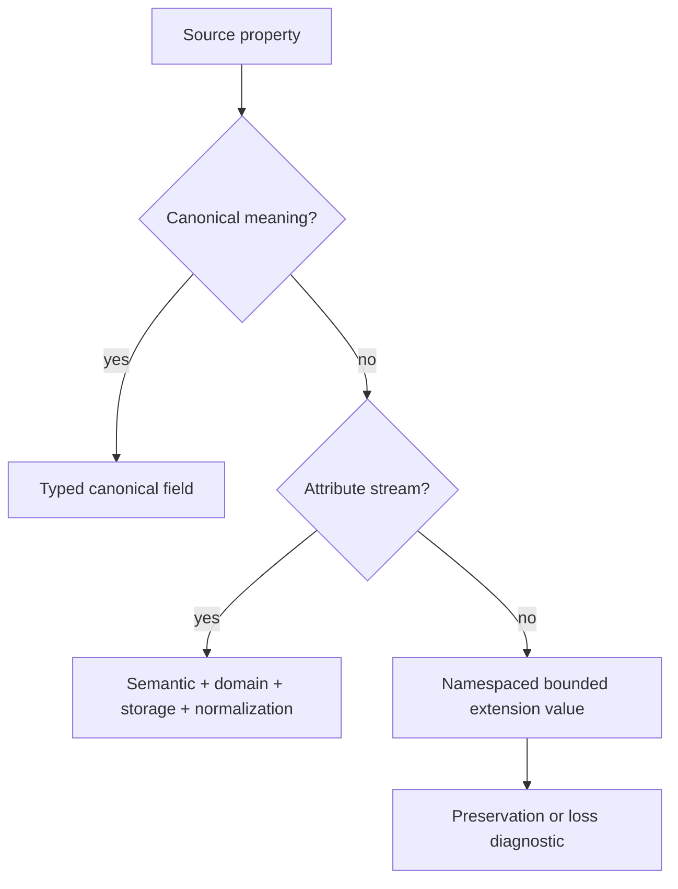

# ADR 0023: Material and Custom Attribute Extension Model

## Context

Stable cross-format concepts need typed fields, while PLY properties, glTF extension attributes,
OBJ/MTL keys, and future formats need bounded preservation. An unrestricted string-to-any map is
easy to add but becomes an unvalidated second schema and hides whether data affects behavior.

## Decision

Baozi uses three extension layers with distinct authority:

1. Canonical typed fields for behavior shared across formats.
2. Typed descriptors for extensible concepts such as texture bindings and custom attributes.
3. Bounded namespaced extension values for source facts that do not yet justify canonical fields.

### Core Key and Value Shape

A `NamespacedKey` is bounded lowercase ASCII `namespace:name` with exactly one separator and non-empty
components. Namespace components may use dots and hyphens; the local name may additionally use
underscores. Leading/trailing separators, empty components, path separators, control characters, and
any non-canonical spelling are invalid. Core validation does not case-fold or otherwise guess a
normalization. Duplicate canonical keys within one owning extension collection are invalid.

Extension values are a closed, size-accounted set: booleans, signed/unsigned integers, finite
`f64`, bounded UTF-8 strings, bounded byte payloads with media type, Baozi vectors/colors/matrices,
and typed dense arrays. Generic extension and metadata values may not contain dense scene IDs,
source handles, provenance-arena IDs, or encoded references to them. Nested arbitrary maps and backend
objects are forbidden. Metadata is descriptive; an extension that changes rendering, topology,
deformation, or animation must use a typed descriptor or be reported as unsupported behavior.

### Declarative Schema Snapshot

`baozi-core` owns a closed, data-only extension schema language. An `ExtensionSchemaId` is the stable
tuple `(namespace, local_schema_id, schema_version)`. A schema may declare only core-understood facts:

- the owner/entity kind and closed value shape;
- attribute domain or other cardinality authority;
- bounded string, byte, array, and nesting limits;
- optional canonical reference kinds and generation qualification;
- central validation rules; and
- ADR 0032 remap and derived-data invalidation obligations.

Schemas cannot contain callbacks, trait objects, backend values, native handles, process-local type
identities, or executable validation/remap code. A behavior-bearing typed descriptor may reference a
canonical ID only through an `ExtensionSchemaId` whose declarative schema names that reference kind,
generation rule, and remap obligation.

Every Scene owns an immutable `ExtensionSchemaSnapshot` containing the exact declarative schemas
required by its retained typed descriptors. Entries are in canonical schema-ID/version order, IDs are
unique, and equal IDs with conflicting bodies are invalid. The snapshot participates in canonical
string/byte/cell budgets, validation traversal, snapshots, and full-value digests. It contains no
registry, importer, codec, or plugin object, so Scene validation and remapping are independent of the
lifetime of any component that originally supplied the schema data.

The central validator proves that every typed descriptor resolves in the Scene-owned snapshot, its
value shape/cardinality/references satisfy that schema, and every referenced dense ID belongs to the
same validated generation. `SceneEdit` applies the declarative remap obligations for all affected
schemas; an operation that cannot preserve or remap a present schema fails before mutation. ADR 0021
is related navigation for how import registries admit and supply schema data; it does not change these
core value, snapshot, validation, or remap semantics.

Custom attributes are not metadata. Each declares a namespaced semantic, scalar component type,
lane count, normalization/encoding, attribute domain, payload representation, and provenance. The
component type preserves signedness and width; PLY `uchar` and `uint`, for example, do not both
become `f32`. Domain cardinality follows ADR 0030.

Promotion from an extension to a canonical typed field removes the duplicate extension on newly
imported scenes in the same breaking change. Conversion tests prove the old source key maps to the
new field without preserving two authorities.

## Considered Options

### Option A: A universal string property bag

It preserves arbitrary input cheaply, but callers cannot discover type, domain, cardinality, or
behavior and the validator cannot bound nested values. Rejected.

### Option B: Add a canonical field for every source property

It provides strong typing but couples core releases to every format and creates producerless fields
with unclear semantics. Rejected.

### Option C: Typed core plus bounded namespaced extensions

It keeps common behavior ergonomic while preserving inspectable source facts under validation.
Chosen.

## Consequences

- Format crates must decide whether a value is behavior, an attribute, descriptive metadata, or
  unsupported loss; dumping everything into metadata is invalid.
- Extension bytes, strings, arrays, keys, and any retained typed-descriptor references are charged
  to import limits and central validation.
- Consumers can ignore unknown namespaces without confusing them with canonical behavior.

## Risks and Mitigations

| Risk | Severity | Mitigation |
| --- | --- | --- |
| Extension bags become a permanent junk drawer | High | Track repeated keys across formats and promote only demonstrated shared semantics. |
| Ambiguous key spelling creates duplicate semantic authorities | High | Require one canonical lowercase key grammar and reject duplicate canonical keys within each owner. |
| Schema snapshot depends on external code or process state | High | Permit only immutable core-owned declarative data; validator and remapper execute no callbacks. |
| Conflicting schema bodies share one identity | High | Require unique canonical schema IDs and reject conflicting bodies during central Scene validation. |
| Schema data bypasses resource evidence | High | Charge snapshot keys, bodies, arrays, and traversal to canonical output and validation budgets. |
| Large arrays bypass attribute budgets | High | Use the same checked storage and domain-cell accounting as canonical attributes. |
| Typed promotion loses round-trip facts | Medium | Require format fixtures comparing source values before deleting the extension mapping. |

## Success Metrics

| Metric | Target | Measurement |
| --- | --- | --- |
| Schema closure | Generic extension decoding has no arbitrary nesting, backend object, or dense-ID variant | public enum/API review and negative construction tests |
| Snapshot closure | every typed descriptor resolves to one unique declarative schema in the Scene-owned snapshot | core validator and digest mutation tests |
| Teardown independence | validation and remapping require no registry, importer, codec, callback, or backend object | core-only construction and edit tests |
| Domain fidelity | Custom payload element counts and scalar widths match their declared domains exactly | PLY and synthetic exact/off-by-one fixtures |
| Promotion uniqueness | A promoted property has one canonical authority in new scenes | source mapping snapshots |

## Acceptance Criteria

- Bare and malformed extension keys fail validation.
- Duplicate canonical keys, duplicate schema IDs, and conflicting schema bodies fail central Scene
  validation.
- Unknown PLY scalar widths and signedness survive in typed custom attributes with exact domain
  counts.
- Nested unbounded maps and backend-owned values cannot enter the public IR.
- Generic extension values cannot hide a dense ID; every typed descriptor reference is centrally
  validated and remapped across generations.
- A Scene containing typed descriptors remains inspectable, validatable, digestible, and editable
  using only its immutable `ExtensionSchemaSnapshot` after every importer/registry object is gone.
- An edit that lacks a required schema remap or invalidation rule fails before changing the input
  generation.
- Every extension allocation and reference participates in resource and scene validation.
- A promotion fixture contains one canonical authority, not both old extension and new field.
