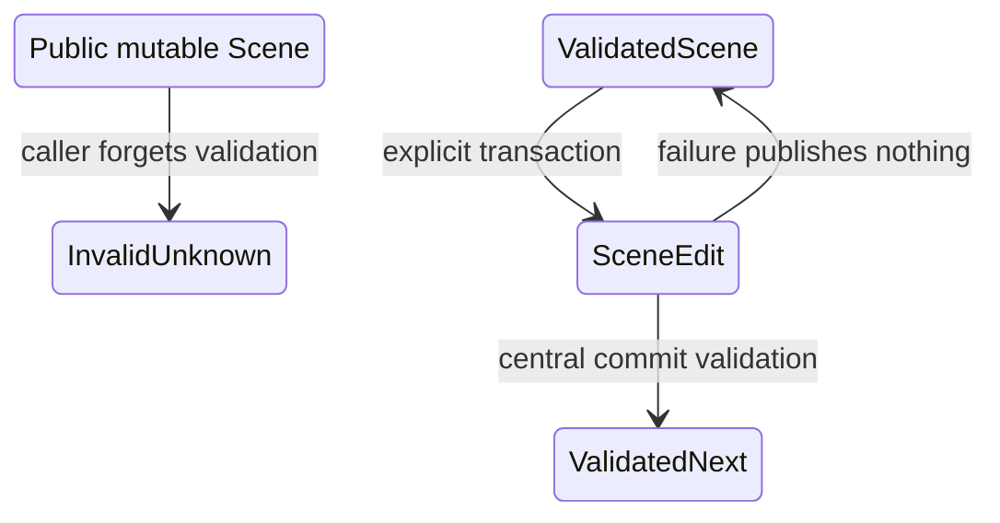

# ADR 0025: Scene IR Invariants and Validation Boundaries

## Context

This ADR previously allowed direct mutation of public `Scene` fields and required callers to
remember `validate_scene` before returning data to Baozi. That made validation a convention rather
than a state property, allowed stale bounds and IDs, and directly contradicted ADR 0003's validated
result contract.

## Supersession Decision

ADR 0045 now owns the opaque construction -> validated generation -> edit boundary. ADR 0032 owns
transactional commit, remap publication, and derived-data invalidation. Direct mutation of a
validated scene is no longer part of the canonical interface.

## Historical Options

### Option A: Public mutation followed by optional validation

This was convenient but made every consumer responsible for proof freshness and was therefore
rejected by the replacement ADRs.

### Option B: No editing after import

This preserves invariants but is unsuitable for asset tools and postprocessing. Rejected.

### Option C: Isolated edits with mandatory commit validation

This is the replacement decision in ADRs 0003 and 0032.

## Consequences

- This ADR is historical and no longer authorizes public mutable collections.
- `validate_scene(&Scene) -> bool/result` may exist as an internal diagnostic primitive, but it does
  not manufacture a public validation proof.
- Compile-fail tests and edit rollback tests replace reliance on caller discipline.

## Residual Risks

| Risk | Severity | Mitigation |
| --- | --- | --- |
| Public fields accidentally recreate unchecked mutation | Critical | Public-API and compile-fail tests enforce read-only validated storage. |
| Internal validation result is mistaken for a public proof | High | Proof construction stays private and only builder finish/edit commit can publish it. |

## Supersession Acceptance

- Governance checks reciprocal supersession links to ADRs 0003 and 0032.
- No accepted ADR normatively depends on this document.
- Mutation rollback tests prove failure, cancellation, and invalid output leave the input generation
  and digest unchanged.
