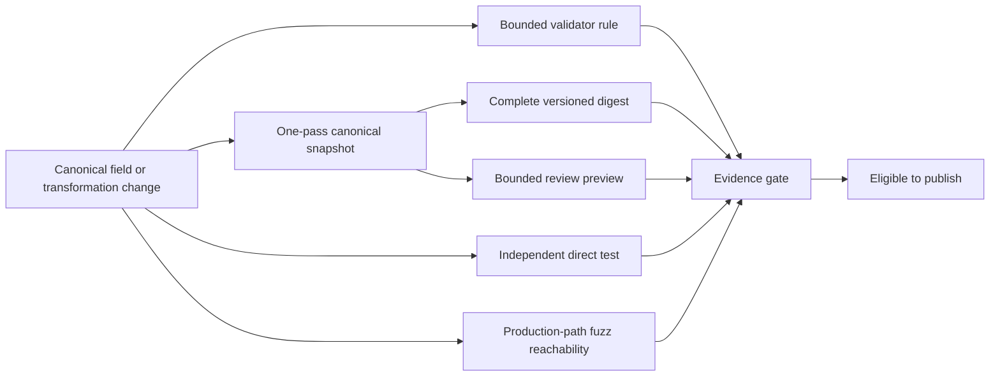

# ADR 0026: Validation, Snapshot, and Fuzz Evidence Contract

## Status and Authority

This accepted ADR is the sole authority for the evidence that must accompany each behavior-bearing
canonical field and transformation result. ADR 0005 owns the broader test portfolio, fixture
provenance, and external-oracle safety policy. ADR 0017 owns the separation between the Rust API,
test snapshots, and future cache schemas. This ADR owns the non-bypassable field evidence contract.

Acceptance defines required architecture, not current completion. Test counts, currently reachable
formats, fuzz campaign results, and pass/fail status belong in verification records rather than this
durable decision.

## Context

Parser output can be structurally plausible while values, references, transforms, domains, or loss
semantics are wrong. Counts and short previews reveal gross shape but do not prove that data beyond
the preview participates in regression evidence. Full normalized text makes every value visible but
can duplicate a hostile-size Scene in memory and produce unreviewable goldens. Fuzz targets can also
create false confidence when they exercise a parser helper instead of the facade/session path or do
not validate successful output.

Baozi therefore needs evidence that is complete for machines, bounded for reviewers, reachable
through production boundaries, and updated atomically with the field it protects.

## Decision

Every new or changed behavior-bearing canonical field must add or update four forms of evidence in
the same implementation unit:

1. **Validator evidence.** A central, bounded rule checks references, domain cardinality, numeric
   validity, ordering, storage shape, and resource limits applicable to the field. Invalid cases have
   stable issue codes and object paths.
2. **Snapshot evidence.** The canonical snapshot traversal includes the complete semantic value in
   a versioned, domain-separated digest and emits a bounded human preview.
3. **Direct evidence.** A focused unit, malformed, property, or independently authored semantic
   expectation proves both a valid value and its most important invalid or lossy boundary.
4. **Reachability evidence.** A production-path fuzz target can mutate the field through the facade,
   import session, validator, or postprocess entry point that publishes it. Every successful fuzz
   result is centrally validated.

A field is not complete because it appears in a struct, count, debug print, parser-private test, or
compile-only fuzz harness. Producerless concepts remain abstract rather than adding concrete public
variants with no way to satisfy this contract.

### Complete Digest Contract

The snapshot schema has an explicit schema version, domain tag, and digest-algorithm identifier.
The digest traversal covers every canonical value exactly once, including omitted-from-preview
values, collection lengths and order, enum discriminants, option presence, integer signedness and
width, string/byte lengths and contents, references, transforms, metadata values, material
properties, embedded payloads, skin matrices and influences, morph data, animation values,
provenance, remaps, losses, and structured diagnostics that belong to the selected snapshot domain.

Encoding is canonical rather than derived from `Debug`, memory layout, or host endianness. Maps use
their specified deterministic key order. Finite floats use a field-defined canonical encoding; any
normalization of signed zero or precision is explicit in the schema and never inherited from a
display epsilon. A change to field encoding, traversal meaning, or digest algorithm requires a
snapshot schema version change and known-vector tests.

Raw import, postprocessed output, validation, and report evidence use distinct domain tags. Equal
bytes in two domains therefore do not create an accidental equivalence claim.

### Bounded Preview and Traversal

Snapshot generation traverses canonical values once and feeds two sinks:

- a constant-state digest sink for complete machine evidence;
- a preview sink capped by configured bytes and per-collection item limits.

Preview truncation is explicit and includes total counts, but it never truncates digest coverage.
The implementation must not construct a full normalized string or clone the Scene. Allocation,
traversal work, optional ordering scratch, output bytes, and cancellation checks are charged before
growth under snapshot-specific limits. Ordering scratch is bounded and documented when canonical
storage does not already provide deterministic order.

Scale tests use 1x, 10x, and 100x inputs, plus selected million-cell or 1000x cases, to prove linear
visit counts, bounded preview text, and auxiliary memory that does not grow with omitted payload
bytes except for explicitly capped ordering scratch.

### Direct and Differential Evidence

Checked-in goldens are review artifacts, not their own only oracle. Critical format semantics have
independently authored expected values or specification-derived fixtures. Importer-generated output
must not be accepted merely by regenerating its snapshot.

Mutation tests alter a value after the visible preview boundary and must change the complete digest.
Direct tests also cover invalid references, non-finite values, domain/count mismatches, unsupported
loss, and budget exhaustion relevant to the field. Tolerated external-oracle differences remain
explicit under ADR 0005 and cannot weaken Baozi's validator or source expectation.

### Fuzz Reachability

Parser fuzz targets invoke the same detection, stable-input session, dependency policy, conversion,
and final validation path used by the facade. Format-private decoder targets may supplement this
coverage but cannot replace it. Generic validation and postprocess targets cover canonical edits or
transformations that no current source format can construct directly.

Fuzz assertions require termination within budgets, no panic/abort/invalid success, bounded failure
evidence, and central validation of every success. Compilation proves harness compatibility; the
declared sanitizer platform and bounded execution campaign provide runtime evidence.

## Alternatives Considered

### Option A: Counts and compact previews only

Pros:

- small, readable snapshots
- inexpensive implementation

Cons:

- mutations outside the preview can remain invisible
- equal shapes can hide wrong transforms, indices, weights, metadata, or animation values
- adding a field can appear covered without its payload entering any oracle

Decision: rejected because shape-compatible semantic regressions remain undetectable.

### Option B: Full normalized text snapshots

Pros:

- every value is directly inspectable
- simple text comparison

Cons:

- duplicates large canonical data and can exceed memory/output budgets
- creates noisy, impractical reviews for large buffers
- couples correctness evidence to display formatting

Decision: rejected as the complete representation. Small focused fixtures may still print all
values inside the same bounded schema.

### Option C: Complete domain-separated digest plus bounded preview

Pros:

- every value affects deterministic machine evidence
- reviewer output and auxiliary memory remain bounded
- schema and domain changes are explicit
- supports large-scale mutation and complexity tests

Cons:

- a digest difference identifies that data changed but the preview may not locate it
- canonical encoding and known vectors require maintenance
- digest evidence must be paired with independent expected values to avoid self-oracles

Decision: chosen.

## Consequences

Positive:

- hidden canonical data cannot silently bypass regression evidence
- snapshot output stays reviewable for large assets
- validators, direct tests, and fuzz reachability evolve with the IR
- successful parser and postprocess fuzz cases cannot publish invalid Scene state

Negative:

- every semantic field has a higher implementation and review cost
- snapshot schema changes require explicit versioning and golden updates
- digest-only differences need focused fixtures or diagnostic tooling for localization

## Risks and Mitigations

| Risk | Severity | Likelihood | Mitigation |
| --- | --- | --- | --- |
| Snapshot code forgets a newly added field | High | Medium | Require the four-evidence checklist in the same change and exhaustive snapshot/validator review at the owning type boundary. |
| Digest schema changes accidentally | High | Medium | Version and domain-separate the encoding; maintain known vectors and cross-platform goldens. |
| Digest collision masks a change | Medium | Very low | Use an admitted collision-resistant algorithm and pair digests with direct semantic expectations. |
| Preview or sorting recreates input-sized memory | High | Medium | Cap both sinks and scratch reservations; enforce million-cell scale and peak-memory tests. |
| Fuzz target exercises only a private parser helper | High | Medium | Require facade/session reachability; treat private targets as supplemental evidence only. |
| Snapshot regeneration becomes the only oracle | High | High | Require specification-derived or independently authored expectations for critical semantics. |
| Compile-only fuzz checks are mistaken for runtime safety | High | Medium | Record sanitizer execution separately and prohibit maturity promotion on compilation alone. |

## Acceptance Criteria

| Contract | Measurable evidence |
| --- | --- |
| Complete coverage | Mutating any selected canonical value, including one beyond the preview limit, changes the domain digest. |
| Schema stability | Known vectors pin schema version, domain tags, type/length encoding, float policy, and digest algorithm. |
| Bounded review output | Million-cell scenes remain within configured preview bytes and do not materialize full normalized text. |
| Linear traversal | 1x/10x/100x scale tests report one bounded visit per encoded value plus documented capped ordering work. |
| Field discipline | Each behavior-bearing field has validator, snapshot, direct, and parser- or generic-reachable fuzz evidence. |
| Invalid-state rejection | Direct and fuzz tests prove invalid references, cardinalities, values, and budgets cannot become successful validated output. |
| Production reachability | Public parser fuzz targets execute detection/session/dependency/finalization boundaries, and every success passes central validation. |
| Oracle independence | Critical supported semantics have source-derived expectations or explicit tolerated-difference records, not only regenerated snapshots. |

## Implementation Evidence

Implementation and verification status change over time. Consult the canonical architecture plan,
test-support snapshot implementation, format/facade test suites, fuzz workspace, and engineering
verification records. Those artifacts demonstrate progress without changing this accepted decision.
