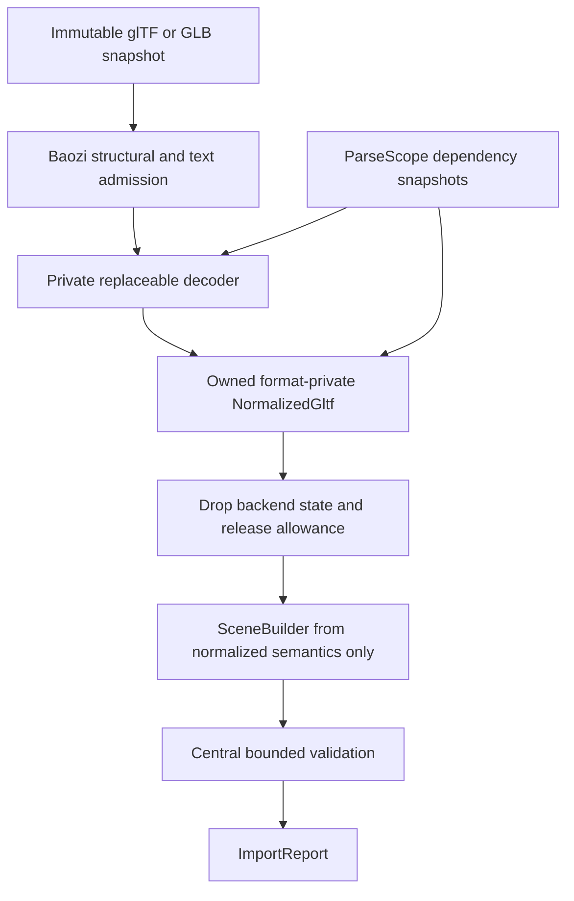

# ADR 0027: glTF Backend Ownership and Replacement Policy

## Context

glTF is broad enough that a bootstrap decoder accelerates useful coverage, but a decoder backend may
allocate before Baozi admission, abort on malformed data, omit source spans, or encode assumptions
that conflict with Baozi's canonical Scene. Translating backend handles directly into SceneBuilder
would spread those assumptions through material, accessor, skin, morph, animation, and extension code,
making replacement a whole-importer rewrite.

The selected backend name, version, and active exceptions are transient implementation evidence kept
in the linked backend research notes, not durable decisions in this ADR.

## Decision

`baozi-format-gltf` owns glTF semantics. Any third-party decoder is a private, replaceable syntax
backend behind Baozi admission and a format-private normalized model. Backend objects, types,
lifetimes, errors, validation messages, and feature flags never cross the format-crate boundary.

Accepted freezes this ownership and replacement boundary. It does not approve any active backend for
Beta/Stable or claim the full normalized pipeline is implemented.

### Required Pipeline

1. `ImportSession` supplies the single immutable primary `.gltf`/GLB snapshot.
2. Baozi performs bounded container/JSON admission before backend entry: magic/version/length, nesting,
   object/array/string/number/token budgets, and strict text profile where applicable.
3. Required and optional buffers/images are requested only through `ParseScope`; the backend receives
   no raw `AssetIo` or host path.
4. Before backend entry, the adapter reserves a conservative opaque-backend allowance through the
   session's `baozi-operation` capability, checks cancellation, then decodes private backend state and
   charges observable work. Post-decode measurement cannot retroactively satisfy this admission gate.
5. Backend state is converted into a bounded owned `NormalizedGltf` model using Baozi-owned IDs,
   stable raw source spans, typed causes, and dependency identities. Where the backend omits spans, a
   Baozi-owned admitted syntax map reconstructs them before backend state may be dropped.
6. Backend objects are dropped as soon as normalization no longer needs them; phase reservations make
   any overlap explicit.
7. Scene construction reads only `NormalizedGltf` plus session-owned immutable dependency snapshots.
8. Central validation, not the backend or format crate, creates the `ValidatedScene` proof.



### Normalized Model Contract

The exact Rust layout is private and may change freely. It must nevertheless represent every admitted
source concept needed by canonical conversion without consulting backend objects:

- document/default scene, every declared scene and root list, node membership, and explicit source
  indices;
- logical meshes and primitives, modes, indices, and accessor contracts;
- buffer, view, accessor, sparse accessor, stride, normalization, and range semantics;
- domain-aware vertex/corner/face attributes and custom semantic identity;
- materials, images, samplers, textures, color-space/use context, and extension payload decisions;
- skins, joints, skeleton roots, inverse bind matrices, and space conventions;
- morph targets, mesh defaults, node overrides, animations, samplers/channels, interpolation, and
  `f64` source times;
- source spans, aliases, synthetic/defaulted values, and loss/provenance facts; and
- unsupported required/optional extension disposition.

It stores Baozi-owned values or checked references to session-owned immutable snapshots. It cannot
store decoder-backend handles, backend indices without explicit source identity, hidden IO closures,
or borrowed memory whose lifetime requires retaining the backend graph.

Scene construction is a separately testable normalized-model consumer. Its module may import glTF
format-owned model/types and core `SceneBuilder`, but must not import, name, or accept a decoder-backend
module/type. A hand-built normalized fixture must exercise it without invoking the backend. Backend
drop and opaque-allowance release occur before builder entry; any intentionally retained primary or
dependency snapshot remains separately reserved, so the peak records real overlap without charging a
released backend allowance.

Stable source range means a raw byte range into the immutable primary or dependency snapshot, not a
backend object path or decoded character offset. If a claimed semantic or diagnostic cannot obtain a
stable range from the backend or the Baozi syntax map, that backend slice is inadmissible for the
claim; "span unavailable" is not a silent normalized-model fallback.

Accessors are admitted before materialization: checked offset/stride/count/component arithmetic,
buffer-range bounds, sparse indices/values, normalized conversion, and output cell/byte reservation.
Unsupported core semantics are fatal. Optional extension or resource loss is allowed only when the
format contract and caller loss policy authorize it, with a diagnostic and loss record.

### Source Scene Projection

ADR 0039 owns the generic source-scene selection and import-closure contract. For glTF, the
format-owned typed options expose an explicit selection by declared scene index or
`DocumentDefault`. `DocumentDefault` selects the document's declared default, selects the sole
declared scene when there is exactly one, and fails with a typed selection-required error when two or
more scenes exist without a default. It never falls back to scene index zero.

When a document declares no scenes, the adapter selects all validated parentless nodes as projection
roots and records `ParentlessNodeProjection`; the required synthetic canonical root then owns those
roots exactly as it does for a declared scene. For a declared scene, the selected roots and their
descendants define the structural closure. Only
resources reachable from that closure enter the canonical Scene. Skin joints and skeleton roots must
remain within the selected closure; a cross-selection skin reference fails rather than importing an
extra node or silently changing the hierarchy. Animation clips with target channels outside the
closure either fail or omit only the authorized channels with stable loss and provenance records.
Shared source nodes are never cloned merely because they are listed in an unselected scene.
Every projection receives one identity-TRS synthetic canonical root with generated scene-level
provenance; selected source roots are its ordered children as required by ADR 0039.

### glTF Node Transform Admission

A glTF node uses either `matrix` or any subset of TRS properties, never both. An authored matrix must
be finite, affine, decomposable as translation, rotation, and scale under ADR 0008, and contain no
skew or shear; decomposition is an admission check and does not replace the preserved authored
`Matrix` form. Omitted TRS properties materialize to translation zero, rotation identity, and scale
one while the canonical node remains authored `Trs`.

Any animation channel targeting translation, rotation, or scale requires a TRS-authored node. A
matrix-authored target, a matrix/TRS combination, or a matrix that fails the decomposability and
no-shear rules is a hard glTF conformance error before canonical construction; the adapter does not
silently decompose, repair, or loss-authorize those invalid glTF cases.

The glTF predicate is Baozi-owned and independent of `gltf-rs::Transform::decomposed`. The affine
bottom row must compare exactly to `[0, 0, 0, 1]` before canonical construction; the adapter does not
recover or normalize a near-affine glTF matrix. For the remaining decomposition/no-shear predicate,
it promotes each finite authored `f32` cell exactly to `f64` and evaluates products and sums in fixed
x/y/z order without fused `mul_add`. The frozen constant is:

```text
ORTHOGONAL_REL_TOLERANCE = 64 * f32::EPSILON
```

For column-major matrix `m`, affine admission requires `m[0][3]`, `m[1][3]`, and `m[2][3]` to compare
exactly to zero and `m[3][3]` to compare exactly to one. Signed zero is accepted and preserved. Let
`c0`, `c1`, and `c2` be the three spatial columns. Every pair of nonzero columns must satisfy the
inclusive squared test
`dot(ci, cj)^2 <= ORTHOGONAL_REL_TOLERANCE^2 * norm2(ci) * norm2(cj)`. An exactly zero column is a
valid zero scale and requires no normalization; a near-zero nonzero column uses the same relative
test and is never coerced to zero.

This predicate defines Baozi's accepted floating-point representation of decomposable `R * S`
columns without choosing a decomposition. Consequently one, two, or three zero scales are valid, and
a negative determinant/reflection is valid because glTF permits negative scale. The predicate neither
rejects determinant zero nor chooses an axis to carry a negative sign. The authored matrix cells,
including signed zero, remain unchanged.
Raw admission rejects matrix plus any TRS property before the backend accessor can hide that
combination; the complete animation-reference pass rejects every matrix-authored target.

### Backend Admission and Maturity

A backend version/path is admissible only while it satisfies:

- license, MSRV, supported-target, WASM, unsafe/FFI, and dependency policy;
- bounded preflight before attacker-controlled large allocation;
- no abort or uncaught panic on admitted malformed inputs in Linux sanitizer fuzzing;
- enough source identity/span information for stable Baozi diagnostics or a Baozi-owned layer that
  reconstructs it safely;
- operation/budget hooks or a declared conservative allowance plus subprocess RSS/timeout evidence;
- strict glTF UTF-8/JSON behavior under ADR 0035; and
- conformance fixtures for every feature claimed in the support matrix.

Compiling a fuzz target is not runtime evidence. A failure of the bounded-memory, bounded-work,
panic/abort, required-semantics, or strict-decoding admission gates disables and unregisters the
affected backend slice, rejects/replaces it, or moves it behind an admitted non-first-party process
boundary. Experimental maturity cannot keep a baseline-unsafe slice reachable through the first-party
format or `all-formats`.

An opaque call without a mid-call cancellation checkpoint may remain Experimental only when Baozi's
preflight proves a strict finite input, work, and memory envelope and polls immediately before and
after entry. If that finite envelope cannot be enforced, the path fails admission. Once baseline
safety passes, incomplete semantic breadth, sustained campaign history, independent oracle evidence,
or packaging evidence may retain Experimental maturity under ADR 0011.

### Replacement Triggers

| Trigger | Required response |
| --- | --- |
| Allocation/recursion occurs before Baozi admission | Disable and unregister the slice until it is wrapped/preflighted, privately isolated, or replaced. |
| Malformed admitted input aborts or escapes panic containment | Disable and unregister the path, then replace/harden and rerun the sanitizer admission gate. |
| Required glTF 2.0 core semantics cannot reach `NormalizedGltf` | Replace or implement the affected decoder slice. |
| Diagnostics or claimed normalized semantics cannot recover stable raw source identity/range | Add Baozi-owned syntax mapping or replace the slice; do not silently omit the range. |
| License/MSRV/WASM/unsafe/maintenance gate fails | Keep the last admitted closure pinned; if none remains, disable/unregister or replace before first-party use. |
| Backend types or assumptions leak beyond the adapter | Refactor immediately; leakage is an architectural defect, not compatibility. |

Replacement may rewrite all internals of `baozi-format-gltf`. It must preserve the normalized semantic
and facade conformance suite, not reproduce backend quirks. `repo-ref/` is study material, never public
API or an automatic vendoring source; clean-room and license obligations still apply.

## Alternatives Considered

### Option A: Make the bootstrap decoder the public glTF and Scene model

This provides quick access to advanced fields but freezes upstream ownership, lifetimes, validation,
and release cadence into Baozi. Rejected.

### Option B: Translate directly from backend objects into canonical Scene

This avoids an intermediate model but interleaves backend quirks with canonical conversion and makes
partial replacement expensive. Rejected.

### Option C: Private backend plus Baozi-owned normalized model

This incurs temporary peak memory and adapter work, but creates a testable semantic firewall and lets
decoder slices be replaced independently. Chosen.

## Consequences

Positive:

- Backend replacement does not change public API or canonical IR.
- glTF-specific defaults, extension decisions, and provenance have one owner.
- Admission, diagnostics, and resource behavior follow the same session contract as other formats.
- Conformance tests target normalized semantics rather than dependency quirks.

Negative:

- Backend and normalized models may overlap temporarily and must be peak-live budgeted.
- Baozi owns more glTF semantic validation than a thin wrapper would.
- Some backend convenience APIs cannot be used because they perform hidden IO or allocation.

## Risks and Mitigations

| Risk | Severity | Mitigation |
| --- | --- | --- |
| Normalized model merely mirrors backend types | High | Baozi-owned IDs/contracts and backend-leak symbol/dependency tests. |
| Backend allocates/aborts before preflight | Critical | Disable/unregister until structural admission and sanitizer/RSS gates pass; an opaque allowance alone is insufficient. |
| Intermediate overlap exceeds memory | High | Phase reservations, prompt backend drop, and peak-live scale tests. |
| Replacement changes semantic output silently | High | Backend-independent normalized and canonical golden/conformance suite. |
| Optional extension data is silently lost | High | Required/optional extension disposition plus explicit diagnostic/loss policy. |

## Acceptance Criteria

| Contract | Testable acceptance |
| --- | --- |
| Backend privacy | Public API, rustdoc, snapshots, reports, diagnostics, and core IR contain no backend type/name dependency. |
| IO authority | Instrumented tests prove every external buffer/image request goes through `ParseScope` and policy. |
| Normalized firewall | Scene construction tests run from a backend-independent normalized fixture; dependency/lint checks prove builder code imports no backend module or type. |
| Backend lifetime | Drop instrumentation proves backend state and opaque allowance are gone before SceneBuilder entry, while snapshot/model/builder overlap remains visible in peak-live evidence. |
| Source mapping | Backend-provided and Baozi-reconstructed spans both resolve to stable raw ranges; a fixture with unavailable required ranges fails before canonical construction. |
| Admission | Oversized/deep/dense JSON, invalid GLB lengths, accessor overflow, and sparse ranges fail before unsafe allocation/materialization. |
| Admission versus maturity | A baseline-unsafe backend slice is absent from first-party registration/all-formats, while fixtures with only missing non-safety evidence remain eligible for Experimental. |
| Semantic breadth | Fixtures cover multi-primitive meshes, attributes, material/texture sharing, skins, morphs, and animations through normalized and facade layers. |
| Scene projection | Multi-scene fixtures prove default, explicit, missing-default, shared-root, skin, and animation-closure behavior with source-scope evidence. |
| Node transforms | Matrix/TRS mutual exclusion, exact affine bottom-row fixtures including signed zero and next-representable nonzero/away-from-one rejection, orthogonality fixtures at 0.5x, exactly 1x inclusive, the next representable value above 1x, and 2x the threshold, one/two/three zero scales, nonzero near-zero scales, odd/even negative scales, matrix decomposability/no-shear, omitted TRS defaults, bit-preserving authored-form retention, backend-independent classification, and matrix-target animation rejection have positive and negative fixtures. |
| Replacement equivalence | Any alternate backend passes identical normalized-model and canonical golden/digest tests. |
| Maturity truthfulness | Linux sanitizer and subprocess RSS/timeout gates execute before promotion; compile-only evidence cannot satisfy them. |
