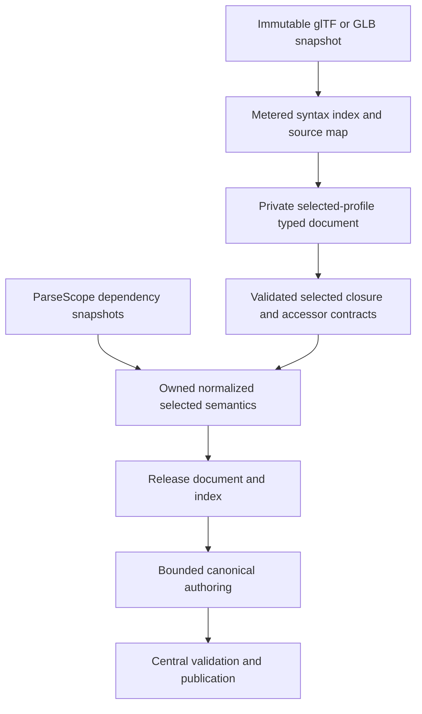

# ADR 0027: glTF Backend Ownership and Replacement Policy

## Context

The owning gltf-rs decoder required an opaque input-byte expansion allowance and a maintained
pair of distribution packages. That allowance did not bind every input-controlled collection,
escaped string and validation temporary to its actual owner. The selected profile already has
explicit source ranges, accessor contracts, selected closure and a normalized submission seam.
Owning that bounded document directly closes the allocation gap without replacing the canonical
Scene or expanding the supported glTF profile.

## Decision

`baozi-format-gltf` owns a private selected-profile document over the immutable primary snapshot.
The iterative JSON scanner builds one admitted structural index and the raw source map. Typed
tables and nested collections use existing metered storage; raw JSON/BIN and unescaped strings
borrow the snapshot. Escaped strings decode once after their capacity is admitted. There is no
owning generic JSON Value tree, global allocator context, opaque byte multiplier or legacy decoder
feature. The maintained `baozi-gltf` and `baozi-gltf-json` production paths are removed at cutover.

Schema/default/enum/reference validation is global where the source format requires it. Selected
payload interpretation, dependencies, losses, accessor layouts and normalized semantics retain
one format-owned authority. The document does not become a second semantic importer. Its views,
indices, errors and lifetimes remain private; public consumers use canonical Baozi types.

### Required Pipeline

1. `ImportSession` supplies the single immutable primary `.gltf`/GLB snapshot.
2. Bounded container/JSON admission validates framing, strict text, nesting, tokens and ranges
   while building the structural index and source inventory through admitted storage.
3. Typed document decoding admits every input-controlled allocation before it grows. Collection
   and escaped-string owners carry their charges until destruction; getters borrow and allocate
   nothing. Syntax/index lookup does not repeatedly reparse full JSON objects.
4. Global document checks precede selected closure and payload contracts. Only selected buffers
   and images enter dependency IO, through `ParseScope`; the document has no host path or raw IO.
5. Accessor readers bind checked dense/sparse layouts to immutable buffer slices. Normalization
   copies selected semantics into the existing bounded `NormalizedGltf` model and source profile.
6. Prepared handles, typed document, structural index and their charges are released before
   canonical submission. Retained snapshots and normalized data keep their independent owners.
7. Scene construction reads normalized semantics and admitted immutable resource ranges only.
8. Central validation creates the `ValidatedScene` proof and controls publication.



Acceptance freezes this ownership boundary. It does not assign Beta/Stable maturity, claim full
glTF conformance or qualify unexecuted targets.

### Normalized Model Contract

The exact Rust layout is private and may change freely. It must nevertheless represent every admitted
source concept needed by canonical conversion without consulting backend objects:

- document/default scene, every declared scene and root list, node membership, and explicit source
  indices;
- logical meshes and primitives, modes, indices, and accessor contracts;
- buffer, view, accessor, sparse accessor, stride, normalization, and range semantics;
- domain-aware vertex/corner/face attributes and custom semantic identity;
- materials, images, samplers, textures, color-space/use context, and extension payload decisions;
- skins, joints, skeleton roots, inverse bind matrices, and space conventions;
- morph targets, mesh defaults, node overrides, animations, samplers/channels, interpolation, and
  `f64` source times;
- source spans, aliases, synthetic/defaulted values, and loss/provenance facts; and
- unsupported required/optional extension disposition.

It stores Baozi-owned values or checked references to session-owned immutable snapshots. It cannot
store decoder-backend handles, backend indices without explicit source identity, hidden IO closures,
or borrowed memory whose lifetime requires retaining the backend graph.

The selected-scene model need not copy the complete unselected decoder graph. The admitted immutable
primary snapshot and its typed raw-range inventory retain declarations outside the selected closure;
the source-scope record retains their selected/omitted disposition. Canonical construction reads owned
selected semantics and session snapshot references only. Source arrays keep their original ordinals,
including parent-qualified primitive and animation-channel/sampler ordinals, independently of dense
canonical table order. This permits dropping the backend without materializing unrelated resources.

The same bounded JSON scanner that admits syntax builds this raw-range inventory. A second JSON
document tree or backend-message parser is unnecessary. Selected unsupported `extras` or extension
payloads must receive an explicit profile decision before dependency IO, even when the decoder would
discard them. A supported extension at an unsupported owner/site is not silently accepted. Missing
required entity ranges fail before canonical construction.

Scene construction is a separately testable normalized-model consumer. Its module may import glTF
format-owned model/types and borrow core's bounded authoring capability, but must not import, name, or
accept a decoder-backend module/type. A hand-built normalized fixture must exercise it without
invoking document decoding. Document/index destruction occurs before canonical authoring; any
retained primary or dependency snapshot remains separately admitted, so peak-live evidence records
actual overlap without retaining a decoder allowance.

Stable source range means a raw byte range into the immutable primary or dependency snapshot, not a
backend object path or decoded character offset. If a claimed semantic or diagnostic cannot obtain a
stable range from the backend or the Baozi syntax map, that backend slice is inadmissible for the
claim; "span unavailable" is not a silent normalized-model fallback.

Accessors are admitted before materialization: checked offset/stride/count/component arithmetic,
buffer-range bounds, sparse indices/values, normalized conversion, and output cell/byte reservation.
Unsupported core semantics are fatal. Optional extension or resource loss is allowed only when the
format contract and caller loss policy authorize it, with a diagnostic and loss record.

### Source Scene Projection

ADR 0039 owns the generic source-scene selection and import-closure contract. For glTF, the
format-owned typed options expose an explicit selection by declared scene index or
`DocumentDefault`. `DocumentDefault` selects the document's declared default, selects the sole
declared scene when there is exactly one, and fails with a typed selection-required error when two or
more scenes exist without a default. It never falls back to scene index zero.

When a document declares no scenes, the adapter selects all validated parentless nodes as projection
roots and records `ParentlessNodeProjection`; the required synthetic canonical root then owns those
roots exactly as it does for a declared scene. For a declared scene, the selected roots and their
descendants define the structural closure. Only
resources reachable from that closure enter the canonical Scene. Skin joints and skeleton roots must
remain within the selected closure; a cross-selection skin reference fails rather than importing an
extra node or silently changing the hierarchy. Animation clips with target channels outside the
closure either fail or omit only the authorized channels with stable loss and provenance records.
Shared source nodes are never cloned merely because they are listed in an unselected scene.
Every projection receives one identity-TRS synthetic canonical root with generated scene-level
provenance; selected source roots are its ordered children as required by ADR 0039.

### glTF Node Transform Admission

A glTF node uses either `matrix` or any subset of TRS properties, never both. An authored matrix must
be finite, affine, decomposable as translation, rotation, and scale under ADR 0008, and contain no
skew or shear; decomposition is an admission check and does not replace the preserved authored
`Matrix` form. Omitted TRS properties materialize to translation zero, rotation identity, and scale
one while the canonical node remains authored `Trs`.

Any animation channel targeting translation, rotation, or scale requires a TRS-authored node. A
matrix-authored target, a matrix/TRS combination, or a matrix that fails the decomposability and
no-shear rules is a hard glTF conformance error before canonical construction; the adapter does not
silently decompose, repair, or loss-authorize those invalid glTF cases.

The glTF predicate is Baozi-owned and independent of `gltf-rs::Transform::decomposed`. The affine
bottom row must compare exactly to `[0, 0, 0, 1]` before canonical construction; the adapter does not
recover or normalize a near-affine glTF matrix. For the remaining decomposition/no-shear predicate,
it promotes each finite authored `f32` cell exactly to `f64` and evaluates products and sums in fixed
x/y/z order without fused `mul_add`. The frozen constant is:

```text
ORTHOGONAL_REL_TOLERANCE = 64 * f32::EPSILON
```

For column-major matrix `m`, affine admission requires `m[0][3]`, `m[1][3]`, and `m[2][3]` to compare
exactly to zero and `m[3][3]` to compare exactly to one. Signed zero is accepted and preserved. Let
`c0`, `c1`, and `c2` be the three spatial columns. All three must be nonzero, counting signed zero
as zero. Every pair of columns must satisfy the
inclusive squared test
`dot(ci, cj)^2 <= ORTHOGONAL_REL_TOLERANCE^2 * norm2(ci) * norm2(cj)`. A near-zero nonzero column
uses the same relative test and is never coerced to zero.

This predicate defines Baozi's accepted floating-point representation of decomposable `R * S`
columns without choosing a decomposition. A negative determinant/reflection remains valid because
glTF permits negative scale; the predicate does not choose an axis to carry a negative sign. Zero
scales remain valid through authored TRS and may produce singular derived transforms, but the
current pinned glTF node-matrix contract prohibits a zero spatial column. Canonical matrices and
inverse binds keep their distinct existing validation. Accepted authored matrix cells, including
signed zero, remain unchanged.
Raw admission rejects matrix plus any TRS property before the backend accessor can hide that
combination; the complete animation-reference pass rejects every matrix-authored target.

### Backend Admission and Maturity

A backend version/path is admissible only while it satisfies:

- license, MSRV, supported-target, WASM, unsafe/FFI, and dependency policy;
- bounded preflight before attacker-controlled large allocation;
- no abort or uncaught panic on admitted malformed inputs in Linux sanitizer fuzzing;
- enough source identity/span information for stable Baozi diagnostics or a Baozi-owned layer that
  reconstructs it safely;
- pre-allocation metering at each input-controlled owner, with bounded work and cancellation;
- strict glTF UTF-8/JSON behavior under ADR 0035; and
- conformance fixtures for every feature claimed in the support matrix.

Compiling a fuzz target is not runtime evidence. A failure of the bounded-memory, bounded-work,
panic/abort, required-semantics, or strict-decoding admission gates disables and unregisters the
affected backend slice, rejects/replaces it, or moves it behind an admitted non-first-party process
boundary. Experimental maturity cannot keep a baseline-unsafe slice reachable through the first-party
format or `all-formats`.

Missing semantic breadth, sustained campaign history, independent oracle evidence or packaging
evidence may retain Experimental maturity after baseline safety passes. An opaque allowance is
not an alternative to owner-bound allocation admission in the selected-profile document.

### Replacement Triggers

| Trigger | Required response |
| --- | --- |
| Allocation/recursion occurs before Baozi admission | Disable and unregister the slice until it is wrapped/preflighted, privately isolated, or replaced. |
| Malformed admitted input aborts or escapes panic containment | Disable and unregister the path, then replace/harden and rerun the sanitizer admission gate. |
| Required glTF 2.0 core semantics cannot reach `NormalizedGltf` | Replace or implement the affected decoder slice. |
| Diagnostics or claimed normalized semantics cannot recover stable raw source identity/range | Add Baozi-owned syntax mapping or replace the slice; do not silently omit the range. |
| License/MSRV/WASM/unsafe/maintenance gate fails | Keep the last admitted closure pinned; if none remains, disable/unregister or replace before first-party use. |
| Backend types or assumptions leak beyond the adapter | Refactor immediately; leakage is an architectural defect, not compatibility. |

Replacement may rewrite all internals of `baozi-format-gltf`. It must preserve the normalized semantic
and facade conformance suite, not reproduce backend quirks. `repo-ref/` is study material, never public
API or an automatic vendoring source; clean-room and license obligations still apply.

## Alternatives Considered

### Option A: Make the bootstrap decoder the public glTF and Scene model

This provides quick access to advanced fields but freezes upstream ownership, lifetimes, validation,
and release cadence into Baozi. Rejected.

### Option B: Translate directly from backend objects into canonical Scene

This avoids an intermediate model but interleaves backend quirks with canonical conversion and makes
partial replacement expensive. Rejected.

### Option C: Private backend plus Baozi-owned normalized model

This incurs temporary peak memory and adapter work, but creates a testable semantic firewall and lets
decoder slices be replaced independently. Chosen.

## Consequences

Positive:

- Backend replacement does not change public API or canonical IR.
- glTF-specific defaults, extension decisions, and provenance have one owner.
- Admission, diagnostics, and resource behavior follow the same session contract as other formats.
- Conformance tests target normalized semantics rather than dependency quirks.

Negative:

- Backend and normalized models may overlap temporarily and must be peak-live budgeted.
- Baozi owns more glTF semantic validation than a thin wrapper would.
- Some backend convenience APIs cannot be used because they perform hidden IO or allocation.

## Risks and Mitigations

| Risk | Severity | Mitigation |
| --- | --- | --- |
| Normalized model merely mirrors backend types | High | Baozi-owned IDs/contracts and backend-leak symbol/dependency tests. |
| Backend allocates/aborts before preflight | Critical | Disable/unregister until structural admission and sanitizer/RSS gates pass; an opaque allowance alone is insufficient. |
| Intermediate overlap exceeds memory | High | Metered owners, prompt document/index release, and peak-live scale tests. |
| Replacement changes semantic output silently | High | Backend-independent normalized and canonical golden/conformance suite. |
| Optional extension data is silently lost | High | Required/optional extension disposition plus explicit diagnostic/loss policy. |

## Acceptance Criteria

| Contract | Testable acceptance |
| --- | --- |
| Backend privacy | Public API, rustdoc, snapshots, reports, diagnostics, and core IR contain no backend type/name dependency. |
| IO authority | Instrumented tests prove every external buffer/image request goes through `ParseScope` and policy. |
| Normalized firewall | Scene construction tests run from a backend-independent normalized fixture; dependency/lint checks prove canonical authoring code imports no backend module or type. |
| Backend lifetime | Drop/ledger regressions prove document and index owners are gone before canonical authoring, while snapshot/model/construction overlap remains visible in peak-live evidence. |
| Source mapping | Backend-provided and Baozi-reconstructed spans both resolve to stable raw ranges; a fixture with unavailable required ranges fails before canonical construction. |
| Admission | Oversized/deep/dense JSON, invalid GLB lengths, accessor overflow, and sparse ranges fail before unsafe allocation/materialization. |
| Admission versus maturity | A baseline-unsafe backend slice is absent from first-party registration/all-formats, while fixtures with only missing non-safety evidence remain eligible for Experimental. |
| Semantic breadth | Fixtures cover multi-primitive meshes, attributes, material/texture sharing, skins, morphs, and animations through normalized and facade layers. |
| Scene projection | Multi-scene fixtures prove default, explicit, missing-default, shared-root, skin, and animation-closure behavior with source-scope evidence. |
| Node transforms | Matrix/TRS mutual exclusion, exact affine bottom-row fixtures including signed zero and next-representable nonzero/away-from-one rejection, orthogonality fixtures at 0.5x, exactly 1x inclusive, the next representable value above 1x, and 2x the threshold, rejected zero matrix columns versus accepted zero TRS scales, nonzero near-zero scales, odd/even negative scales, matrix decomposability/no-shear, omitted TRS defaults, bit-preserving authored-form retention, backend-independent classification, and matrix-target animation rejection have positive and negative fixtures. |
| Replacement equivalence | Any alternate backend passes identical normalized-model and canonical golden/digest tests. |
| Maturity truthfulness | Linux sanitizer and subprocess RSS/timeout gates execute before promotion; compile-only evidence cannot satisfy them. |

## Amendment History

### 2026-11-02: Admit quantization through the shared accessor authority

- `KHR_mesh_quantization` adds only its finite base and POSITION/NORMAL/TANGENT morph
  component tuples. One encoding classifier serves global declaration checks and selected
  interpretation. Both required/used declarations are checked, including referenced extra
  encodings in omitted meshes, without acquiring their omitted buffers.
- One dense/sparse merge yields both stored and normalized values. Source-domain bounds are
  validated before narrowing and observed in the existing materialization traversal, including
  optional influence bounds. Pure implicit-zero descriptors retain the core exception. The exact
  rational normalized-conversion rule below is unchanged; directions are not silently normalized.
- Short-component vertex bases and distinct accessors sharing a vertex view require explicit
  stride under the pinned core text. Sparse values remain tightly packed and component-aligned.
  Global buffer-view schema range errors remain document failures; selected encoding/layout/
  bounds errors identify the accessor. Count/paired-set and influence-sum semantics retain their
  own existing failure owner.
- Canonical geometry remains F32, with one authoring path. Node transforms, inverse binds and
  texture transforms supply authored dequantization once; the importer adds no bake, quantized
  Scene representation, UV/color morph support or extra decoder. The exact matrix and execution
  scope belong to the [profile](../formats/gltf.md) and evolution execution record.

### 2026-11-02: Own the core numeric and absence contracts explicitly

- Node-matrix admission adopts Transformations at Khronos commit
  `59ecbdba704206bb656965ab4e202881806066f1`, including its nonzero spatial-column rule. This
  supersedes this ADR's earlier allowance for degenerate matrix-authored transforms under the
  published 2021 decomposability wording. It does not rewrite that historical source, prohibit
  explicit zero TRS scales, tighten inverse binds or alter format-independent canonical matrices.
  The frozen orthogonality tolerance above is Baozi's interpretation of qualitative closeness,
  not a threshold prescribed by Khronos. The actual format owner must enforce it globally.
- Schema optionality means an absent member. Authored `null` does not become a default or an
  absent reference where the field schema requires another type. Exact raw `extras: null` remains
  descriptive source metadata. Obsolete decoder null-as-absence behavior and its tests are removed.
- Unsigned schema integers are interpreted exactly from admitted decimal/exponent spellings,
  including zero fractional parts, cancellation of decimal scale and mathematical negative zero.
  Fractional/negative nonzero values fail without F64 rounding or underflow-to-zero acceptance;
  U64 storage, U32 references and host/resource limits remain explicit Baozi domains.
- A missing accessor view and sparse descriptor provides implicit zeros. It still obeys positive
  logical count, type, byte/work/storage admission and applicable semantic rules. An authored
  `byteOffset` requires a view. Pure implicit-zero descriptors have the core's min/max exception;
  stored dense/sparse morph positions retain their actual-data bounds check.
- Core animation channels without a node are ignored without inventing node zero or requiring
  semantic-loss permission. Global structure/references and unsupported target-mechanism checks
  remain; ignored-only resources, duration and canonical channels are not introduced. Source
  ordinals of later retained channels remain unchanged.
- Decoded normalized integer components equal round-to-nearest, ties-to-even F32 of the exact
  UNORM/SNORM rational, clamping signed minima before division. F64 division followed by one F32
  cast realizes this rule for the bounded 8/16-bit operands; it is shared by accessor and influence
  reads. This is a stronger Baozi numeric contract, not a claim that every one-ULP reference-loader
  difference violates Khronos' at-least-32-bit conversion guidance. Independent literal witnesses
  and per-engine observations remain separate.

### 2026-11-01: Admit typed unlit and make optional declaration evidence precise

- Selected material-level `KHR_materials_unlit` objects map to the existing closed Unlit shading
  enum. Their declaration, raw shape, site and supported properties are checked before dependency
  IO. The existing selected material contract carries shading with texture contracts into owned
  normalized rows; canonical authoring uses no backend handle or new core material representation.
- Original PBR fallback factors, all five core texture slots and their forward resource/provenance
  closure remain retained. Source-object unlit extras use existing exact JSON metadata storage.
- Unsupported required extensions fail globally; unsupported selected payloads fail even with
  `SourceSemanticLoss` opt-in. A future fallback must define its schema-owned mapping before caller
  loss authority can apply. Unknown optional declarations without retained payloads produce only
  `gltf.extension_uninterpreted_declaration` after selected-payload checks, replacing the inaccurate
  payload-omission claim. No generic lossy fallback registry is introduced.
- The maintained backend's existing unlit feature admits its required name to backend validation.
  The admission source map still owns original payload ranges and unsupported direct properties;
  an empty backend struct cannot silently discard those properties.
- The [execution plan](../plans/2026-11-01-008-feat-gltf-unlit-materials-plan.md) owns qualification.

### 2026-10-29: Own selected meaning and retain admitted source ranges

- Affected: `Normalized Model Contract` and the executed backend firewall.
- New: the format-private model owns selected semantic tables, names, weights, payloads, and the
  admission scanner's original source-range inventory. Unselected declarations may remain checked
  ranges into the immutable primary snapshot. Backend handles and their opaque allowance end before
  canonical authoring. Encoded resource bytes that are no longer needed are released at normalization.
- Rationale: duplicating every unselected backend object creates cost without changing the selected
  Scene. Reusing the syntax scanner preserves original identity and bytes without another parser.
- Impact: a handwritten model fixture exercises canonical authoring without invoking the backend.
  Source mapping, malformed payload, sanitizer, and independent consumer execution still establish
  the implemented profile; this amendment alone does not admit the format.

### 2026-10-29: Maintain demonstrated validator corrections at the backend

- Affected: `Decision`, with the `Maintained Backend Corrections` subsection.
- New: a narrow maintained source package is permitted when its corrected dependency closure is
  preserved in independent workspaces and packaged manifests. Direct backend tests establish the
  corrected behavior; the original licenses and change inventory remain beside the source.
- Rationale: POSITION index validation and camera projection-discriminator defects belong in the
  validator. Another pre-validation framework would duplicate that responsibility.
- Impact: no facade registration or sanitizer qualification follows from installation. The existing
  format-private ownership, IO, normalization, source identity, and admission requirements remain.

### 2026-08-01: Align the normalized firewall with opaque canonical construction

- Affected: `Context`, `Decision`, `Normalized Model Contract`, and `Acceptance Criteria`.
- Previous: the backend firewall handed normalized semantics to a named core `SceneBuilder` seam.
- New: the import session retains the opaque core construction continuation and glTF conversion
  borrows only its bounded authoring capability after backend state and allowance are released.
- Impact: backend replacement remains format-private while canonical storage ownership and
  finalization cannot leak into the adapter.
- Review: 2026-08-01 fixed-range architecture and glTF ownership review.
- Rationale: the normalized firewall is unchanged; this amendment aligns its downstream seam with
  ADR 0003 and ADR 0020's single canonical lifecycle.
