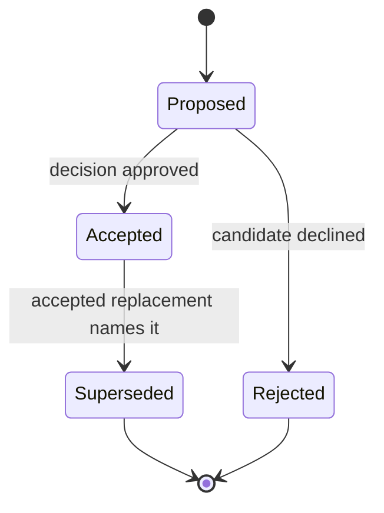

# ADR 0028: ADR Lifecycle and Evidence Governance

## Context

Baozi is making breaking architectural decisions before its first stable release. The repository
already contains plans, research, progress records, implementation code, and ADRs with different
states. Without one authority model, a Proposed ADR can be mistaken for an implemented contract,
two Accepted ADRs can silently govern the same concern, or a superseded decision can remain active
because only its prose mentions the replacement.

Architecture governance must be reproducible in a clean checkout. Local reference trees, transient
test results, and an author's memory are useful inputs, but none can silently create or transfer
authority. The smallest enforceable solution is structured ADR metadata plus a repository-owned
checker.

## Decision

### Authority

Only an ADR with `status: accepted` is normative. Proposed ADRs describe candidate decisions but do
not authorize implementation. Superseded and Rejected ADRs are historical records.

Plans, research notes, engineering-memory records, source code, and tests are evidence or execution
state. They do not override an Accepted ADR. If code and an Accepted ADR disagree, the repository is
in a failing state: either the implementation must conform or a new Accepted ADR must explicitly
supersede the old authority.

ADR number, file date, and merge order do not establish precedence between overlapping Accepted
ADRs. The overlap must be removed, or one Accepted ADR must explicitly supersede the other. A newer
document cannot claim authority through narrative wording alone.

### Lifecycle

The legal status values are `proposed`, `accepted`, `superseded`, and `rejected`. Accepted ADRs may
become Superseded, but they are not rewritten as Rejected. Historical documents remain in place.

### Canonical frontmatter

Every ADR uses the following strict YAML subset. Scalars use `field: value`. Lists use a block list
with two-space indentation or the literal empty list `[]`; `[]` is terminal and cannot be followed
by list items. The parser preserves plain and quoted scalar tokens. Unquoted YAML null aliases
(`null`, `Null`, `NULL`, and `~`) are errors, while an explicitly quoted value remains a string.
Unknown and duplicate fields are errors.

| Field | Cardinality | Meaning |
| --- | --- | --- |
| `status` | Required scalar | One legal lifecycle value. |
| `date` | Required scalar | Original decision date in `YYYY-MM-DD`. |
| `updated` | Optional scalar | Last authority-affecting update date; it cannot precede `date`. |
| `authors` | Required non-empty list | Decision authors, not automatic approvers. |
| `decision_type` | Required scalar | Stable classification for navigation. |
| `depends_on` | Optional list | Normative ADR dependencies. An Accepted ADR may depend only on Accepted ADRs. |
| `related` | Optional list | Non-normative navigation with no authority implication. |
| `supersedes` | Optional list | Accepted ADRs replaced by this Accepted ADR. |
| `superseded_by` | Optional list | Accepted ADRs that replace this Superseded ADR. |
| `evidence` | Optional list | Durable repository-local facts, measurements, or conformance artifacts supporting the decision. |
| `tracers` | Optional list | Durable repository-local implementation, test, or CI files that directly implement or execute the decision. |
| `promotion_requires` | Optional list | Additional machine-gated promotion requirements; currently only `implementation_tracer`. |

`depends_on` is the only dependency field that affects authority. `related` must never be interpreted
as a prerequisite. This distinction allows an Accepted ADR to discuss a Proposed future boundary
without making the future proposal normative.

Supersession is bidirectional. A Superseded ADR must list one or more Accepted replacements in
`superseded_by`; every replacement must list the historical ADR in `supersedes`. Proposed and
Rejected ADRs cannot declare supersession authority. The `depends_on` graph must be acyclic.

### Evidence and promotion

Evidence explains why a decision is credible. A tracer is stronger: it is durable implementation or
conformance evidence whose named repository file directly implements the decision or executes an
assertion of that decision through a production, test, or CI path. A plan, placeholder, generated
transient output, directory name, prose-only status note, or source file unrelated to the claimed
behavior is not a tracer merely because its path exists. Promotion review records the exact behavior
each tracer proves; the structural checker verifies the prerequisite that the file is present and
durable.

Both frontmatter fields use repository-local paths whose targets must exist in a clean checkout. A
gitignored `repo-ref` path is not durable evidence and is rejected by the checker. Local targets
under `.git`, `repo-ref`, or any Git-ignored path are rejected without case-sensitive exceptions.
Ordinary non-ignored evidence links may point to a new unstaged file so a complete change can be
checked before staging. A tracer used to satisfy `implementation_tracer` promotion must instead
resolve to a regular file already tracked or staged in Git.

External evidence appears in Markdown, never in `tracers`, and has an explicit immutable identity:

- source code and historical repository state use a full commit object ID, not a branch, release
  page, mutable tag, or `latest` URL;
- registry/package evidence names an exact version and content checksum;
- an immutable published specification names its exact edition/version and official versioned URL;
  and
- a living official specification with no immutable edition is admissible only when the ADR or a
  linked repository evidence record stores the canonical URL, retrieval date, byte length, and
  SHA-256 digest of the exact final response body after redirects.

A floating official URL without that capture is navigation, not evidence for acceptance or
promotion. When the living document changes, the claim must be reviewed against a new dated digest;
silently following updated content is forbidden.

ADR Markdown uses inline `[label](target)` links. CommonMark reference-style links and definitions
are rejected explicitly so every accepted destination passes through the same path validator.

An evidence link does not promote an ADR. Promotion is a deliberate status change reviewed with its
required evidence. ADR 0037 and ADR 0038 propose future archive and export boundaries, so each must
retain `promotion_requires: implementation_tracer`. They remain Proposed until a future vertical
tracer exists. If either becomes Accepted without a non-empty, resolving `tracers` list, the checker
fails.

### Decision ownership

Each architectural concern has one canonical owner. Other ADRs may reference that owner through
`depends_on` or `related`, but must not restate a competing normative contract. The complete active
catalog is:

| Concern | Canonical owner | Ownership boundary |
| --- | --- | --- |
| Top-level architecture and crate-family responsibility, including the shared `baozi-operation` foundation | ADR 0001 | Assigns implementation families; detailed semantics remain with their domain ADRs. |
| Runtime neutrality, host session admission, executor capacity, and subscriber ownership | ADR 0002 | ADR 0033 governs control inside one admitted operation. |
| Canonical Scene aggregate, builder/proof/edit states, and scene-local identity | ADR 0003 | Geometry, deformation, mutation, and persistent identity are delegated below. |
| Parser backend admission, isolation, and replacement | ADR 0004 | Does not own format maturity or facade features. |
| Test layers, fixture provenance, independent oracles, and external-oracle safety | ADR 0005 | Per-field evidence mechanics belong to ADR 0026. |
| Public compatibility, stability tiers, breaking changes, crate publication, and versioning | ADR 0006 | Domain ADRs define semantics but cannot create a second compatibility policy. |
| Production crate graph, facade feature algebra, MSRV, and baseline CI membership | ADR 0007 | Format maturity and target promises remain separate decisions. |
| Math semantics, numeric storage, units, transforms, and `SceneSpace` | ADR 0008 | Memory layout remains private under ADR 0009. |
| Ownership representation, borrowing/lifetimes, zero-copy boundaries, and memory layout | ADR 0009 | Does not redefine semantic Scene ownership. |
| Asset IO capabilities, logical paths, object-bound authorization, and physical resource opening | ADR 0010 | Public source provenance belongs to ADR 0036. |
| Format maturity, capability status, promotion, demotion, and support claims | ADR 0011 | Composes evidence owned by test, feature, backend, and target ADRs. |
| Material, image, sampler, texture, binding, and color interpretation | ADR 0012 | Source-specific bounded extensions belong to ADR 0023. |
| Import/postprocess separation, typed plan compilation, presets, orchestration, and triangulation admission | ADR 0013 | Transaction/remap mechanics belong to ADR 0032. |
| Parser trust boundaries, panic containment, unsafe code, native FFI, and isolation claims | ADR 0014 | Hostile in-process code is never treated as sandboxed. |
| Common/format options, serialization envelope, codecs, and precedence | ADR 0016 | Live cancellation/progress remains outside frozen options. |
| Rust API serialization, test snapshot, and future cache-schema boundaries | ADR 0017 | Snapshot encoding and coverage mechanics belong to ADR 0026. |
| Format-owned parser tooling and generator selection | ADR 0018 | Backend admission remains under ADR 0004. |
| Diagnostic shape, parser input-consumption modes, recovery delivery, and generated-code contract | ADR 0019 | Outcome finalization belongs to the owning operation. |
| Import lifecycle, `ParseScope`, phase evidence, `ImportReport`, and `ImportFailure` | ADR 0020 | Postprocess has a distinct lifecycle and result. |
| Registry, format descriptor, importer extension trait, and option-codec governance | ADR 0021 | Public compatibility remains under ADR 0006. |
| Attempted/consumed/live/committed resource semantics and ledger dimensions | ADR 0022 | `baozi-operation` provides the shared mechanism; import and postprocess own phase vocabularies. |
| Material/custom-attribute descriptors and bounded namespaced extensions | ADR 0023 | Canonical typed fields remain owned by their semantic ADRs. |
| Per-field validation, stable digest, bounded preview, direct tests, and fuzz reachability | ADR 0026 | Broader portfolio/oracle policy remains under ADR 0005. |
| glTF semantic ownership and private backend replacement boundary | ADR 0027 | General backend admission remains under ADR 0004. |
| ADR lifecycle, authority, evidence identity, supersession, and this catalog | ADR 0028 | Implementation state cannot override an Accepted decision. |
| Format detection, shared stable probe/input, selection, and detection failure evidence | ADR 0029 | Import finalization remains under ADR 0020. |
| Logical mesh, primitive topology, attribute domains, and their cardinality | ADR 0030 | Deformer semantics belong to ADR 0031. |
| Skin, influence, morph, animation, and deformer semantics | ADR 0031 | Structural edit/remap behavior belongs to ADR 0032. |
| `SceneEdit` transactionality, entity/domain remaps, and derived-data validity | ADR 0032 | Plan compilation/orchestration remains under ADR 0013. |
| Operation cancellation, deadlines, progress, callback safety, and tracing semantics | ADR 0033 | Hosts still own concurrent-session admission and trace subscribers. |
| Supported target profiles, portability promises, and promotion/demotion | ADR 0034 | Feature inventory and CI wiring remain under ADR 0007. |
| Text decoding, source mapping, conformance, and deterministic recovery | ADR 0035 | Format options authorize only format-declared recovery. |
| Persistent source identity, provenance, lineage, aliases, redaction, and metadata | ADR 0036 | Dense scene-local identity remains under ADR 0003. |
| Archive/container support | None while ADR 0037 is Proposed | ADR 0037 owns no crate, feature, capability, or public promise until Accepted with a tracer. |
| Export transactions and export loss | None while ADR 0038 is Proposed | ADR 0038 owns no crate, feature, capability, or public promise until Accepted with a tracer. |

ADRs 0015, 0024, and 0025 are historical and own no active concern. Their reciprocal supersession
links point to ADRs 0030/0031, ADR 0006, and ADRs 0003/0032 respectively.

### Automated enforcement

`cargo run -p baozi-xtask -- adr-check` is the canonical local command. It checks:

- one contiguous, unique, canonically named `.md` ADR file and one row in the fence-aware canonical
  index table per number; case-variant Markdown extensions are rejected rather than ignored;
- filename, heading, title, status, and authority-column agreement;
- legal, non-duplicated frontmatter in the canonical subset, including normalized local-path
  duplicate detection;
- well-formed inline links and length-aware code fences, plain-text ATX local heading fragments, a
  column-exact canonical index table, and rejection of reference-style links and raw HTML blocks;
- exact-case repository paths with no symbolic-link, junction, or other reparse component, including
  the ADR directory and index source themselves, plus rejection of missing, Git-ignored, and
  forbidden-reference targets;
- Accepted dependency closure and an acyclic `depends_on` graph;
- bidirectional supersession with legal endpoint states; and
- implementation-tracer promotion gates, including the unconditional ADR 0037/0038 guard.

The checker validates structural consistency. It cannot infer that two paragraphs make competing
semantic claims; architectural review remains responsible for assigning one canonical owner before
acceptance.

## Alternatives Considered

### Manual review only

This has no dependency or tooling cost, but status drift, one-way supersession, and broken links are
easy to miss. It was rejected because the same review mistakes had already appeared across the
initial ADR set.

### General documentation platform and schema service

A hosted registry or full documentation framework could provide workflows, approvals, and rendered
graphs. It was rejected for now because it would add network availability, credentials, and a large
toolchain to a repository-local correctness gate.

### Derive authority from implementation and test coverage

This would treat current behavior as the decision. It was rejected because bugs and temporary
implementation limits would become architecture accidentally, while unimplemented future prose
could still be mistaken for a promise.

### Strict repository-owned checker

This is selected. The metadata language is intentionally small, deterministic, dependency-free, and
covered by positive and negative Rust tests. Future release and maturity checks may extend the
checker, but they must preserve this authority model.

## Consequences

- ADR promotion and supersession become explicit, reviewable state changes.
- Accepted ADRs cannot hide a normative dependency on unresolved proposals.
- Clean-checkout link failures are detected before merge.
- Future metadata requires an intentional checker and schema update; arbitrary frontmatter
  extensions fail closed.
- Semantic overlap still requires human architecture review because structural checks cannot prove
  that two decisions contradict one another.

## Risks and Mitigations

| Risk | Severity | Likelihood | Mitigation |
| --- | --- | --- | --- |
| Strict metadata blocks a legitimate new field | Medium | Medium | Change ADR 0028, parser tests, and README schema together in one review. |
| Existing local reference links pass on one workstation | High | Medium | Require exact path casing and reject symlink/junction/reparse components; reject `repo-ref`; require fixed source/package/spec identities or a dated digest for living official documents. |
| Reciprocal supersession is mechanically valid but semantically incomplete | High | Low | Require the replacing ADR to describe scope and review overlapping Accepted ADRs. |
| A tracer path exists but does not prove behavior | High | Medium | Require a tracked implementation/test/CI file, name the behavior it proves during promotion review, and extend evidence checks without weakening this definition. |
| The checker becomes an unmaintainable general Markdown parser | Medium | Low | Keep the index and frontmatter canonical subset small and test malformed inputs explicitly. |

## Acceptance Criteria

| Criterion | Measurement |
| --- | --- |
| Repository authority is structurally coherent | `cargo run -p baozi-xtask -- adr-check` exits successfully. |
| Parser behavior is regression tested | Positive fixture and malformed, duplicate, invalid-status, cycle, link/fence/fragment, raw-HTML, path-case/reparse, supersession, index, and tracer negative tests pass. |
| Promotion cannot bypass deferred tracers | Mutating ADR 0037 or ADR 0038 to Accepted without `tracers` produces a checker violation. |
| Clean checkout paths are durable | Missing, wrong-case, Git-ignored, `repo-ref`, and physically escaping local paths produce checker violations. |
| Tracer semantics are durable | Every promotion tracer is a tracked implementation, test, or CI file with a reviewed direct connection to the promoted behavior. |
| External evidence is reproducible | Code/packages/versioned specifications use immutable identities; living official documents record retrieval date, response length, and SHA-256. |
| Decision ownership is complete | Every active concern maps to exactly one Accepted ADR; Proposed, Superseded, and Rejected ADRs own none. |
| Rust quality gates remain clean | Format, test, check, and strict Clippy commands pass for `baozi-xtask`. |
