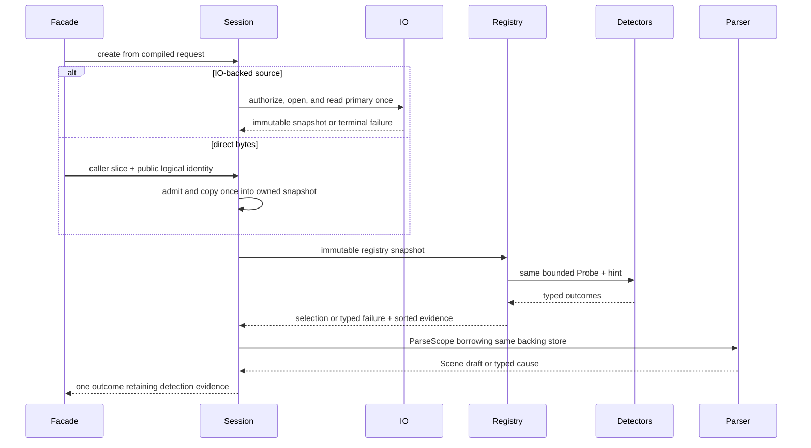

# ADR 0029: Format Detection, Stable Input, and Failure Evidence

## Context

Traditional importer registries hand every detector a mutable stream, then rely on each detector to
rewind it. One faulty detector can poison later candidates, repeated detection can reopen mutable
sources, and a short probe can be confused with a clean no-match. Registration order then changes
selection or erases useful failure evidence.

Every current Baozi importer already consumes the complete primary asset. Baozi can therefore bind one
bounded immutable primary snapshot and derive a read-only probe from it. A future true-streaming API
requires a separate ADR and cannot weaken this contract implicitly.

## Decision

One `ImportSession` binds the primary exactly once into one Baozi-owned, immutable, bounded snapshot.
An IO-backed import performs one policy-authorized open and may use multiple bounded chunk reads
without reopening or reacquiring the source. A direct-byte import performs no physical open: after
byte and live-capacity admission, the session copies the caller slice exactly once into its own
accounted snapshot and never retains or parses from the caller-owned allocation. Every detector
receives the same read-only `Probe` over that snapshot, and the selected parser borrows the same
backing allocation. Detectors never own IO, a seek cursor, rewind, report construction, or lifecycle
advancement.

Detection emits typed outcomes and deterministic evidence. Unsupported, inconclusive, detector fault,
ambiguity, forced-format contradiction, primary acquisition failure, and selected-parser failure are
distinct causes.

Accepted makes this the only format-selection authority; conformance requires session-level
implementation and executable evidence.

### Stable Primary Input

The session is created before binding the source. Public logical source identity is governed by ADR
0036 and is independent of the acquisition mechanism. Exactly one of these paths then runs:

- An IO-backed request performs one ADR 0010-authorized open, enforces the primary byte limit while
  reading, and stores the first immutable snapshot or terminal acquisition failure.
- A direct-byte request admits the input size and live capacity under ADR 0047, copies the caller
  slice once into session-owned immutable storage, and retains no borrow of the caller allocation.
  The caller allocation is not session live memory, and physical-open attempted/consumed evidence is
  zero.

Both paths expose the same snapshot contract to detection and parsing. The snapshot is never copied
into a second detection buffer or reacquired for parsing.

Each direct-byte session creates a fresh opaque authority domain for capability and cache isolation.
That domain is not derived from the caller's public source label, is not serialized, and never enters
public provenance. Reusing a source label therefore grants no cache or dependency authority and does
not prove byte equality; ADR 0036 content evidence remains separate.

Direct bytes grant no dependency authority. That entry path is unconditionally ADR 0010 `Deny` and
cannot be overridden; every sidecar request is rejected before backend IO. A caller that needs
sidecars uses a different entry path with an explicit memory bundle or custom `AssetIo` plus resolver.
Optional omission may continue only when the format descriptor declares the dependency optional and
the caller's loss policy authorizes it; required dependencies fail.

The probe exposes only the admitted prefix/ranges and total source length needed by detection. A read
beyond admitted probe bytes returns `Inconclusive(ProbeExhausted)` rather than EOF or `NoMatch`.
Detectors cannot retain the borrowed probe after selection.

The primary snapshot capacity is a live reservation under ADR 0047. Open/read/short-read/policy and
allocation failures are primary failures, not importer-local detector faults.

### Detector Outcome

Each enabled importer returns exactly one typed outcome:

| Outcome | Meaning |
| --- | --- |
| `Match(confidence)`, where confidence is `Maybe`, `Likely`, or `Certain` | Admitted evidence supports this format at the stated strength. |
| `NoMatch` | The admitted evidence conclusively contradicts this format. |
| `Inconclusive(ProbeExhausted)` | The detector needs bytes outside the configured probe admission. |
| `Fault(code, bounded_detail)` | Trusted detector implementation failed or unwound; it made no claim about the asset. |

Detectors must be deterministic, bounded, side-effect free, and panic-contained where unwind is
available. Their detail text follows diagnostic byte and sensitive-path bounds.

### Selection

Automatic and preferred-format detection run all enabled detectors against the same probe. Evidence
is retained in stable `FormatId` order, independent of registry insertion order. Forced-format mode
runs only the validated forced importer and records that single candidate's evidence.

Selection rules are:

1. Rank content confidence `Certain > Likely > Maybe`; `NoMatch`, `Inconclusive`, and `Fault` are never
   candidates. If any `Certain` or `Likely` exists, form the candidate pool from only the highest such
   confidence. A lower-confidence preferred or extension-matching format cannot enter that pool.
2. A unique candidate in that pool wins.
3. Among tied candidates at that same confidence, the validated caller `preferred FormatId` wins when
   it is present in the pool. Preference is explicit routing authority, but only within equal content
   confidence.
4. If preference did not select, a unique normalized extension match in the pool wins. Extension is a
   weaker tie-break and never overrides an equal-confidence preferred candidate or stronger content.
5. If the highest `Certain`/`Likely` pool remains tied, return typed ambiguity with sorted IDs.
6. If no `Certain` or `Likely` exists, consider only `Maybe` outcomes. A preferred `Maybe` candidate
   wins; otherwise a unique extension-matching `Maybe` candidate wins. A unique unhinted `Maybe` is
   insufficient, and multiple extension-matching `Maybe` candidates are ambiguous.
7. Otherwise, return no selection with all evidence.

A valid strongest match is not discarded because another detector faults. `UnsupportedFormat` is
returned only when every enabled detector cleanly reports `NoMatch`. Any fault or inconclusive outcome
without a selected match yields `DetectionFailure`, preserving every candidate outcome.

### Forced and Preferred Formats

A forced `FormatId` is validated against the immutable registry before primary IO. Its detector still
examines the shared probe:

- `Match` proceeds;
- `Inconclusive` may proceed because the caller supplied explicit authority, while evidence records
  the limitation;
- `NoMatch` is a typed forced-format contradiction; and
- `Fault` is a detection failure.

Forcing a format never grants IO, budget, recovery, or validation exceptions. A preferred format is
validated against the same immutable registry snapshot before primary IO. It is only a tie-break among
candidates at the winning confidence, precedes extension within that pool, and never overrides
stronger content, `NoMatch`, `Inconclusive`, or `Fault`. Preference for a `Maybe` supplies the explicit
hint required by rule 6 but grants no parse, resource, recovery, or validation exception.

### Failure Evidence

Detection evidence is immutable and included in both success reports and every later failure after
detection. A failure records the source identity, last completed internal lifecycle phase, selected
format when any, all candidate outcomes, bounded diagnostics, and ledger snapshot. The parser cannot
replace or omit this evidence.

The last-completed phase is outcome evidence owned by the session; it is not a public enum a parser or
caller can assign. A `ValidatedScene` proof is likewise distinct from phase evidence.

## Alternatives Considered

### Option A: One mutable stream per detector with rewind

This saves a primary snapshot in some cases but lets cursor behavior and registration order affect
selection and requires repeated IO for non-seekable backends. Rejected.

### Option B: Trust extension only and parse on detector match

This is fast but treats short probes as matches/no-matches inconsistently and loses ambiguity/fault
evidence. Rejected.

### Option C: One immutable snapshot, typed outcomes, and deterministic aggregate evidence

This costs one bounded retained primary buffer but removes cursor poisoning, reopen races, and
string-based failure inference. Chosen.

## Consequences

Positive:

- All detectors and the selected parser observe identical primary bytes.
- Registration order cannot change a non-ambiguous result.
- Detector bugs no longer masquerade as unsupported formats.
- Success and downstream failure retain explainable selection evidence.

Negative:

- The complete bounded primary snapshot remains live through parsing.
- Direct-byte import performs one deliberate owned copy instead of borrowing caller memory.
- Probe admission may produce an inconclusive result that callers must distinguish from unsupported.
- True streaming requires a future explicit API rather than reuse of this facade.

## Risks and Mitigations

| Risk | Severity | Mitigation |
| --- | --- | --- |
| Snapshot plus parser models multiplies memory | High | Peak-live accounting and phase release under ADR 0047. |
| A greedy detector dominates weak formats | High | Confidence conformance fixtures and ambiguity instead of arbitrary ID tie-break. |
| Extension hint overrides content | High | Use extension only at equal confidence or unique `Maybe` fallback. |
| Forced format becomes a validation bypass | High | Forced selection changes only routing; all parse, budget, and validation gates remain. |
| Detector panic aborts the process | High | Catch unwind where available; document abort/hostile extension need for process isolation. |
| Direct bytes gain ambient sidecar access | Critical | Give each session a fresh opaque authority domain and deny dependencies unless the caller chooses an explicit IO/bundle entry path. |

## Acceptance Criteria

| Contract | Testable acceptance |
| --- | --- |
| IO-backed snapshot | Instrumented mutable IO observes one physical primary open and one logical acquisition; detector and parser share one backing allocation. |
| Direct-byte snapshot | Detector and parser observe one identical session-owned allocation distinct from the caller slice; no second detection copy exists. |
| Direct-byte evidence | Physical-open attempted and consumed are both zero; primary-byte admission precedes the copy, consumed bytes follow only a successful copy, and live capacity covers the owned snapshot. |
| Direct-byte authority | Reused public source labels do not reuse the fresh session authority domain; dependency requests perform no backend open and required dependencies fail. |
| Probe boundaries | Zero, below, exact, and above probe limits distinguish `Inconclusive` from `NoMatch`. |
| Order independence | Every registration permutation yields identical selected format, ambiguity, and sorted evidence. |
| Fault aggregation | Greedy/faulting/valid detector combinations follow the strongest-match and no-clean-unsupported rules. |
| Forced/preferred behavior | Forced success, contradiction, inconclusive authority, and fault are explicit tests; preferred-versus-extension conflicts at `Certain`, `Likely`, and `Maybe` prove the complete ordering. |
| Evidence retention | Parse, validation, cancellation, and postprocess failures retain unchanged detection evidence. |
| Panic boundary | An unwindable detector panic becomes bounded `Fault` evidence and cannot poison other candidates. |
