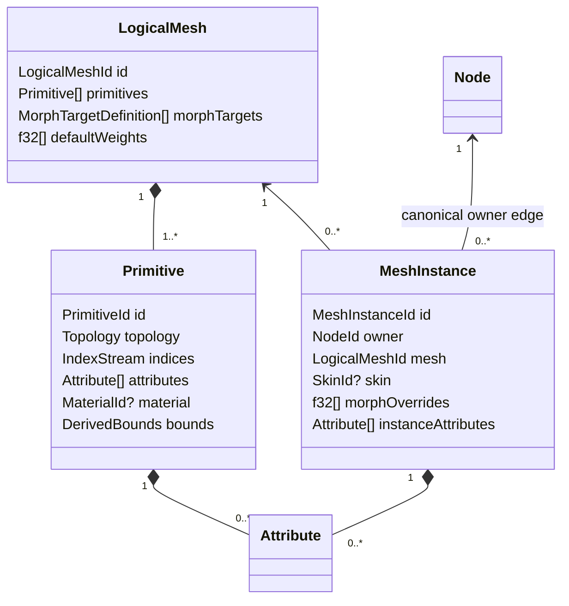

# ADR 0030: Logical Mesh, Primitive, and Attribute Domains

## Context

Source formats disagree about what “mesh” means. glTF groups multiple material/topology primitives
under one logical mesh; OBJ corners can select position, normal, and UV independently; PLY attaches
properties to vertices or faces; STL is effectively one triangle primitive. Assimp's fixed-revision
[`aiMesh`](https://github.com/assimp/assimp/blob/bcc62230fc0471475528d732f4ad108a59bb7f6c/include/assimp/mesh.h)
allows mixed primitive flags but still has one material index and per-vertex arrays. A single
topology and material field on Baozi `Mesh` would likewise split logical identity or force silent
attribute expansion.

## Decision

A `LogicalMesh` owns one or more `Primitive` values. Logical identity, name, provenance, morph target
definitions, and default morph weights belong to the logical mesh. Each primitive independently
owns topology, indices, an optional material binding, geometric attributes, morph delta streams,
primitive bounds state, and provenance. Primitive, logical-mesh, and scene bounds are three different
derived owners; none substitutes for another.

`LogicalMeshId` is scene-local and generation-qualified. `PrimitiveId` and `MorphTargetId` contain
the scene generation, owning logical-mesh dense index, and local dense index. Lookups reject a wrong
generation or owner before checking the local range, so equal local indices cannot be confused
across meshes. They are remapped explicitly when a mesh's local collections change and never serve
as source identities. Storage may retain private local index components; public access derives the
generation and logical-mesh owner from the scene under ADR 0045 rather than trusting caller-supplied
numbers. ADR 0045 owns generation-token publication.



Every primitive is homogeneous: one topology and one optional material. Supported raw topologies
include points, line lists, line strips, line loops, triangle lists/strips/fans where
source-preserving, and polygons with explicit face boundaries. Patches are admitted only when a
producer and bounded descriptor exist; no placeholder topology variant is added in advance.

An index stream addresses the primitive's vertex domain. An absent index stream is explicitly
non-indexed, not an empty indexed stream. `corner_count` is the index count when indexed and vertex
count otherwise. Topology derives `face_count`: points use one corner per face; line and triangle
lists require counts divisible by two and three; line strips use `max(corner_count - 1, 0)`; line
loops use zero faces for fewer than two corners and otherwise one segment face per corner, including
the closing last-to-first segment; triangle strips/fans use `max(corner_count - 2, 0)`; polygons use
explicit boundaries of at least three corners whose checked sum equals `corner_count`. The primitive
therefore calculates every domain count without inspecting attribute payloads. A strip, fan, or loop
corner is one source index-stream element; lowering it to independent faces publishes the duplicated
Corner remap rather than changing this raw cardinality definition.

### Attribute Contract

Each `Attribute` declares:

- semantic: a typed built-in semantic or validated namespaced custom semantic
- domain: `Vertex`, `Corner`, `Face`, or `Instance`
- format: scalar component type, lane count, normalization, and optional registered packed encoding
- payload: dense values or sparse indices/values with an explicit logical element count
- provenance

`AttributeFormat` is a closed semantic format, not a public memory-layout promise:

- `ComponentType` is currently `I8`, `U8`, `I16`, `U16`, `I32`, `U32`, `F32`, or `F64`.
- lane count is non-zero; built-ins use the exact ranges below and custom streams use `1..=16`.
- normalization is `None`, `UNorm`, `SNorm`, or a registered namespaced encoding. Floating-point
  components require `None`; integer normalization must be meaningful for the signedness.
- an optional named packed encoding is admitted only with a registered fixed element width, lane
  interpretation, byte order, validator, and typed-view decoder. No opaque packed encoding is valid.

Source byte order is consumed during decode. Plain canonical buffers store logical typed scalar
values and carry no endian field. A named packed encoding's schema, not each source stream, fixes its
byte order. Public byte layout and `repr` remain private under ADR 0009.

The current built-in schema is normative:

| Semantic | Allowed domain | Allowed format |
| --- | --- | --- |
| `POSITION` | Vertex | `F32 x 3`, no normalization |
| `NORMAL` | Vertex or Corner | `F32 x 3`, no normalization |
| `TANGENT` | Vertex or Corner | `F32 x 4`, no normalization; lane 4 is handedness |
| `TEXCOORD_n` | Vertex or Corner | `F32`, `UNorm U8`, or `UNorm U16`, with 1, 2, or 3 lanes |
| `COLOR_n` | Vertex, Corner, Face, or Instance | `F32`, `UNorm U8`, or `UNorm U16`, with 3 or 4 lanes |
| `SMOOTHING_GROUP` | Face | `U32 x 1`, no normalization; zero means off |

No built-in semantic accepts a namespaced normalization or packed encoding. A validated namespaced
custom semantic may use any domain and current component type within the lane limit, but its
normalization/encoding schema must be registered when it is not one of the ordinary combinations.
Adding a built-in semantic changes this table together with its producer, validator, typed view,
remapper, snapshot, and fixtures; a name alone does not create an admitted built-in.

Payload shape is also closed:

```text
Dense { values: AttributeBuffer }
Sparse {
    logical_count: u32,
    indices: OwnedBuffer<u32>,
    values: AttributeBuffer,
    default: AttributeElement,
}
```

One `AttributeBuffer` has exactly one `AttributeFormat`. Dense element count equals the owner-domain
cardinality. Sparse indices are strictly increasing, unique, and in range; value count equals index
count; the default has the same format; and `logical_count` equals the owner-domain cardinality.
All byte/cell products are checked and charged before allocation.

Attribute placement is constrained: vertex, corner, and face attributes are primitive-owned;
instance attributes are scene-owned `MeshInstance` data. Every mesh instance stores exactly one
owner `NodeId`, while a node has zero or more instances through a derived query/index. No reciprocal
attachment vector is canonical. This avoids making a primitive's cardinality depend on how many
nodes reference its logical mesh and gives animation, skinning, and remaps one instance target.

| Domain | Cardinality authority | Examples |
| --- | --- | --- |
| Vertex | primitive vertex count | position, welded normals, custom vertex property |
| Corner | primitive corner count | OBJ split UVs/normals, per-loop tangents |
| Face | primitive face count | smoothing group, material source tag, PLY face property |
| Instance | exactly one value for the owning mesh instance | per-instance color, source instance key |

`POSITION` is a vertex-domain geometric attribute and is required for geometry that declares
vertices. A normal may be vertex- or corner-domain, while a face smoothing group cannot masquerade
as vertex data. Sparse payload indices are sorted, unique, in range, and paired with the explicit
default above.
Within one owner, the normalized `(semantic, domain)` key is unique; UV/color set numbers are
part of the semantic key. Dense payload length equals the domain cardinality, and a sparse payload's
logical count equals it even when no explicit values are stored.

Typed lookup takes the complete `(semantic, domain)` key. Vertex and Corner fields with the same
semantic may coexist and must remain independently selectable. Convenience normal and UV lookups
therefore require a domain; Position has the single fixed Vertex domain. Borrowed reads neither
merge fields nor allocate a projection to resolve an ambiguous semantic.

Skin influences are a dedicated primitive-owned `InfluenceRows` deformer stream, not a generic
fixed-width `Attribute`. It declares vertex-domain cardinality and uses ADR 0031's checked offsets
plus flat influence payload. Source `JOINTS_n`/`WEIGHTS_n` sets are representation-mapped into that
one semantic stream without changing weights and are not duplicated as ordinary attributes.

Domain-element identity follows the same ownership boundary. A Vertex, Corner, or Face remap
endpoint is `(PrimitiveId, domain_index)`, where `PrimitiveId` carries the scene generation, logical
mesh owner, and primitive-local index. The sole Instance-domain element is identified by its owning
generation-qualified `MeshInstanceId`. ADR 0032 owns the relation and composition rules for those
endpoints.

For each morph target and primitive, at most one delta stream exists for each supported semantic.
A missing target/semantic stream means the all-zero delta defined by ADR 0031, not a second target
identity or an unconstrained empty payload.

Renderer-oriented expansion, triangulation, interleaving, and numeric lowering remain explicit.
A canonical structural edit owns the remaps and applicable loss evidence required by ADR 0032.
A read-only application layout instead borrows existing values and exposes their source endpoints;
it publishes no Scene or operation report. Canonical storage does not force fixed `Vertex`, fixed
UV/color channel counts, or `f32` conversion of custom integer data.

The current core authoring rail accepts dense namespaced custom `F64` attributes through
`GeometryAttributeAuthoring::f64(semantic, domain, lanes, values)`. Primitive-owned Vertex, Corner,
and Face streams retain `f64` scalar sequences exactly, including signed zero and finite values
outside the `f32` range. Both authoring validation and central retained-store validation require
finite values, `1..=16` lanes, and exact owner-domain cardinality. The F64 authoring constructor
does not admit Instance attributes, sparse payloads, or a replacement for built-in floating-point
semantics: POSITION, NORMAL, TANGENT, TEXCOORD, and COLOR continue to require their documented F32
formats. Converting a source built-in to F32 remains an explicit adapter responsibility.

F64 values count as one semantic cell and one scalar inspection each, with eight canonical payload
bytes per scalar. Materialization retains typed F64 leaves; validation never lowers them through
F32. Semantic snapshots identify `scalar=f64` and encode each scalar's full IEEE 754 `to_bits()`
value as eight little-endian bytes. Preview values use sixteen hexadecimal digits. Geometry and
snapshot schema revisions remain 3: scalar tag 3 extends the existing discriminated payload union,
without changing existing tag meanings, table layouts, or the transcripts of scenes without F64
attributes. A nonzero F64 scalar total is also included in the preview summary.

### Borrowed Triangle Application Layout

`baozi-postprocess::triangle_vertices(PrimitiveRef)` returns
`Result<TriangleVertices, VertexLayoutError>`. It accepts only `TopologyKind::TriangleList`;
other topologies return `VertexLayoutError::UnsupportedTopology { topology }`, including empty
non-triangle primitives. Empty triangle lists return an empty layout. No triangulation, normal
generation, coordinate conversion, or numerical degeneracy test occurs inside this reader.

The layout emits exactly one application tuple per source draw Corner, in draw order. With `C`
corners, the application vertex count is `C` and the implicit application index stream is the
allocation-free `Range<u32>` `0..C`. Equal tuples may be repeated. There is no deduplication,
cross-source welding, epsilon comparison, minimal vertex-count guarantee, or owned vertex map.
UV seams and Face boundaries therefore retain their distinct tuples without a tuple-equivalence
policy. Shared source vertices still supply the same Vertex values, influences, and morph deltas.

For application index `c`, the source-domain selection is:

| Field domain | Source element |
| --- | --- |
| Vertex | `primitive.indices()[c]` when indexed, otherwise `c` |
| Corner | `c` |
| Face | `c / 3` |

`TriangleVertices` and `TriangleVertex` are `Copy` borrowed views of the current primitive.
`TriangleVertices` exposes `primitive()`, `len()`, `is_empty()`, checked `vertex(index: usize)`,
`vertices()`, and `indices()`. The vertex iterator is exact-size, double-ended, and cloneable.
`TriangleVertex::index()` is the current Corner ordinal; `source_vertex()`, `source_corner()`, and
`source_face()` return generation- and primitive-qualified endpoints. In particular, a
`PrimitiveVertex` contains `{ primitive: PrimitiveId, index: u32 }`. These endpoints describe the
current Scene, not a new generation or an implicit remap to an earlier import.

`TriangleVertex::attributes()` traverses every retained primitive attribute in order. Each
`VertexAttribute` exposes its original `AttributeRef` through `attribute()` and its selected
`AttributeElement` through `element()`. Keyed `attribute(semantic, domain)` lookup requires the
complete key, preserving simultaneous Vertex and Corner normals or UVs and all Face/custom fields.
Instance-domain fields belong to their mesh instance and are not primitive tuple fields.

Core `AttributeRef::element(index: usize)` returns `Option<AttributeElement>` with borrowed F32,
F64, U32, or I32 scalar slices. Dense selection is O(1); sparse selection is O(log explicit count)
and borrows either the explicit element or the retained default. Out-of-range selection is `None`.
Scalar kind, lane count, signed-zero bits, and full F64 precision are preserved without allocation,
normalization, or implicit conversion. `AttributeRef::data()` retains the source dense/sparse
representation, indices, and defaults; sampling an element does not rewrite that representation.

`TriangleVertex::influences()` returns the complete source-Vertex row, retaining absence, empty rows,
source order, weights, and palette-local joint indices. `morph_delta(target, semantic)` resolves the
target through the same current primitive and returns `Result<Option<Vec3>, SceneLookupError>`.
A foreign generation or logical-mesh owner fails lookup; a missing semantic stream is `None`, while
an implicit sparse zero in a present stream is `Some(Vec3::ZERO)`. The primitive's other projections
of the same logical target cannot supply its delta. Skin selection, palette interpretation, default
morph weights, and instance overrides remain under ADR 0031; this view does not evaluate them.

Construction, iteration, element selection, and source queries perform no heap allocation and
leave source topology, payloads, sparse presence, unreferenced vertices, identity, and provenance
unchanged. Tuple slices borrow the Scene rather than the temporary layout or iterator. The helper
has no operation invocation, retained artifact, account/resource report, or publication step.
Application-owned buffer allocation and optional index collection occur outside the library's
ownership and accounting boundary. The application chooses checked sizing, fallible reservation,
field selection, packing, and cancellation of its own extraction loop. Attribute iteration visits
the actual descriptor sequence once per tuple; keyed lookup is O(attribute count). No full scan,
sort, or tuple cache is performed at construction. Expanding a highly shared mesh can repeat data
up to the draw-Corner count; the zero-allocation view does not promise compact application buffers.

Primitive bounds are `Derived<Bounds>` in primitive-local space. Logical-mesh bounds are a separate
`Derived<Bounds>` combining primitives under the declared morph-bounds policy; scene bounds are a
scene-owned `Derived<Bounds>` combining instances and node transforms. ADR 0032 defines valid versus
absent state. Authored normals and tangents remain provenance-bearing attributes, but after a write
to one of their dependencies an operation must prove preservation, remap/recompute them, or remove
them with invalidation/loss evidence before commit. A stale attribute is never publishable merely
because it originated in the source.

## Considered Options

### Option A: One primitive per mesh object

This keeps the type small, but splits glTF logical mesh identity, duplicates morph defaults, and
makes source-level animation/provenance harder to address. Rejected.

### Option B: One mesh with mixed topology/material faces

This preserves one identity but makes validation and renderer lowering implicit and permits
attributes with ambiguous cardinality. Rejected.

### Option C: Logical mesh owning homogeneous primitives

This preserves source grouping while giving every topology and attribute a deterministic owner and
count. Chosen.

## Consequences

- STL, OBJ, PLY, and glTF cut over to one model without a legacy single-primitive path.
- OBJ may preserve corner-domain streams without importer-time vertex explosion.
- Canonical primitive split/merge and corner expansion must return explicit entity and domain
  remaps. Borrowed triangle tuples expose current source endpoints without publishing a remap.
- Convenience accessors can expose typed positions and triangle views, but they never redefine the
  canonical owner.

## Risks and Mitigations

| Risk | Severity | Mitigation |
| --- | --- | --- |
| Domain-aware processing is more complex | Medium | Centralize cardinality/remap utilities and require operations to declare supported domains. |
| Sparse payloads hide invalid defaults | High | Require explicit logical count, sorted indices, value count, and semantic/default validation. |
| Importers over-split logical meshes | Medium | Golden tests assert source logical identity and primitive grouping per format. |
| Custom packed formats complicate consumers | Medium | Provide checked typed views and explicit conversion helpers with loss policy. |

## Success Metrics

| Metric | Target | Measurement |
| --- | --- | --- |
| Cardinality determinism | Domain counts derive only from topology/owner and exact/off-by-one payloads have deterministic outcomes | all topology/domain matrix tests |
| Validation complexity | Topology, attributes, sparse indices, and influence cells are visited in `O(primitives + attributes + cells)` work | validator work counters at 1x/10x/100x fixtures |
| Source structure | glTF multi-primitive, OBJ corner streams, PLY face streams, and glTF line loops require no legacy mesh path | facade goldens and legacy-symbol search |

## Acceptance Criteria

- A glTF mesh with multiple primitives remains one logical mesh with distinct materials.
- An OBJ fixture preserves separate position/normal/UV corner semantics without mandatory vertex
  expansion.
- PLY vertex and face properties validate against different domain counts and preserve scalar type.
- Zero, exact, and off-by-one cardinalities are tested for all four domains and sparse payloads.
- Zero, one, exact, and excess line-loop counts preserve closing-edge semantics and deterministic
  Corner/Face remaps when lowered.
- Every built-in semantic rejects a wrong domain, component type, lane count, normalization, or
  packed encoding before publication.
- Primitive split, merge, triangulation, and vertex join tests publish deterministic remaps for every
  affected domain.
- Borrowed triangle-layout fixtures must cover UV seams, Face fields, complete semantic/domain keys,
  dense/sparse and F64 values, indexed/implicit/empty streams, and source-Vertex-consistent influence
  and morph reads without reader allocations or source mutation. These are acceptance requirements,
  not a record of executed checks.
