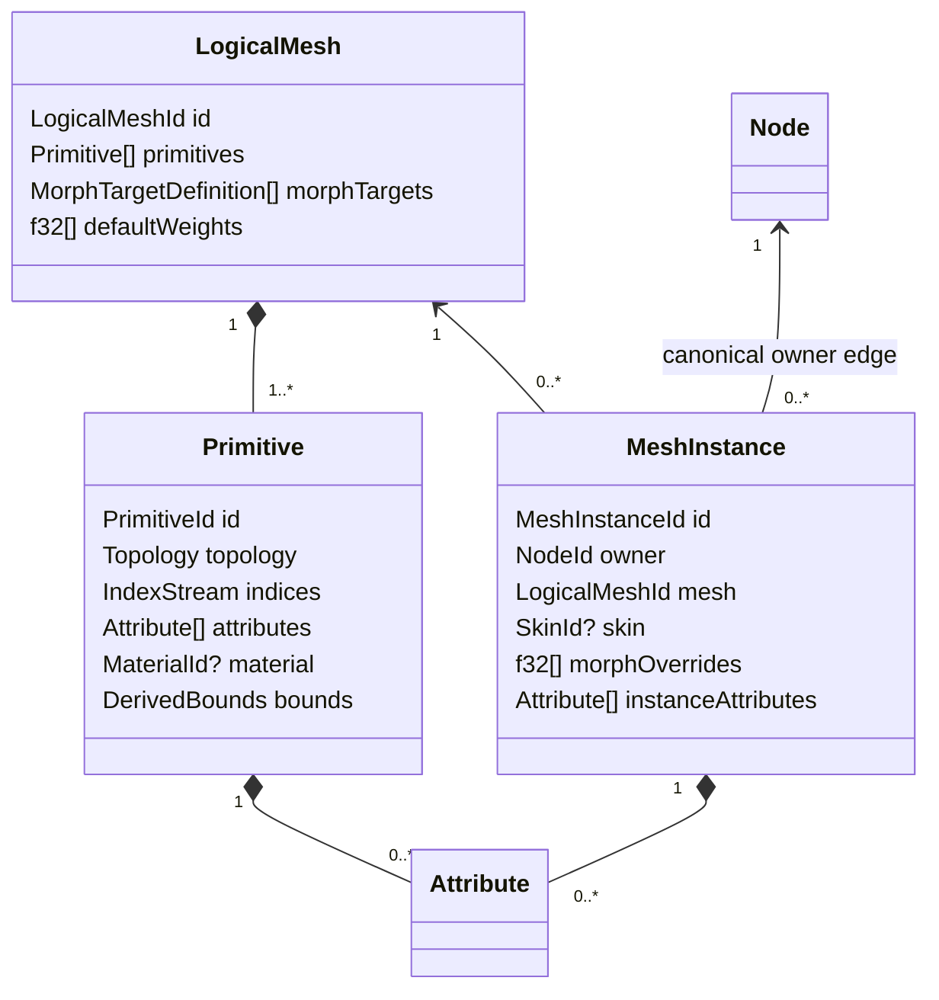

# ADR 0030: Logical Mesh, Primitive, and Attribute Domains

## Context

Source formats disagree about what “mesh” means. glTF groups multiple material/topology primitives
under one logical mesh; OBJ corners can select position, normal, and UV independently; PLY attaches
properties to vertices or faces; STL is effectively one triangle primitive. Assimp's fixed-revision
[`aiMesh`](https://github.com/assimp/assimp/blob/bcc62230fc0471475528d732f4ad108a59bb7f6c/include/assimp/mesh.h)
allows mixed primitive flags but still has one material index and per-vertex arrays. A single
topology and material field on Baozi `Mesh` would likewise split logical identity or force silent
attribute expansion.

## Decision

A `LogicalMesh` owns one or more `Primitive` values. Logical identity, name, provenance, morph target
definitions, and default morph weights belong to the logical mesh. Each primitive independently
owns topology, indices, an optional material binding, geometric attributes, morph delta streams,
primitive bounds state, and provenance. Primitive, logical-mesh, and scene bounds are three different
derived owners; none substitutes for another.

`LogicalMeshId` is scene-local and generation-qualified. `PrimitiveId` and `MorphTargetId` contain
the scene generation, owning logical-mesh dense index, and local dense index. Lookups reject a wrong
generation or owner before checking the local range, so equal local indices cannot be confused
across meshes. They are remapped explicitly when a mesh's local collections change and never serve
as source identities. Storage may retain private local index components; public access derives the
generation and logical-mesh owner from the scene under ADR 0003 rather than trusting caller-supplied
numbers. ADR 0003 owns generation-token publication.



Every primitive is homogeneous: one topology and one optional material. Supported raw topologies
include points, line lists, line strips, line loops, triangle lists/strips/fans where
source-preserving, and polygons with explicit face boundaries. Patches are admitted only when a
producer and bounded descriptor exist; no placeholder topology variant is added in advance.

An index stream addresses the primitive's vertex domain. An absent index stream is explicitly
non-indexed, not an empty indexed stream. `corner_count` is the index count when indexed and vertex
count otherwise. Topology derives `face_count`: points use one corner per face; line and triangle
lists require counts divisible by two and three; line strips use `max(corner_count - 1, 0)`; line
loops use zero faces for fewer than two corners and otherwise one segment face per corner, including
the closing last-to-first segment; triangle strips/fans use `max(corner_count - 2, 0)`; polygons use
explicit boundaries of at least three corners whose checked sum equals `corner_count`. The primitive
therefore calculates every domain count without inspecting attribute payloads. A strip, fan, or loop
corner is one source index-stream element; lowering it to independent faces publishes the duplicated
Corner remap rather than changing this raw cardinality definition.

### Attribute Contract

Each `Attribute` declares:

- semantic: a typed built-in semantic or validated namespaced custom semantic
- domain: `Vertex`, `Corner`, `Face`, or `Instance`
- format: scalar component type, lane count, normalization, and optional registered packed encoding
- payload: dense values or sparse indices/values with an explicit logical element count
- provenance

`AttributeFormat` is a closed semantic format, not a public memory-layout promise:

- `ComponentType` is currently `I8`, `U8`, `I16`, `U16`, `I32`, `U32`, `F32`, or `F64`.
- lane count is non-zero; built-ins use the exact ranges below and custom streams use `1..=16`.
- normalization is `None`, `UNorm`, `SNorm`, or a registered namespaced encoding. Floating-point
  components require `None`; integer normalization must be meaningful for the signedness.
- an optional named packed encoding is admitted only with a registered fixed element width, lane
  interpretation, byte order, validator, and typed-view decoder. No opaque packed encoding is valid.

Source byte order is consumed during decode. Plain canonical buffers store logical typed scalar
values and carry no endian field. A named packed encoding's schema, not each source stream, fixes its
byte order. Public byte layout and `repr` remain private under ADR 0009.

The current built-in schema is normative:

| Semantic | Allowed domain | Allowed format |
| --- | --- | --- |
| `POSITION` | Vertex | `F32 x 3`, no normalization |
| `NORMAL` | Vertex or Corner | `F32 x 3`, no normalization |
| `TANGENT` | Vertex or Corner | `F32 x 4`, no normalization; lane 4 is handedness |
| `TEXCOORD_n` | Vertex or Corner | `F32`, `UNorm U8`, or `UNorm U16`, with 1, 2, or 3 lanes |
| `COLOR_n` | Vertex, Corner, Face, or Instance | `F32`, `UNorm U8`, or `UNorm U16`, with 3 or 4 lanes |
| `SMOOTHING_GROUP` | Face | `U32 x 1`, no normalization; zero means off |

No built-in semantic accepts a namespaced normalization or packed encoding. A validated namespaced
custom semantic may use any domain and current component type within the lane limit, but its
normalization/encoding schema must be registered when it is not one of the ordinary combinations.
Adding a built-in semantic changes this table together with its producer, validator, typed view,
remapper, snapshot, and fixtures; a name alone does not create an admitted built-in.

Payload shape is also closed:

```text
Dense { values: AttributeBuffer }
Sparse {
    logical_count: u32,
    indices: OwnedBuffer<u32>,
    values: AttributeBuffer,
    default: AttributeElement,
}
```

One `AttributeBuffer` has exactly one `AttributeFormat`. Dense element count equals the owner-domain
cardinality. Sparse indices are strictly increasing, unique, and in range; value count equals index
count; the default has the same format; and `logical_count` equals the owner-domain cardinality.
All byte/cell products are checked and charged before allocation.

Attribute placement is constrained: vertex, corner, and face attributes are primitive-owned;
instance attributes are scene-owned `MeshInstance` data. Every mesh instance stores exactly one
owner `NodeId`, while a node has zero or more instances through a derived query/index. No reciprocal
attachment vector is canonical. This avoids making a primitive's cardinality depend on how many
nodes reference its logical mesh and gives animation, skinning, and remaps one instance target.

| Domain | Cardinality authority | Examples |
| --- | --- | --- |
| Vertex | primitive vertex count | position, welded normals, custom vertex property |
| Corner | primitive corner count | OBJ split UVs/normals, per-loop tangents |
| Face | primitive face count | smoothing group, material source tag, PLY face property |
| Instance | exactly one value for the owning mesh instance | per-instance color, source instance key |

`POSITION` is a vertex-domain geometric attribute and is required for geometry that declares
vertices. A normal may be vertex- or corner-domain, while a face smoothing group cannot masquerade
as vertex data. Sparse payload indices are sorted, unique, in range, and paired with the explicit
default above.
Within one owner, the normalized `(semantic, domain)` key is unique; UV/color set numbers are
part of the semantic key. Dense payload length equals the domain cardinality, and a sparse payload's
logical count equals it even when no explicit values are stored.

Skin influences are a dedicated primitive-owned `InfluenceRows` deformer stream, not a generic
fixed-width `Attribute`. It declares vertex-domain cardinality and uses ADR 0031's checked offsets
plus flat influence payload. Source `JOINTS_n`/`WEIGHTS_n` sets are representation-mapped into that
one semantic stream without changing weights and are not duplicated as ordinary attributes.

Domain-element identity follows the same ownership boundary. A Vertex, Corner, or Face remap
endpoint is `(PrimitiveId, domain_index)`, where `PrimitiveId` carries the scene generation, logical
mesh owner, and primitive-local index. The sole Instance-domain element is identified by its owning
generation-qualified `MeshInstanceId`. ADR 0032 owns the relation and composition rules for those
endpoints.

For each morph target and primitive, at most one delta stream exists for each supported semantic.
A missing target/semantic stream means the all-zero delta defined by ADR 0031, not a second target
identity or an unconstrained empty payload.

Renderer views may expand corner attributes, triangulate, interleave streams, or lower integer
formats, but those are explicit postprocess/helper outputs with remaps and loss reports. Canonical
storage does not force fixed `Vertex`, fixed UV/color channel counts, or `f32` conversion of custom
integer data.

Primitive bounds are `Derived<Bounds>` in primitive-local space. Logical-mesh bounds are a separate
`Derived<Bounds>` combining primitives under the declared morph-bounds policy; scene bounds are a
scene-owned `Derived<Bounds>` combining instances and node transforms. ADR 0032 defines valid versus
absent state. Authored normals and tangents remain provenance-bearing attributes, but after a write
to one of their dependencies an operation must prove preservation, remap/recompute them, or remove
them with invalidation/loss evidence before commit. A stale attribute is never publishable merely
because it originated in the source.

## Considered Options

### Option A: One primitive per mesh object

This keeps the type small, but splits glTF logical mesh identity, duplicates morph defaults, and
makes source-level animation/provenance harder to address. Rejected.

### Option B: One mesh with mixed topology/material faces

This preserves one identity but makes validation and renderer lowering implicit and permits
attributes with ambiguous cardinality. Rejected.

### Option C: Logical mesh owning homogeneous primitives

This preserves source grouping while giving every topology and attribute a deterministic owner and
count. Chosen.

## Consequences

- STL, OBJ, PLY, and glTF cut over to one model without a legacy single-primitive path.
- OBJ may preserve corner-domain streams without importer-time vertex explosion.
- Primitive split/merge and corner expansion must return explicit entity and domain remaps.
- Convenience accessors can expose typed positions and triangle views, but they never redefine the
  canonical owner.

## Risks and Mitigations

| Risk | Severity | Mitigation |
| --- | --- | --- |
| Domain-aware processing is more complex | Medium | Centralize cardinality/remap utilities and require operations to declare supported domains. |
| Sparse payloads hide invalid defaults | High | Require explicit logical count, sorted indices, value count, and semantic/default validation. |
| Importers over-split logical meshes | Medium | Golden tests assert source logical identity and primitive grouping per format. |
| Custom packed formats complicate consumers | Medium | Provide checked typed views and explicit conversion helpers with loss policy. |

## Success Metrics

| Metric | Target | Measurement |
| --- | --- | --- |
| Cardinality determinism | Domain counts derive only from topology/owner and exact/off-by-one payloads have deterministic outcomes | all topology/domain matrix tests |
| Validation complexity | Topology, attributes, sparse indices, and influence cells are visited in `O(primitives + attributes + cells)` work | validator work counters at 1x/10x/100x fixtures |
| Source structure | glTF multi-primitive, OBJ corner streams, PLY face streams, and glTF line loops require no legacy mesh path | facade goldens and legacy-symbol search |

## Acceptance Criteria

- A glTF mesh with multiple primitives remains one logical mesh with distinct materials.
- An OBJ fixture preserves separate position/normal/UV corner semantics without mandatory vertex
  expansion.
- PLY vertex and face properties validate against different domain counts and preserve scalar type.
- Zero, exact, and off-by-one cardinalities are tested for all four domains and sparse payloads.
- Zero, one, exact, and excess line-loop counts preserve closing-edge semantics and deterministic
  Corner/Face remaps when lowered.
- Every built-in semantic rejects a wrong domain, component type, lane count, normalization, or
  packed encoding before publication.
- Primitive split, merge, triangulation, and vertex join tests publish deterministic remaps for every
  affected domain.
