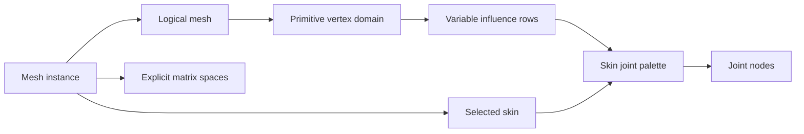

# ADR 0031: Animation, Skin, Morph, and Deformer Contract

## Context

The current IR stores exactly four joint indices and weights per vertex, stores animation time as
`f32` seconds, and attaches morph defaults directly to individual targets. Those choices match one
renderer layout but lose source influence counts, authored time precision, primitive-specific morph
deltas, and per-instance weights. Assimp's fixed-revision
[`aiAnimation`](https://github.com/assimp/assimp/blob/bcc62230fc0471475528d732f4ad108a59bb7f6c/include/assimp/anim.h)
and [`aiMesh`/`aiAnimMesh`](https://github.com/assimp/assimp/blob/bcc62230fc0471475528d732f4ad108a59bb7f6c/include/assimp/mesh.h)
preserve broader data, but name-based targets and implicit matrix spaces are not sufficiently precise
for Baozi's validated IR.

## Decision

Skinning, morphing, and animation remain source-preserving data contracts. Baozi imports tracks and
deformer inputs; it does not become a runtime animation evaluator, blender, inverse-kinematics
system, or renderer palette builder.

### Skin And Influences

A `Skin` owns an ordered joint palette and an optional source-declared skeleton-root hint. Every
joint entry references a `NodeId`. The validated palette has exactly one inverse-bind matrix per
joint; when a format normatively defaults a missing matrix to identity, the importer materializes
that identity and records the default in provenance. The skin declares its matrix-space contract;
the canonical contract is:

- input position: logical-mesh local bind space
- inverse bind: mesh local bind space to joint local bind space
- current joint transform: joint local space to scene space
- output: owning mesh-instance local space

For mesh instance transform `M`, joint scene transform `Jj`, inverse bind `Bj`, position `p`, and
weights `wj`, the instance-local result is:

```text
p_instance = inverse(M) * sum(wj * Jj * Bj * p)
```

Here `M` is the current local-to-scene transform of the mesh instance's owning node; `MeshInstance`
does not introduce a second transform. Evaluation helpers fail on a singular `M`.

A source with a bind-shape or other correction matrix stores that typed correction and its declared
from/to spaces; it is not folded silently into vertices. Unknown or contradictory spaces are a
validation/import error unless a format-specific recovery policy records the exact repair.

Vertex influences are variable-length compressed rows: `vertex_offsets` has `vertex_count + 1`
entries and a flat influence array stores palette-local joint index, finite non-negative `f32`
weight, and source order for deterministic ties. Weight sums need not equal one in raw import, but
the discrepancy is diagnosed. Zero weights may be preserved; compaction may remove them.

The row contract is exact: offsets are `u32`, the first offset is zero, offsets are non-decreasing,
the final offset equals the flat influence count, and every offset is in range. There is one row per
primitive vertex. Source order is a unique bounded ordinal within each row and survives reordering so
ties remain deterministic. Counts, offsets, influence cells, and their byte products are checked and
charged before allocation.

Fixed-four or fixed-eight layouts are explicit lossy postprocess outputs. Compaction declares the
limit and minimum weight, sorts by descending weight with joint/source-order tie rules, reports
dropped weight mass, and renormalizes only when requested.

Influence indices are interpreted relative to each mesh instance's selected skin, not one skin owned
by the logical mesh. For every instance that selects a skin, every joint index in every primitive of
its logical mesh must be in that skin's palette. Two instances may therefore use different palette
nodes or orderings while sharing the same numeric influence rows. An instance with no skin is valid;
its influence rows remain inert source data and no palette is invented. Selecting a skin for geometry
with no influence rows is also structurally valid. A singular instance transform may be preserved as
source data, but an instance-local palette/evaluation helper returns a typed error instead of
manufacturing an inverse. The skeleton-root hint does not replace joint-node references or relax
graph validation.



### Morph Targets And Instances

A logical mesh owns an ordered `MorphTargetDefinition` list and an equally sized finite default-weight
`f32` vector. Definitions carry target identity, optional name, and provenance. The current canonical
producer contract is relative deltas, matching glTF: each primitive carries position, normal, and
three-component tangent deltas keyed by target; tangent handedness is not morphed. Each delta payload
is finite `F32 x 3` over that primitive's Vertex domain and can be dense or sparse under ADR 0030.
Absolute/replacement or normalized morph methods do not gain concrete variants until a supported
producer defines their combination semantics and fixtures.

Missing deltas for a target on a primitive mean zero deformation, not a different target list. A
scene `MeshInstance` may provide a full override vector whose count matches the logical mesh target
count; override and animated morph-weight values are finite `f32`. Effective weight precedence for
evaluation is animation sample, then instance override, then logical-mesh default. Baozi stores these
sources separately and does not bake the effective value into import output.

### Animation

An `AnimationClip` declares a source time domain and owns channels. Key times and duration are
finite `f64` values in the authored domain. The time domain records seconds, frames with a rate,
ticks with an optional ticks-per-second rate, or a validated namespaced source unit. A seconds view
exists only when conversion is defined; import never resamples keys merely to normalize units.

Every channel declares:

- a current producer-backed target: node translation, node rotation, node scale, or mesh-instance
  morph weights
- interpolation: step, linear, or cubic spline, plus a namespaced source interpolation only when a
  producer supplies its bounded payload
- pre- and post-extrapolation behavior: source/default value, constant, linear, repeat, or a
  producer-backed namespaced behavior
- strictly increasing key times, typed values, and interpolation-specific tangent payloads
- provenance and bounded source timing metadata

Current channel payloads are closed and have deterministic per-key cardinality:

| Target | Sample value | Values per key | Cubic tangent payload |
| --- | --- | --- | --- |
| node translation | `Vec3<f32>` | one | finite `Vec3<f32>` in/out derivatives |
| node rotation | finite unit `Quat<f32>` | one | finite, non-unit `Vec4<f32>` in/out component derivatives |
| node scale | `Vec3<f32>` | one | finite `Vec3<f32>` in/out derivatives |
| mesh-instance morph weights | bounded `Vec<f32>` | logical-mesh morph-target count | equally sized finite `Vec<f32>` in/out derivatives |

Step and linear channels store one sample value per key and no tangent payload. Cubic-spline channels
store exactly one in tangent, sample value, and out tangent per key. Times and clip duration are
`f64`; sample values, morph weights, and tangents are `f32`. A clip duration is finite and
non-negative, while key times may be any finite authored values in their declared time domain.

Target identity uses dense `NodeId` or `MeshInstanceId`, not a name. Material, visibility, camera,
light, matrix, and arbitrary property channel variants are not added until a supported importer can
produce and validate them. Extensibility comes from validated namespaced target/property descriptors
with explicit owner and payload schema, not producerless concrete enum variants.

Quaternion sample values preserve authored signs, require finite unit rotations within the numeric
tolerance, and define shortest-path handling as sampling policy rather than silently rewriting keys.
Their cubic `Vec4` derivatives are not quaternions and are never normalized. Sample normalization
outside tolerance requires explicit format recovery and a diagnostic. Cubic-spline channel
cardinality and tangent interpretation are validated per value type. Duplicate times must
be rejected or resolved by an explicit format recovery policy with a diagnostic before entering the
canonical clip.

## Considered Options

### Option A: Fixed-four influences and normalized `f32` seconds

This feeds common shaders directly, but permanently discards weights and time precision during
import. Rejected.

### Option B: Preserve backend-specific skin and animation objects

This avoids conversion complexity, but leaks parser types and prevents common validation,
postprocess, and snapshots. Rejected.

### Option C: Variable deformer data and typed source-time channels

This preserves authoring truth while keeping renderer conversion explicit and measurable. Chosen.

## Consequences

- The canonical glTF importer preserves skins, node TRS tracks, and morph weights without fixed-four
  pruning or `f32` time conversion.
- Mesh instances, rather than logical meshes, own skin selection and morph overrides.
- Renderer-ready palettes and sampled transforms remain helper/postprocess products with loss and
  remap reports.
- New channel target classes require a real producer, invariant definition, and fixture before
  joining the canonical model.

## Risks and Mitigations

| Risk | Severity | Mitigation |
| --- | --- | --- |
| Matrix-space ambiguity produces plausible wrong deformation | Critical | Store explicit from/to spaces and validate full skinned fixtures against an external oracle. |
| Variable influences increase memory | Medium | Use checked compressed rows and charge influence cells before allocation. |
| Sparse morph streams are misaligned across primitives | High | Validate target IDs, logical counts, sparse indices, and zero-default semantics centrally. |
| Source interpolation cannot be sampled by Baozi | Medium | Preserve a bounded namespaced descriptor and report unsupported evaluation rather than approximating. |

## Success Metrics

| Metric | Target | Measurement |
| --- | --- | --- |
| Influence fidelity | Zero, four, and over-four rows retain all source cells before explicit compaction | raw fixtures and dropped-mass reports |
| Time fidelity | `f64` source times remain distinct while all value/tangent cardinalities match their target schema | long-time step/linear/cubic fixtures |
| Validation complexity | Skin palettes, rows, morph cells, and animation keys validate in `O(nodes + instances + cells)` work | deterministic scale counters |

## Acceptance Criteria

- A vertex with zero, four, and more than four source influences round-trips raw import without
  truncation; explicit compaction reports deterministic dropped mass.
- A skin fixture validates the matrix equation under a non-identity mesh-instance transform and
  non-identity inverse binds.
- Two instances of one logical mesh retain different skin and morph overrides.
- The same influence rows validate against each selected skin independently; a too-short palette
  fails only the candidate scene, while an unskinned instance invents no palette.
- Dense and sparse morph fixtures produce equivalent expanded deltas without changing defaults.
- `f64` key times closer than `f32` precision remain distinct, sorted, and source-domain accurate.
- Cubic rotation samples require unit quaternions while their finite `Vec4` derivatives are accepted
  without normalization; morph tangent vectors match target count exactly.
- Invalid joint rows, palette indices, target counts, time domains, interpolation payloads, and
  target IDs fail before a validated scene is published.
