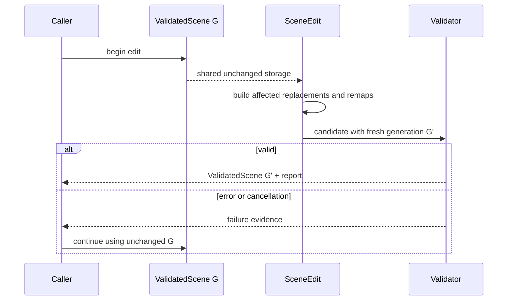

# ADR 0032: Postprocess Remap, Edit Transaction, and Derived Data Contract

## Context

Triangulation, vertex joining, mesh splitting, influence compaction, and coordinate conversion can
change several identity domains at once. Mutating vectors in place and validating only at the end
cannot tell callers which IDs survived, whether corner/face attributes followed topology, or which
cached bounds and tangents became stale. It also risks publishing a partial scene after failure.

ADR 0013 owns pipeline and preset policy. This ADR is authoritative for structural mutation,
transactionality, remaps, and derived-data validity.

ADR 0022 remains the normative authority for attempted, consumed, live, peak-live, and committed
accounting invariants. Import and postprocess own their domain ledger semantics, policy, dimensions,
phase vocabulary, and evidence. This ADR owns the postprocess edit meanings for replacement, scratch,
and remap reservations; it cannot refund monotonic work or reinterpret committed output.

The runtime-neutral leaf crate `baozi-operation` owns the reusable reservation/ledger state-machine
mechanism together with operation-control and effect-descriptor mechanics. It performs checked state
transitions but owns no import/postprocess policy, dimensions, phase semantics, evidence schema, or
Scene meaning. This ADR supplies the scene-specific read/write, remap, invalidation, loss, and edit
ledger semantics to that shared mechanism rather than defining a second mechanism.

## Decision

`SceneEdit` is the only canonical mutation capability. It starts from a
`ValidatedScene`, shares unchanged storage, and owns all replacement buffers and scratch state. The
input remains a valid generation throughout the operation. `commit` applies replacements to a new
generation, assigns a fresh collision-free `SceneGenerationId`, runs central validation, and returns
the new `ValidatedScene` plus an edit report. Branched edits from one input never share an output
generation token.
Failure, resource exhaustion, or cancellation drops the working set and publishes no scene.



ADR 0013 compiles postprocess requests into a typed plan before an edit begins. This ADR requires
every operation descriptor consumed by that plan to declare entity/domain read sets, write sets,
invalidation sets, remap obligations, and structural loss classes. `SceneEdit` accepts writes only
through those declared effects and charges replacement/remap storage before constructing it.
User-facing edit methods are typed adapters over the same effect descriptors; there is no raw
mutable collection escape hatch that can omit remap or invalidation obligations.

After each operation constructs its affected replacements, the edit validates that operation's
postconditions, every affected canonical invariant, remap completeness, and derived-data outcome in
a private candidate state. Only a passing candidate is atomically swapped into the transaction's
working generation for the next operation to observe. This is not public publication and does not
mint a `ValidatedScene` proof; final commit still performs full central validation for the complete
plan. A step failure discards its candidate and prevents all later steps from running.

Each passing immutable private step state receives a fresh internal `SceneGenerationId` so its
per-step remap endpoints cannot be confused. A generation token identifies a state; it is not a
validation proof. Intermediate tokens may appear only as remap evidence after the entire edit
commits, and no API exposes their private candidate scenes. Final commit publishes the last token
together with the only new `ValidatedScene` proof.

### Remap Contract

Every successful structural operation records generation-qualified remaps for each affected entity
and attribute domain; a successful final edit commit publishes them. A value-only edit marks the
corresponding identities unchanged while still reporting invalidation. An entity remap is a
relation, not a one-to-one map:

- one old ID may map to zero IDs when deleted
- one old ID may map to many ordered IDs when split
- many old IDs may map to one ID when merged
- a generated ID has no old ID but carries derivation provenance

Domain remaps cover vertex, corner, face, and instance elements. Vertex, corner, and face endpoints
are exactly `(PrimitiveId, domain_index)`, where `PrimitiveId` already contains the scene generation,
logical-mesh owner, and primitive-local index. An instance-domain endpoint is exactly the owning
generation-qualified `MeshInstanceId`; the domain has one element for that instance and does not add
an unqualified numeric component. These shapes provide both old-to-new relations for external
references and deterministic new-to-old origins for copying attributes and diagnostics.
Interpolated/generated elements include a typed derivation record rather than a fake source index.
Identity remaps for unaffected kinds are omitted only when the report explicitly marks that kind
unchanged between its input and output generations.

Every remap envelope names one exact `from_generation` and `to_generation`. Scene-wide entity
endpoints contain typed dense IDs; primitive and morph-target endpoints also contain their logical
mesh owner. Vertex, corner, and face endpoints additionally identify their owning primitive through
`PrimitiveId`. A numeric index without its generation and complete required owner chain is not a
remap endpoint.

An edit report contains both ordered per-step remaps and one composed input-to-final remap for every
affected kind/domain. Composition is relational in execution order: deletion terminates an old
origin, split order remains stable, merges retain all ordered old origins, and generated elements
remain originless while carrying typed derivation provenance. An explicitly unchanged kind composes
as the identity relation across different generation tokens. Private failed-step remaps are never
included in either published form.

An operation that writes topology must either remap every present affected-domain attribute in the
same transaction or fail with an unsupported-domain error. It cannot drop a corner or face stream
merely because the algorithm originally handled only vertex attributes.

### Derived Data

Published optional derived fields use one state model:

```text
Derived<T> =
    Absent { reason }
  | Valid { value, generation, input_stamp, producer }
```

`generation` equals the owning `ValidatedScene` generation. `input_stamp` is a deterministic digest
of the field's declared semantic inputs and dependency-schema version; `producer` distinguishes a
source-preserved value from a named operation and option digest. `Absent` contains no stale value.
An edit may use a private dirty/invalidated staging marker, but commit must turn it into `Absent` or a
new `Valid`; `Invalidated` is an edit-report outcome, not a third publishable value-bearing state.
When an unchanged derived value is preserved, commit verifies its input stamp and rebinds the small
state wrapper to the output generation; the immutable value storage may remain shared.

The bounds owners are fixed: each primitive may own primitive-local bounds, each logical mesh may own
logical-mesh-local bounds under an explicit morph-bounds policy, and Scene may own scene-space bounds
over node transforms and mesh instances. No owner reuses another owner's cache as if the spaces were
equal. Derived fields carry validity tied to scene generation and declared inputs. The minimum
dependency rules are:

| Derived data | Invalidated by |
| --- | --- |
| primitive bounds | positions, morph bounds policy, topology/vertex deletion |
| logical-mesh bounds | primitive bounds, primitive membership, logical-mesh morph bounds policy |
| normals | positions, topology, smoothing/crease data |
| tangents | positions, topology, normals, selected UV stream, tangent-basis convention |
| scene bounds | logical-mesh/primitive bounds, node transforms, mesh instances, skin/morph bounds policy |
| renderer influence palette | skin palette, influences, compaction options |

Operations may preserve, invalidate, or recompute a derived field. Preservation requires a proof
declared by that operation; otherwise a matching write set invalidates it. A validated output may
contain an explicitly absent optional cache, but never a stale value marked valid. Normals and
tangents are canonical attributes rather than hidden caches: when their dependencies change, an
operation must prove preservation, remap or recompute them, or remove them with structured
invalidation/loss evidence before commit. A validated scene never exposes an attribute marked
invalid for ordinary reads.

Postprocess success reports ordered steps, diagnostics, losses, resource statistics, entity remaps,
domain remaps, and derived-data outcomes. Resource semantics are owned by ADR 0022: attempted and
consumed work remain monotonic on success or failure; peak-live records the transaction high-water;
and committed output/remaps advance only after final publication. Failure evidence includes the last
completed step plus attempted, consumed, peak-live, and zero newly committed output without
presenting private candidate remaps as committed.

## Considered Options

### Option A: In-place mutation with validation at pipeline end

This minimizes temporary storage, but rollback is unreliable, IDs become ambiguous, and a failed
step can poison the caller's only scene. Rejected.

### Option B: Clone the entire scene before every step

This gives simple rollback but violates peak-live goals and still leaves remap/invalidation rules
implicit. Rejected.

### Option C: Affected-set transaction with explicit remaps and invalidation

This preserves the input proof, bounds temporary storage, and makes structural effects consumable by
tools. Chosen.

## Consequences

- All postprocess implementations and user edits use the same commit boundary.
- Algorithms must be domain-complete or reject unsupported present data before mutation.
- Dense IDs never silently survive a generation change; provenance persists separately.
- Some operations need extra remap storage, which is budgeted as required output evidence rather
  than optional debug data.

## Risks and Mitigations

| Risk | Severity | Mitigation |
| --- | --- | --- |
| Copy-on-write still exceeds peak-live budget | High | Reserve affected replacement and remap capacities before execution and release step scratch promptly. |
| Remap relations become too large | Medium | Use compact ranges/CSR representations while preserving complete semantics and limits. |
| Operation forgets a derived dependency | High | Central dependency registry plus mutation tests that compare declared write sets to cache outcomes. |
| Failure reports imply partial commit | High | Separate attempted step evidence from committed remaps and expose generation IDs on every report. |

## Success Metrics

| Metric | Target | Measurement |
| --- | --- | --- |
| Atomicity | Every injected failure leaves input generation, digest, and proof unchanged and publishes zero remaps | failure/cancellation/resource matrix |
| Remap completeness | Per-step and composed remaps cover every affected entity/domain with exact generation endpoints | split/merge/delete/generate composition tests |
| Operation-local complexity | Private candidate validation and remap composition are `O(affected entities + affected edges + affected cells + remap cells)` | deterministic per-step scale counters |
| Publication validation complexity | Final central validation is `O(total graph edges + total entities + total references + total payload cells)` under ADR 0003 | deterministic full-validator work counters |

## Acceptance Criteria

- Injected failure, cancellation, and budget exhaustion preserve the input generation and full-data
  digest.
- An invalid affected replacement fails private step validation before any later operation can read
  it, while the original validated generation remains unchanged.
- Triangulation remaps face and corner attributes; vertex joining remaps vertex attributes and skin
  influences; split/merge publishes one-to-many/many-to-one entity relations.
- Every operation with present unsupported domains fails before allocating its output replacement.
- Coordinate/topology changes invalidate or recompute all dependent bounds, normals, and tangents.
- Published derived fields are either `Absent` or generation/input-stamped `Valid`; no private dirty
  marker or stale normal/tangent survives commit.
- Multi-step reports compose their input-to-final relation exactly, and sibling commits from one
  input use different output generation endpoints.
- A compiled plan cannot open an edit unless every operation descriptor covers its writes, remaps,
  invalidation, and structural loss obligations.
- External code cannot publish a candidate scene or mark derived data valid without commit
  validation.
