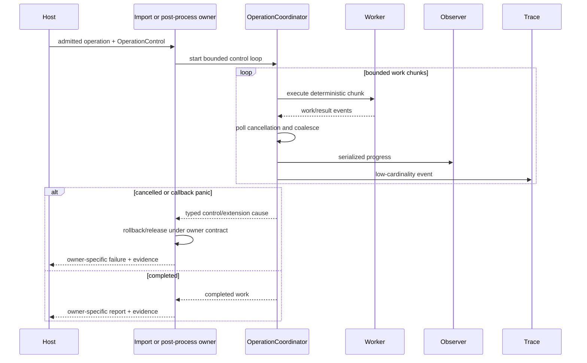

# ADR 0033: Operation Control and Observability

## Context

Cancellation, progress, diagnostics, tracing, and statistics serve different consumers. Treating them
as one logging callback makes correctness depend on subscriber setup, permits callback floods, and
often hides cancellation inside immutable options. Internal parallelism can also invoke callbacks
concurrently or reorder progress unless the contract defines a coordinator.

Baozi cannot preempt arbitrary trusted in-process code. It can provide deterministic cooperative
checkpoints, contain unwindable callback panics, and state precisely where an opaque backend cannot
meet that guarantee.

## Decision

Every import or post-process operation receives a separate `OperationControl` capability containing
cooperative cancellation, bounded progress delivery, and an optional deadline/backstop. It is not part
of the frozen semantic configuration. Diagnostics, ledger statistics, and tracing remain distinct
channels with explicit ownership.

The dependency-leaf `baozi-operation` crate owns `OperationControl`, cancellation/checkpoint traits,
the owner-neutral `OperationCoordinator`, progress-delivery bounds, and the reservation/ledger
mechanisms shared with ADR 0022. It owns no import/post-process phase enum, policy, diagnostic shape,
report, or failure. `baozi-import` and `baozi-postprocess` each own their operation-specific phase
vocabulary, limits, cause conversion, cleanup, and finalization.

Accepted makes this the operation-control authority; implementation completeness is tracked
separately.

### Channel Separation

| Channel | Audience | Durable result evidence | Owner |
| --- | --- | --- | --- |
| Cancellation/deadline | Operation coordinator | Typed cancelled/deadline failure | `OperationControl` |
| Progress | Interactive host | No; semantic sequence is testable but callback delivery is transient | `OperationControl` |
| Diagnostics | Asset caller/user | Yes, bounded in success and failure outcomes | Owning import or post-process operation |
| Statistics/resource evidence | Caller/operator | Yes, immutable operation-ledger snapshot | Owning import or post-process operation |
| Tracing spans/events | Operator/profiler | No correctness dependency | Library emits; host subscribes |

No diagnostic or failure is emitted only through logs. No cancellation decision depends on tracing,
and no progress callback may mutate the frozen import config.

### OperationControl

The capability provides conceptual operations equivalent to:

```rust
pub struct OperationControl {
    cancel: Arc<dyn CancellationSignal + Send + Sync>,
    progress: Option<Box<dyn ProgressObserver + Send>>,
    deadline: Option<Instant>,
    limits: ProgressLimits,
}
```

The actual public layout may differ. Required behavior is:

- cancellation is monotonic: once observed, the operation cannot return success;
- a deadline is a backstop and does not replace deterministic work budgets;
- absence of a control capability behaves as a no-op control, without global lookup;
- polling and progress use bounded deterministic work intervals;
- callback invocation happens without any Baozi-owned registry, ledger, cache, resolver, IO-wrapper,
  allocator, or outcome lock held;
  and
- control capabilities cannot open resources, construct diagnostics, alter budgets, or finalize an
  outcome.

The shared `OperationCoordinator` polls control and serializes observer delivery. It never owns result
finalization. `ImportSession` converts a returned control cause into its one `ImportFailure` under ADR
0020; the post-process owner rolls back `SceneEdit`, preserves/returns the input proof, and creates its
distinct failure under the post-process authority.

Core builders and validators receive only a borrowed `OperationCheckpoint`/reservation capability
from `baozi-operation`. They can charge work, reserve/release storage, poll cancellation, and report
owner-tagged progress, but cannot inspect import policy or construct an owner-specific failure. This
inversion preserves the crate direction: core/import/postprocess may depend on `baozi-operation`, while
`baozi-operation` depends on none of them and postprocess never depends on import.

### Cancellation Bound

Every primary/dependency snapshot read loop, detector boundary and bounded detector scan, parser loop,
graph traversal, decode adapter, SceneBuilder loop, validation pass, and post-process step declares a
maximum `work units between cancellation checks`. The owner performs another checkpoint after final
validation and after any final phase-complete progress delivery but before publishing success. An
observer cancellation request at either point is terminal and cannot race with success publication.
Tests assert work counts, not wall-clock latency.

Detection uses the session-created `DetectionScope` rather than charging the coordinator around an
opaque detector call. Only one `DetectionWorkPermit` may be outstanding. `begin_work(amount)` polls,
rejects zero or more than 4 KiB, then charges attempted `DetectionWork`. `complete()` charges consumed
work first, clears the outstanding permit, and performs the post-work poll, so cancellation after the
chunk preserves its consumed evidence. Zero/repeated work admission, polling during a live permit,
dropping it unfinished, or returning with it outstanding latches the first terminal cause. A detector
cannot catch the opaque abort and return a match to suppress that latch.

Byte-oriented text profile, UTF-8, token-boundary, and owned-string copy loops poll at least once per
4 KiB quantum unless they declare a stricter record boundary. Collection loops use a separately
declared item quantum. The bound applies independently to repeated passes: validating, tokenizing, and
copying the same surface each require their own checkpoints rather than borrowing another pass's poll.

On cancellation, the coordinator stops work and returns a typed control cause. The owning operation
discards unpublished staging, releases live reservations, and finalizes its own failure retaining
prior diagnostics and ledger evidence. Post-process cancellation leaves the input `ValidatedScene`
proof unchanged.

For parallel work, the coordinator stops scheduling new partitions after cancellation; already
running cooperative partitions poll the same signal. An opaque backend that cannot poll is checked
immediately before and after entry and must not advertise bounded cancellation. Host process isolation
is required for hard termination of hostile or non-cooperative code.

### Progress Model

Each progress event contains a stable owner-defined operation phase, unit kind, monotonically
increasing completed work, optional nondecreasing total, and operation-local sequence number.
Percentages are a presentation concern and are not emitted when total work is unknown.

`ImportProgressPhase` is transient observer vocabulary owned by `baozi-import`. It is distinct from
ADR 0020's sealed `ImportPhaseEvidence` and ADR 0022's `ImportLedgerPhase`. Progress events may be
coalesced or dropped and ledger phases may revisit parser-local work; neither can advance
`last_completed`. The import session alone advances lifecycle evidence after the mapped atomic
boundary succeeds. Post-processing defines the analogous three distinct types under its own ADR.

Rules:

- events are serialized through the operation coordinator, even when work is parallel;
- completed work never decreases within `(phase, unit)`;
- phases follow the lifecycle/compiled-plan order;
- delivery is coalesced by a minimum work interval and capped by event count and encoded bytes;
- coalescing never changes ledger work counters;
- the final value for a completed phase is delivered when capacity remains; and
- callback return may request cancellation but cannot replace a typed operation failure.

Progress callback panics are caught only when the platform panic strategy can unwind. The coordinator
returns a typed trusted-extension cause to the owning operation, cancels remaining work, and preserves
evidence. Abort, process exit, deadlock, and arbitrary allocation cannot be contained in-process.

### Diagnostics

ADR 0019 owns diagnostic shape. Operation control enforces delivery safety: diagnostic count and bytes
are budgeted centrally, callback-like diagnostic observers cannot bypass storage caps, and parser code
never calls host presentation code directly. Strict/loss policy promotion occurs in the owning
operation so the original diagnostic remains in that operation's evidence.

### Tracing and Profiling

Library spans use stable low-cardinality names such as `baozi.import`, `baozi.detect`, `baozi.parse`,
`baozi.validate`, and `baozi.postprocess`. Default fields use format ID, phase, bounded counts, and
outcome category. Full host paths, source contents, user-provided names, and diagnostic messages are
excluded from normal fields.

Baozi never installs a subscriber or exporter. Timings are observational and cannot affect selection,
validation, or success. A no-subscriber build retains identical semantic behavior.

### Crate Contract

| Crate | Owns | Must not do |
| --- | --- | --- |
| `baozi-operation` | Owner-neutral control, coordinator, checkpoint, reservation, and ledger mechanisms | Interpret domain phases, install global state, schedule sessions, or construct domain failures |
| `baozi-core` | Deterministic builder/validator work using borrowed operation capabilities | Depend on import or finalize cancellation |
| `baozi-import` | Import phases, effective limits, session cleanup, and import failure/report conversion | Duplicate the coordinator/ledger state machine or admit concurrent sessions |
| `baozi-postprocess` | Post-process phases, effective limits, rollback, and post-process outcome conversion | Depend on import or duplicate shared operation mechanisms |
| Host/facade adapter | Concurrent-session admission, optional executor capacity, observer implementation | Install hidden global admission or let observer state alter semantics |



## Alternatives Considered

### Option A: Use logs for progress, diagnostics, and cancellation

This is easy to add but cannot provide typed outcomes, bounded delivery, or reliable control. Rejected.

### Option B: Pass arbitrary callbacks directly into every parser

This gives flexibility but duplicates panic handling, permits concurrent invocation, and grants too
much capability. Rejected.

### Option C: Operation-coordinated control with owner-specific durable outcomes

This centralizes ordering, bounds, and failure behavior while keeping host presentation optional.
Chosen.

## Consequences

Positive:

- Cancellation and progress behave consistently across formats and post-process steps.
- Callback behavior cannot silently change import semantics.
- Failure reports retain diagnostics and resource evidence without requiring tracing.
- Hosts own concurrency and presentation while Baozi owns one operation's coordination.

Negative:

- Long loops and backend adapters need explicit work checkpoints.
- Progress totals are sometimes unknown and must not be presented as fake percentages.
- Non-cooperative in-process dependencies cannot offer bounded cancellation.

## Risks and Mitigations

| Risk | Severity | Mitigation |
| --- | --- | --- |
| Callback flood dominates parse time | High | Work-interval coalescing plus event-count and byte caps. |
| Parallel workers reorder progress | Medium | Coordinator-only observer delivery and stable merge order. |
| Callback panic leaves partial output | High | Catch unwind at coordinator; owning operation cancels, rolls back, and finalizes once. |
| Deadline is treated as a complexity guarantee | High | Keep deterministic operation budgets mandatory and label deadline as backstop. |
| Trace fields expose sensitive paths/content | High | Low-cardinality allowlist and capture tests. |

## Acceptance Criteria

| Contract | Testable acceptance |
| --- | --- |
| Cancellation latency | Each large loop stops within its declared maximum additional work units. |
| Full-stage cancellation | Cancellation before/during primary read, between/during detectors, during dependency read, parse, Scene construction, validation, and the pre-publication checkpoint returns failure; final progress-event cancellation cannot publish success. |
| Detector capability | Detector work is single-outstanding and at most 4 KiB; begin polls then charges attempted, complete charges consumed then post-polls, and zero/repeated/poll-during/drop/forgotten-permit violations preserve the first terminal latch. |
| Text and collection checkpoints | UTF-8/profile scans, tokenizer passes, and owned-string copies poll independently at no more than 4 KiB byte intervals; collection loops prove their declared item interval. |
| Monotonic progress | Recorded events are phase-ordered and completed/total values never regress. |
| Bounded delivery | Huge inputs respect event count/byte caps while ledger work remains exact. |
| Callback containment | An unwindable observer panic yields the owner's typed failure and retained evidence; postprocess publishes no staging and preserves input proof. |
| Parallel serialization | A multi-worker test proves the observer is never invoked concurrently. |
| Callback lock freedom | An observer may start a nested operation without deadlocking because delivery holds no Baozi-owned registry, ledger, cache, resolver, IO-wrapper, allocator, or outcome lock. |
| Trace independence | With no subscriber, all semantic outputs equal a captured-tracing run. |
| Sensitive fields | Captured normal-level spans contain no host root, source bytes, or unbounded asset names. |
| Dependency direction | Workspace graph checks prove `baozi-operation` is a leaf, core does not depend on import, and postprocess does not depend on import. |
| Phase separation | Dropped/coalesced progress and arbitrary legal ledger-phase transitions never mutate lifecycle evidence. |
| Host admission | An instrumented host gate alone controls concurrent operation entry; changing its capacity changes concurrency without any Baozi-global queue or semaphore. |
