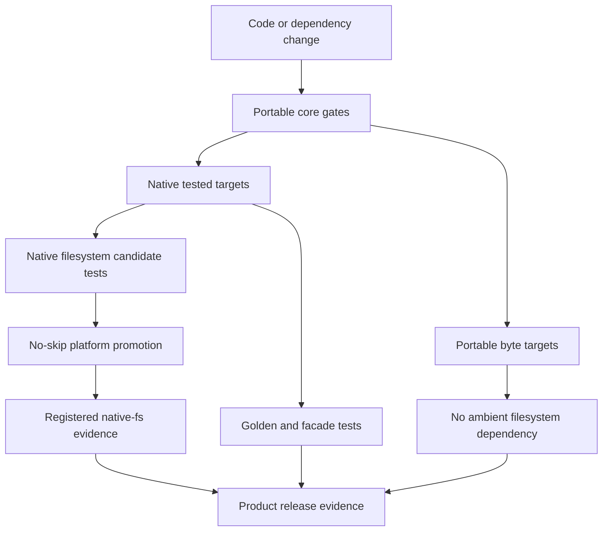

# ADR 0034: Supported Targets and Portability

## Status and Authority

This accepted ADR defines target support profiles and their qualification rules. A target listed in
a profile is eligible to qualify for that profile; the listing is not by itself a current support
claim. A release or user-facing document may repeat a target claim only after the required runner and
matrix evidence exists, passes the profile's promotion conditions, and is linked from durable
verification records. ADR 0007 owns feature inventory and CI wiring.

## Context

Rust can compile for many targets, but a successful cross-compile does not prove parser behavior,
filesystem containment, deterministic output, or dependency compatibility. Baozi needs honest support
claims before native filesystem code and format backends grow.

Rust's platform tiers describe the compiler and standard library, not Baozi's CI or security
guarantees. Baozi therefore uses its own support profiles and names them without reusing Rust's tier
numbers.

## Decision

Baozi defines support as a capability profile plus executable evidence. A target not listed below may
compile, but that is not a support promise.

## Baozi Support Profiles

The `Targets eligible for qualification` column defines the intended profile membership after all
required evidence passes. It does not report the repository's current evidence state.

| Profile | Targets eligible for qualification | Required evidence | Capability promise |
| --- | --- | --- | --- |
| Native Tested | `x86_64-unknown-linux-gnu`, `x86_64-pc-windows-msvc`, `aarch64-apple-darwin` | build, unit/facade/golden tests and docs | byte, memory, and custom IO; native filesystem remains an unregistered candidate |
| Portable Byte | `wasm32-unknown-unknown`, `wasm32-wasip1` | no-default compile, per-format compile, representative runtime tests where runner support exists | byte and memory/custom IO; no Baozi ambient filesystem helper |
| Build Monitored | `aarch64-unknown-linux-gnu`, `x86_64-apple-darwin` | scheduled or release compile and selected tests on real hosts | no release-blocking runtime promise until promoted |
| Unlisted | all other Rust targets | best effort only | no compatibility, filesystem, or performance promise |

### Current Qualification

No target is currently release-qualified for a user-facing Baozi support claim. The repository has
development evidence, including the full Linux workspace gates, Windows and macOS native-filesystem
candidate facade tests, and byte-only WASM compile checks. Those checks do not yet supply the complete
facade, golden, packaged-consumer, runtime, and release evidence required by the profiles above. U8
and U9 establish the durable target-evidence inventory and release matrix; until then, CI success is
development evidence rather than a support-profile promotion.

The Native Tested baseline follows the upstream Rust target assumptions at the time of this decision:
Windows MSVC requires Windows 10/Server 2016 or newer, and Apple ARM64 requires macOS 11 or newer.
Baozi does not create a broader operating-system promise than Rust's own target support.

## Capability Rules

### Portable Core

- `baozi-core`, byte-oriented import orchestration, and pure byte parsers must not depend on native
  filesystem APIs, process spawning, network clients, or an async runtime.
- Little-endian behavior is tested. File formats declaring other endian encodings must decode them
  explicitly rather than relying on host endianness.
- On-disk widths never use `usize`; conversions to allocation sizes are checked against limits.
- Deterministic snapshots and digests do not include host path syntax, pointer width, locale, time
  zone, random hash order, or native line endings.
- `no_std` is not supported.

### Native Filesystem

The release `native-fs` capability is currently unregistered on every target. Cargo therefore has no
`native-fs` or low-level `fs` feature. Candidate implementations use the explicitly non-release
`native-fs-candidate` and `fs-candidate` features only on `x86_64-unknown-linux-gnu`,
`x86_64-pc-windows-msvc`, and `aarch64-apple-darwin`; all other targets fail to compile the candidate
adapter with one stable diagnostic. In particular, Build Monitored `x86_64-apple-darwin` and
dependency-audit-only `x86_64-unknown-freebsd` must fail closed. No candidate may substitute
`canonicalize + open`.
The predicates also bind an empty `target_abi`, so `x86_64-unknown-linux-gnux32` is not accidentally
treated as `x86_64-unknown-linux-gnu`.

`NATIVE_FS_SUPPORT_STATUS`, `NATIVE_FS_REGISTERED_TARGETS`, and
`NATIVE_FS_CANDIDATE_TARGETS` expose this distinction to code. Repository governance rejects a
release feature while the registered-target set is empty and keeps the candidate dependency closure
separate from runtime conformance evidence.

Native-filesystem registration is platform-local and no-skip. A target may enter the registered set
only after it passes ADR 0010's complete object-bound opening and adversarial platform matrix plus ADR
0014's generic unsafe/dependency admission. ADR 0010 owns open strategies, path/reparse/special-file
mechanics, exact security-sensitive package closure, and the required fixtures; this ADR owns whether
their target-specific evidence is sufficient to make or retain a support claim.

Portable Byte target graphs must resolve no native-filesystem dependencies. Runtime candidates and
audit-only targets must match the machine-readable target and dependency-admission baselines exactly;
membership or closure drift removes the claim until the corresponding gates pass again.

Filesystem guarantees apply to objects opened through Baozi's scoped adapter. They do not sandbox a
malicious `AssetIo`, plugin, host process, kernel driver, or writable mount controlled by the host.

### WebAssembly

`wasm32-unknown-unknown` imports supplied bytes and memory bundles. It has no ambient OS filesystem,
threads, subprocess, or network promise from Baozi.

`wasm32-wasip1` also uses bytes or a host-provided custom `AssetIo`. WASI preopens are capabilities,
but Baozi will not turn an arbitrary WASI path string into authority. A first-party WASI preopen
adapter requires its own implementation tracer and tests before becoming supported.

### Native and FFI Dependencies

- Pure-Rust format backends are preferred.
- ADR 0004 owns backend admission and ADR 0007 owns feature inventory. A native or FFI integration
  stays in a separate non-first-party package unless those authorities explicitly admit it as a
  first-party format.
- Once admitted as first-party, the format is included in `all-formats` even when its backend is
  target-limited. Unsupported targets fail explicitly or report the declared capability as
  unavailable; feature resolution must not silently omit the format. `default-formats` remains the
  curated low-surprise subset owned by ADR 0007.
- A dependency that drops a supported target, raises MSRV, introduces an incompatible license, or
  prevents byte-only WASM compilation blocks its update or triggers backend replacement.

## Promotion and Demotion

A target moves to Native Tested or Portable Byte only when CI or a documented release runner executes
its required matrix, including real tests rather than compile-only placeholders, and the resulting
qualification is recorded in the durable target-evidence inventory. Promotion requires two
consecutive green release cycles or equivalent pre-release evidence.

A target is demoted when its runner is unavailable for two releases, a security primitive cannot be
verified, or a required dependency no longer supports it. Documentation changes in the same commit;
silently retaining the support row is not allowed.

## Alternatives Considered

### Option A: Claim every Rust Tier 1 target Baozi supports compiling

Pros:

- Broad compatibility message.
- Minimal project-specific taxonomy.

Cons:

- Rust tiers do not prove Baozi tests, filesystem safety, or format dependencies.
- Makes platform regressions invisible until users report them.
- Overcommits a young project to targets without runners.

Decision: rejected.

### Option B: Support Linux only until after the first release

Pros:

- Small CI matrix and one strong sanitizer authority.
- Simplifies native path behavior.

Cons:

- Defers Windows and macOS path design until APIs are harder to change.
- Misses portability bugs in path, float, and feature assumptions.
- Does not meet expected 3D asset pipeline environments.

Decision: rejected.

### Option C: Capability-based profiles with three tested native OS families and byte-only WASM

Pros:

- Makes guarantees and missing capabilities explicit.
- Forces native path security to be proven where it is exposed.
- Preserves browser portability without pretending browser filesystem access exists.

Cons:

- Requires multiple CI operating systems and feature matrices.
- Some Rust targets remain best effort.
- Platform runner changes can force an explicit demotion.

Decision: chosen.

## Success Metrics

| Metric | Target | Measurement |
| --- | --- | --- |
| Native filesystem evidence | every release-registered target executes its complete no-skip filesystem security matrix; currently none are registered | CI/release matrix and registered-target constant |
| WASM isolation | byte-only builds contain no native filesystem or network dependency | feature tree and target builds |
| Determinism | shared golden digests match across tested native targets | cross-platform golden jobs |
| Target honesty | every documented profile maps to a machine gate | ADR/CI checker |
| Dependency portability | default and all-format pure-Rust trees compile for portable byte targets | per-feature target checks |
| Failure behavior | unsupported native adapters fail closed | compile-fail or runtime capability tests |
| Candidate special-file behavior | reliably constructible directories, FIFOs, sockets, and devices fail without blocking and without pathname reopen | platform-local candidate deadline and same-handle tests; not promotion by itself |

## Risks and Mitigations

| Risk | Severity | Likelihood | Mitigation |
| --- | --- | --- | --- |
| Cross-platform CI becomes slow | Medium | High | representative PR matrix; full powerset and sanitizers scheduled |
| Compile-only WASM hides runtime bugs | High | Medium | add representative wasm runtime tests as runner support matures |
| Target table drifts from workflows | High | Medium | xtask checks profile-to-workflow mapping in the release unit |
| Native filesystem differs on exotic filesystems | High | Medium | capability errors fail closed; test supported local filesystem classes |
| Apple or Windows runner availability changes | Medium | Medium | explicit demotion process and release evidence |
| 32-bit overflow remains untested | High | Medium | no general 32-bit support claim; checked conversions and wasm32 gates |

## Consequences

Positive:

- Users can distinguish compile success from supported behavior.
- Native security and portable byte imports have separate, testable promises.
- Dependencies cannot silently narrow the target set.

Negative:

- Three native OS families and two WASM targets increase CI maintenance.
- Unlisted targets receive no stability promise even when they happen to work.
- WASI filesystem convenience is deferred until capability plumbing is implemented.

## Amendment History

### 2026-08-12: Separate profile membership from current qualification

- Affected: `Status and Authority`, `Baozi Support Profiles`, and `Promotion and Demotion`.
- Previous: profile rows listed target triples without explicitly separating intended profile
  membership from the repository's current evidence state, allowing the table to be misread as a
  current support claim.
- New: target rows define eligibility for future qualification; current release-qualified membership
  is explicitly empty until the complete durable target evidence required by U8 and U9 exists.
- Impact: user-facing support claims are narrowed to evidence actually held by the repository; no
  target, build path, or native-filesystem candidate is removed.
- Review: 2026-08-12 target-qualification truthfulness review in the canonical-architecture refactor
  session.
- Rationale: this refines the existing evidence-gated support decision without moving target-profile
  ownership or changing any profile's required capabilities.

## Sources

These are living official documents. They were retrieved on 2026-07-10; each digest is SHA-256 over
the final response body after redirects.

- [Rust platform support](https://doc.rust-lang.org/rustc/platform-support.html) - 98,647 bytes;
  `0894d0d43e848cda273112c7cadc0fd98731bd6414eaa93a36b6ab84aa2ecd07`.
- [Rust `wasm32-unknown-unknown` target](https://doc.rust-lang.org/rustc/platform-support/wasm32-unknown-unknown.html) -
  38,081 bytes; `8fb68c6fcb050c067a145ff1796a1479090bd7ae87deb14cb2d824661565cc10`.
- [Rust `wasm32-wasip1` target](https://doc.rust-lang.org/rustc/platform-support/wasm32-wasip1.html) -
  31,326 bytes; `ff11550740755ad44d717fb0ea4efe7b6c5bb2f744e9b562e6160e317b61eb11`.
- [Rust Apple Darwin targets](https://doc.rust-lang.org/rustc/platform-support/apple-darwin.html) -
  26,863 bytes; `714f6173858ccff3bd2eb7434be8510df7ba4464fe369b89aed8a1c901ce5bbe`.
- [Rust Windows MSVC targets](https://doc.rust-lang.org/rustc/platform-support/windows-msvc.html) -
  26,833 bytes; `4a1fb5b81a1929cf88005fe41b0779cc4df5fbdc5ee3bda340137dab65e1f1be`.
