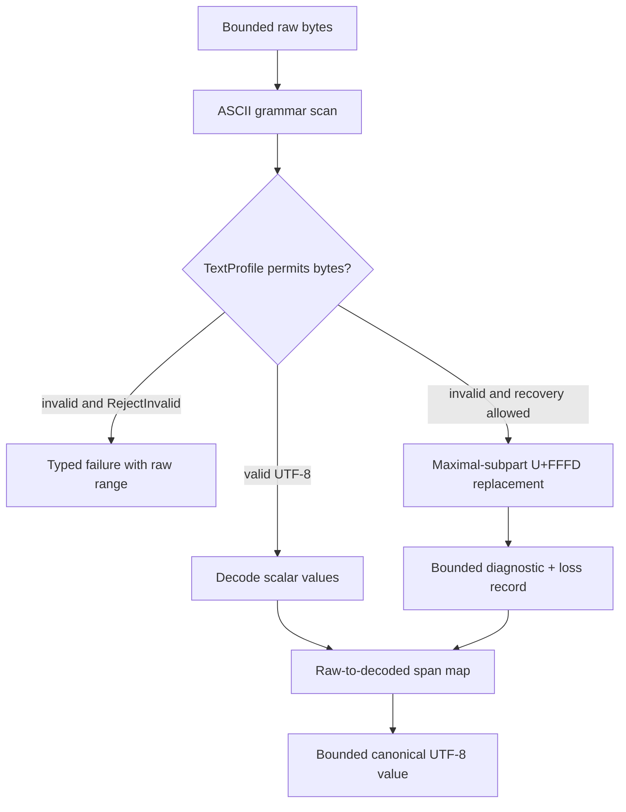

# ADR 0035: Text Decoding Conformance and Recovery

## Context

Text assets combine byte-oriented grammar with user-visible names and metadata. glTF JSON has a strict
encoding contract, PLY has an ASCII header, while real-world OBJ/MTL files may contain invalid UTF-8
from locale-dependent tools. Using the platform locale or `from_utf8_lossy` implicitly makes results
host-dependent, loses exact source locations, and hides semantic loss.

Decoding also expands data: a small invalid byte sequence can produce more UTF-8 output bytes. Raw
input, decoded text, line indexes, diagnostics, and canonical strings therefore need separate bounded
accounting.

## Decision

Each text-bearing format's validated `FormatDescriptor` owns a `TextProfile` that separates ASCII
grammar recognition from decoding of textual values. Strict conformance is the default. Recovery is
deterministic, explicitly authorized through that format's typed option envelope, format-limited,
diagnosed, and recorded as loss. Baozi never consults the host locale and never performs heuristic
encoding detection.

`TextProfile` owns lexical/encoding rules and immutable format hard caps only. `baozi-import` owns the
request `ResourceLimits`, effective decoder budget, `ConformancePolicy`, and `LossPolicy`; the facade
may construct/re-export them but owns no duplicate policy. `baozi-io` owns only path/backend/handle
rules and backend-local hard caps. For every matching dimension the effective limit is the minimum of
the text-profile hard cap, request resource limit, and any backend-local hard cap.

Accepted freezes decoding semantics; it does not claim all existing parsers already conform.

### Profile Contract

A format profile declares:

- permitted source encoding(s);
- whether a UTF-8 byte order mark (BOM) is forbidden, accepted, or accepted-with-diagnostic;
- newline forms accepted by grammar;
- which byte ranges are ASCII syntax and which are decoded values;
- whether invalid UTF-8 recovery is ever allowed;
- NUL/control-character policy; and
- immutable format hard caps for raw, decoded, line-index, token, and canonical-string dimensions.

These hard caps are not caller defaults or a second budget. A profile or format envelope cannot raise
`ResourceLimits`, and a request cannot raise the profile cap. Missing dimensions are invalid
descriptor construction rather than an implicit unlimited value. The selected session freezes the
effective minimum before decoding begins and exposes only that effective capability to the parser.

The selected format's codec compiles its recovery option before session creation. That option may
choose only a mode advertised by the descriptor's `TextProfile`; common frozen `ConformancePolicy`
and `LossPolicy` then decide whether the requested recovery is acceptable. No common/global recovery
switch exists, and callers cannot force recovery where the specification requires rejection.

Compilation uses ADR 0016's bounded `OptionCompileScope` and sealed runtime option type key. Invalid
mode/profile pairings, compile-budget exhaustion, type disagreement, and unwindable codec panic are
pre-session `RequestError` values with zero asset IO. Source decoding failures and authorized recovery
facts occur only after session creation and therefore use the import outcome path.

### Canonical v1 Modes

| Mode | Behavior | Use |
| --- | --- | --- |
| `RejectInvalid` | First disallowed byte sequence is a typed parse failure with raw byte range | Default and all specification-strict fields |
| `ReplaceInvalidUtf8` | Replace each maximal subpart of an ill-formed Unicode subsequence with one U+FFFD, diagnose every bounded raw range, and record loss | Explicit format-owned typed option for allowed legacy text fields such as OBJ/MTL names |

No Windows-1252, system code page, locale, or heuristic codec is implicit in canonical v1. A future
legacy codec requires a named stable codec ID, versioned conformance vectors, and an ADR update; it
cannot change the meaning of `ReplaceInvalidUtf8`.

### Format Baseline

| Format surface | Required baseline |
| --- | --- |
| glTF JSON | Strict UTF-8 according to the glTF profile; reject BOM and invalid sequences; no recovery mode. |
| PLY header and ASCII grammar | Required ASCII syntax; non-ASCII where grammar expects tokens is a byte-location failure. |
| ASCII STL grammar | Required ASCII syntax for keywords/numbers; textual extension fields need an explicit future profile. |
| OBJ/MTL syntax | ASCII tokens/numbers; names and any preserved textual values are UTF-8, with `ReplaceInvalidUtf8` available only through the OBJ-owned typed option and common loss authority. |

Comments that are discarded still consume raw bytes and token/work budgets. They need not be decoded
unless a format contract preserves them as provenance.

### Source Mapping and Newlines

The decoder emits or maintains a bounded mapping from decoded ranges to raw byte ranges. Diagnostics
and provenance use raw byte offsets as authority. Line and column are derived from raw bytes with a
format-declared newline profile, so replacement expansion cannot shift later source locations.

CRLF is one logical newline where permitted. Bare CR is accepted only when the format profile names
it; otherwise it is a parse failure or authorized recovery with a diagnostic. Decoders do not rewrite
the stored source or canonical value merely to compute line numbers.

### BOM, NUL, Controls, and Normalization

- A BOM is interpreted only at byte offset zero and only as the profile permits. It is never stripped
  from an arbitrary textual value.
- NUL and forbidden controls are rejected before values enter canonical strings, even when their byte
  sequence is valid UTF-8.
- Baozi preserves decoded Unicode scalar values and performs no implicit NFC/NFD normalization,
  case-folding, trimming, or locale-sensitive mapping.
- Syntax-specific whitespace handling is separate from value decoding and must not alter quoted or
  otherwise preserved text.

### Accounting and Diagnostics

Raw bytes are charged when consumed. Before allocating decoded storage, the parser reserves a checked
worst-case or exact output size. Decoded UTF-8 bytes, line-index storage, replacement diagnostics, and
canonical retained strings are separate live/committed dimensions under ADR 0022.

The reservation/ledger mechanism is owned by `baozi-operation`; `baozi-import` owns the effective
limits and import dimension/phase interpretation. The decoder cannot consult the descriptor cap,
request limit, and backend cap independently after freezing, because doing so would create competing
precedence paths.

Each recovery diagnostic uses a stable code, raw byte range, and bounded escaped preview. Repeated
invalid sequences remain subject to diagnostic count/byte caps, while attempted recovery count and
bytes remain monotonic. Strict loss policy promotes the first recovery to failure without discarding
prior evidence.

## Alternatives Considered

### Option A: Always call lossy UTF-8 conversion

This is simple and robust against invalid bytes, but silently changes names, obscures exact loss, and
may produce unbounded diagnostics later. Rejected.

### Option B: Decode through the host locale/system code page

This reads some legacy files conveniently but makes imports machine-dependent and unreproducible.
Rejected.

### Option C: Format profiles with strict default and explicit deterministic recovery

This preserves conformance and reproducibility while offering a bounded escape hatch for legacy
OBJ/MTL values. Chosen.

## Consequences

Positive:

- Identical bytes produce identical text on every platform and locale.
- Invalid encoding and every authorized replacement are visible in outcome evidence.
- Source locations remain stable after recovery.
- Formats with strict specifications cannot be weakened by a global permissive switch.

Negative:

- Some locale-encoded legacy assets fail until callers explicitly choose a supported recovery.
- Parsers need byte/value boundary awareness and span mapping.
- Canonical v1 does not decode named legacy code pages.

## Risks and Mitigations

| Risk | Severity | Mitigation |
| --- | --- | --- |
| Different decoders choose different replacement boundaries | High | Baozi-owned maximal-subpart conformance vectors shared by all format adapters. |
| Recovery changes identifiers and breaks references | High | Emit loss with raw range; strict loss policy; validate all decoded references after replacement. |
| Diagnostic previews expose controls or huge source fragments | High | Escape controls and cap preview/total diagnostic bytes before allocation. |
| Decoded expansion bypasses memory limits | High | Reserve output and account decoded/canonical bytes separately from raw bytes. |
| Unicode normalization changes identity unexpectedly | Medium | No implicit normalization; expose any future normalization as explicit loss-aware postprocess. |

## Acceptance Criteria

| Contract | Testable acceptance |
| --- | --- |
| Cross-platform determinism | Shared conformance vectors produce identical values, raw spans, diagnostics, and losses on all target tiers. |
| Strict profiles | Invalid UTF-8/BOM in glTF and non-ASCII grammar bytes in strict PLY/STL cases fail at exact raw offsets. |
| Explicit recovery | OBJ/MTL recovery occurs only when descriptor profile, selected format envelope, common conformance policy, and loss policy all permit it. |
| Limit ownership | Cap/request/backend permutations enforce their minimum, while facade and IO expose no duplicate effective-budget type. |
| Pre-session boundary | Invalid recovery options, codec budget/type failures, and unwindable codec panic produce bounded `RequestError` values with zero sessions and opens. |
| Replacement semantics | Overlong, truncated, surrogate, stray continuation, and adjacent invalid sequences match maximal-subpart vectors. |
| Location stability | Diagnostics after earlier replacements still report original raw byte line/column. |
| Bounded expansion | Worst-case invalid input respects decoded, diagnostic, canonical string, and peak-live budgets. |
| Locale independence | Tests under different process locales yield byte-for-byte equal outcomes. |
